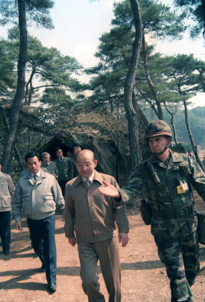
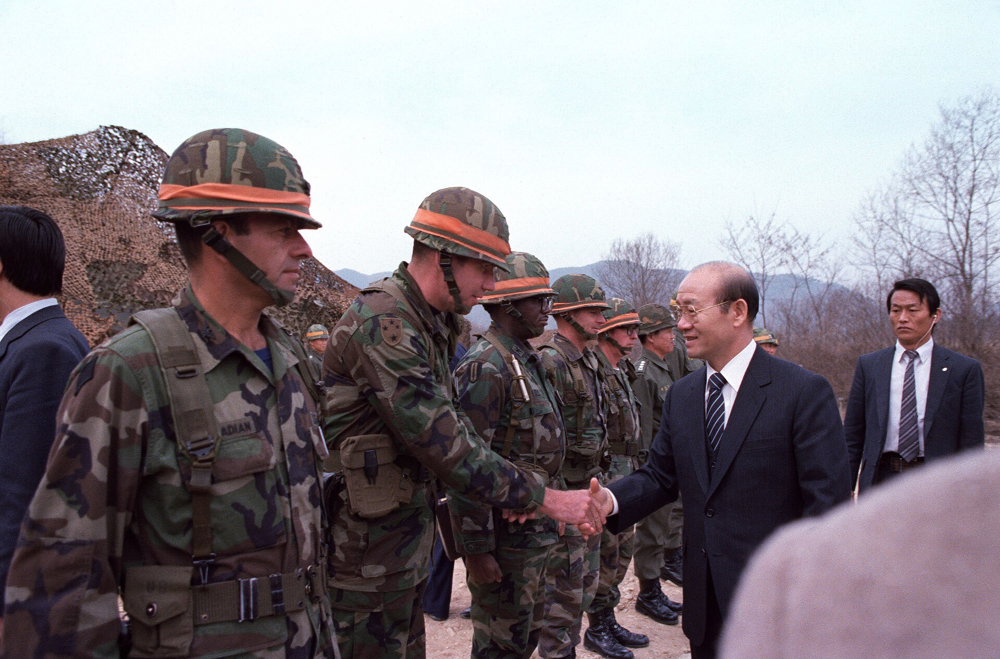
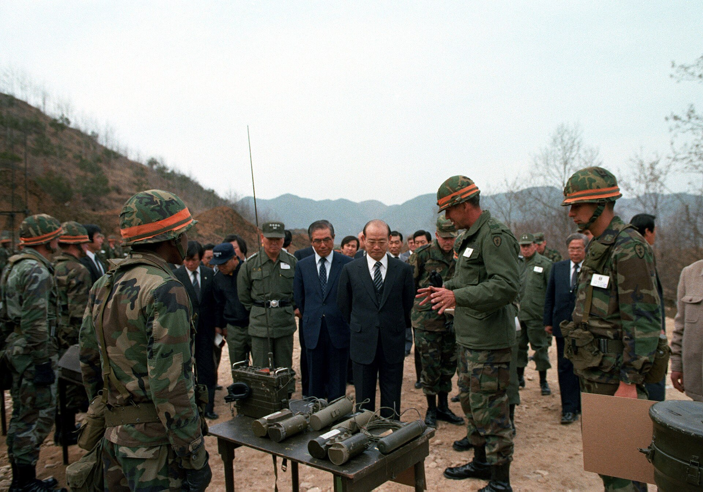

38년 전 오늘, 1988년 11월 23일. 전두환 전 대통령이 서울 연희동 자택에서 대국민 사과 성명을 발표하고 강원도 인제군 백담사로 은둔의 길을 떠났습니다. 퇴임 후 9개월 만에 이뤄진 이 발표는 전국에 텔레비전으로 생중계되며 큰 파장을 일으켰습니다.

## 거세진 5공 청산 요구와 퇴임 9개월 만의 사과

1988년 2월 대통령직에서 물러난 전두환 전 대통령을 향한 여론은 급격히 악화되었습니다. 제5공화국 시절 벌어진 각종 권력형 비리와 인권 침해 사건, 그리고 1980년 5·18 광주 민주화 운동에 대한 진상 규명 요구가 빗발쳤습니다.

국회 청문회가 열리고 친인척 비리가 속속 드러나면서 전직 대통령에 대한 사법 처리 요구까지 분출했습니다. 결국 전 전 대통령은 연희동 자택에서 직접 대국민 사과 담화를 발표하기로 결정했습니다.

## 27분간의 생중계, "머리 숙여 용서를 빕니다"

11월 23일 오전 9시 32분, 전두환 전 대통령은 텔레비전 카메라 앞에 서서 '국민 여러분께 드리는 말씀'을 낭독하기 시작했습니다. 27분 동안 이어진 발표에서 그는 재임 기간 중 발생한 실책과 비리에 대해 책임을 인정했습니다.

전 전 대통령은 1980년 5월 광주 사태의 비극적인 결과에 대해 큰 책임을 느끼며 상처를 치유하지 못한 점을 깊이 후회한다고 밝혔습니다. 또한 삼청교육대 사건, 공직자 및 언론인 해직, 일해재단과 새세대육영회 관련 잡음, 그리고 친인척들의 비리에 대해서도 머리 숙여 용서를 구했습니다.

*1985년 자료 — 사진: AL CHANG / Public domain*

## 사저와 정치자금 139억 원 등 전 재산 헌납 선언

이날 담화에서 전 전 대통령은 소유하고 있던 전 재산을 국가와 정부에 헌납하겠다고 발표했습니다. 헌납 대상에는 연희동 사저 안채와 바깥채, 서초동 토지, 용평 콘도미니엄, 골프 회원권 2건, 그리고 금융자산 23억여 원이 포함되었습니다.

여기에 더해 대통령 재임 중 여당 총재로서 관리하다 남은 잉여 정치자금 139억 원도 국가가 맡아 정치 발전을 위해 써달라며 환원하겠다고 밝혔습니다. 그는 해외에 단 한 평의 땅이나 한 푼의 돈도 빼돌린 적이 없으며, 은닉 재산이 드러난다면 어떠한 책임도 감수하겠다고 강조했습니다.

*1983년 자료 — 사진: AL CHANG / Public domain*

## 눈물의 연희동 출발, 설악산 백담사로

회견을 마친 전 전 대통령 내외는 오전 10시 20분경 연희동 자택을 나섰습니다. 이웃 주민들과 짧은 인사를 나눈 뒤 승용차에 오른 부인 이순자 씨는 얼굴을 감싸 안고 끝내 눈물을 터뜨렸습니다.

이들이 향한 곳은 서울에서 멀리 떨어진 강원도 인제군 북면 용대리 내설악의 백담사 부근 산골이었습니다. 최고 권력의 정점에 섰던 전직 국가원수가 국민의 심판을 받겠다며 두메산골 사찰로 들어가는 전례 없는 장면이 펼쳐졌습니다.

*1983년 자료 — 사진: Al CHANG / Public domain*

## 역사의 격랑 속으로 사라진 은둔길의 기억

백담사로 떠난 전두환 전 대통령 내외는 이후 외딴 절에서 칩거 생활을 이어갔습니다. 그러나 재산 헌납과 백담사 은둔으로도 격동했던 현대사의 상처와 비판 여론이 완전히 가라앉지는 않았습니다.

그 후 수많은 세월이 흐르고 재판과 사면 등 굴곡진 역사가 이어졌지만, 1988년 11월 23일 아침 연희동 골목을 빠져나가 설악산으로 향하던 승용차의 행렬은 여전히 많은 이들의 뇌리에 뚜렷하게 남아 있습니다.

### 참고 자료

- <https://newslibrary.naver.com/viewer/index.naver?articleId=1988112300209201004&editNo=2&printCount=1&publishDate=1988-11-23&officeId=00020&pageNo=1&printNo=20662&publishType=00020>
- <https://commons.wikimedia.org/wiki/File:Bundesarchiv_B_145_Bild-00168473,_Berlin,_Hans-Dietrich_Genscher,_Bundesminister_des_Ausw%C3%A4rtigen_(l.),_f%C3%BChrt_ein_Gespr%C3%A4ch_mit_Staatspr%C3%A4sident_Chun_Doo_Hwan.jpg>
- <https://commons.wikimedia.org/wiki/File:Chun_Doo-hwan_and_General_Claude_M._Kicklighter,_1985-Mar-22.jpg>
- <https://commons.wikimedia.org/wiki/File:Chun_Doo-hwan,_1983-March-11-02.jpg>
- <https://commons.wikimedia.org/wiki/File:Chun_Doo-hwan,_1983-March-11-05.jpg>
