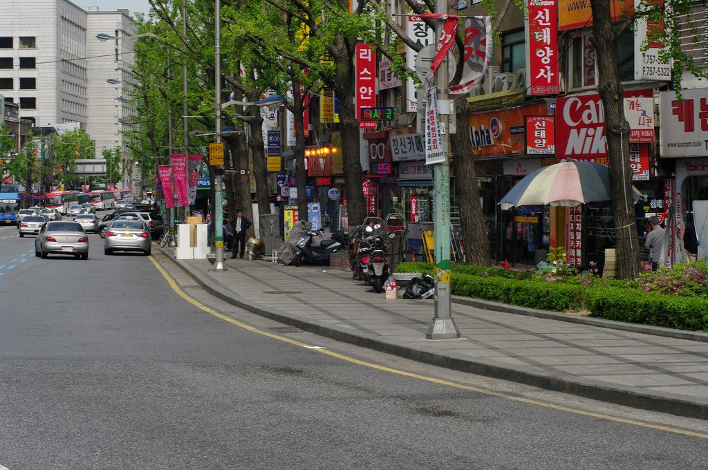

27년 전 오늘, 1999년 11월 23일. 한국 야구 역사상 가장 위대한 투수로 꼽히는 '국보' 선동열 선수가 15년간 지켜온 마운드를 떠나며 은퇴를 알렸습니다. 일본 프로야구 주니치 드래건스를 10년 만의 센트럴리그 우승으로 이끈 직후, 가장 높은 정상의 자리에서 내린 결단이었습니다.

## 불패의 신화, 무등산 폭격기

선동열은 1985년 후기 리그부터 해태 타이거즈의 유니폼을 입고 프로 무대에 첫발을 내디뎠습니다. 데뷔 이듬해인 1986년에는 24승 6패, 평균자책점 0.99라는 경이적인 성적을 기록하며 리그를 압도했습니다. 150km/h를 훌쩍 넘는 묵직한 패스트볼과 예리하게 꺾이는 슬라이더 앞에 상대 타자들은 속수무책이었습니다.

그가 등판하기 위해 불펜에서 몸을 풀기만 해도 상대 팀 벤치는 얼어붙었고, 관중석에서는 '경기가 끝났다'며 일찌감치 자리를 뜨는 팬들이 나올 정도였습니다. 1987년 5월 16일 사직구장에서 롯데의 최동원과 맞붙어 15회 연장까지 홀로 232개의 공을 던지며 2대 2 무승부를 기록한 경기는 한국 야구사의 명승부로 남아 있습니다.

## 0점대 평균자책점과 6번의 한국시리즈 우승

선동열이 국내 프로야구 11시즌 동안 남긴 기록은 전무후무합니다. 통산 146승 40패 132세이브, 평균자책점 1.20은 지금까지도 깨지지 않은 대기록입니다. 그는 규정 이닝을 채우면서도 0점대 평균자책점을 무려 세 차례(1986년 0.99, 1987년 0.89, 1993년 0.78)나 기록했습니다.

어깨 부상 이후 마무리 투수로 전향한 뒤에도 그의 위력은 줄어들지 않았습니다. 1995년에는 109.1이닝을 던지며 0.49라는 믿기 힘든 평균자책점을 남겼습니다. 해태 타이거즈는 선동열의 압도적인 피칭에 힘입어 1986년부터 1993년까지 6번의 한국시리즈 우승 트로피를 들어 올렸습니다.

*Scene of the era (not a photo of this event) — 사진: Emmanuel Dyan / CC BY 2.0*

## 대한해협을 건너 '나고야의 수호신'으로

1996년 선동열은 한국 프로야구 선수 가운데 최초로 일본 무대에 진출해 주니치 드래건스 유니폼을 입었습니다. 첫해에는 일본 타자들의 정교함과 낯선 환경에 적응하지 못하며 2군으로 강등되는 등 평균자책점 5.50에 3세이브로 큰 시련을 겪었습니다.

하지만 그는 물러서지 않았습니다. 혹독한 훈련 끝에 구위를 되찾은 1997년, 선동열은 38세이브를 기록하며 당시 일본 신기록을 세우고 구원 공동 1위에 올랐습니다. 현지 언론과 팬들은 그를 '나고야의 수호신'이라 부르며 열광했습니다. 일본 진출 4년 동안 통산 10승 4패 98세이브, 평균자책점 2.79의 훌륭한 발자취를 남겼습니다.

*Scene of the era (not a photo of this event) — 사진: JoshBerglund19 / CC BY 2.0*

## 나고야 관광호텔, 정상에서 내린 결단

1999년 주니치는 선동열의 든든한 뒷문 단속에 힘입어 10년 만에 센트럴리그 정상을 탈환했습니다. 시즌을 성공적으로 마친 선동열은 구단과 팬들의 만류에도 불구하고 은퇴를 결심했습니다.

11월 22일 오전, 일본 나고야 관광호텔에서 열린 은퇴 기자회견에는 60여 명의 일본 현지 기자가 몰려 열띤 취재 경쟁을 벌였습니다. 선동열은 회견에서 '더 뛸 수 있고 더 뛰고 싶지만, 정상에서 떠나겠다'며 담담하게 작별을 고했습니다. 가장 빛나는 순간에 스스로 마운드를 내려온 국보 투수의 뒷모습에 양국 팬들은 아쉬움과 함께 아낌없는 박수를 보냈습니다.

*Scene of the era (not a photo of this event) — 사진: Tomas Forgac / Public domain (PDM) 1.0*

## 영구 결번 18번, 팬들의 가슴에 남은 전설

은퇴 후 선동열은 지도자로 변신해 삼성 라이온즈 감독으로서 2005년과 2006년 연속 한국시리즈 우승을 일궈냈고, 국가대표팀 감독을 역임하며 한국 야구 발전에 기여했습니다.

그러나 많은 팬에게 선동열은 여전히 등번호 18번을 달고 마운드에서 타자를 압도하던 모습으로 기억됩니다. 그가 달았던 18번은 구단 역사상 영구 결번으로 지정되어 영원히 팬들의 곁에 남아 있습니다. 마운드를 호령하던 무등산 폭격기의 강속구는 세월이 흘러도 한국 야구의 영원한 전설로 빛나고 있습니다.

### 참고 자료

- <https://newslibrary.naver.com/viewer/index.naver?articleId=1999112300329101006&editNo=40&printCount=1&publishDate=1999-11-23&officeId=00032&pageNo=1&printNo=16912&publishType=00010>
- <https://commons.wikimedia.org/wiki/File:%E6%B3%95%E6%94%BF%E4%B8%89%E7%BE%BD%E3%82%AC%E3%83%A9%E3%82%B92.jpg>
- <https://www.flickr.com/photos/17616316@N00/5747821147>
- <https://www.flickr.com/photos/79877212@N00/3391174523>
- <https://www.flickr.com/photos/94173538@N00/3017898541>
