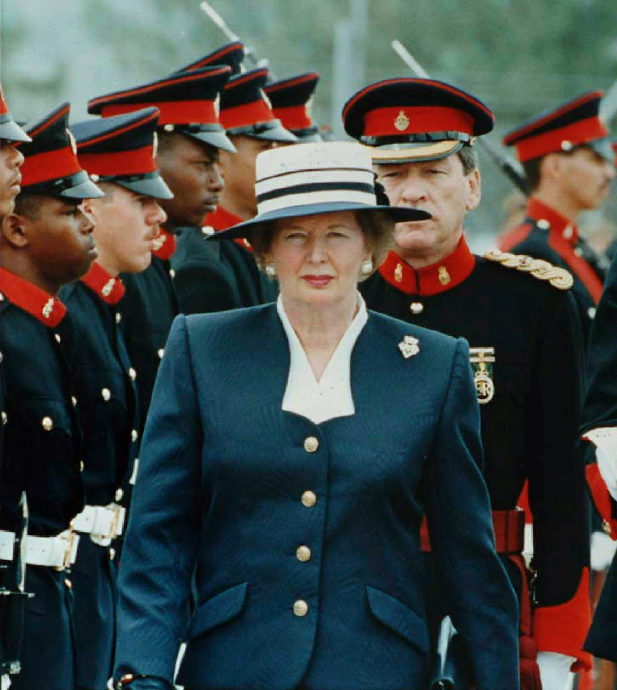
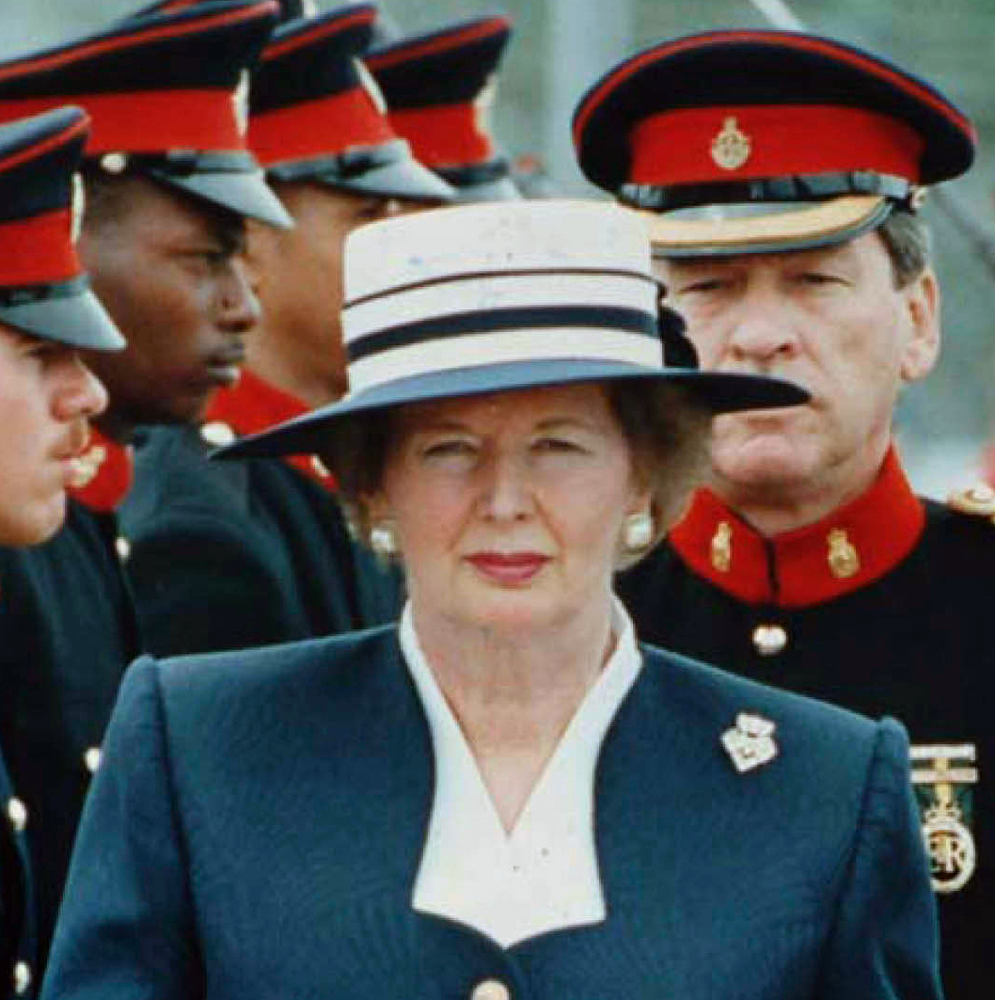
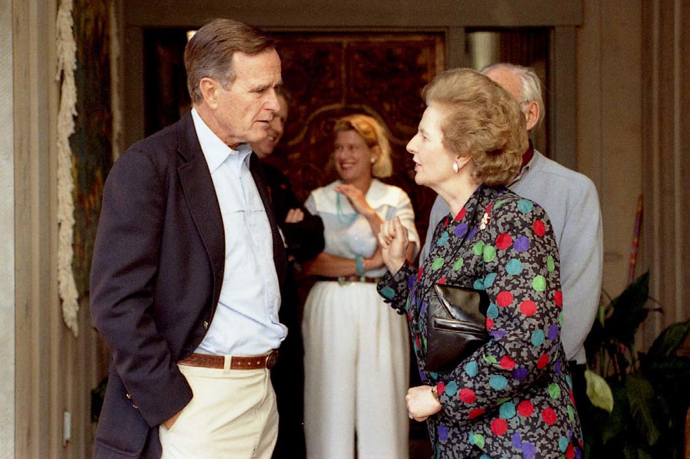

36년 전 오늘, 1990년 11월 23일. 영국을 11년 반 동안 이끌어온 '철의 여인' 마거릿 대처 총리가 자리에서 물러났다는 소식이 전 세계 신문 1면을 장식했습니다. 전날인 11월 22일 런던 다우닝가 10번지 총리실에서 전격적으로 사임 성명이 발표되면서, 전후 영국 정치를 뒤흔들었던 한 시대가 막을 내렸습니다.

## 식료품점의 딸에서 20세기 최장수 총리로

1925년 링컨셔주 그랜샘의 평범한 식료품점 둘째 딸로 태어난 마거릿 대처는 옥스퍼드 대학교에서 화학과 법학을 전공한 뒤 정계에 입문했습니다. 1959년 하원의원에 처음 당선된 이후 교육부 장관을 거쳐 1975년 영국 보수당 최초의 여성 당수가 되었습니다. 이어 1979년 총선에서 노동당을 꺾고 승리하며 영국 헌정사상 첫 여성 총리 자리에 올랐습니다.

대처 총리는 이른바 '영국병'으로 불리던 만성적 경제 침체와 노사 분규를 타파하기 위해 강력한 시장주의 개혁을 추진했습니다. 국영기업의 과감한 민영화, 긴축 재정, 세제 개혁, 규제 완화를 밀어붙였으며, 1982년 아르헨티나와의 포클랜드 전쟁을 승리로 이끌며 국민적 지지를 모았습니다. 1983년과 1987년 총선에서도 압승을 거두며 20세기 영국 총리 중 가장 긴 11년 7개월 동안 다우닝가를 지켰습니다.

## 유럽 통합 갈등과 보수당 당내 반발

영원할 것 같았던 철의 여인의 권력도 집권 후반기 들어 거센 암초를 만났습니다. 대처 총리가 강력하게 밀어붙였던 인두세 도입에 대한 국민적 반발이 극심했고, 유럽 공동체 통합과 유로화 도입을 둘러싼 완강한 반대 입장은 보수당 내 친유럽파 각료들과의 심각한 갈등을 낳았습니다.

결국 당내 중진이었던 마이클 헤즐타인 전 국방장관이 당수직에 도전장을 던지며 보수당 지도부 경선이 치러졌습니다. 1990년 11월 20일 실시된 보수당 의원 1차 투표에서 대처 총리는 204표를 얻어 152표에 그친 헤즐타인을 앞섰지만, 1차 투표 확정에 필요한 득표선에서 불과 4표가 모자랐습니다. 과반 득표 규정을 채우지 못하면서 승부는 2차 투표로 넘어가게 되었습니다.

*Thatcher reviews troops — 사진: White House Photo Office / Public domain*

## 하룻밤 사이 번복된 결심과 전격 사임

1차 투표 결과 직후 대처 총리는 오는 27일 예정된 2차 투표에 출마해 끝까지 싸우겠다고 공언했습니다. 하지만 보수당 내 기류는 급격히 얼어붙었습니다. 21일 밤부터 22일 아침까지 이어진 내각 각료들과의 면담에서, 각료들은 2차 투표에서 헤즐타인에게 패배할 위험이 크며 당이 분열될 수 있다는 우려를 가감 없이 전했습니다.

결국 대처 총리는 22일 아침 총리실에서 전격 사임 성명을 발표했습니다. 대처는 성명을 통해 "동료들과 광범위한 협의를 거친 결과, 내가 물러남으로써 당내 동료들이 지도부 선출 투표에 나설 수 있도록 하는 것이 당의 단결과 차기 총선 승리에 더 잘 기여할 수 있다는 결론을 내렸다"고 밝혔습니다. 대처는 엘리자베스 2세 여왕에게 새 당수가 선출되는 대로 총리직에서 물러나겠다는 뜻을 정식으로 보고했습니다.

*Thatcher reviews troops (cropped) — 사진: White House Photo Office / Public domain*

## 의회에서의 마지막 일격과 후계 구도

사퇴를 선언한 당일 오후, 대처 총리는 하원에 출석했습니다. 야당인 노동당이 총리 사임을 기회로 정권을 흔들기 위해 내각 불신임안을 제출하고 조기 총선을 요구했기 때문입니다. 하지만 대처 총리는 흔들림 없는 단호한 연설로 의회를 압도했고, 불신임안은 367대 247표라는 압도적인 표차로 부결되었습니다. 권좌에서 내려오는 마지막 순간까지 특유의 당당함을 잃지 않은 장면이었습니다.

대처의 2차 투표 불출마로 차기 당수 경선은 3파전으로 재편되었습니다. 도전자였던 마이클 헤즐타인 전 국방장관에 맞서 대처 총리의 지지를 받는 더글러스 허드 외무장관과 존 메이저 재무장관이 출사표를 던졌습니다. 한편 노동당의 닐 키녹 당수는 대처의 퇴진을 환영했고, 런던 주식시장은 불확실성 해소 기대감으로 급등세를 보였습니다.

*Thatcher and Bush - 1990 - P14935-18A — 사진: This photo was taken by the Presidential photographer. / Public domain*

## '대처리즘'이 남긴 유산과 기억

마거릿 대처 총리의 전격 사임은 냉전 종식과 함께 전 세계가 숨 가쁘게 변화하던 시기에 찾아온 대사건이었습니다. 타협을 모르는 강력한 리더십과 신자유주의 경제 개혁은 영국의 경제 체질을 바꾸고 성장을 회복시켰다는 찬사를 받았지만, 동시에 복지 축소와 지역 간 빈부 격차를 심화시켰다는 상반된 평가를 남겼습니다.

소련의 언론이 처음 붙였으나 스스로도 자랑스러워했던 '철의 여인'이라는 칭호는 그녀의 트레이드마크로 역사에 남았습니다. 11년 7개월간 영국과 서방 세계를 호령하던 강력한 지도자가 당내 반발과 4표 차이의 규정에 막혀 다우닝가를 떠나던 그날의 충격은, 지금도 수많은 사람들의 뇌리에 뚜렷한 역사의 한 장면으로 기억되고 있습니다.

### 참고 자료

- <https://newslibrary.naver.com/viewer/index.naver?articleId=1990112300289101001&editNo=4&printCount=1&publishDate=1990-11-23&officeId=00028&pageNo=1&printNo=782&publishType=00010>
- <https://commons.wikimedia.org/wiki/File:ThatcherProfile.JPG>
- <https://commons.wikimedia.org/wiki/File:Thatcher_reviews_troops.jpg>
- <https://commons.wikimedia.org/wiki/File:Thatcher_reviews_troops_(cropped).jpg>
- <https://commons.wikimedia.org/wiki/File:Thatcher_and_Bush_-_1990_-_P14935-18A.jpg>
