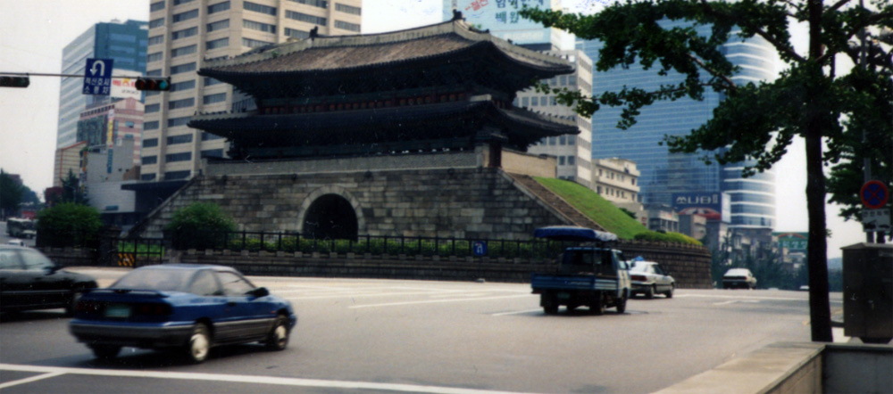
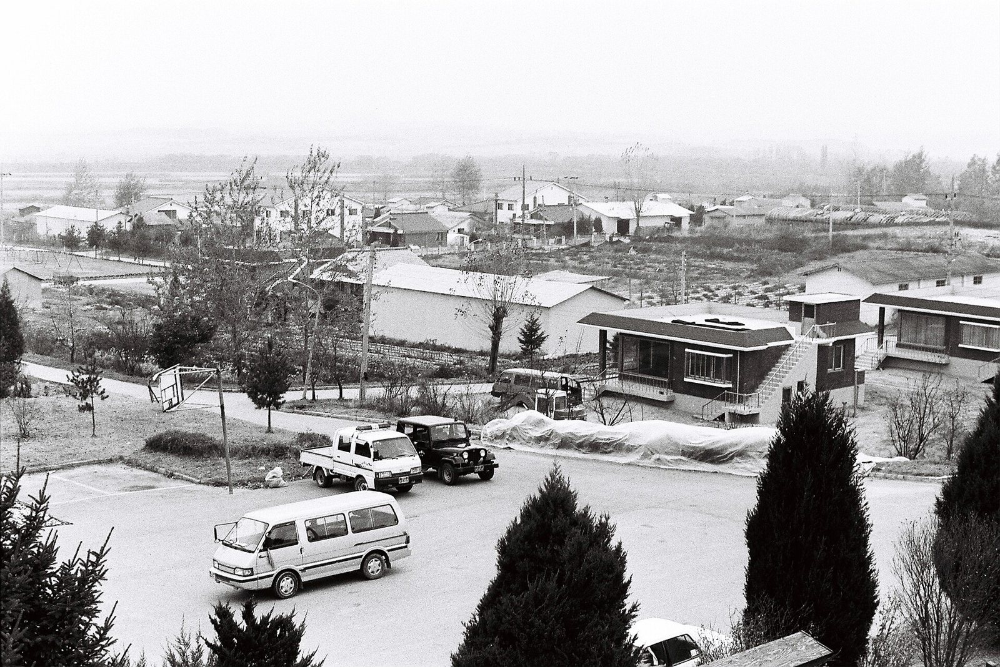
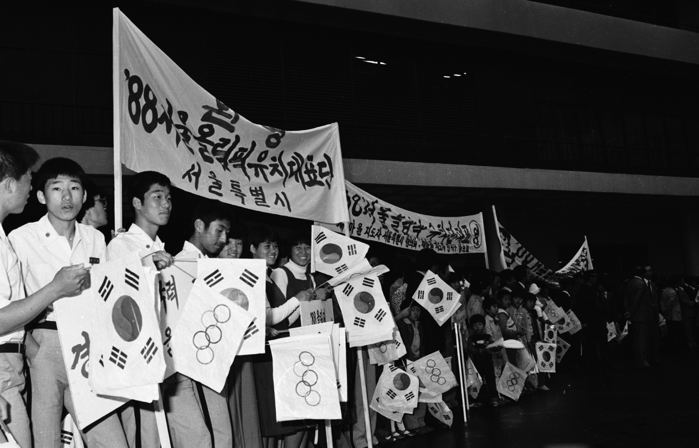

32년 전 오늘, 1994년 11월 23일. 전국 15개 시도, 56개 시험지구의 7백2개 고사장에서 1995학년도 대학수학능력시험이 일제히 치러졌습니다. 재학생과 재수생을 합쳐 총 78만 1천7백49명이 결전을 치른 이날, 전국에는 수은주가 영하로 떨어지는 매서운 입시 한파가 몰아쳤습니다.

## 1년에 한 차례로 바뀐 두 번째 수능

1993년에 첫선을 보인 대학수학능력시험은 당초 8월과 11월 두 차례 시험을 치르는 방식으로 출발했습니다. 그러나 수험생들의 수험 부담이 지나치게 크다는 지적과 난이도 문제 등이 겹치면서, 1994년 11월 23일에 치러진 1995학년도 시험부터는 한 차례만 치르는 단판 승부로 전환되었습니다.

이날 응시한 인원은 재학생과 재수생을 포함해 78만 1천7백49명에 달했습니다. 당시 대학별 본고사를 실시하는 대학 수가 지난해 9개 대학에서 38개 대학으로 크게 늘어났기 때문에 대입 전형에서 수능 시험이 차지하는 비중은 다소 낮아졌다는 평가도 있었습니다. 하지만 대다수 수험생에게 수능은 대학 진학을 위해 결코 소홀히 할 수 없는 결정적인 관문이었습니다.

## 예비소집일의 풍경과 수험생들의 긴장

시험 전날인 11월 22일, 전국 각 고사장 관리본부는 오전 10시부터 오후 3시 사이에 수험생 예비소집을 실시했습니다. 서울 이화여고 운동장과 노천극장 등 전국 곳곳의 학교 운동장에는 수험표를 교부받으려는 수험생들의 발길이 이어졌습니다.

수험생들은 차가운 바람을 맞으며 시험 당일 주의사항에 귀를 기울였습니다. 수험표와 함께 주민등록증이나 학생증을 반드시 챙겨야 하고, 오전 8시 반까지 지정된 시험실에 입실해야 한다는 지침을 꼼꼼히 확인했습니다. 수험표를 손에 쥔 학생들의 얼굴에는 긴장과 비장함이 교차했습니다.

*Southern Gate 숭례문 崇禮門 (5678277441) — 사진: InSapphoWeTrust from Los Angeles, California, USA / CC BY-SA 2.0*

## 영하 4도까지 떨어진 매서운 수능 한파

기상청은 11월 23일 시험 당일 날씨가 당초 예상과 달리 올가을 들어 가장 쌀쌀할 것이라고 예보했습니다. 실제로 아침 기온은 영하 4도에서 영상 6도의 분포를 보이며 중부내륙 지방 대부분이 영하권으로 얼어붙었습니다.

지역별로는 강원도 철원이 영하 4도까지 떨어져 전국에서 가장 추웠고, 춘천 영하 3도, 충북 청주 영하 2도, 대전 영하 1도를 기록했습니다. 인천과 전주는 0도, 서울과 광주는 영상 1도, 대구 영상 2도, 부산은 영상 6도를 나타냈습니다. 수험생들은 두툼한 옷을 여러 겹 껴입고 입김을 내뿜으며 고사장으로 향해야 했습니다.

*1994년 11월 북방선 일대 통일촌 — 사진: 경기도 / KOGL Type 1*

## 온 사회가 숨죽인 하루, 교통 대책과 시험 진행

수험생들이 시험 시간에 늦지 않도록 범정부 차원의 교통 소통 대책도 시행되었습니다. 서울과 부산을 비롯한 전국 68개 시군 지역에서는 관공서 공무원과 50인 이상 기업체 임직원들의 출근 시간, 그리고 초등학교, 중학교, 고등학교 학생들의 등교 시간을 오전 10시 이후로 늦췄습니다.

수험생들은 오전 8시 반까지 고사실에 무사히 입실했고, 시험은 오전 9시 1교시 언어영역으로 시작되었습니다. 4개 영역에 걸쳐 총 2백 문항이 출제되었으며, 오후 5시 10분까지 장장 6시간 동안 시험이 이어졌습니다. 고사장 밖에서는 부모들이 자녀의 선전을 기원하며 추위 속에서 애를 태웠습니다.

*1988년 서울 올림픽 유치 대표단 환영인파 — 사진: 서울역사박물관 / KOGL Type 1 (공공누리 제1유형, 출처표시)*

## 개인당 6장 교부된 성적표와 입시의 기억

이날 치러진 1995학년도 수능의 성적통지표는 시험 한 달 뒤인 12월 23일 재학 중인 학교와 출신 학교에서 수험생들에게 교부되었습니다. 당시 대학 복수 지원 제도에 맞춰 개인당 6장씩의 성적표가 배부되었습니다.

수능 날만 되면 어김없이 찾아왔던 쌀쌀한 추위와 이른 아침 숨죽였던 거리, 떨리는 손으로 시험지를 넘기던 그날의 기억은 세월이 흘러도 많은 이들의 가슴속에 뚜렷한 한 장면으로 남아 있습니다.

### 참고 자료

- <https://newslibrary.naver.com/viewer/index.naver?articleId=1994112300209101002&editNo=45&printCount=1&publishDate=1994-11-23&officeId=00020&pageNo=1&printNo=22692&publishType=00010>
- <https://commons.wikimedia.org/wiki/File:Kyongheru.jpg>
- <https://commons.wikimedia.org/wiki/File:Southern_Gate_%EC%88%AD%EB%A1%80%EB%AC%B8_%E5%B4%87%E7%A6%AE%E9%96%80_(5678277441).jpg>
- <https://commons.wikimedia.org/wiki/File:1994%EB%85%84_11%EC%9B%94_%EB%B6%81%EB%B0%A9%EC%84%A0_%EC%9D%BC%EB%8C%80_%ED%86%B5%EC%9D%BC%EC%B4%8C.jpg>
- <https://museum.seoul.go.kr/archive/archiveNew/NR_archiveView.do?ctgryId=CTGRY766&type=B&upperNodeId=CTGRY769&fileSn=300&fileId=H-TRNS-96110-769>
