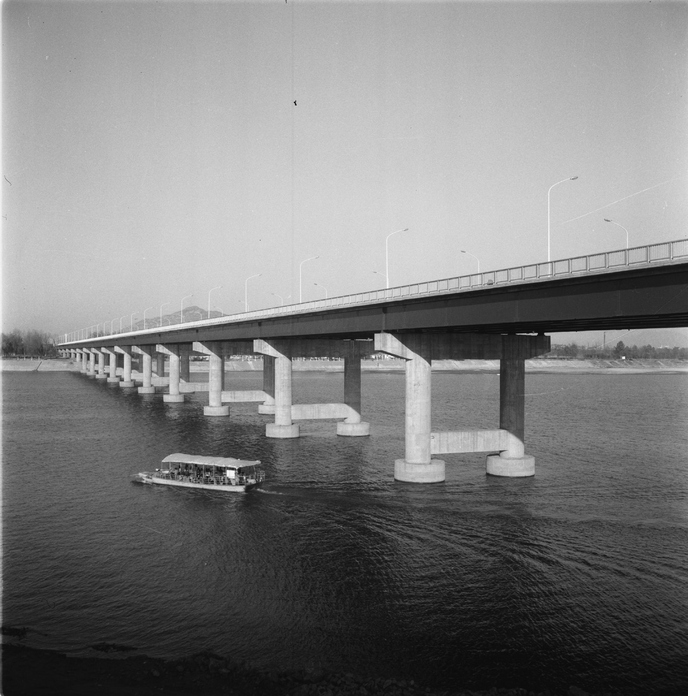
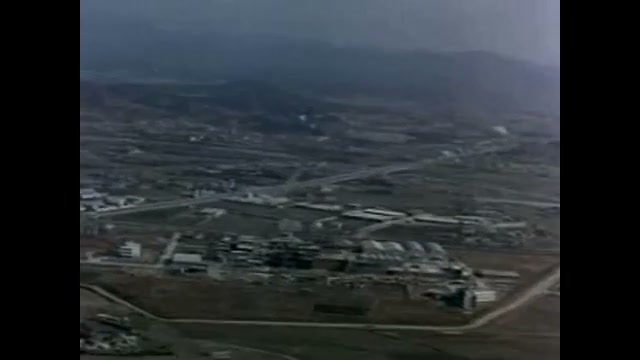

50년 전 오늘, 1976년 11월 23일 신문 1면에는 얼어붙은 고속도로에서 벌어진 참혹한 사고 소식이 일제히 실렸습니다. 절기상 첫눈이 내린다는 소설을 맞아 전국에 내린 눈이 그대로 얼어붙으면서, 경부고속도로를 비롯한 전국의 주요 고속도로가 아비규환의 빙판길로 변해버렸습니다.

## 소설 추위와 함께 얼어붙은 도로

1976년 11월 22일 오후부터 서울과 중부지방을 비롯한 전국에 눈과 진눈깨비가 쏟아졌습니다. 이날 적설량은 수원 10.5센티미터, 광주 6.6센티미터, 대전 5.1센티미터, 청주 4.8센티미터, 서울 3.5센티미터를 기록했습니다.

문제는 영하로 떨어진 기온이었습니다. 내린 눈이 도로 면에 그대로 얇은 얼음막으로 굳어지면서 도로는 통제 불능의 은판으로 바뀌었습니다. 개통된 지 불과 6년 남짓이었던 고속도로에는 제설 체계나 결빙 예방 장비가 크게 부족했고, 도로에 진입한 차량들은 무방비 상태로 빙판길을 마주해야 했습니다.

## 불과 6시간 반 동안 터진 34건의 사고

사고는 11월 22일 오후 1시 40분부터 저녁 8시 10분까지, 불과 6시간 30분 사이에 집중적으로 일어났습니다. 경부고속도로를 포함한 전국 4개 고속도로에서 발생한 사고만 모두 34건에 달했습니다.

특히 서울과 부산을 잇는 경부고속도로 한 곳에서만 무려 30건의 연쇄 추돌 사고가 기록되었습니다. 이는 경부고속도로 개통 이래 가장 짧은 시간 동안 가장 많은 사고가 발생한 전례 없는 기록이었습니다. 대부분의 사고는 2중에서 최대 18중까지 이어진 대규모 다중 추돌이었습니다.

![[1026호] 새마을 박정희 대통령 양재동과 과천에서 식수 (1975.04.12) 장면 1](../images/2026-11-23-06-2.jpg)
*[1026호] 새마을 박정희 대통령 양재동과 과천에서 식수 (1975.04.12) 장면 1 — 사진: KTV 국민방송 e영상역사관 (대한뉴스) / KTV 공공저작물 — 영상 저작물 전면 개방(대통령실 2025-07-09), 출처 표시*

## 금강 10미터 아래로 추락한 고속버스

가장 큰 인명 피해는 충북 옥천군 동이면 경부고속도로 금강유원지 부근 금강3교 진입로에서 발생했습니다. 오후 7시 10분쯤, 승객 50여 명을 태우고 서울을 떠나 구미로 향하던 한진고속 버스가 진눈깨비로 얼어붙은 커브길에서 미끄러졌습니다.

통제력을 잃은 버스는 다리 난간 2미터를 부수고 10여 미터 아래 차가운 금강 바닥으로 곤두박질쳤습니다. 이 사고로 버스 운전사와 승객 등 7명이 숨지고 34명이 중경상을 입었습니다. 육군 장병과 방위병 등 30여 명이 긴급 투입되어 부서진 차체 속에서 울부짖는 승객들을 구출해 병원으로 이송했습니다.

*완공된 영동대교 — 사진: 서울역사박물관 / KOGL Type 1 (공공누리 제1유형, 출처표시)*

## 곳곳에서 이어진 18중 추돌과 화물차 참사

비슷한 시각인 오후 8시 10분쯤 경기도 용인군 남사면 경부고속도로 상행선에서는 눈길에 미끄러져 넘어진 트럭을 피하지 못하고 뒤따르던 트럭들과 고속버스 등 18대가 연쇄 추돌했습니다. 이 사고로 버스 승객 1명이 숨지고 90여 명이 다쳤습니다.

충북 청원군 현도면 금강제1교 부근에서도 배추를 싣고 가던 트럭이 미끄러지며 버스와 화물차들이 연쇄 충돌했고, 뒤이어 달려오던 트럭이 중앙분리대를 넘어 15미터 다리 밑으로 추락해 조수가 목숨을 잃었습니다. 23일 새벽 2시 천원군 망향휴게소 부근에서도 김장 재료를 실은 트럭 등 16대가 들이받아 상행선이 2시간 40분 동안 전면 불통되었습니다.

*마음을 잇는 길(호남 남해 고속도로) ... 좋게 하기 위해 택 코팅을 함. (1973.00.00) 장면 2 — 사진: KTV 국민방송 e영상역사관 (문화영화) / KTV 공공저작물 — 영상 저작물 전면 개방(대통령실 2025-07-09), 출처 표시*

## 통행금지 시간에 갇힌 귀성객과 승객들

기록적인 연쇄 충돌로 인해 전국 고속도로 상하행선은 거대한 주차장으로 변했습니다. 하늘에서 내려다본 고속도로는 부서진 차량과 흩어진 짐들로 마치 전투가 휩쓸고 지나간 전장을 방불케 했습니다.

이날 전국적으로 11명이 목숨을 잃고 199명이 다쳤습니다. 살아남은 승객들도 극심한 정체로 밤 12시 통행금지 시간 이후에야 목적지에 도착하거나 차 안에서 밤을 지새우는 큰 고통을 겪었습니다. 이 참사를 계기로 겨울철 고속도로 월동 장구 의무화와 제설 방재 체계가 국가적 과제로 떠올랐습니다.

### 참고 자료

- <https://newslibrary.naver.com/viewer/index.naver?articleId=1976112300329201003&editNo=2&printCount=1&publishDate=1976-11-23&officeId=00032&pageNo=1&printNo=9587&publishType=00020>
- <https://www.kogl.or.kr/recommend/recommendDivView.do?division=img&recommendIdx=67598>
- <https://www.ehistory.go.kr/view/movie?mediasrcgbn=KV&mediaid=944&mediadtl=6604&mediagbn=DH#t=0.3>
- <https://museum.seoul.go.kr/archive/archiveNew/NR_archiveView.do?ctgryId=CTGRY746&type=B&upperNodeId=CTGRY747&fileSn=300&fileId=H-TRNS-81021-747>
- <https://www.ehistory.go.kr/view/movie?mediasrcgbn=KV&mediaid=11341&mediadtl=25493&mediagbn=MH#t=0.7>
