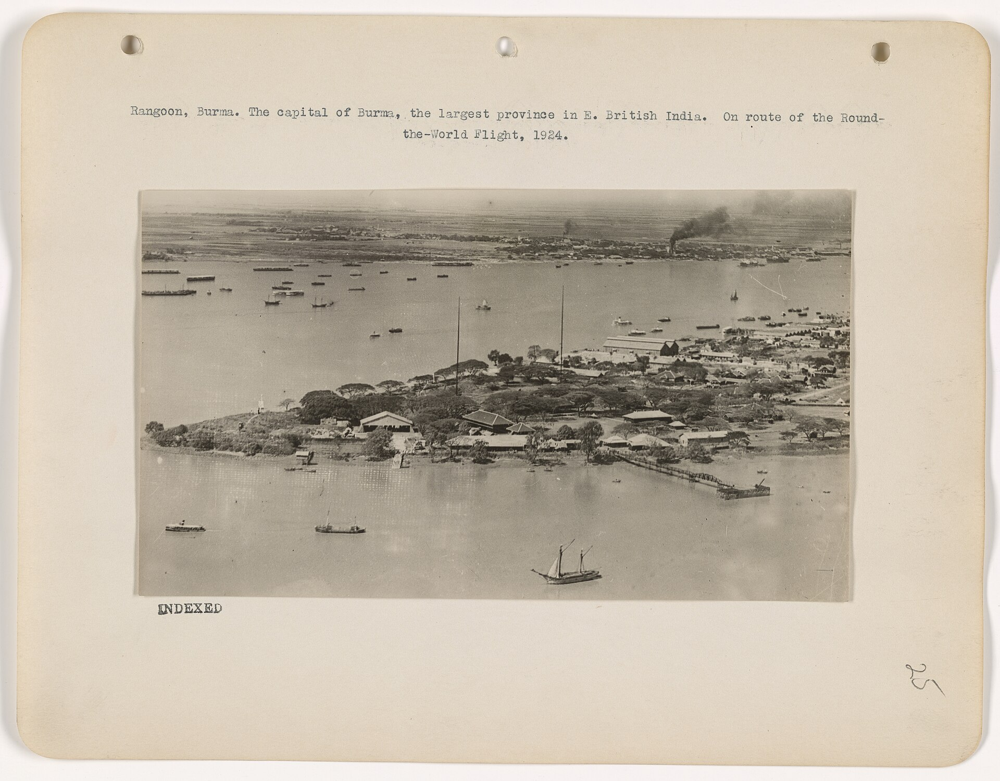
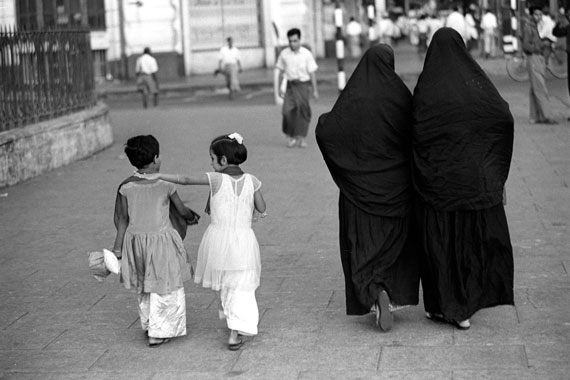
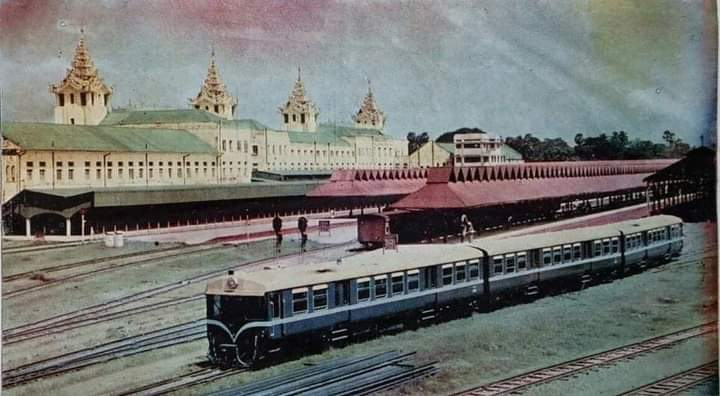

43년 전 오늘, 1983년 11월 24일. 버마 아웅산 묘소 폭발 테러를 일으킨 북한 공작원의 자백이 현지 법정에서 공식 공개됐습니다. 온 국민을 비통에 빠뜨렸던 참사의 실체가 명명백백하게 드러난 순간이었습니다.

## 세계의 이목이 쏠린 랑군 법정

1983년 10월 9일 버마 랑군 아웅산 묘소에서 발생한 폭발 테러는 대한민국 정부 요인과 수행원 17명의 목숨을 앗아간 비극이었습니다. 사건 발생 한 달여 만인 11월 하순, 버마 당국은 랑군 시내 3군통합장교회관에서 체포된 범인들에 대한 정식 재판을 시작했습니다. 11월 23일 열린 이틀째 공판에는 이탈리아 대사, 영국 대리대사, 일본과 한국 대사관 직원 등 외교관들이 대거 참석했습니다. 소련의 타스 통신과 중공의 신화사 통신, 서방 언론 등 보도진 30여 명이 재판정 안팎을 가득 메우며 긴장감이 감돌았습니다.

## 증언대에 선 버마 경찰국장의 폭로

버마 폭발사건조사위원회 사무총장이자 경찰국장인 우 테인 아웅은 이날 검찰 측 증인으로 출두해 체포된 범인의 진술을 상세히 공개했습니다. 군병원에서 치료를 받던 중 입을 연 피고인은 북한 육군 대위 강민철로 밝혀졌습니다. 강민철은 군번 9970번, 28세의 나이로 개성에 주둔하는 북한 인민무력부 정찰국 소속 특공대원이라고 털어놓았습니다. 그의 자백은 그동안 북한 정권이 부인해 오던 범행의 배후를 뿌리째 뒤흔드는 결정적 증언이었습니다.

*Burma - Rangoon - NARA - 68154576 — 사진: Unknown authorUnknown author or not provided / Public domain*

## 개성에서 랑군까지 이어진 침투 공작

공개된 자백에 따르면 범행을 지시한 인물은 북한 육군 소장 최창수였습니다. 최창수의 직접 명령을 받은 3인조 공작조는 조장인 소령 진모, 조원인 대위 김치오와 강민철로 꾸려졌습니다. 이들은 9월 9일 북한 황해도 옹진항을 배로 출발해 9월 22일 무렵 랑군항에 은밀히 도착했습니다. 현지 도착 직후 북한대사관 정무담당 참사관인 전창휘의 주택으로 안내받아 은신처를 마련했고, 이틀 뒤 자신들이 머물던 방에서 준비된 폭파 장비를 넘겨받았습니다.

*Myanmar Rangun 1963 © Eric Bachmann — 사진: Nachlass Eric Bachmann Fotoarchiv / CC BY-SA 4.0*

## 치밀했던 범행 준비와 당일의 폭발

공작조는 사건 사흘 전인 10월 6일 외국 귀빈들이 자주 찾는 쉐다곤 파고다를 둘러본 뒤 아웅산 묘소를 사전 답사했습니다. 10월 7일 새벽 2시, 묘소 남쪽을 통해 지붕으로 올라간 강민철은 조장 진모가 올려준 원격조종 폭탄 2개를 천장에 설치했습니다. 사건 당일인 10월 9일 아침, 범인들은 묘소 근처 영화관 앞에서 대기하다 참배객 차량 행렬을 확인하고 조장 진모가 원격 스위치를 눌렀습니다. 그러나 진모는 폭발 직후 홀로 달아났고, 강민철과 김치오는 랑군강을 건너 도주하다 경찰 검문에 걸려 김치오는 사망하고 강민철은 부상을 입은 채 체포됐습니다.

*Rangoon circular dmu trains at rangoon central station 1960 — 사진: မြန်မာ့မီးရထားဝန်ကြီးဌာန / Public domain*

## 은신처 도면과 현장 검증으로 입증된 사실

버마 수사 당국은 강민철의 진술에만 의존하지 않고 철저한 물증을 확보했습니다. 강민철은 법원 조사에서 은신했던 집의 내부 구조를 손수 그렸는데, 차고를 통해 출입할 수 있는 2층 구조와 천장에 선풍기가 달린 큰 방의 위치까지 정확히 묘사했습니다. 버마 법원 재판관들과 경찰이 알론구 티리가에 있는 북한 참사관의 주택을 현장 검증한 결과, 강민철이 마시고 남긴 빈 맥주병까지 그대로 발견되어 진술의 진실성이 입증됐습니다.

## 거짓을 무너뜨린 명백한 기록

북한 정권은 사건 초기부터 자신들과 무관하다고 주장했으나, 현지 법정에서 쏟아져 나온 구체적인 군번과 소속, 침투 경로와 현장 증거 앞에서 그 주장은 힘을 잃었습니다. 재판정을 지켜보던 동구권 외교관과 특파원들도 구체적인 정황과 물증이 공개되자 당혹감을 감추지 못했습니다. 국가적 비극 속에서 차분하게 범행 전모를 밝혀낸 43년 전 오늘의 재판 기록은 우리 역사에 잊을 수 없는 아픔이자 진실의 기록으로 남아 있습니다.

### 참고 자료

- <https://newslibrary.naver.com/viewer/index.naver?articleId=1983112400209201005&editNo=2&printCount=1&publishDate=1983-11-24&officeId=00020&pageNo=1&printNo=19121&publishType=00020>
- <https://commons.wikimedia.org/wiki/File:Koreans_in_the_open-air_market_during_the_joint_U.S._Marine_Corps_and_Republic_of_Korea_marine_training_Exercise_Team_Spirit_%2783_-_DPLA_-_9709018acc3f0f2a7130720b4131f978.jpeg>
- <https://commons.wikimedia.org/wiki/File:Burma_-_Rangoon_-_NARA_-_68154576.jpg>
- <https://commons.wikimedia.org/wiki/File:Myanmar_Rangun_1963_%C2%A9_Eric_Bachmann.jpg>
- <https://commons.wikimedia.org/wiki/File:Rangoon_circular_dmu_trains_at_rangoon_central_station_1960.jpg>
