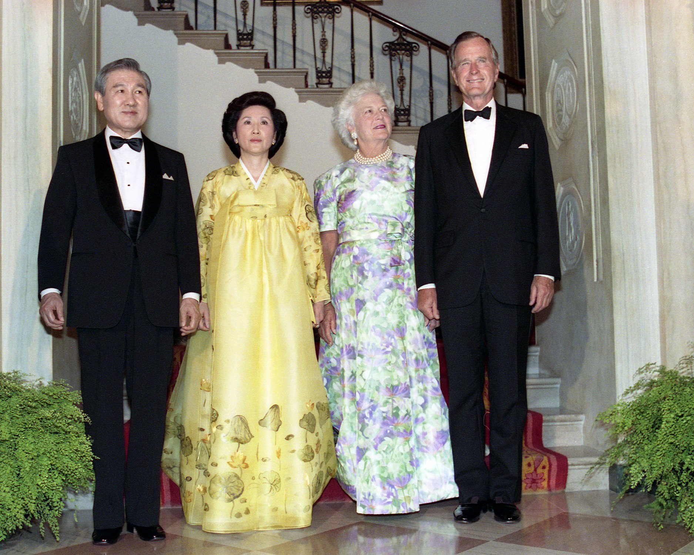
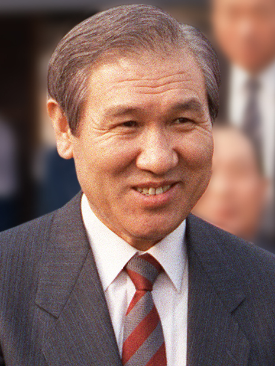

31년 전 오늘, 1995년 11월 24일. 노태우 전 대통령의 비자금 사건을 파헤치던 검찰의 수사가 최고조에 달했습니다. 비자금의 핵심 창구로 지목받던 인물이 소환돼 밤을 새워 조사를 받았고, 뇌물을 건넨 재벌 총수들이 무더기로 재판에 넘겨질 처지에 놓였습니다.

## 온 나라를 뒤흔든 5천억 비자금 파문

1995년 늦가을, 대한민국은 전직 대통령의 천문학적인 비자금 조성 의혹으로 씻을 수 없는 충격에 빠져 있었습니다. 당시 대검찰청 중앙수사부는 안강민 중수부장을 필두로 노태우 전 대통령이 재임 기간 동안 조성한 약 5천억 원대 비자금의 출처와 흐름을 쫓고 있었습니다. 이미 서울구치소에 수감되어 있던 노 전 대통령을 상대로 검찰은 구류신문을 이어가며 압박 수위를 높여가고 있었습니다.

## 핵심 통로 이원조의 소환과 철야 조사

1995년 11월 23일 오전, 정관계와 금융계의 막후 실세로 꼽히던 이원조 전 의원이 서초동 대검찰청에 모습을 드러냈습니다. 검찰은 이 전 의원을 상대로 노 전 대통령의 비자금 조성 과정에서 어떤 역할을 했는지 집중 추궁하며 강도 높은 밤샘 조사를 벌였습니다.

이 전 의원은 검찰 조사에서 동국제강 장상태 회장으로부터 30억 원을 받아 노 전 대통령에게 건넨 사실을 시인했습니다. 또한 1991년 안영모 당시 동화은행장으로부터 행장 연임 청탁의 대가로 2억 3천만 원을 받은 개인 비리 혐의도 일부 인정했습니다. 검찰은 특정범죄가중처벌법상 수뢰 등의 혐의로 구속영장 청구를 검토하며 수사에 박차를 가했습니다.

*President George H. W. Bush and First Lady Barbara Bush with Korean President Roh Tae-woo and Kim Ok-suk — 사진: The Bush 41 Presidential Library / Public domain*

## 상무대 이전공사와 드러난 비자금 수표

같은 날 검찰은 상무대 이전사업 비리와 관련해 조기현 전 청우종합건설 회장도 소환해 조사를 벌였습니다. 검찰은 주택은행과 국민은행, 제일은행, 서울은행 등 4개 은행에 개설된 청우종합건설의 13개 계좌에 대한 압수수색을 통해 자금 흐름을 추적해 왔습니다.

수사 결과 조 전 회장이 상무대 이전공사 대금 189억 원을 빼돌려 상당 부분을 뇌물로 전달한 혐의가 포착되었습니다. 실제로 해당 계좌에서 인출된 수표 중 일부가 노 전 대통령의 비자금 계좌로 흘러 들어간 사실이 확인되면서 검은돈의 실체가 명백한 물증으로 입증되었습니다.

*Roh Tae-woo March 1989 (3x4) — 사진: CHERIE A. THURLBY / Public domain*

## 재벌 총수 24명 기소라는 사상 초유의 방침

11월 24일 조간신문 1면을 장식한 또 하나의 거대한 소식은 대기업 총수들에 대한 전면적인 사법처리 방침이었습니다. 검찰은 노 전 대통령에게 뇌물을 건넨 29개 재벌그룹 가운데 공소시효 5년이 지나지 않은 24개 그룹 총수를 전원 기소하겠다고 발표했습니다.

공소시효가 살아 있는 1990년 11월 이후 건네진 뇌물 액수만 해도 1천465억 원에 달했습니다. 현대와 대우가 각각 150억 원, 엘지 140억 원, 동아와 롯데가 각각 110억 원, 삼성과 한진, 진로가 각각 100억 원을 건넨 것으로 확인되었습니다. 이 밖에도 쌍용, 효성, 대림, 금호, 기아 등 대한민국의 대표 기업 총수들이 줄줄이 기소 대상에 포함되었습니다.

![[1992호] 전직 대통령 초청 회동 김영삼 대통령, 전직 대통령 초청 회동 (1994.01.13) 장면 1](../images/2026-11-24-03-4.jpg)
*[1992호] 전직 대통령 초청 회동 김영삼 대통령, 전직 대통령 초청 회동 (1994.01.13) 장면 1 — 사진: KTV 국민방송 e영상역사관 (대한뉴스) / KTV 공공저작물 — 영상 저작물 전면 개방(대통령실 2025-07-09), 출처 표시*

## 정경유착의 고리를 끊기 위한 진통

선경, 극동건설, 코오롱, 해태, 태평양 등 5개 그룹은 공소시효 만료로 기소 대상에서 일단 제외되었으나, 검찰은 뇌물성이 명백한 2~3개 그룹 총수의 경우 구속까지 검토하겠다며 단호한 태도를 보였습니다. 일반의 예상을 뛰어넘는 검찰의 강경 방침에 재계는 거대한 혼란과 긴장에 휩싸였습니다.

청와대와 대기업, 금융권이 은밀하게 얽혀 있던 정경유착의 어두운 카르텔이 법의 심판대 위에 오른 순간이었습니다. 전직 대통령의 구속과 재벌 총수들의 줄소환이라는 전대미문의 사건은 국민들에게 깊은 허탈감을 주었지만, 동시에 우리 사회가 투명한 시장경제로 나아가기 위해 반드시 거쳐야 할 뼈아픈 통과의례였습니다.

### 참고 자료

- <https://newslibrary.naver.com/viewer/index.naver?articleId=1995112400209101003&editNo=45&printCount=1&publishDate=1995-11-24&officeId=00020&pageNo=1&printNo=23035&publishType=00010>
- <https://www.kogl.or.kr/recommend/recommendDivView.do?division=img&recommendIdx=76827>
- <https://commons.wikimedia.org/wiki/File:President_George_H._W._Bush_and_First_Lady_Barbara_Bush_with_Korean_President_Roh_Tae-woo_and_Kim_Ok-suk.jpg>
- <https://commons.wikimedia.org/wiki/File:Roh_Tae-woo_March_1989_(3x4).jpg>
- <https://www.ehistory.go.kr/view/movie?mediasrcgbn=KV&mediaid=11982&mediadtl=27374&mediagbn=DH#t=0.3>
