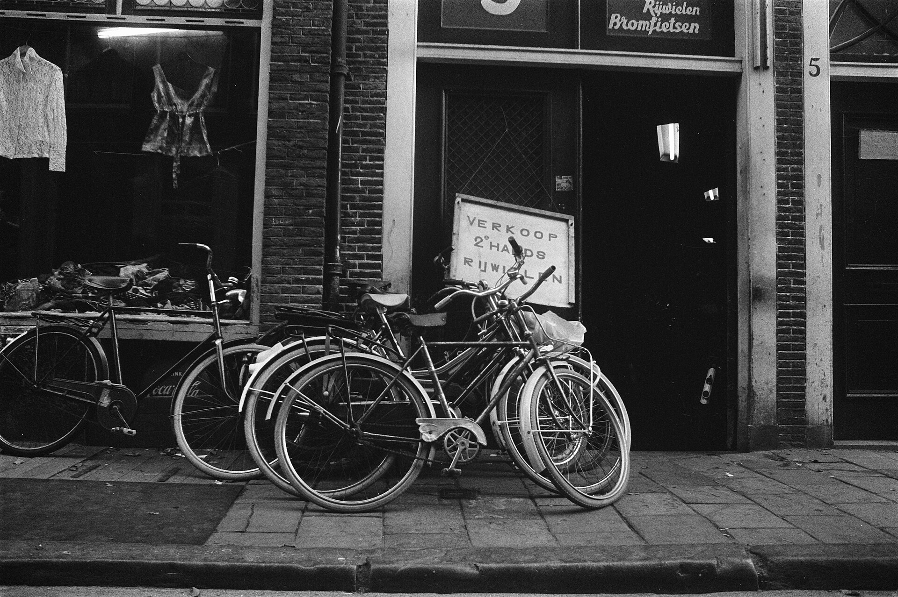

53년 전 오늘, 1973년 11월 24일. 정부가 8기통 이상 고급 자가용 승용차의 운행을 전면 금지하는 비상 조치를 전격 발표했습니다. 전 세계를 뒤흔든 제1차 석유 파동의 충격 속에서 대한민국 정부가 국가적 생존을 위해 꺼내 든 강력한 강제 절약 카드였습니다.

## 경제기획원과 상공부의 긴급 합동 기자회견

1973년 11월 24일 오전, 태완선 경제기획원 장관과 이낙선 상공부 장관은 경제기획원에서 긴급 합동 기자회견을 열었습니다. 전날인 11월 23일 국무회의 의결을 거친 '에너지 소비 절약 종합대책'을 국민 앞에 정식으로 발표하는 자리였습니다.

산유국들의 원유 감량 공급으로 촉발된 글로벌 오일쇼크는 한국 경제에도 치명적인 위협이 되고 있었습니다. 정부는 제한된 유류 공급 속에서 산업 생산 활동을 유지하기 위해 불요불급한 민간 소비를 대폭 강제 억제하기로 결정했습니다.

## 8기통 이상 고급 승용차 운행 전면 금지

이날 발표된 대책 가운데 가장 파격적인 조치는 8기통 이상 고급 자가용 승용차의 운행 금지였습니다. 발표 바로 다음 날인 11월 25일부터 8기통 이상 대형 승용차는 일체 도로를 달릴 수 없도록 엄격히 못 박았습니다. 면제 대상은 구급차와 언론기관 취재차, 외국인 차뿐이었습니다.

정부는 에너지 위기 속에서 사회 지도층부터 솔선수범해야 한다며 대형 자가용 운행에 철퇴를 내렸습니다. 또한 자가용의 공휴일 운행을 자발적으로 줄이도록 권고하되, 실효가 없을 경우에는 공휴일 자가용 전면 규제까지 단행하겠다고 경고했습니다.

*Tweedehands fietsen worden te koop aangeboden, Bestanddeelnr 926-7968 — 사진: Fotograaf Onbekend / Anefo / CC0*

## 교통과 수송 부문에 내려진 고강도 긴축

자가용뿐 아니라 대중교통과 운송 전반에도 강도 높은 축소 조치가 내려졌습니다. 서울 시내버스는 기름 소비를 줄이기 위해 평균 1km였던 정류장 간격을 1.5km에서 1.9km로 대폭 늘려 정차 횟수를 줄이도록 했습니다.

내항 선박의 월간 운항 횟수 1만 4,843회 가운데 10%에 달하는 1,482회를 감축하기로 했습니다. 아울러 11월 26일부터는 화물 트럭과 정기노선 버스를 제외한 모든 차량의 고속도로 통행료를 20% 인상하고, 서울 시내 택시의 8부제(윤번제) 운행을 실시했습니다.

![[667호] 해외 소식 CCTV를 이용한 영국의 교통 소통 작전. (1968.03.23) 장면 1](../images/2026-11-24-04-3.jpg)
*[667호] 해외 소식 CCTV를 이용한 영국의 교통 소통 작전. (1968.03.23) 장면 1 — 사진: KTV 국민방송 e영상역사관 (대한뉴스) / KTV 공공저작물 — 영상 저작물 전면 개방(대통령실 2025-07-09), 출처 표시*

## TV 방송 단축부터 사우나 주 3일 영업까지

일상생활 곳곳에도 촘촘한 절약 규제가 적용됐습니다. 11월 26일부터 TV 방영 시간은 주당 91시간 20분에서 67시간 10분으로 무려 25% 단축됐습니다. 밤늦게까지 텔레비전을 켜두는 전력 소비를 줄이기 위한 조치였습니다.

밤 10시 이후 네온사인 조명은 전면 금지됐고, 서울 시내 대중 사우나탕은 금요일, 토요일, 일요일 사흘만 문을 열 수 있었습니다. 다방은 1시간 30분, 대중음식점은 1시간씩 영업시간을 줄였으며, 영화관 상영 횟수도 하루 5회에서 4회로 제한됐습니다. 백화점과 대형 건물의 연말연시 전등 장식은 전면 금지됐고, 각급 학교의 겨울방학 연장도 검토 과제로 올랐습니다.

![[667호] 해외 소식 CCTV를 이용한 영국의 교통 소통 작전. (1968.03.23) 장면 2](../images/2026-11-24-04-4.jpg)
*[667호] 해외 소식 CCTV를 이용한 영국의 교통 소통 작전. (1968.03.23) 장면 2 — 사진: KTV 국민방송 e영상역사관 (대한뉴스) / KTV 공공저작물 — 영상 저작물 전면 개방(대통령실 2025-07-09), 출처 표시*

## 매점매석 엄단과 중장기 에너지 대책 마련

태완선 장관은 회견에서 위기를 틈타 폭리를 취하려는 불공정 유통 행위를 국민의 이름으로 엄단하겠다고 밝혔습니다. 매점매석이나 석유류의 부정 저장, 은닉 행위에 대해서는 물가안정에 관한 법률을 적용해 가혹하게 다스리겠다고 경고했습니다.

동시에 정부는 이번 위기를 계기로 원유 비축량을 대폭 늘리고 공급원을 다변화하겠다는 중장기 대책을 제시했습니다. 석탄 개발 촉진, 원자력 및 수력 발전 증대, 열관리 효율화 등 대체 에너지를 확보해 향후 닥칠지 모를 자원 위기에 대비하겠다는 청사진도 함께 발표했습니다.

## 에너지 안보의 중요성을 일깨운 역사적 하루

1973년 11월 24일의 비상 대책은 기름 한 방울 나지 않는 자원 빈국의 현실을 뼈저리게 일깨워 준 사건이었습니다. 국민들은 실내 온도를 낮추고 소형 연탄을 때며, 2km 이내 거리는 걸어 다니는 고통 분담에 동참해야 했습니다.

당시 도입된 강력한 유류 절약 시책들은 이후 한국의 에너지 정책과 산업 구조 개편에 지대한 영향을 미쳤습니다. 국가적 위기 앞에서 8기통 고급차의 시동을 끄고 거리의 조명을 낮췄던 그날의 기록은, 에너지 안보의 무게를 보여주는 생생한 역사로 남아 있습니다.

### 참고 자료

- <https://newslibrary.naver.com/viewer/index.naver?articleId=1973112400209201005&editNo=2&printCount=1&publishDate=1973-11-24&officeId=00020&pageNo=1&printNo=16047&publishType=00020>
- <https://commons.wikimedia.org/wiki/File:Huurfietsen_worden_aangeboden,_Bestanddeelnr_926-7972.jpg>
- <https://commons.wikimedia.org/wiki/File:Tweedehands_fietsen_worden_te_koop_aangeboden,_Bestanddeelnr_926-7968.jpg>
- <https://www.ehistory.go.kr/view/movie?mediasrcgbn=KV&mediaid=509&mediadtl=3983&mediagbn=DH#t=0.3>
- <https://www.ehistory.go.kr/view/movie?mediasrcgbn=KV&mediaid=509&mediadtl=3983&mediagbn=DH#t=0.7>
