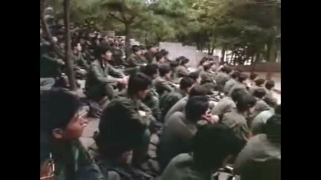
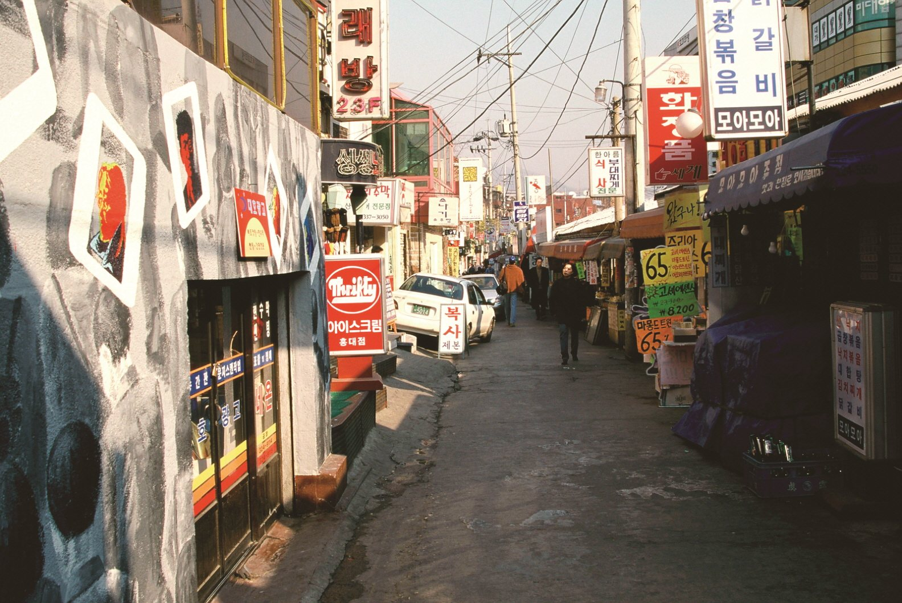
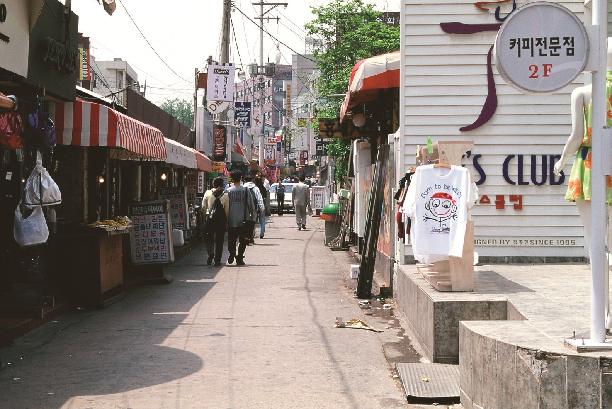

28년 전 오늘인 1998년 11월 24일, 99학년도 대학수학능력시험 가채점 분석 결과가 일제히 보도되었습니다. 시험이 쉽게 출제되면서 수험생들의 평균 점수가 전년보다 최대 30점가량 치솟았고, 사상 초유의 점수 인플레이션으로 수험생과 학부모들은 극심한 눈치작전에 직면했습니다.

## 전년 대비 20~30점 폭등한 수능 점수

1998년 11월 23일, 대성학원, 종로학원, 고려학원, 중앙교육진흥연구소 등 사설 대입전문기관들은 수능 응시자들의 답안 가채점 결과를 분석해 발표했습니다. 분석 결과 400점 만점인 수능에서 응시자들의 평균 점수가 전년보다 20점에서 30점가량 대폭 상승할 것으로 나타났습니다. 인문계 전국 평균점수는 231점에서 238점, 자연계는 241점에서 249점으로 조사되어 각각 전년보다 18~25점, 22~30점씩 상승할 것으로 예측되었습니다.

## 300점 이상만 18만 명, 쏟아진 고득점자

점수 상승 폭이 워낙 크다 보니 중상위권과 최상위권의 수험생 수가 폭발적으로 증가했습니다. 중위권 기준선인 300점 이상 수험생은 전년도 11만 명 수준에서 6만 명 이상 늘어난 17만 8천 명에서 19만 4천 명, 즉 18만 명 안팎에 달할 것으로 집계되었습니다. 350점 이상 상위권 수험생 역시 전년의 2배에 달하는 4만에서 5만 명에 이르고, 370점 이상 최상위권은 무려 3배 이상 증가한 1만에서 1만 5천 명에 달할 것으로 추정되었습니다.

*김영삼 대통령 취임 5주년 2 ... 개혁 (1997.00.00) 장면 2 — 사진: KTV 국민방송 e영상역사관 (대통령기록영상) / KTV 공공저작물 — 영상 저작물 전면 개방(대통령실 2025-07-09), 출처 표시*

## 서울대 첫 특차 도입과 치솟은 명문대 합격선

고득점자가 쏟아지자 주요 대학의 특차 및 정시모집 합격선도 유례없이 높게 형성되었습니다. 특히 99학년도 대입에서 처음으로 특차모집을 실시한 서울대의 경우, 상위권 학과 지원 합격선이 인문계 383점에서 392점, 자연계 382점에서 394점에 이를 것으로 전망되었습니다. 서울대 특차는 상위 3% 이내 성적을 요구했기 때문에 지원 가능선 자체가 인문계 362점, 자연계 367~368점 선으로 예상되었습니다. 연세대와 고려대의 상위권 학과 역시 특차 기준 인문계 375점 이상, 자연계 378점 이상이 되어야 합격이 가능할 것으로 관측되었습니다.

*홍익대학교 먹자골목 상점들(1996) — 사진: 서울역사박물관 / KOGL Type 1 (공공누리 제1유형, 출처표시)*

## 특차 원서접수 창구의 팽팽한 긴장감

가채점 결과가 발표되던 11월 23일, 각 대학에서는 99학년도 대입 특차모집 원서접수가 일제히 시작되었습니다. 경희대와 서강대 등 주요 대학 접수창구에는 이른 아침부터 수험생과 학부모들의 발길이 이어졌습니다. 점수가 크게 올랐음에도 동점자와 고득점자가 워낙 많아 합격을 장담할 수 없는 탓에, 학부모들은 원서를 접수하기 직전까지 서류를 몇 번이고 다시 꼼꼼하게 살피며 초조한 표정을 감추지 못했습니다.

*먹자골목의 모습(1996) — 사진: 서울역사박물관 / KOGL Type 1 (공공누리 제1유형, 출처표시)*

## 변별력 상실과 치열해진 눈치작전

입시 전문가들은 시험의 변별력이 크게 떨어졌다고 지적했습니다. 350점 이상 상위권 수험생들은 점수 차이가 크지 않아 논술과 면접 준비에 만전을 기해야 한다는 조언이 잇따랐습니다. 가장 혼선이 심했던 300점에서 350점대 중상위권 수험생들에게는 정시모집 4개 군 복수지원 기회 중 2개 군은 소신지원, 나머지 2개 군은 안전하게 지원하는 분산 전략이 권고되는 등 치열한 합격 작전이 펼쳐졌습니다.

## 그 시절 수험생 가족들의 기억

점수가 수십 점 올랐다는 소식에 안도했던 순간도 잠시, 쏟아져 나온 고득점자 통계에 가슴을 졸여야 했던 1998년 늦가을의 풍경은 수많은 수험생과 가족들에게 깊은 기억으로 남아 있습니다. 시험 난이도 조절과 입시 제도의 급변이 수험 현장에 미치는 영향을 뚜렷하게 보여준 대표적인 장면이었습니다.

### 참고 자료

- <https://newslibrary.naver.com/viewer/index.naver?articleId=1998112400329101001&editNo=40&printCount=1&publishDate=1998-11-24&officeId=00032&pageNo=1&printNo=16600&publishType=00010>
- <https://www.kogl.or.kr/recommend/recommendDivView.do?division=img&recommendIdx=72963>
- <https://www.ehistory.go.kr/view/movie?mediasrcgbn=KV&mediaid=2248&mediadtl=9132&mediagbn=DT#t=0.7>
- <https://museum.seoul.go.kr/archive/archiveNew/NR_archiveView.do?ctgryId=CTGRY463&type=A&upperNodeId=CTGRY464&fileSn=300&fileId=H-TRNS-86006-464>
- <https://museum.seoul.go.kr/archive/archiveNew/NR_archiveView.do?ctgryId=CTGRY463&type=A&upperNodeId=CTGRY464&fileSn=300&fileId=H-TRNS-86010-464>
