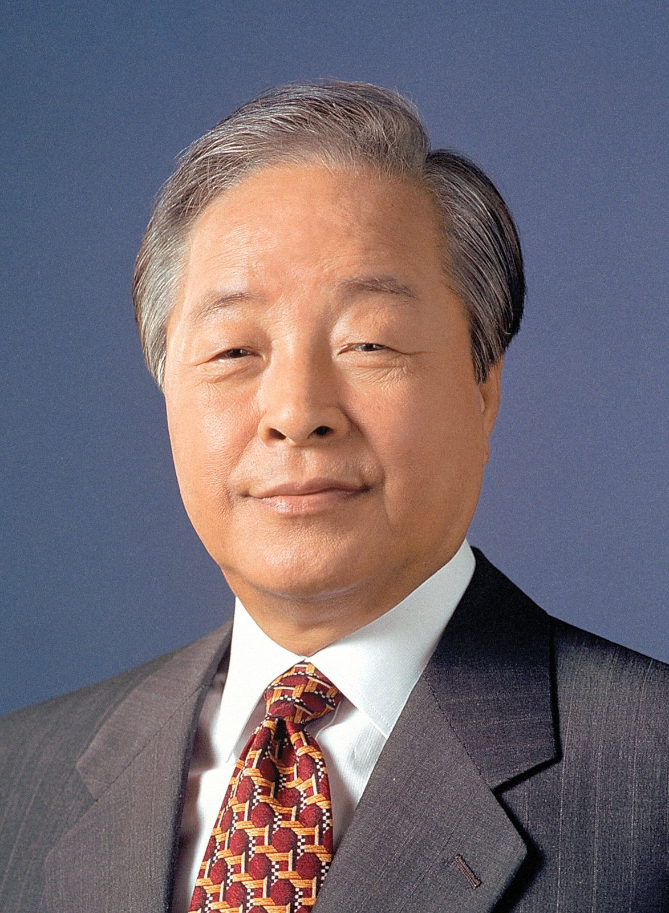
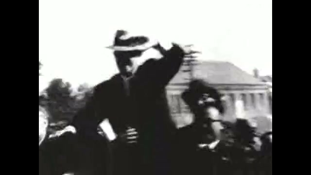

31년 전 오늘, 1995년 11월 25일 주요 조간신문 1면은 '5·18 특별법 만든다'는 대형 표제로 뒤덮였습니다. 김영삼 대통령이 전날 청와대에서 여당 지도부에 이번 정기국회 회기 안에 특별법을 제정하라고 전격 지시하면서, 정국은 거대한 소용돌이에 휩싸였습니다.

## 청와대의 전격 지시, 연내 특별법 통과 못 박아

1995년 11월 24일 낮, 김영삼 대통령은 민자당 강삼재 사무총장을 청와대로 불러 오찬을 함께하며 결단을 내렸습니다. 이번 정기국회 회기인 12월 19일 이내에 5·18 특별법을 반드시 제정하라는 공식 지시였습니다.

김 대통령은 군사쿠데타를 일으켜 국민에게 수많은 고통과 슬픔을 안겨준 당사자들을 처리하기 위해 특별법이 반드시 필요하다고 강조했습니다. 여당은 즉각 김윤환 대표 주재로 고위당직자회의를 열어 대통령의 방침을 추인하고 실무 작업에 들어갔습니다.

## 12·12부터 5·18까지, 정권 찬탈 전 과정이 수사 대상

청와대 윤여준 대변인은 이번 특별법이 5·17 비상계엄 확대에만 국한되지 않는다고 설명했습니다. 1979년 12·12 군사쿠데타부터 1980년 5·18 광주민주화운동에 이르기까지 신군부가 정권을 찬탈한 전 과정을 포괄해 다루게 될 것임을 분명히 했습니다.

처벌 대상에는 쿠데타의 핵심 주역이었던 전두환 전 대통령과 노태우 전 대통령이 직접 포함되었습니다. 아울러 정호용 당시 특전사령관과 박준병 의원 등 군 지휘관 출신 인사들도 사법처리 대상에 오르게 되었습니다.

*1993년 자료 — 사진: 대한민국 국가기록원 / KOGL Type 1*

## ‘제2의 건국’ 심정, 무너진 민족 자존심 회복 천명

김영삼 대통령은 이날 오후 수석비서관회의에서도 강력한 어조로 심경을 밝혔습니다. 군사쿠데타는 국가 최후의 보루인 군의 명예를 짓밟고 민족 자존심을 한없이 손상시킨 역사적 비극이라 규정했습니다.

어떤 경우에도 쿠데타는 정당화될 수 없으며, 제2의 건국을 하는 심정으로 결단을 내렸다고 말했습니다. 특별법 제정을 통해 이 땅에 정의와 진실, 그리고 법이 살아있음을 반드시 실증하겠다는 뜻이었습니다.

![[1912호] 제 14대 국회 개원 제 14대 국회 개원 (1992.07.01) 장면 1](../images/2026-11-25-01-3.jpg)
*[1912호] 제 14대 국회 개원 제 14대 국회 개원 (1992.07.01) 장면 1 — 사진: KTV 국민방송 e영상역사관 (미공개 대한뉴스) / KTV 공공저작물 — 영상 저작물 전면 개방(대통령실 2025-07-09), 출처 표시*

## 발칵 뒤집힌 연희동, '정치보복' 주장하며 강력 반발

특별법 제정 소식이 전해지자 서울 연희동 전두환 전 대통령 자택은 큰 충격에 휩싸였습니다. 전 전 대통령은 측근인 이양우 변호사를 통해 정부와 국회가 특별법을 강행한다면 헌정사에 씻을 수 없는 오점을 남길 것이라며 강력히 반발했습니다.

전 씨 측은 13대 국회 청문회와 1년 넘는 검찰 수사를 통해 이미 종결된 사안이라고 주장했습니다. 24일 밤에는 장세동 전 안기부장과 이 변호사가 굳은 표정으로 연희동 골목을 오가며 심야 대책 회의를 여는 모습이 언론에 포착되기도 했습니다.

*60년대 ... 유권자들 어리둥절 (1995.00.00) 장면 1 — 사진: KTV 국민방송 e영상역사관 (문화영화) / KTV 공공저작물 — 영상 저작물 전면 개방(대통령실 2025-07-09), 출처 표시*

## 역사의 법정에 선 두 전직 대통령과 그 의미

노태우 전 대통령이 이미 비자금 사건으로 구속 수감되어 있던 상황에서 나온 이번 조치는 신군부 세력 전체를 향한 단죄의 신호탄이었습니다. 야당이 요구하던 특별검사제 도입은 받아들여지지 않았으나, 여당 내 율사 출신 의원들을 중심으로 법안 성안 작업이 일사천리로 추진되었습니다.

이날의 전격적인 지시는 훗날 두 전직 대통령이 나란히 법정에 서서 중형을 선고받는 역사적 재판으로 이어졌습니다. 1995년 11월 25일의 지면은 불법적인 권력 찬탈에 대한 공소시효를 넘어서 역사의 정의를 바로 세우고자 했던 결정적인 전환점으로 기억되고 있습니다.

### 참고 자료

- <https://newslibrary.naver.com/viewer/index.naver?articleId=1995112500209101001&editNo=45&printCount=1&publishDate=1995-11-25&officeId=00020&pageNo=1&printNo=23036&publishType=00010>
- <https://commons.wikimedia.org/wiki/File:Photograph_of_President_William_J._Clinton_Jogging_with_South_Korean_President_Kim_Young-sam_in_Seoul,_South_Korea_-_DPLA_-_db397cf78942930170d611051ed97b6c.jpg>
- <https://commons.wikimedia.org/wiki/File:Kim_Young-sam_presidential_portrait.jpg>
- <https://www.ehistory.go.kr/view/movie?mediasrcgbn=KV&mediaid=30000439&mediadtl=43398&mediagbn=DK#t=0.3>
- <https://www.ehistory.go.kr/view/movie?mediasrcgbn=KV&mediaid=1159&mediadtl=7304&mediagbn=MH#t=0.3>
