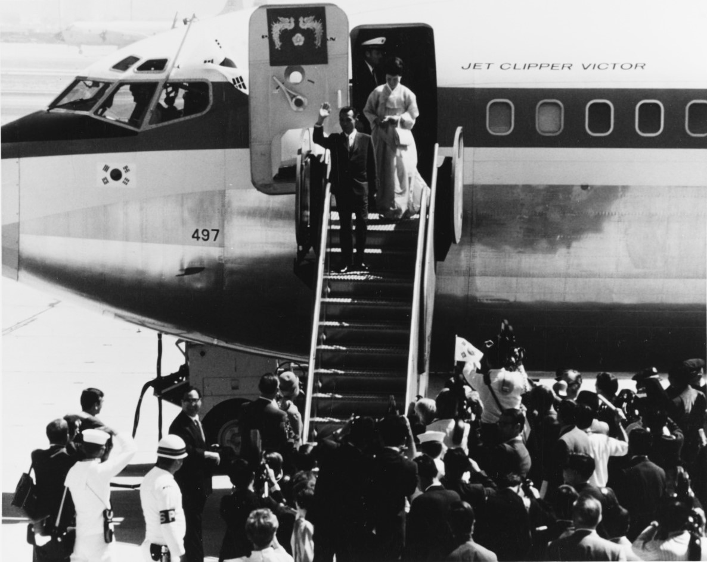
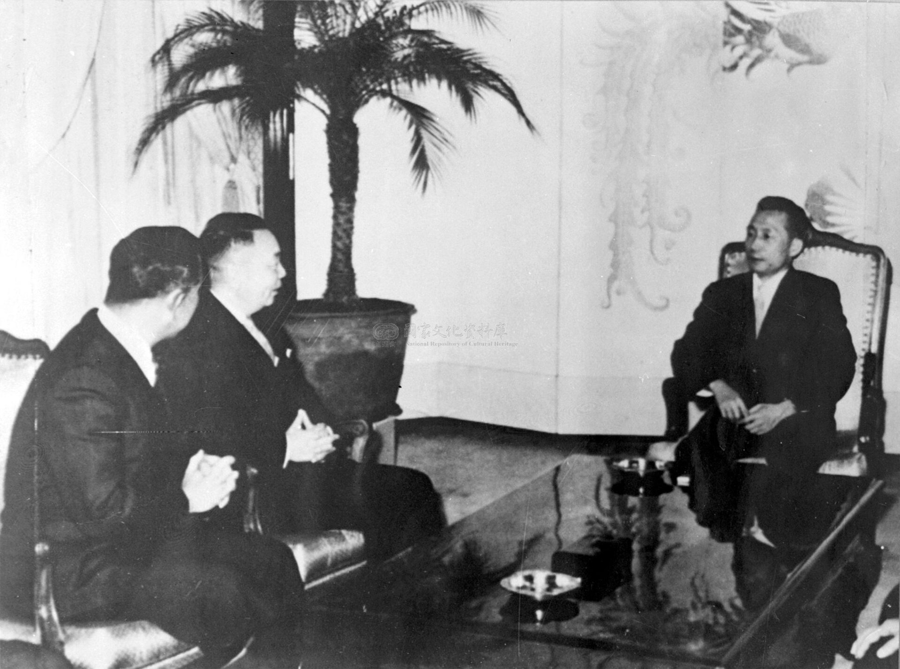
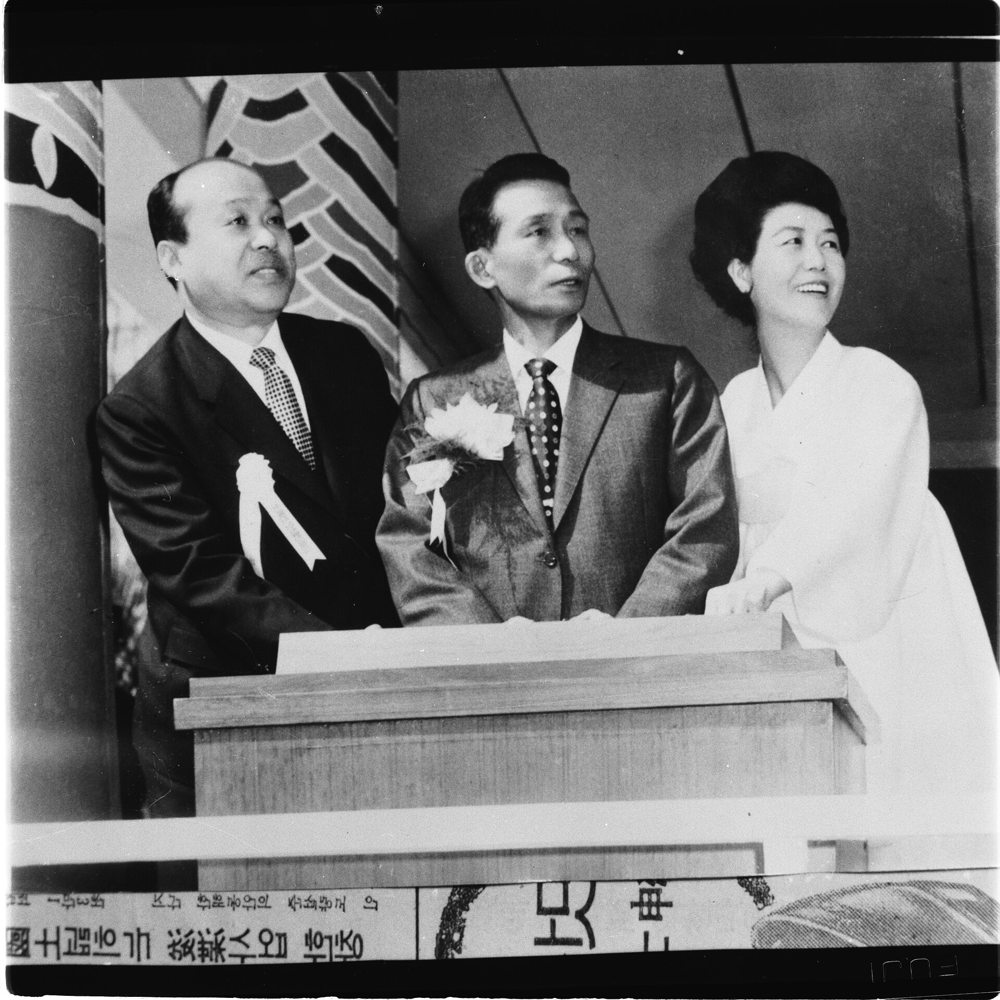

54년 전 오늘, 1972년 11월 25일. 강원도 춘천의 깊은 골짜기에서 동양 최대 규모를 자랑하는 소양강 다목적댐이 마침내 물을 채우기 시작했습니다. 거친 자연의 물길을 막아 거대한 인공 호수를 만드는 대역사가 결실을 맺은 순간이었습니다.

## 물난리와 가뭄에 시달리던 시절의 결단

과거 한강 유역은 여름철 집중호우가 쏟아질 때마다 극심한 홍수 피해를 겪었고, 봄철 갈수기에는 메마른 땅과 용수 부족으로 고통받았습니다. 수도 서울과 경인 공업지역이 빠르게 팽창하던 당시, 안정적인 수자원 확보와 홍수 조절은 나라의 미래가 걸린 절체절명의 과제였습니다. 정부는 한강과 낙동강 등 4대강 유역 개발을 추진하며 북한강 최대 지류인 소양강에 대규모 다목적댐을 세우기로 결정했습니다.

## 1972년 11월 25일, 역사적인 담수식

공사가 시작된 지 5년 6개월 만인 1972년 11월 25일 오전, 강원도 춘성군 신북면 천전리 현장에서 마침내 소양강댐 담수식이 거행되었습니다. 춘천시에서 동북쪽으로 12킬로미터 떨어진 공사 현장에는 정부 관계자들과 공사를 이끈 기술자들, 그리고 삶의 터전을 내어준 수몰지구 주민들이 대거 참석했습니다. 물길을 돌리기 위해 뚫어두었던 가배수 터널이 완전히 닫히자, 소양강의 푸른 물줄기가 거대한 제방 앞에 멈춰 서며 서서히 차오르기 시작했습니다.

*사건 당시 사진 아님 · 1969년 — 사진: National Archive / Public domain*

## 인간의 강한 의지로 자연을 극복하다

이날 담수식에 참석한 박정희 대통령은 치사를 통해 자연에 대한 인간의 도전과 의지를 높이 평가했습니다. 박 대통령은 우리가 가진 좋은 점을 잘 보전하고 비능률과 비생산을 추방하여 조국을 부강하게 만들어야 한다고 강조했습니다. 아울러 동양 최대의 댐을 순수한 우리 기술진의 손으로 만들어낸 점을 치하하며, 공사를 맡은 건설부와 수자원개발공사, 현대건설 관계자 및 아낌없이 협조해 준 현지 주민들에게 감사를 전했습니다.

*사건 당시 사진 아님 · 1969년 — 사진: 中央通訊社 / Public domain*

## 29억 톤의 물을 품은 동양 최대의 사력댐

소양강댐은 높이 123미터, 길이 530미터에 달하는 거대한 흙과 돌로 쌓아 올린 사력댐입니다. 댐이 가둘 수 있는 총저수용량은 29억 톤에 이르렀고, 홍수조절용량만 해도 3억 5천만 톤에 달했습니다. 또한 댐 유역면적은 2천7백3제곱킬로미터에 달했으며, 20만 킬로와트 용량의 수력발전 시설까지 갖추어 당시 국내 수력 발전사에 획기적인 이정표를 세웠습니다.

*사건 당시 사진 아님 · 1971년 — 사진: 서울역사박물관 / KOGL Type 1*

## 수도권의 젖줄이자 산업화의 든든한 버팀목

소양강댐에 물이 차오르면서 한강 하류의 서울과 인천 등 수도권 지역은 홍수의 공포에서 벗어날 수 있게 되었습니다. 갈수기에도 균일한 수량을 방류함으로써 수도권 주민들의 상수도와 공업용수, 농업용수를 사계절 내내 안정적으로 공급받는 길이 열렸습니다. 댐에서 생산된 풍부한 전력은 공장들의 기계를 돌리며 대한민국 경제 성장을 뒷받침하는 핵심 원동력이 되었습니다.

## 반세기가 흐른 지금도 흐르는 생명의 물길

소양강댐이 물을 담기 시작한 지 반세기가 넘는 세월이 흘렀습니다. 댐이 만들어낸 소양호는 오늘날에도 수도권 수천만 시민의 생명수를 책임지는 든든한 보루로 그 자리를 지키고 있습니다. 흙과 바위를 날라 거대한 물길을 다스렸던 그 시절의 땀방울은 오늘날 우리가 누리는 일상의 든든한 밑거름이 되어 흐르고 있습니다.

### 참고 자료

- <https://newslibrary.naver.com/viewer/index.naver?articleId=1972112500329201015&editNo=2&printCount=1&publishDate=1972-11-25&officeId=00032&pageNo=1&printNo=8358&publishType=00020>
- <https://commons.wikimedia.org/wiki/File:1971%EB%85%84_%ED%95%9C%EA%B5%AD_7%EB%8C%80_%EB%8C%80%ED%86%B5%EB%A0%B9_%EC%B7%A8%EC%9E%84%EC%8B%9D.jpg>
- <https://commons.wikimedia.org/wiki/File:President_Park_Chung-hee_and_his_wife_descend_from_a_Pan_Am_707_at_NAS_Moffett_Field.jpg>
- <https://commons.wikimedia.org/wiki/File:%E8%94%A3%E7%B6%93%E5%9C%8B%E9%83%A8%E9%95%B7%E6%8B%9C%E6%9C%83%E6%9C%B4%E6%AD%A3%E7%86%99%E7%B8%BD%E7%B5%B1.jpg>
- <https://commons.wikimedia.org/wiki/File:%EC%A7%80%ED%95%98%EC%B2%A0_%EA%B1%B4%EC%84%A4_%EC%B0%A9%EA%B3%B5%EC%8B%9D%EC%97%90_%EC%B0%B8%EC%84%9D%ED%95%9C_%EB%B0%95%EC%A0%95%ED%9D%AC_%EB%8C%80%ED%86%B5%EB%A0%B9_%EB%82%B4%EC%99%B8_(1971._4._12).jpg>
