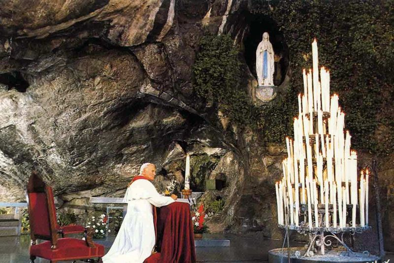
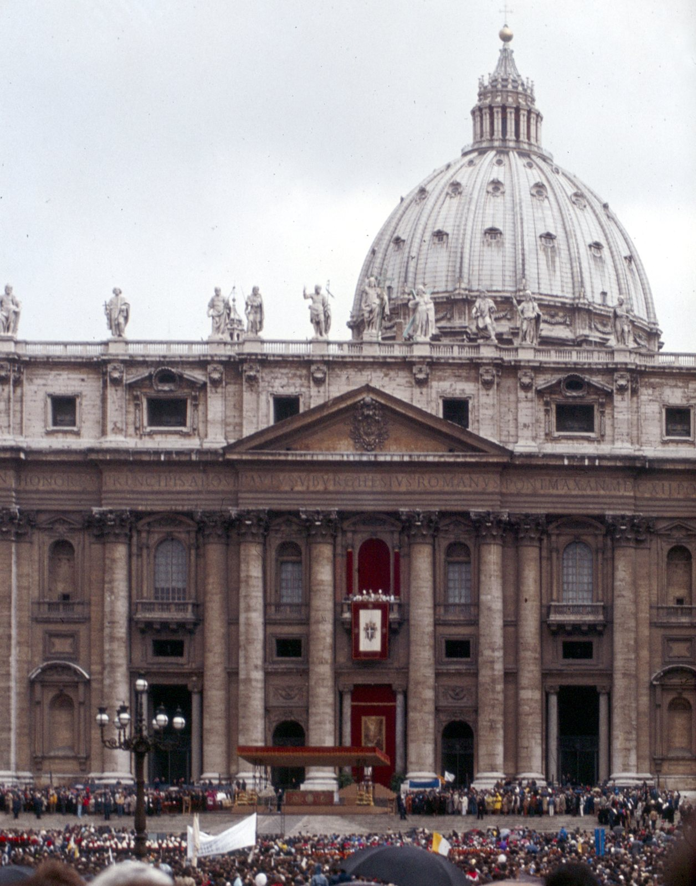
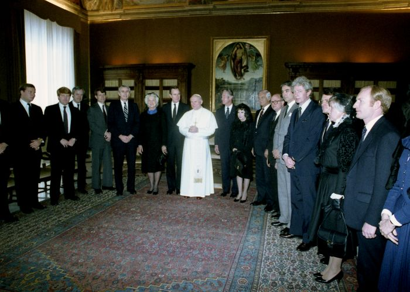

43년 전 오늘, 1983년 11월 25일. 로마 교황 요한 바오로 2세의 대한민국 방문 일정이 전격 발표되었습니다. 한국 천주교 역사 200년 만에 교황이 이 땅을 찾는다는 역사적인 소식이었습니다.

## 정부와 교회의 동시 공식 발표

1983년 11월 25일 정오, 황선필 청와대 대변인은 교황 요한 바오로 2세가 전두환 대통령의 초청으로 1984년 5월 3일부터 7일까지 4박 5일간 한국을 공식 방문한다고 발표했습니다. 정부는 교황을 세계 평화와 화합의 사도로서 맞이할 것이며, 이번 방한이 한국 천주교회의 오랜 숙원을 이루는 계기가 될 것이라고 설명했습니다. 같은 시각, 한국천주교주교회의 의장 김수환 추기경 역시 서울대교구청 회의실에서 기자회견을 열고 주교단 초청에 따른 교황의 사목 방문 일정을 공식 천명했습니다.

## 한국 천주교 선교 200주년과 103위 시성식

이번 방한의 가장 중요한 배경은 바로 1984년에 맞이하는 한국 천주교 선교 200주년이었습니다. 교황 요한 바오로 2세는 체한 기간 중 서울 여의도 광장에서 열리는 대규모 기념 미사에 참석해 신앙을 위해 목숨을 바친 103위 한국 순교복자의 시성식을 직접 집전하기로 했습니다. 로마 바티칸이 아닌 선교 현지에서 교황이 직접 시성식을 거행하는 것은 가톨릭 역사상 전례를 찾기 힘든 파격적인 조치였으며, 한국 교회에 대한 교황청의 각별한 애정을 보여주는 상징이었습니다.

*JPII Lourdes — 사진: Ireneed / CC BY-SA 3.0*

## 소외된 이웃을 찾아오는 평화의 사자

김수환 추기경은 이날 회견에서 교황의 방문이 단순한 의전 행사가 아닌 참된 사목 방문임을 분명히 했습니다. 김 추기경은 물질주의와 비인간화로 고통받는 현대 세계에 교황이 사랑과 진리, 정의와 희망을 전해왔음을 상기시켰습니다. 특히 병들고 가난한 이들, 감옥에 갇힌 사람들과 같이 보통 때는 기쁨을 누리기 힘든 소외된 이웃을 찾아 위로하는 데 이번 방한의 깊은 뜻이 있다고 강조했습니다. 아울러 분단 상황에 놓인 한반도의 현실 속에서 북한과 공산권 지역의 박해받는 신자들에게도 희망의 빛을 줄 것으로 기대했습니다.

*Rom-Petersplatz-34-Balkon mit Papst Johannes Paul II-1983-gje — 사진: Gerd Eichmann / CC BY-SA 4.0*

## 방한 일정의 윤곽과 국내외의 들뜬 반응

발표 당시 공개된 일정에 따르면 교황은 4박 5일 동안 서울뿐 아니라 광주와 대구 등 주요 지방 도시를 순례할 계획을 세웠습니다. 광주에서는 불우한 환자와 농민들을 만나고, 대구에서는 공장 근로자들을 찾아 격려하는 등 현장 중심의 일정이 예고됐습니다. 또한 한국인 최초의 사제인 김대건 신부의 탄생지인 솔뫼 성지 순례와 타종교 지도자들과의 접견도 논의되었습니다. 당시 취임 이후 36번째 해외 방문이자 아시아에서는 세 번째였던 교황의 방한을 취재하기 위해 전용기에 동승하는 60~70명의 기자를 포함해 전 세계에서 1천5백여 명의 외신기자가 입국할 것으로 예상되며 국제적인 관심이 집중되었습니다.

*George H. W. Bush, Barbara Bush, and others meet with Pope John Paul II at the Vatican — 사진: Credit: George H.W. Bush Presidential Library and Museum / Public domain*

## 역사의 한 페이지로 남은 평화의 발걸음

1983년 11월 25일에 울려 퍼진 교황 방한 소식은 정치적 갈등과 사회적 격변 속에서 지쳐 있던 국민들에게 커다란 위로와 설렘으로 다가왔습니다. 정부 당국 역시 7억 5천만 명에 달하는 전 세계 가톨릭 신자들에게 한국의 현실을 알리고 국제사회에서 한국의 정신적 위상을 높이는 중대한 전기가 될 것으로 평가했습니다. 이날의 발표는 이듬해 5월 온 나라를 평화와 화해의 물결로 물들였던 역사적 순간의 서막이었습니다.

### 참고 자료

- <https://newslibrary.naver.com/viewer/index.naver?articleId=1983112500209201005&editNo=2&printCount=1&publishDate=1983-11-25&officeId=00020&pageNo=1&printNo=19122&publishType=00020>
- <https://commons.wikimedia.org/wiki/File:Estelle_JPII2.jpg>
- <https://commons.wikimedia.org/wiki/File:JPII_Lourdes.jpg>
- <https://commons.wikimedia.org/wiki/File:Rom-Petersplatz-34-Balkon_mit_Papst_Johannes_Paul_II-1983-gje.jpg>
- <https://commons.wikimedia.org/wiki/File:George_H._W._Bush,_Barbara_Bush,_and_others_meet_with_Pope_John_Paul_II_at_the_Vatican.jpg>
