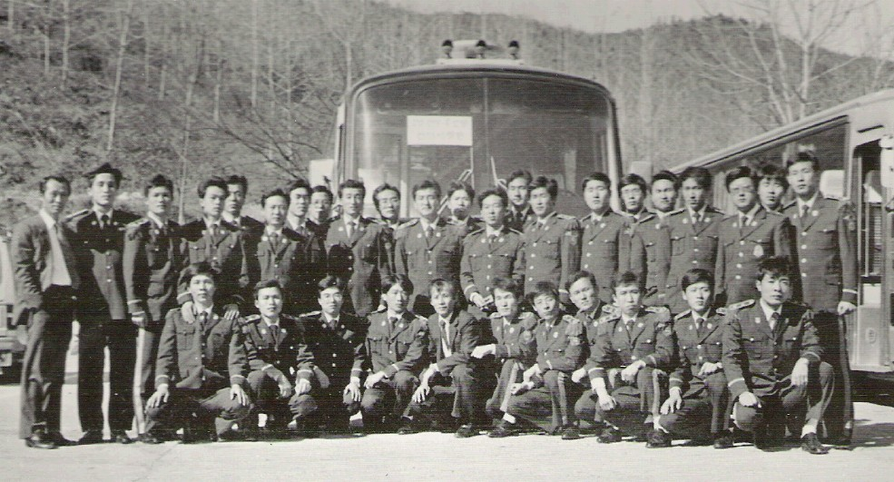

40년 전 오늘, 1986년 11월 25일. 문교부가 대학 입시를 시험 성적을 확인하고 지원하던 기존 방식에서, 대학을 먼저 지원하고 시험을 치르는 '선지원 후시험'으로 전면 개편한다고 발표했습니다. 점수를 모른 채 먼저 원서를 내야 했던 이 제도는 당시 수험생과 학부모들에게 커다란 변화를 가져왔습니다.

## 극심했던 눈치작전과 졸업정원제의 그늘

1980년대 초중반 대입 학력고사는 먼저 시험을 치른 뒤 성적표를 받아 들고 지원 대학을 선택하는 '선시험 후지원' 체제였습니다. 수험생들은 1점 단위로 촘촘하게 매겨진 점수를 들고 합격 가능한 대학과 학과를 저울질했습니다. 원서 접수 마감 시한이 다가올 때마다 대학교 접수 창구 앞에는 경쟁률을 살피며 마지막 순간까지 눈치작전을 벌이는 진풍경이 벌어졌습니다. 여기에 1981학년도부터 도입된 '대학 졸업정원제'는 또 다른 고통이었습니다. 정원의 130퍼센트를 선발한 뒤 졸업 정원에 맞춰 일정 비율의 학생을 강제로 탈락시키는 제도로 인해, 대학에 들어가서도 학생들은 학점 경쟁과 탈락의 공포에 시달려야 했습니다.

## 1986년 11월 25일, 문교부의 전격 발표

1986년 11월 25일 손제석 문교부 장관은 서울 세종로 정부종합청사에서 대학입학제도 개선방안을 공식 발표했습니다. 개편안의 핵심은 1988학년도 대학 입시부터 현행 선시험 후지원 방식을 대학별 '선지원 후시험' 방식으로 전환하는 것이었습니다. 이 제도는 당시 고등학교 2학년 학생들부터 곧바로 적용되었습니다. 아울러 전두환 대통령은 이날 청와대 영빈관에서 열린 교육개혁심의회 확대회의에서 자질 부족자 양산과 면학 분위기 저해 등 부작용을 지적하며 졸업정원제를 폐지하고 입학정원제로 환원할 것을 지시했습니다.

*1986년 제5기 소방간부후보생 일동32 — 사진: 최광모 / CC BY-SA 4.0*

## 전국 공통 출제와 대학별 고사 관리

개선안에 따르면 학력고사 출제는 과목 편중 등 부작용을 막기 위해 중앙교육평가원이 전국 공통으로 맡았습니다. 다만 시험 관리는 전국의 각 대학교가 자율적으로 진행하도록 했습니다. 시험은 전기와 후기로 나뉘어 수험생이 지원한 대학의 고사장에서 직접 치러졌습니다. 총점과 문항별 배점, 과목별 가중치 적용 여부는 각 대학에 일임되었습니다. 시험 과목은 기존 9개 과목 체제를 유지하되, 객관식 위주에서 벗어나 주관식 문제를 혼합 출제하도록 했습니다.

![[1568호] 1986년도 대입 학력고사 1986년도 대입 학력고사 (1985.11.22) 장면 1](../images/2026-11-25-05-3.jpg)
*[1568호] 1986년도 대입 학력고사 1986년도 대입 학력고사 (1985.11.22) 장면 1 — 사진: KTV 국민방송 e영상역사관 (대한뉴스) / KTV 공공저작물 — 영상 저작물 전면 개방(대통령실 2025-07-09), 출처 표시*

## 논술고사 폐지와 내신 30% 이상 의무 반영

전형 요소에도 큰 변화가 있었습니다. 각 대학이 개별적으로 치르던 대입 논술고사는 1988학년도부터 전면 폐지하기로 결정되었습니다. 대신 사정 기준은 학력고사 성적과 고교 내신 성적, 면접 및 구술고사로 단순화되었습니다. 특히 고교 교육 정상화를 위해 고등학교 내신 성적 반영 비율을 최소 30퍼센트 이상 의무화하도록 못 박았습니다. 제2외국어 기피 현상을 막기 위해 각 대학에 선택과목 가산점 제도 도입을 적극적으로 권장하기도 했습니다.

![[1366호] 중.고등학생 교복 머리형 자율화 중.고등학생 교복 머리형 자율화 (1982.01.09) 장면 1](../images/2026-11-25-05-4.jpg)
*[1366호] 중.고등학생 교복 머리형 자율화 중.고등학생 교복 머리형 자율화 (1982.01.09) 장면 1 — 사진: KTV 국민방송 e영상역사관 (대한뉴스) / KTV 공공저작물 — 영상 저작물 전면 개방(대통령실 2025-07-09), 출처 표시*

## 졸업정원제 폐지와 수험생들의 추억

입학생 초과 모집에 따른 강제 탈락 제도가 사라지면서 대학가는 오랜 혼란을 덜게 되었습니다. 기존 재학생들에 대해서는 전원에게 졸업자격고사를 실시하는 등 구제 경과 조치가 마련되었습니다. 반면 선지원 후시험 제도는 자신의 실제 점수를 모른 채 학교를 정해야 했기에, 수험생들에게 또 다른 소신 지원과 배짱 지원의 갈림길을 안겼습니다. 그 시절 추운 겨울 아침, 수험표를 쥐고 지원한 대학교 교정을 찾아가 떨리는 가슴으로 시험을 치렀던 기억은 1980년대 후반을 지나온 세대들의 마음에 깊은 흔적으로 남아 있습니다.

### 참고 자료

- <https://newslibrary.naver.com/viewer/index.naver?articleId=1986112500329201004&editNo=2&printCount=1&publishDate=1986-11-25&officeId=00032&pageNo=1&printNo=12667&publishType=00020>
- <https://commons.wikimedia.org/wiki/File:Margaret_Thatcher_visits_POSTECH.jpg>
- <https://commons.wikimedia.org/wiki/File:1986%EB%85%84_%EC%A0%9C5%EA%B8%B0_%EC%86%8C%EB%B0%A9%EA%B0%84%EB%B6%80%ED%9B%84%EB%B3%B4%EC%83%9D_%EC%9D%BC%EB%8F%9932.jpg>
- <https://www.ehistory.go.kr/view/movie?mediasrcgbn=KV&mediaid=10934&mediadtl=23737&mediagbn=DH#t=0.3>
- <https://www.ehistory.go.kr/view/movie?mediasrcgbn=KV&mediaid=10323&mediadtl=21916&mediagbn=DH#t=0.3>
