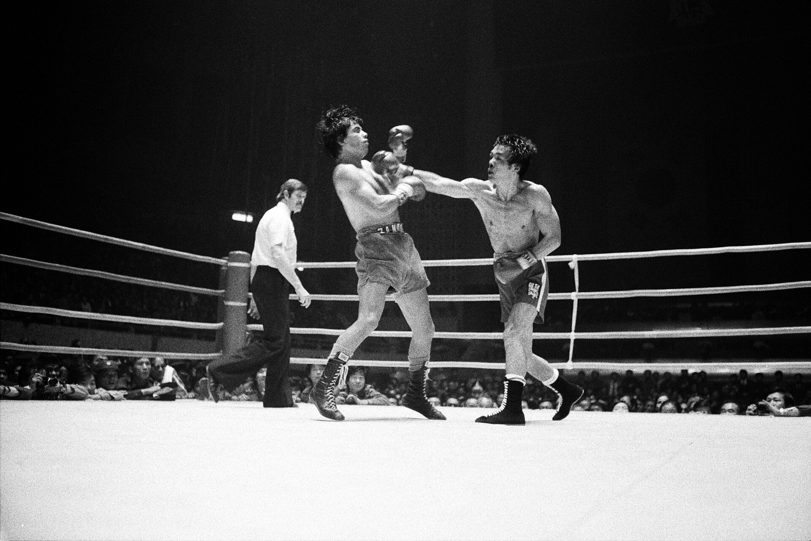
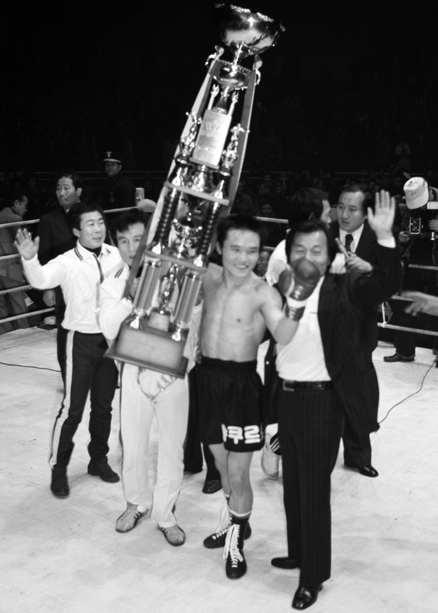
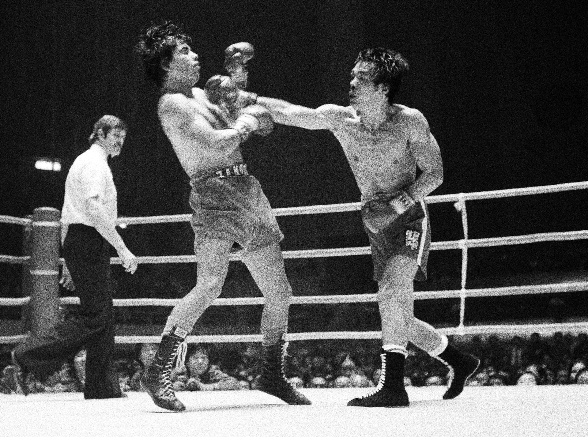

50년 전 오늘, 1976년 11월 25일. 프로복서 염동균 선수가 세계복싱평의회(WBC) 슈퍼밴텀급 챔피언에 올랐다는 낭보가 전국에 울려 퍼졌습니다. 전날 밤 서울 장충체육관에서 열린 세계선수권쟁탈전에서 챔피언인 일본의 로열 고바야시를 15회 판정으로 누르고 당당히 세계 왕좌를 거머쥐었습니다.

## 부산의 한을 씻어낸 115일 만의 재도전

염동균 선수의 이번 타이틀 획득은 단순한 승리 그 이상의 의미를 지니고 있었습니다. 경기 불과 115일 전, 부산에서 벌어졌던 경기에서 염동균 선수는 석연치 않은 판정 시비 사건을 겪으며 통한의 눈물을 흘려야 했습니다.

그 한 많은 억울함을 가슴에 묻은 채 염동균 선수는 묵묵히 훈련에 매진했습니다. 온 국민의 안타까움과 응원 속에서 다시 링에 오를 기회를 잡은 염 선수는 챔피언 벨트를 되찾겠다는 굳은 각오로 1976년 11월 24일 밤 결전의 무대에 올랐습니다.

## 장충체육관을 뒤흔든 15라운드의 수싸움

도전자 염동균이 상대해야 했던 챔피언은 55.34킬로그램 한계 체중의 슈퍼밴텀급 정상에 군림하던 일본의 로열 고바야시였습니다. 고바야시는 시작부터 거센 양훅을 앞세워 거칠게 몰아붙였습니다.

하지만 염동균 선수는 흔들리지 않았습니다. 상대의 거친 난타전 유도에 말려들지 않고, 경쾌한 풋워크로 거리를 유지하며 링을 넓게 활용했습니다. 상대가 주먹을 휘두를 때마다 상체를 절묘하게 숙이는 더킹 기술로 양훅을 무력화시켰고, 틈이 보일 때마다 착실하게 유효타를 꽂아 넣으며 득점을 차곡차곡 쌓아나갔습니다.

*프로복싱 WBC 밴텀급 타이틀매치 홍수환 대 자모라 경기 — 사진: 대한민국 정부 / Public domain*

## 일본 심판마저 손을 들어준 명백한 판정승

치열하게 이어진 공방전은 마침내 마지막 15라운드의 종료 공이 울릴 때까지 계속되었습니다. 판정의 순간, 관중들의 시선은 일제히 링 위의 심판들에게 쏠렸습니다.

채점 결과는 염동균 선수의 분명한 우세였습니다. 일본인 주심 요시다 씨는 146대 146으로 동점을 매겼으나, 일본인 부심 모리타 씨가 148대 146으로 염동균 선수의 우세를 선언했습니다. 여기에 한국의 최영춘 부심 역시 148대 144로 염 선수의 손을 들어주며 2대 0 판정승이 확정되었습니다. 일본인 심판조차 염동균 선수의 기량을 인정하지 않을 수 없었던 완벽한 경기 운영이었습니다.

*Dong-Kyun Yum — 사진: 대한민국 정부 / Public domain*

## 한국 프로복싱 사상 네 번째 세계 챔피언

이로써 염동균 선수는 대한민국 프로복싱 역사에 찬란한 이정표를 하나 더 세우게 되었습니다. 한국 프로복싱 사상 김기수, 홍수환, 유제두 선수에 이어 역대 네 번째 세계 챔피언의 영예를 차지한 것입니다.

1970년대 복싱은 온 국민이 텔레비전과 라디오 앞에 모여 숨을 죽이고 지켜보던 최고의 인기 스포츠였습니다. 거친 링 위에서 투혼을 발휘해 세계 정상에 우뚝 선 복서들의 승리는 고단한 일상을 살아가던 국민들에게 크나큰 위로와 자긍심을 안겨주었습니다.

*Alfonso Zamora vs. Soo-Hwan Hong — 사진: 대한민국 정부 / Public domain*

## 그 시절 링 위의 열정과 환호

15라운드 내내 쉼 없이 뛰며 주먹을 피하고 날리던 프로복싱 세계타이틀 매치는 그 자체로 한 편의 드라마였습니다. 장충체육관을 가득 메운 함성과 라디오 중계에 귀를 기울이던 사람들의 탄성은 승리의 순간 거대한 환호로 바뀌었습니다.

부산의 억울한 판정 시비를 딛고 정확히 115일 만에 실력으로 세계 정상에 오른 염동균 선수. 그의 끈기와 집념이 일궈낸 이 빛나는 승전보는 50년이 지난 지금도 한국 스포츠의 가슴 벅찬 명장면으로 기억되고 있습니다.

### 참고 자료

- <https://newslibrary.naver.com/viewer/index.naver?articleId=1976112500209201013&editNo=2&printCount=1&publishDate=1976-11-25&officeId=00020&pageNo=1&printNo=16969&publishType=00020>
- <https://commons.wikimedia.org/wiki/File:%ED%94%84%EB%A1%9C%EB%B3%B5%EC%8B%B1_WBC_%EC%8A%88%ED%8D%BC%EB%B0%B4%ED%85%80%EA%B8%89_%EC%B1%94%ED%94%BC%EC%96%B8_%ED%83%80%EC%9D%B4%ED%8B%80%EC%9D%84_%ED%9A%8D%EB%93%9D%ED%95%9C_%EC%97%BC%EB%8F%99%EA%B7%A0_%EC%84%A0%EC%88%98.jpg>
- <https://commons.wikimedia.org/wiki/File:%ED%94%84%EB%A1%9C%EB%B3%B5%EC%8B%B1_WBC_%EB%B0%B4%ED%85%80%EA%B8%89_%ED%83%80%EC%9D%B4%ED%8B%80%EB%A7%A4%EC%B9%98_%ED%99%8D%EC%88%98%ED%99%98_%EB%8C%80_%EC%9E%90%EB%AA%A8%EB%9D%BC_%EA%B2%BD%EA%B8%B0.jpg>
- <https://commons.wikimedia.org/wiki/File:Dong-Kyun_Yum.jpg>
- <https://commons.wikimedia.org/wiki/File:Alfonso_Zamora_vs._Soo-Hwan_Hong.jpg>
