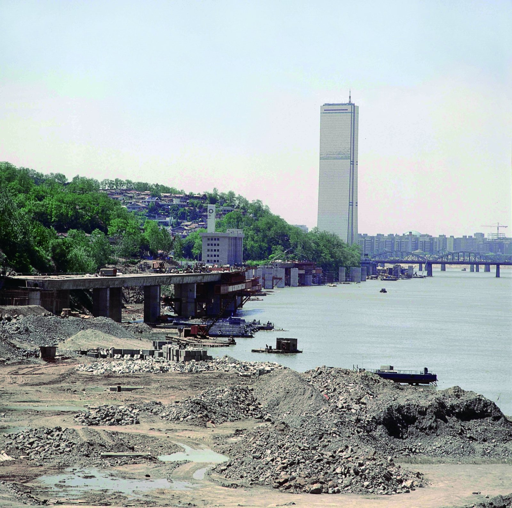
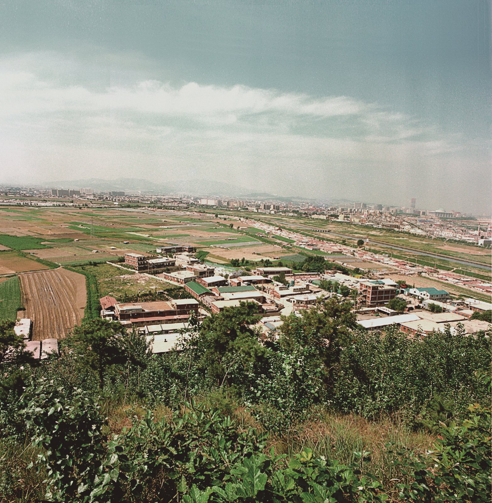

40년 전 오늘, 1986년 11월 26일. 대한민국 정부는 북한의 금강산댐 수공 위협에 대응하기 위해 휴전선 이남 북한강 상류에 거대한 대응댐을 건설하겠다고 전격 발표했습니다. 이 댐에 붙은 이름은 바로 ‘평화의 댐’이었습니다.

## 핵무기보다 무섭다는 ‘200억 톤 수공’ 공포

1986년 가을, 온 나라는 북한이 금강산 일대에 건설 중인 대형 댐 소식으로 발칵 뒤집혔습니다. 당시 정부는 북한이 금강산댐을 고의로 무너뜨려 최대 200억 톤에 달하는 물폭탄을 쏟아붓는 수공 작전을 펼칠 수 있다고 주장했습니다.

정부의 설명은 구체적이고도 끔찍했습니다. 댐이 터지면 거대한 물결이 하류로 덮쳐 서울 여의도 63빌딩 중턱까지 물이 차오를 수 있으며, 그 파괴력은 핵무기보다 치명적이라는 경고였습니다. 1988년 서울 올림픽 개최를 앞두고 있던 국민들에게 이는 막대한 불안과 공포로 다가왔습니다.

## 정부종합청사 회의실에 모인 4개 부처 장관들

1986년 11월 26일 오전 10시, 서울 정부종합청사 회의실에서 관계 4부 장관의 긴급 합동 기자회견이 열렸습니다. 이기백 국방부 장관, 이규효 건설부 장관, 이웅희 문화공보부 장관, 허문도 국토통일원 장관이 나란히 자리했습니다.

장관들은 합동 담화문을 낭독하며 "북한측이 건설하고 있는 금강산댐의 가공할 위협으로부터 우리 스스로를 지켜내는 정당한 국가보위상의 자위조치로 대응댐을 건설하기로 결정했다"고 밝혔습니다. 북한 측에 댐 건설 중지를 거듭 촉구하면서도, 공사를 강행할 경우 자위적 대응이 불가피함을 분명히 했습니다.

![[1607호] 한강개발 되살아난 민족의 젖줄 한강개발 (1986.08.22) 장면 2](../images/2026-11-26-01-2.jpg)
*[1607호] 한강개발 되살아난 민족의 젖줄 한강개발 (1986.08.22) 장면 2 — 사진: KTV 국민방송 e영상역사관 (대한뉴스) / KTV 공공저작물 — 영상 저작물 전면 개방(대통령실 2025-07-09), 출처 표시*

## 6천억 원 투입 계획과 ‘국민 참여’의 언급

정부가 발표한 대응댐의 위치는 북한 금강산댐 파괴 시 피해를 최소화할 수 있는 강원도 화천군 화천댐 상류였습니다. 댐의 규모는 높이 190미터에서 200미터, 길이 약 1,100미터로 잡혔으며, 사업비는 약 6,000억 원이 소요될 것으로 추산되었습니다. 연내 타당성 조사에 착수해 1994년이나 1995년경 완공한다는 청사진이었습니다.

기자들과의 일문일답에서 장관들은 "댐 건설비는 원칙적으로 정부 예산으로 충당하겠지만, 국민들의 자발적인 참여가 있다면 이를 최대한 수용할 것"이라고 밝혔습니다. 또한 북한 댐이 완전히 무너지더라도 화천댐 이북에서 물을 막아내 수도권을 100퍼센트 지켜낼 수 있다고 강조했습니다.

*노량대교 건설 공사 — 사진: 서울역사박물관 / KOGL Type 1 (공공누리 제1유형, 출처표시)*

## 온 국민을 울린 성금 모금과 훗날 밝혀진 진실

합동 담화문 발표 직후, 전국적으로 전례 없는 대규모 모금 운동이 번져 나갔습니다. 코묻은 돼지저금통을 들고 온 초등학생부터 쌈짓돈을 내놓은 노인, 할당된 금액을 낸 기업들까지 약 639억 원에 달하는 성금이 모였습니다. 평화의 댐은 1987년 2월 착공되어 1989년 높이 80미터 규모의 1단계 공사를 마쳤습니다.

그러나 1993년 문민정부 출범 후 감사원의 감사 결과, 당시 제5공화국 정권이 발표했던 금강산댐의 수공 위협은 지나치게 과장되었던 것으로 밝혀졌습니다. 실제 북한 금강산댐의 최대 저수 용량은 발표된 200억 톤에 턱없이 못 미치는 수준이었고, 63빌딩 중턱 침수 주장 역시 현실성이 결여된 정보였습니다. 정권 유지를 위해 위기감을 부풀렸다는 거센 비판과 함께 '대국민 사기극'이라는 오명이 붙었습니다.

*목동 신시가지 개발 전 모습 — 사진: 서울역사박물관 / KOGL Type 1 (공공누리 제1유형, 출처표시)*

## 오늘날 북한강을 지키는 홍수조절 댐으로

정치적 논란과 비판의 세월을 겪었지만, 지어진 댐은 다른 방식으로 제 몫을 해냈습니다. 평상시에는 물을 채우지 않는 건류댐으로 운영되다가, 1996년과 1999년의 집중호우 당시 북한강 상류의 거센 물길을 막아내며 화천댐과 하류 지역의 범람을 막는 결정적 역할을 했습니다.

이후 2002년 북한 금강산댐의 안전 문제로 방류가 이어지자 정부는 2단계 증축 공사를 거쳐 2005년 높이 125미터로 댐을 완성했습니다. 1986년 그 긴박했던 겨울날, 텔레비전 화면을 가득 채웠던 4부 장관의 담화와 온 국민의 성금 기억은 여전히 한국 현대사의 잊지 못할 한 페이지로 남아 있습니다.

### 참고 자료

- <https://newslibrary.naver.com/viewer/index.naver?articleId=1986112600329201004&editNo=2&printCount=1&publishDate=1986-11-26&officeId=00032&pageNo=1&printNo=12668&publishType=00020>
- <https://www.ehistory.go.kr/view/movie?mediasrcgbn=KV&mediaid=11065&mediadtl=24447&mediagbn=DH#t=0.3>
- <https://www.ehistory.go.kr/view/movie?mediasrcgbn=KV&mediaid=11065&mediadtl=24447&mediagbn=DH#t=0.7>
- <https://museum.seoul.go.kr/archive/archiveNew/NR_archiveView.do?ctgryId=CTGRY772&type=B&upperNodeId=CTGRY775&fileSn=300&fileId=H-TRNS-101628-775>
- <https://museum.seoul.go.kr/archive/archiveNew/NR_archiveView.do?ctgryId=CTGRY766&type=B&upperNodeId=CTGRY767&fileSn=300&fileId=H-TRNS-96021-767>
