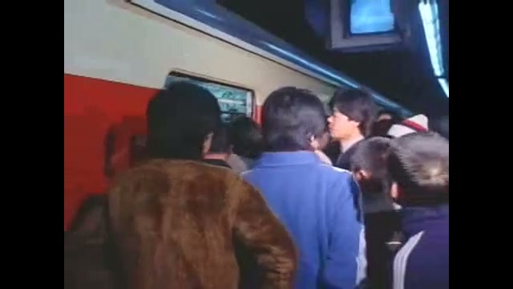
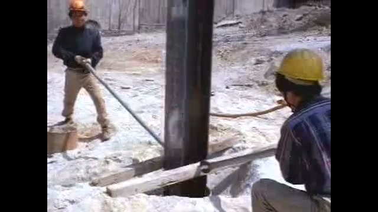

32년 전 오늘, 1994년 11월 26일. 서울 한강 밑바닥을 통과하는 지하철 터널이 마침내 뚫렸다는 소식이 전해졌습니다. 서울 지하철 5호선 공사 구간 중 최대 난공사로 꼽히던 여의도와 마포 사이 한강 하저터널의 쌍굴 가운데 하나가 첫 관통을 이뤄낸 것입니다.

## 철교 대신 강바닥 아래를 선택한 지하철 5호선

대한민국 지하철의 역사는 1974년 8월 15일 서울 종로선(1호선) 개통과 함께 본격적으로 시작되었습니다. 이후 2호선, 3호선, 4호선이 차례로 지어지며 한강을 건널 때 열차는 언제나 다리 위를 달렸습니다. 1900년 완공된 유서 깊은 한강철교부터 당산철교나 동작대교 같은 교량 위로 전철이 지나가는 풍경은 서울 시민들에게 매우 익숙한 일상이었습니다.

그러나 1990년대 서울 도심 교통난을 해소하기 위해 추진된 2기 지하철 5호선은 전혀 다른 방식을 도입했습니다. 한강 위에 새로운 교량을 놓는 대신, 한강 수면 수십 미터 아래 암반층을 파고들어 강북의 마포와 여의도를 최단거리 지하로 직접 연결하는 과감한 도전에 나선 것입니다.

## 여의도와 인공섬 사이 608미터, 최대의 난공사

하저터널 공사는 땅 위나 일반 지하 굴착 공사와는 차원이 다른 어려움이 따랐습니다. 거대한 한강 본류의 수압을 견뎌내야 했고, 강 밑 지반을 뚫는 과정에서 강물이 터널 안으로 새어 들거나 지반이 붕괴될 위험을 철저히 막아야 했습니다.

이번에 뚫린 구간은 여의도에서 인공섬까지 이어지는 608미터 구간이었습니다. 열차가 오가는 방향별로 별도의 굴을 파는 쌍굴 공사 방식으로 설계되었는데, 그중 첫 번째 굴이 1994년 11월 25일 마침내 반대편과 정확히 이어졌습니다. 5호선 전체 공사 현장 중에서도 손꼽히는 최대 난공사 구간에서 거둔 값진 결실이었습니다.

*지하철 2호선 개발 ... 1호선도 한계점에 이름, 사람이 많은 지하철 1호선의 모습 (1978.00.00) 장면 1 — 사진: KTV 국민방송 e영상역사관 (문화영화) / KTV 공공저작물 — 영상 저작물 전면 개방(대통령실 2025-07-09), 출처 표시*

## 11월 25일 현장에서 울려 퍼진 환호성

11월 25일 하저터널 공사 현장에서는 공사 관계자들과 기술진이 참석한 가운데 뜻깊은 관통식이 열렸습니다. 거센 물줄기 아래 흙과 돌을 부수며 한 치 앞을 내다보기 힘들었던 굴착 작업 끝에 마침내 벽이 허물어지고 반대편 불빛이 터널 안으로 비쳐 들었습니다.

어둡고 습한 지하 현장에서 수많은 땀을 흘려온 노동자들과 기술자들은 터널이 뚫리는 순간 일제히 박수와 환호를 보내며 서로를 격려했습니다. 신문 1면에는 지하 터널 한가운데 모여 축하 플래카드를 들고 환하게 웃는 공사 관계자들의 사진이 대대적으로 실렸습니다.

![[1934호] 지하철 5호선 구간( 터널 공사)(대한뉴스 1933호 수록) 지하철 5호선 구간( 터널 공사)(대한뉴스 1933호 수록) (1992.12.02) 장면 1](../images/2026-11-26-02-3.jpg)
*[1934호] 지하철 5호선 구간( 터널 공사)(대한뉴스 1933호 수록) 지하철 5호선 구간( 터널 공사)(대한뉴스 1933호 수록) (1992.12.02) 장면 1 — 사진: KTV 국민방송 e영상역사관 (미공개 대한뉴스) / KTV 공공저작물 — 영상 저작물 전면 개방(대통령실 2025-07-09), 출처 표시*

## 1863년 런던에서 1994년 서울까지, 진화하는 도시철도

세계 최초의 지하철은 1863년 영국 런던에서 증기기관차를 이용해 개통된 메트로폴리탄 철도였습니다. 당시에는 땅을 파고 구조물을 만든 뒤 덮는 개착식 공법이 중심이었고, 매연을 환기하기 위해 역사를 반지하로 짓기도 했습니다. 이어 1875년 터키 이스탄불, 1896년 헝가리 부다페스트 등으로 도시철도 기술은 전 세계로 뻗어나갔습니다.

서울 지하철 역시 1974년 첫걸음을 뗀 이후 비약적인 발전을 거듭했습니다. 1994년에는 서울특별시 도시철도공사가 설립되며 기존 1~4호선 운영 체계를 넘어 5호선 등 새로운 광역 수송망 구축에 박차를 가했습니다. 한강 바닥 아래를 뚫는 첨단 터널 기술은 한국 토목 기술이 한 단계 도약했음을 대내외에 증명하는 상징적인 이정표가 되었습니다.

*교통량 증가에 따른 변화 ... 콘크리트 구조물 만드는 모습 (1992.00.00) 장면 1 — 사진: KTV 국민방송 e영상역사관 (문화영화) / KTV 공공저작물 — 영상 저작물 전면 개방(대통령실 2025-07-09), 출처 표시*

## 오늘날 수많은 시민이 지나치는 한강 밑 608미터

1994년 첫 관통에 성공한 한강 하저터널은 이후 나머지 쌍굴까지 안전하게 연결되며 5호선의 핵심 구간으로 자리 잡았습니다. 오늘날 5호선 열차를 타고 마포역과 여의나루역 사이를 지나는 시민들은 창밖으로 한강의 물결을 보지 못합니다. 칠흑 같은 어둠 속을 달릴 뿐이지만, 그 벽 너머로는 유유히 한강물이 흐르고 있습니다.

1993년 당시 300원, 1995년 400원 하던 기본 지하철 요금표가 아득한 옛이야기가 된 지금도, 32년 전 수많은 이들의 땀과 기술로 한강 바닥을 뚫어냈던 608미터의 하저터널은 매일 수많은 시민들의 출퇴근길을 안전하게 잇고 있습니다.

### 참고 자료

- <https://newslibrary.naver.com/viewer/index.naver?articleId=1994112600329101003&editNo=20&printCount=1&publishDate=1994-11-26&officeId=00032&pageNo=1&printNo=15266&publishType=00010>
- <https://pixabay.com/photos/tokyo-japan-city-urban-subway-9826329/>
- <https://www.ehistory.go.kr/view/movie?mediasrcgbn=KV&mediaid=2098&mediadtl=8970&mediagbn=MH#t=0.3>
- <https://www.ehistory.go.kr/view/movie?mediasrcgbn=KV&mediaid=30000461&mediadtl=43585&mediagbn=DK#t=0.3>
- <https://www.ehistory.go.kr/view/movie?mediasrcgbn=KV&mediaid=2409&mediadtl=9240&mediagbn=MH#t=0.3>
