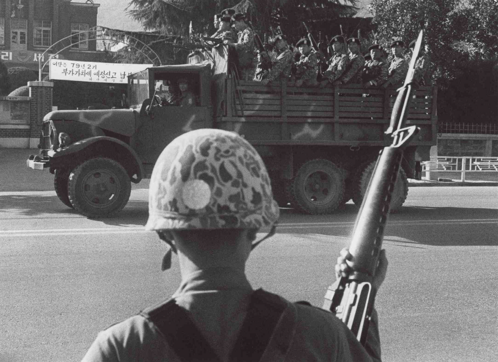
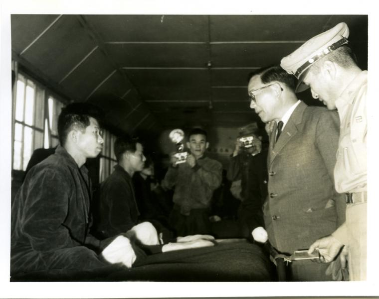
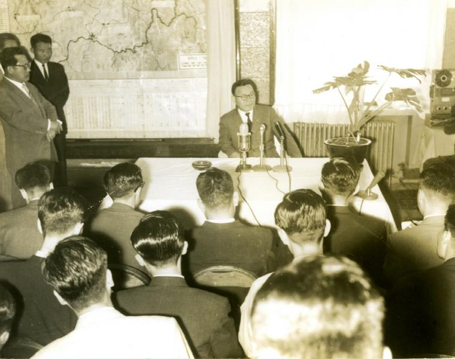

47년 전 오늘, 1979년 11월 26일. 계엄사령부는 서울 중구 명동 YWCA 강당에서 결혼식을 가장해 불법 집회를 연 혐의로 전직 국회의원 박종태, 양순직, 문인 김병걸, 함석헌 등 참석자 96명을 검거해 수사 중이라고 발표했습니다. 10·26 사건 이후 비상계엄이 덮친 정국 속에서 벌어진 초유의 위장 집회 사건이었습니다.

## 비상계엄 아래 띄운 5백여 장의 청첩장

1979년 10월 26일 박정희 대통령 사망 이후 전국에 비상계엄이 선포되었습니다. 계엄사령부 포고령 제1호 제1항에 따라 일체의 옥내외 집회가 엄격히 금지되었습니다. 그러나 정부와 통일주체국민회의가 대의원 간접선거를 통해 최규하 국무총리를 후임 대통령으로 선출하려 하자, 재야 세력은 이에 강하게 반발했습니다. 유신헌법 폐지와 대통령 직선제를 요구하는 목소리를 내야 했지만 일반적인 방식으로는 모일 수 없었습니다.

## 세상에 없던 신부 '윤정민'

당국의 삼엄한 눈을 피하기 위해 재야 인사들이 선택한 방법은 위장결혼식이었습니다. 주최 측은 '신랑 홍성엽 군과 신부 윤정민 양이 혼례를 올린다'는 내용의 청첩장 5백여 장을 인쇄해 은밀히 배포했습니다. 예식 일시는 1979년 11월 24일 토요일 오후 5시 30분, 장소는 서울 명동성당 맞은편 YWCA 1층 강당이었습니다. 신랑 홍성엽은 연세대학교 복학생이자 민청협 회원으로 실존 인물이었으나, 신부 윤정민은 가공의 인물이었습니다. 세상을 떠난 윤형중 신부의 성씨와 민주주의의 앞 글자를 따서 지은 이름이었습니다.

*Airborne troops entering Masan 1979-10-20 — 사진: Photos taken by 전민조 and hosted by the National Museum of Con / KOGL Type 1*

## 신랑 입장 후 낭독된 국민선언

1979년 11월 24일 오후 5시 45분쯤, 영문을 모르고 축하하러 온 일반 하객과 은밀한 연락을 받고 모여든 시민들로 식장이 가득 찼습니다. 기독교청년협회 회장 김정택의 사회로 가짜 신랑이 식장에 입장했습니다. 그러나 신부 입장은 없었습니다. 신랑 입장이 끝나자마자 전 국회의원 박종태가 단상으로 뛰어올라 '통일주체국민회의 대의원에 의한 대통령 선출 저지를 위한 국민선언'을 힘차게 낭독했습니다. 최규하 대통령 권한대행의 11·10 시국 담화를 반대하며 직선제 개헌을 촉구하는 내용이었습니다.

*사건 당시 사진 아님 · 1960년 — 사진: 충청남도 / KOGL Type 0 Public Domain*

## 계엄군의 난입과 96명 현장 검거

선언문 낭독과 함께 장내에는 광화문 등 주요 도시에서 일제히 궐기하자는 전단이 뿌려졌고, 참석자들의 환호와 박수가 터져 나왔습니다. 그러나 행사 시작 전부터 재야 원로들을 미행하던 사복 경찰과 계엄군이 예식장에 난입했습니다. 장내는 순식간에 아수라장이 되었고 집회는 강제로 해산되었습니다. 계엄사령부는 이틀 뒤인 11월 26일, 포고령 위반 혐의로 현장에서 96명을 검거했다고 공식 발표했습니다.

*사건 당시 사진 아님 · 1960년 — 사진: 충청남도 / KOGL Type 0 Public Domain*

## 보안사 연행과 혹독한 수사

계엄 발표 이후 관련자 140명이 불구속 입건되었으며, 윤보선 전 대통령과 함석헌 등은 소환 및 서면 조사를 받았습니다. 특히 백기완, 임채정 등 주동 인사 14명은 서울 용산구의 보안사령부 서빙고 분실로 끌려가 혹독한 조사를 받았습니다. 군사 정권의 서슬 퍼런 탄압 속에서도 민주화를 갈망하던 이들의 저항 의지를 꺾지는 못했습니다.

## 훗날의 명예회복과 남겨진 역사

당시 옥고를 치렀던 백기완은 1980년 12월 서대문구치소 수감 중 옥중 장편시 '묏비나리'를 지었습니다. 이 시의 일부 문구는 1981년 김종률이 작곡하고 황석영이 다듬은 노래 '임을 위한 행진곡'의 노랫말이 되었습니다. 또한 이 사건으로 연행되었던 이들은 세월이 흘러 민주화운동관련자 보상심의위원회를 통해 명예를 회복했습니다. 2001년 10월 18일 임채정, 박종태, 양순직, 이해동이 복권되었고, 2002년 6월 12일 문동환, 2003년 9월 9일 김상현이 잇달아 민주화 운동 관련자로 인정받았습니다.

### 참고 자료

- <https://newslibrary.naver.com/viewer/index.naver?articleId=1979112600329201004&editNo=2&printCount=1&publishDate=1979-11-26&officeId=00032&pageNo=1&printNo=10510&publishType=00020>
- <https://commons.wikimedia.org/wiki/File:Reporting_on_a_rooftop_1979-11-03.png>
- <https://commons.wikimedia.org/wiki/File:Airborne_troops_entering_Masan_1979-10-20.png>
- <https://www.kogl.or.kr/recommend/recommendDivView.do?division=img&recommendIdx=37406>
- <https://www.kogl.or.kr/recommend/recommendDivView.do?division=img&recommendIdx=37405>
