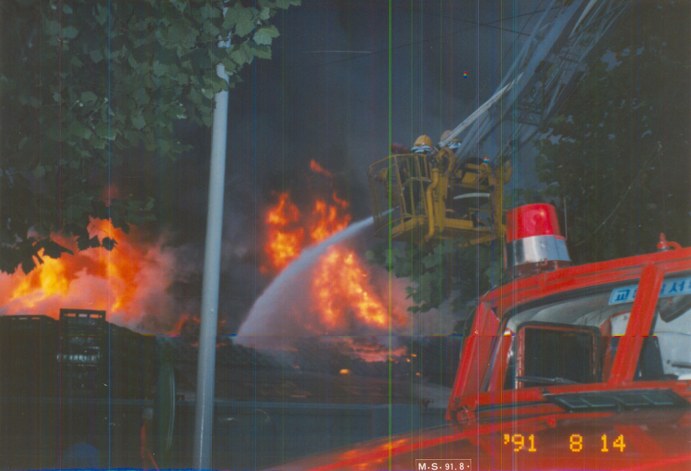
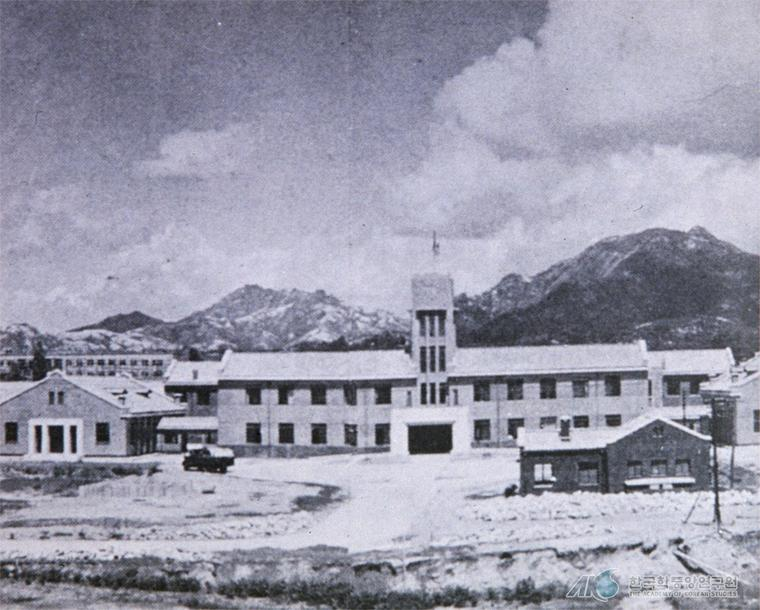

35년 전 오늘, 1991년 11월 26일 전국 99개 전기대의 92학년도 입시 원서 접수 최종 결과가 일제히 발표됐습니다. 대학 진학을 앞둔 수험생과 학부모들의 긴장감이 극에 달했던 순간이었습니다.

## 전국 평균 4.1대1, 낮아진 경쟁률

11월 25일 마감된 92학년도 전기대 입시 원서 접수 결과, 전국 99개 대학의 정원 15만6천1백11명 모집에 총 63만9천4백85명이 지원했습니다. 전체 경쟁률은 4.09대1, 즉 약 4.1대1로 최종 집계됐습니다. 이는 91학년도의 4.53대1과 비교해 눈에 띄게 낮아진 수치였습니다.

## 경쟁률 하락의 배경과 입시 판도

경쟁률이 크게 떨어진 배경에는 복합적인 요인이 있었습니다. 당해 연도 체력장 수검자가 전년보다 약 2만 명 줄어들어 전체 수험생 규모가 감소한 반면, 대학 모집정원은 9천7백65명 늘어났습니다. 여기에 취업난을 고려한 수험생들이 4년제 대학 대신 전문대나 후기대를 목표로 삼으면서 전기대 응시를 포기하는 경향도 두드러졌습니다.

*1990년대 초기 서울소방 활동 사진스캔0055 — 사진: 서울특별시 소방재난본부 / CC BY-SA 4.0*

## 서울대 2.35대1, 주요 대학의 희비

서울대는 4천6백85명 모집에 1만1천14명이 지원해 2.35대1의 경쟁률을 기록하며 5년 연속 내림세를 이어갔습니다. 서울대 안에서는 음대 성악과 남학생 모집이 17명 정원에 92명이 몰려 5.41대1로 가장 높았습니다. 연세대는 2.79대1로 전년의 2.92대1보다 낮아졌고, 고려대는 2.26대1로 전년의 2.17대1보다 다소 상승했습니다. 이화여대는 2.05대1, 서강대는 2.4대1, 숙명여대는 2.8대1을 나타냈습니다.

*사건 당시 사진 아님 — 사진: 한국학중앙연구원 / KOGL Type 1 attribution*

## 최고 59.9대1과 뜻밖의 정원 미달

전국 최고 경쟁률을 기록한 곳은 대전대 미생물학과였습니다. 20명 정원에 무려 1천1백98명이 몰려 59.9대1이라는 폭발적인 수치를 보였습니다. 신설 대학인 한국산업기술대 역시 2백40명 정원에 5천7백36명이 지원해 대학별 최고인 23.9대1을 기록했습니다. 반면 한국교원대 기술교육과는 20명 정원에 19명이 지원해 미달됐고, 이화여대 과학교육과 물리전공 등 전국 7개 대학의 7개 학과가 정원을 채우지 못하는 이변도 나타났습니다.

![[1274.5호] 전기대학 입학시험 전국 전기대학 입학시험 (1980.01.22) 장면 2](../images/2026-11-26-04-4.jpg)
*[1274.5호] 전기대학 입학시험 전국 전기대학 입학시험 (1980.01.22) 장면 2 — 사진: KTV 국민방송 e영상역사관 (대한뉴스) / KTV 공공저작물 — 영상 저작물 전면 개방(대통령실 2025-07-09), 출처 표시*

## 창구 앞 눈치작전과 그 시절의 풍경

원서 접수 마지막 날 대학 캠퍼스 접수처 주변은 수험생과 학부모들로 인산인해를 이뤘습니다. 지원자 현황판의 숫자가 바뀔 때마다 탄식과 안도가 교차했고, 마감 직전까지 도장을 쥔 채 접수 창구를 서성이는 눈치작전이 치열했습니다. 접수를 마치고 수험표를 챙겨 든 수험생들은 후련함과 긴장감을 동시에 안고 시험 준비에 돌입했습니다.

## 지금도 가슴에 남은 수험 시절의 추억

오늘날 컴퓨터 클릭 한 번으로 이뤄지는 온라인 접수와 달리, 그 시절에는 직접 발로 뛰며 종이 원서를 내야 했습니다. 다음 날 아침 배달된 신문의 깨알 같은 경쟁률 표를 돋보기로 확인하며 합격 가능성을 가늠하던 그날의 긴장감은 많은 이들의 기억 속에 여전히 생생하게 남아 있습니다.

### 참고 자료

- <https://newslibrary.naver.com/viewer/index.naver?articleId=1991112600329101001&editNo=15&printCount=1&publishDate=1991-11-26&officeId=00032&pageNo=1&printNo=14240&publishType=00010>
- <https://commons.wikimedia.org/wiki/File:1990%EB%85%84%EB%8C%80_%EC%B4%88%EA%B8%B0_%EC%84%9C%EC%9A%B8%EC%86%8C%EB%B0%A9_%ED%99%9C%EB%8F%99_%EC%82%AC%EC%A7%84%EC%8A%A4%EC%BA%940052.jpg>
- <https://commons.wikimedia.org/wiki/File:1990%EB%85%84%EB%8C%80_%EC%B4%88%EA%B8%B0_%EC%84%9C%EC%9A%B8%EC%86%8C%EB%B0%A9_%ED%99%9C%EB%8F%99_%EC%82%AC%EC%A7%84%EC%8A%A4%EC%BA%940055.jpg>
- <https://www.kogl.or.kr/recommend/recommendDivView.do?division=img&recommendIdx=72963>
- <https://www.ehistory.go.kr/view/movie?mediasrcgbn=KV&mediaid=10271&mediadtl=21458&mediagbn=DH#t=0.7>
