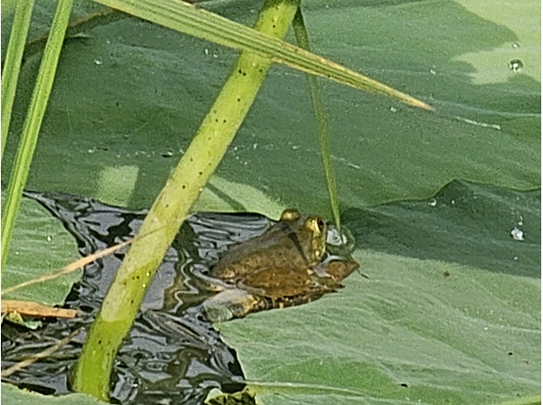
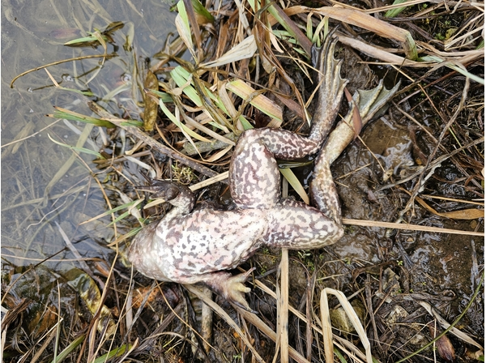
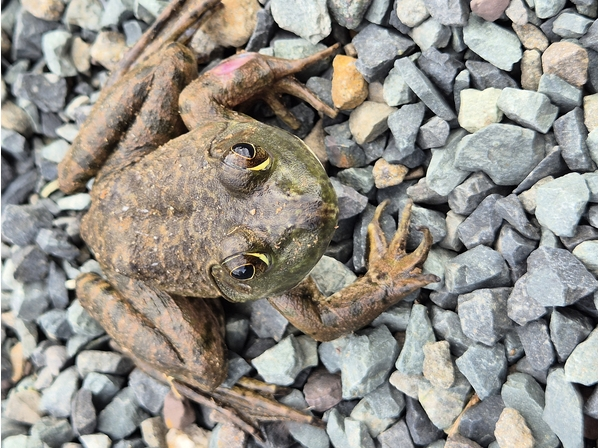

28년 전 오늘, 1998년 11월 26일. 자연생태계의 보고로 꼽히던 지리산 국립공원의 생태계가 외래종의 습격과 무분별한 개발로 심각하게 파괴되고 있다는 공식 조사 결과가 발표됐습니다. 깊은 산속 계곡까지 외래종이 침범하고 토종 야생동물들이 자취를 감추고 있다는 충격적인 소식이었습니다.

## 국립공원관리공단이 밝혀낸 지리산의 민낯

1998년 11월 25일, 국립공원관리공단은 지난 1997년 4월부터 1년 넘게 지리산 일대를 샅샅이 뒤져 작성한 '지리산국립공원 야생동물 생태계 정밀조사' 보고서를 언론에 공개했습니다. 국가가 직접 공인한 첫 정밀 조사 결과였습니다. 지리산은 한반도 남부 내륙에서 가장 웅장하고 원시림이 잘 보존된 자연의 보고로 여겨져 왔기에, 보고서에 담긴 실태는 온 국민에게 커다란 충격을 주었습니다.

## 계곡을 점령한 생태계 폭군, 황소개구리와 붉은귀거북

보고서에서 가장 눈에 띈 대목은 외래 생물의 무서운 번식이었습니다. 미국 남부가 원산지인 황소개구리와 애완용으로 수입됐던 붉은귀거북이 지리산 동부권 깊숙한 계곡까지 무리 지어 서식하고 있는 사실이 공식 확인됐습니다. 엄청난 식성을 가진 황소개구리는 한국 토종 개구리와 물고기, 심지어 뱀까지 닥치는 대로 잡아먹으며 지리산의 수중 생태계를 무너뜨리고 있었습니다. 방생 행사나 사육 포기로 자연에 풀려난 붉은귀거북 역시 토종 남생이의 서식처를 빼앗고 고유 어종을 위협하고 있었습니다.

*사건 당시 사진 아님 — 사진: 국립생태원 / KOGL Type 1 attribution*

## 여우와 사향노루는 어디로… 사라진 토종 야생동물

외래종이 득세하는 사이, 지리산을 터전으로 삼아 오랫동안 살아왔던 고유 야생동물들은 벼랑 끝으로 내몰렸습니다. 1990년대 초까지만 해도 드물게나마 발자국과 배설물이 목격되던 여우와 사향노루, 늑대와 표범이 이번 정밀 조사에서는 단 한 마리도 관찰되지 않았습니다. 밀렵꾼들의 덫과 올가미, 서식지 파괴가 겹치면서 대형 포유류와 희귀 동물들이 사실상 지리산에서 완전히 자취를 감춘 것으로 분석됐습니다.

*사건 당시 사진 아님 — 사진: 국립생태원 / KOGL Type 1 attribution*

## 배설물 속 쏟아져 나온 스티로폼과 비닐

지리산 생태계를 망가뜨린 것은 외래종뿐만이 아니었습니다. 인간이 남긴 흉터는 야생동물의 몸속 깊숙이까지 침투해 있었습니다. 지리산에 살던 족제비와 야생 고양이의 배설물을 분석한 결과, 행락객들이 산속에 버리고 간 비닐, 스티로폼, 알루미늄 쿠킹호일과 쇳조각 등이 고스란히 검출됐습니다. 먹을 것이 부족해진 동물들이 쓰레기를 먹이로 착각해 삼키면서 정상적인 먹이사슬이 완전히 망가지고 있었습니다.

*사건 당시 사진 아님 — 사진: 국립생태원 / KOGL Type 1 attribution*

## 아스팔트 위의 떼죽음과 뒤바뀐 철새의 계절

국립공원을 관통해 무분별하게 뚫린 아스팔트 도로는 동물들의 이동 통로를 완전히 끊어놓았습니다. 개구리와 도롱뇽, 뱀 등 양서류와 파충류들이 산란과 번식을 위해 집단으로 도로를 건너다 달리는 차에 깔려 죽는 로드킬 사고가 곳곳에서 끊이지 않았습니다. 여기에 지구 온난화의 여파도 지리산을 비켜가지 못했습니다. 4월 초 화엄사 인근에서 흰배지빠귀와 노랑할미새 등 여름 철새가 일찌감치 관찰되는가 하면, 10월 말 심원 지역에서는 여름새인 밀화부리 50여 마리가 월동을 준비하며 텃새처럼 머무는 등 계절의 시계마저 어그러져 있었습니다.

## 무관심과 난개발이 남긴 깊은 상처

1998년 늦가을에 발표된 이 보고서는 인간의 무분별한 개발과 환경 파괴가 자연에 어떤 재앙을 불러오는지를 명확하게 경고했습니다. 편리함을 위해 닦은 도로와 무심코 들여와 버린 외래 생물, 산에 버리고 온 쓰레기 한 조각이 수천 년을 이어온 지리산의 생태 그물을 찢어놓았던 것입니다. 지리산의 신음이 전국에 생생하게 전해졌던 그 시절의 뉴스를 돌아보게 됩니다.

### 참고 자료

- <https://newslibrary.naver.com/viewer/index.naver?articleId=1998112600329101001&editNo=45&printCount=1&publishDate=1998-11-26&officeId=00032&pageNo=1&printNo=16602&publishType=00010>
- <https://www.kogl.or.kr/recommend/recommendDivView.do?division=img&recommendIdx=152711>
- <https://www.kogl.or.kr/recommend/recommendDivView.do?division=img&recommendIdx=152710>
- <https://www.kogl.or.kr/recommend/recommendDivView.do?division=img&recommendIdx=152709>
- <https://www.kogl.or.kr/recommend/recommendDivView.do?division=img&recommendIdx=152708>
