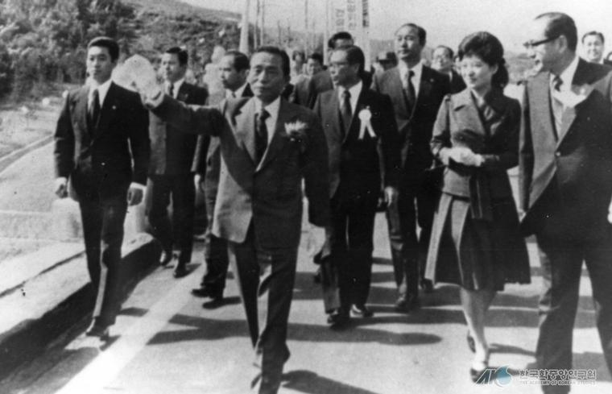
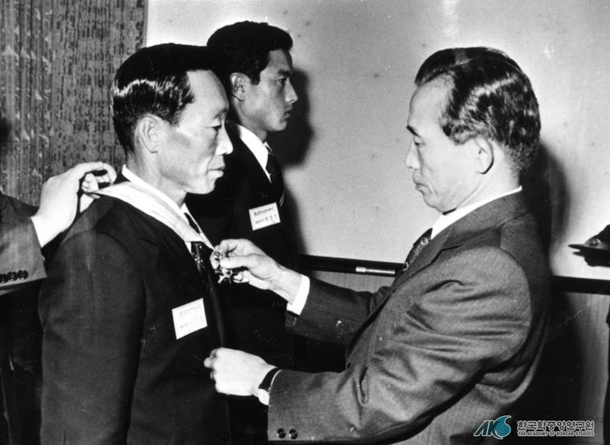
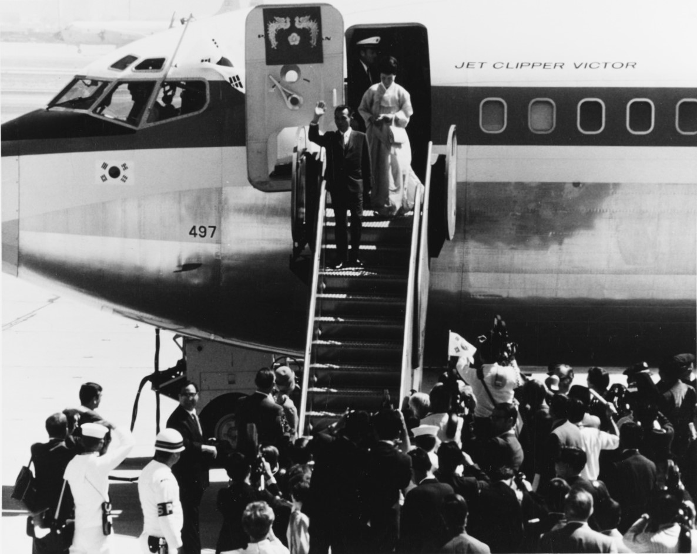

55년 전 오늘, 1971년 11월 26일. 전주와 순천을 잇는 호남고속도로 2차 구간과, 순천에서 부산을 잇는 남해고속도로가 나란히 착공에 들어갔습니다. 험준한 산과 고개를 넘나들며 멀리 돌아가야 했던 남부권 도시들이 마침내 하나의 고속 도로망으로 묶이는 역사적인 첫걸음이었습니다.

## 남부권을 동서로 잇는 대동맥 구상

1970년대 초반까지 영남과 호남 사이를 이동하는 것은 무척 고된 여정이었습니다. 포장되지 않거나 좁고 굴곡이 심한 국도에 의존해야 했기 때문에 물자를 실어 나르는 데 많은 시간과 비용이 소모되었습니다. 호남평야와 김해평야에서 거두어들인 풍부한 농산물, 그리고 남해안 일대에서 갓 잡아 올린 신선한 해산물이 시장으로 제때 공급되지 못하는 일도 잦았습니다. 이에 정부는 국토 균형 발전과 남부권 경제권 형성을 위해 두 도로의 연결을 본격 추진했습니다.

## 광주와 마산에서 울려 퍼진 착공의 첫 삽

1971년 11월 26일, 전라도 광주와 경상도 마산에서 각각 성대한 기공식이 거행되었습니다. 김종필 국무총리와 태완선 건설부 장관을 비롯한 주요 관계자들이 참석해 공사의 무사를 기원하며 첫 삽을 떴습니다. 호남고속도로 2차 구간과 남해고속도로 건설에는 세계은행 차관과 국내 자본이 함께 투입되었으며, 호남과 영남을 실질적으로 묶는 대역사가 힘차게 시작되었습니다.

*사건 당시 사진 아님 — 사진: 한국학중앙연구원 / KOGL Type 1 attribution*

## 28개 나들목으로 촘촘히 연결된 노선망

이 대규모 고속도로는 전주를 출발점으로 완주, 김제, 정읍, 장성을 거쳐 광주로 이어지고, 다시 담양, 곡성, 승주를 지나 순천에 도달하도록 짜였습니다. 이어 남해고속도로를 통해 광양, 하동, 사천, 진양, 함안, 창원, 김해를 차례로 통과해 종점인 부산까지 연결되는 방대한 대동맥이었습니다. 노선 곳곳에는 전주남, 태인, 정읍, 광주, 창평, 옥과, 순천, 진교, 진주, 군북, 마산, 진영, 구포 등 모두 28개소에 달하는 인터체인지가 마련되어 주변 지역 주민들의 접근성을 높이도록 설계되었습니다.

*사건 당시 사진 아님 — 사진: 한국학중앙연구원 / KOGL Type 1 attribution*

## 미래를 내다본 설계와 획기적인 시간 단축

건설 계획에는 장기적인 교통량 증가를 내다본 안목도 반영되었습니다. 훗날 4차선으로 넓힐 수 있도록 넉넉한 부지를 먼저 확보해 두고, 우선 왕복 2차선으로 공사를 진행했습니다. 평균 설계속도는 시속 100킬로미터로 잡혔습니다. 기존 국도를 이용할 때 하루가 꼬박 걸리던 긴 이동 시간이 절반 수준으로 대폭 단축될 것이라는 전망이 나왔으며, 차량 운행 비용 또한 해마다 크게 절감할 수 있을 것으로 분석되었습니다.

*사건 당시 사진 아님 · 1969년 — 사진: National Archive / Public domain*

## 산업과 일상을 바꾼 동서 교통축

호남고속도로와 남해고속도로의 착공은 남부권 주민들의 일상에도 커다란 변화를 예고했습니다. 양쪽 지역의 물류가 거침없이 이어지며 산업 발전의 기틀이 다져졌고, 친척 방문이나 수학여행, 지역 축제를 오가는 길도 한결 수월해졌습니다. 비포장 신작로를 덜컹거리며 달리던 버스 대신 매끄럽게 뻗은 고속도로를 달리는 일은 당시 사람들에게 새로운 시대의 상징과도 같았습니다.

## 남해안 시대를 연 추억의 길목

이날 광주와 마산에서 쏘아 올린 첫 삽은 훗날 남해안 공업지대와 내륙 곡창지대를 탄탄하게 뒷받침하는 토대가 되었습니다. 굽이치던 고갯길을 지나 시원하게 뚫린 도로를 달리며 바라보던 푸른 남해와 넓은 들녘의 풍경은 수많은 운전자와 승객들의 마음속에 오래도록 자리 잡았습니다.

### 참고 자료

- <https://newslibrary.naver.com/viewer/index.naver?articleId=1971112600209201006&editNo=2&printCount=1&publishDate=1971-11-26&officeId=00020&pageNo=1&printNo=15429&publishType=00020>
- <https://commons.wikimedia.org/wiki/File:%EC%A7%80%ED%95%98%EC%B2%A0_%EA%B1%B4%EC%84%A4_%EC%B0%A9%EA%B3%B5%EC%8B%9D%EC%97%90_%EC%B0%B8%EC%84%9D%ED%95%9C_%EB%B0%95%EC%A0%95%ED%9D%AC_%EB%8C%80%ED%86%B5%EB%A0%B9_%EB%82%B4%EC%99%B8_(1971._4._12).jpg>
- <https://www.kogl.or.kr/recommend/recommendDivView.do?division=img&recommendIdx=75035>
- <https://www.kogl.or.kr/recommend/recommendDivView.do?division=img&recommendIdx=72753>
- <https://commons.wikimedia.org/wiki/File:President_Park_Chung-hee_and_his_wife_descend_from_a_Pan_Am_707_at_NAS_Moffett_Field.jpg>
