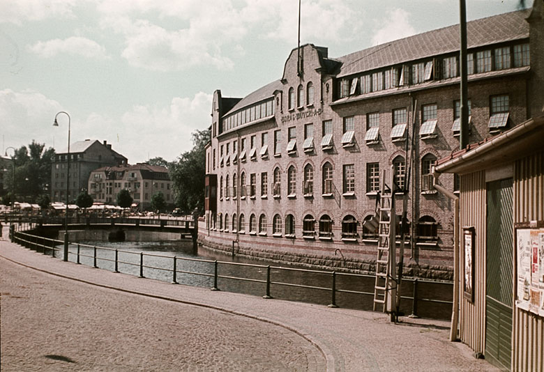
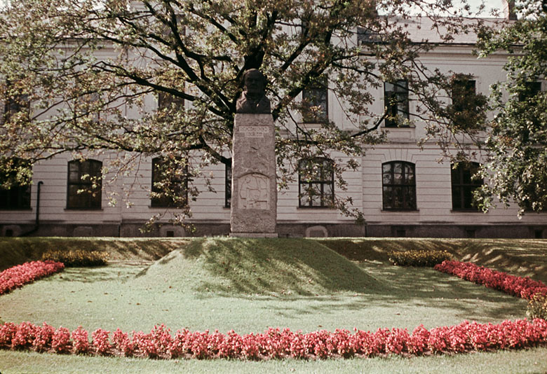
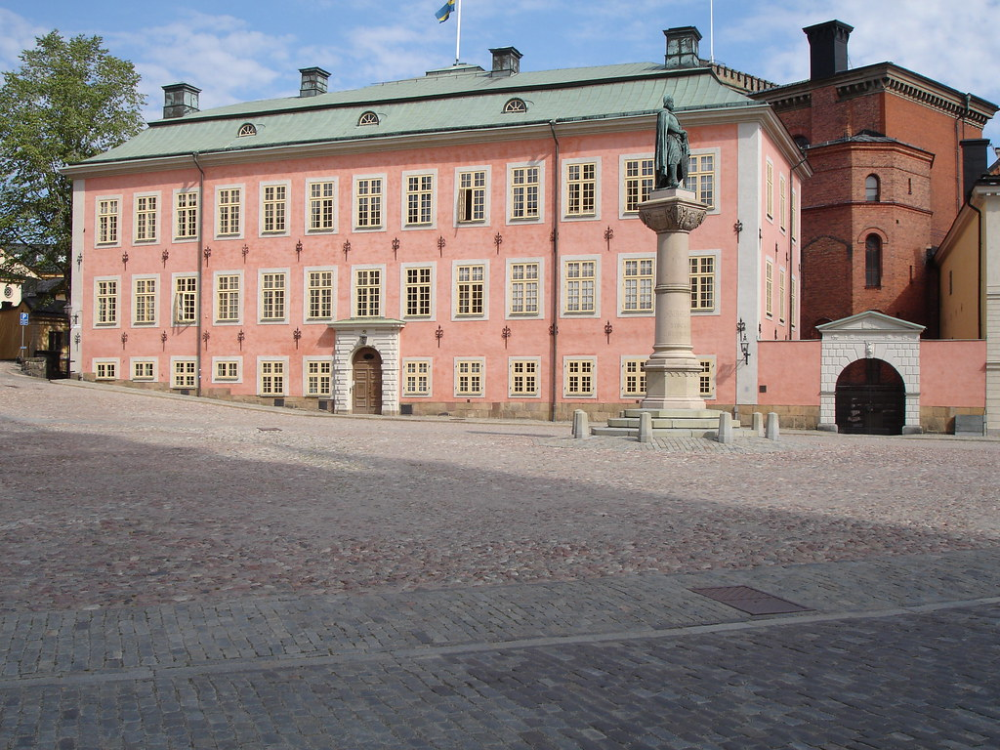

54년 전 오늘, 1972년 11월 27일. 한국 여자 탁구가 스웨덴에서 열린 스칸디나비아 오픈 탁구대회에서 개인단식과 복식을 모두 휩쓸며 세계 정상에 올랐다는 낭보가 전해졌습니다. 변방에 머물던 한국 스포츠가 세계 최고 권위의 대회에서 강호들을 줄줄이 무너뜨리고 일궈낸 기념비적인 쾌거였습니다.

## 세계선수권에 버금가는 권위의 무대, 스칸디나비아 오픈

1972년 스웨덴 보라스에서 치러진 스칸디나비아 오픈 탁구선수권대회는 세계선수권대회 못지않은 권위와 관록을 자랑하는 최고 권위의 국제 대회였습니다. 당시 세계 여자 탁구는 두터운 선수층을 자랑하는 중공과 탄탄한 기본기를 갖춘 체코슬로바키아, 헝가리 등 유럽 강호들이 철옹성을 구축하고 있었습니다.

한국 탁구는 이전까지 이러한 권위 있는 국제대회에서 정상을 밟아본 적이 없었습니다. 그러나 이에리사, 정현숙, 박미라, 나인숙으로 꾸려진 한국 여자 대표팀은 차가운 북유럽의 녹색 테이블 위에서 거대한 파란을 준비하고 있었습니다.

## 남북 대결과 8강전, 거침없는 진격

대회 종반으로 향할수록 한국 선수들의 기세는 매서웠습니다. 여자 단식 준준결승에서는 남북 대결이 성사되어 큰 관심을 모았습니다. 이에리사 선수는 국제대회에 처음 모습을 드러낸 북한의 차경미 선수를 맞아 빈틈없는 경기 운영으로 3대 0 완승을 거두었습니다.

정현숙 선수 역시 유럽의 강호인 헝가리의 키샤지 선수를 3대 0으로 가볍게 물리치며 4강에 안착했습니다. 비록 나인숙 선수가 중공의 동몽아에게, 박미라 선수가 체코의 일로나 보스토바에게 각각 0대 3으로 패하며 4강 진출이 좌절되었지만, 두 선수의 선전으로 한국 탁구의 힘을 세계에 똑똑히 보여주었습니다.

*Borås - KMB - 16001000237384 — 사진: Fredrik Bruno / Public domain*

## 준결승의 돌풍, 관중들을 흥분의 도가니로 몰아넣다

11월 25일 밤에 열린 여자 단식 준결승은 대회 최고의 하이라이트였습니다. 이에리사 선수는 세계 최강으로 꼽히던 중공의 풍몽아 선수를 상대했습니다. 이에리사는 21-14, 21-16, 21-15로 세 세트를 연달아 따내며 3대 0 완승을 거두는 기염을 토했습니다.

이어 정현숙 선수는 체코의 강호 일로나 보스토바 선수와 맞붙었습니다. 정현숙 역시 21-12, 21-15, 21-10의 압도적인 점수 차로 3대 0 스트레이트 승리를 따냈습니다. 다크호스로 등장한 두 한국 선수가 중공과 체코의 대표 에이스들을 단 한 세트도 내주지 않고 연파하자 현지 관중들은 흥분의 도가니에 빠져들었습니다.

*Borås - KMB - 16001000237484 — 사진: Fredrik Bruno / Public domain*

## 복식 결승 완승, 중공을 3대 0으로 꺾다

대회 최종일인 11월 26일, 한국 대표팀은 복식에서도 거침없는 승리를 이어갔습니다. 이에리사·박미라 조는 준결승에서 헝가리 조를 3대 1로 누르고 결승에 올랐습니다. 결승 상대는 체코를 3대 1로 꺾고 올라온 중공의 친포친·린메이충 조였습니다.

결승전에서 이에리사와 박미라는 환상의 호흡을 자랑하며 중공 조를 압도했습니다. 한 세트도 내주지 않고 3대 0 완승을 거두며 마침내 여자 복식 우승 트로피를 품에 안았습니다. 중공의 탄탄한 수비와 날카로운 공격을 완벽하게 무너뜨린 통쾌한 승리였습니다.

*DSC00760, Stockholm, Sweden — 사진: jimg944 / CC BY 2.0*

## 한국 선수끼리 맞붙은 단식 결승, 사상 첫 전 종목 석권

복식 우승의 감격이 채 가시기도 전에 이어진 여자 단식 결승전은 한국 탁구 역사상 가장 아름다운 장면을 연출했습니다. 준결승에서 세계적 강호들을 꺾은 이에리사 선수와 정현숙 선수가 테이블을 사이에 두고 우승을 다투는 동반 결승전이 성사된 것입니다.

선의의 경쟁을 펼친 끝에 이에리사 선수가 승리하며 단식 패권을 차지했고, 정현숙 선수는 값진 준우승을 차지했습니다. 이로써 한국은 스칸디나비아 오픈 여자부 단식 우승과 준우승, 복식 우승을 모두 휩쓸며 사상 최초로 권위 있는 국제대회 전 종목을 석권하는 대위업을 달성했습니다.

## 한국 스포츠 역사의 전환점, 지금도 살아 숨 쉬는 전설

이 대회에서 남자 단식은 스웨덴의 크옐 요한슨 선수가, 혼합복식은 헝가리의 이스트반 요이어와 유디트 마고스 조가 각각 차지했습니다. 그 화려한 세계적 스타들 속에서도 가장 밝게 빛난 주인공은 단연 한국의 어린 태극 낭자들이었습니다.

스웨덴 보라스에서 울려 퍼진 승전보는 한국 탁구가 세계 정상으로 비상하는 찬란한 출발점이었습니다. 이듬해인 1973년 사라예보 세계선수권 단체전 우승의 기적 또한 바로 이 스칸디나비아의 눈부신 자신감에서 싹텄습니다. 반세기가 지난 지금도 1972년 북유럽 코트를 뜨겁게 달구었던 그날의 환호는 한국 스포츠의 위대한 신화로 선명하게 기억되고 있습니다.

### 참고 자료

- <https://newslibrary.naver.com/viewer/index.naver?articleId=1972112700329201011&editNo=2&printCount=1&publishDate=1972-11-27&officeId=00032&pageNo=1&printNo=8359&publishType=00020>
- <https://commons.wikimedia.org/wiki/File:Tafeltenniskampioenschappen,_winnaar_bij_de_dames_werd_mevrouw_Stoelemeyer_Artz_,_Bestanddeelnr_916-3220.jpg>
- <https://commons.wikimedia.org/wiki/File:Bor%C3%A5s_-_KMB_-_16001000237384.jpg>
- <https://commons.wikimedia.org/wiki/File:Bor%C3%A5s_-_KMB_-_16001000237484.jpg>
- <https://www.flickr.com/photos/21203533@N00/227820719>
