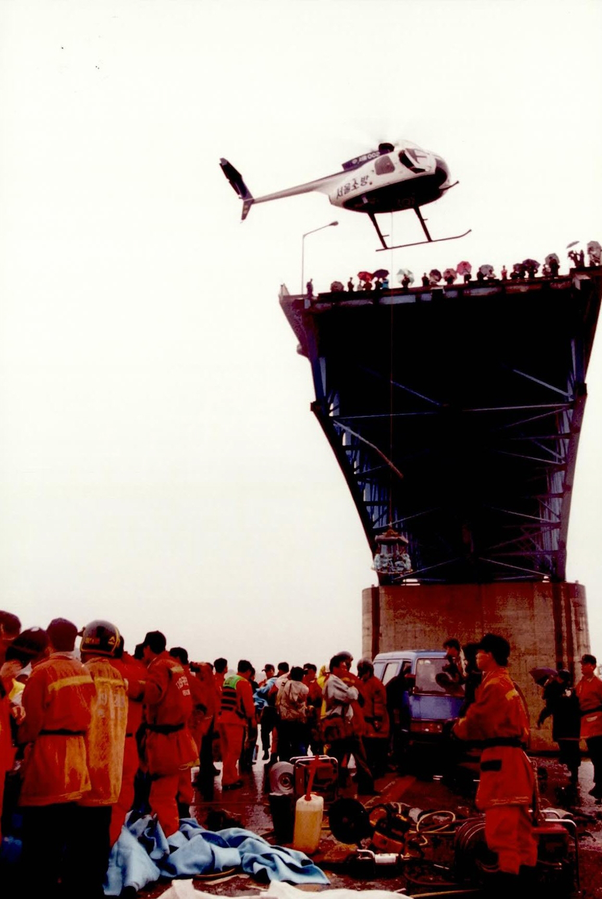

32년 전 오늘, 1994년 11월 27일. 경기도 고양시 일산신도시의 한 아파트 지하주차장에서 지탱 기둥이 부서져 주민들이 한밤중에 긴급 대피하는 소동이 벌어졌습니다. 지은 지 불과 2년밖에 되지 않은 최신 시범아파트에서 벌어진 사고였습니다.

## 입주 2년 만에 부서져 내린 일산 1호 아파트

사고가 발생한 곳은 경기 고양시 일산신도시 백석동 백송마을 삼호아파트 단지였습니다. 1990년에 착공해 1992년 7월 완공된 뒤, 그해 8월 30일부터 입주를 시작한 일산신도시 최초의 시범아파트였습니다. 새집에 입주한 지 겨우 2년 남짓 지난 시점에 건물의 하중을 떠받치는 핵심 뼈대가 무너져 내렸습니다.

문제의 장소는 508동, 509동, 510동 주민들이 함께 사용하는 공동 지하주차장이었습니다. 지하주차장을 떠받치고 있던 26개의 콘크리트 지지대 가운데 주차장 입구 쪽에 서 있던 첫 번째 기둥 상단이 하중을 견디지 못하고 부서졌습니다. 위치상 가장 많은 무게를 받는 핵심 기둥이었습니다.

## 콘크리트 90cm 탈락과 휘어진 철근

1994년 11월 26일 밤 9시 무렵, 주차장을 순찰하던 경비원 송병태 씨와 차를 대려던 한 주민이 파손 현장을 발견했습니다. 높이 3.5미터, 가로세로 각 40센티미터 크기의 콘크리트 기둥 윗부분에서 콘크리트가 90센티미터 길이, 10에서 15센티미터 두께로 떨어져 나간 상태였습니다.

콘크리트 덩어리가 바닥에 쏟아져 내리면서 기둥 내부가 훤히 드러났습니다. 직경 1.5센티미터 두께의 내부 철근 10여 개는 상부 구조물의 엄청난 무게를 이기지 못해 모두 같은 방향으로 활처럼 휘어져 있었습니다. 기둥의 균열은 실시간으로 아랫부분을 향해 계속 진행되고 있었습니다.

![[1980호] 하수처리장 공사 난지 하수처리장 건설 막바지(경기도 고양시 ) (1993.10.20) 장면 1](../images/2026-11-27-02-2.jpg)
*[1980호] 하수처리장 공사 난지 하수처리장 건설 막바지(경기도 고양시 ) (1993.10.20) 장면 1 — 사진: KTV 국민방송 e영상역사관 (대한뉴스) / KTV 공공저작물 — 영상 저작물 전면 개방(대통령실 2025-07-09), 출처 표시*

## 한밤중의 대피 방송과 탈출 소동

상황을 확인한 아파트 관리사무소와 경비원은 즉시 비상 안내방송을 내보냈습니다. 지하주차장에 세워둔 차량을 모두 밖으로 빼달라는 다급한 방송이었습니다. 때마침 방송사 뉴스 프로그램에서도 지하주차장 기둥이 무너지고 있다는 긴급 보도가 전파를 탔습니다.

뉴스를 지켜보던 단지 내 6개 동 393세대, 주민 1천여 명이 무너질지도 모른다는 공포에 휩싸여 집 밖으로 뛰쳐나왔습니다. 주민들은 지하주차장에 있던 차량 80여 대를 지상으로 이동시키느라 차가 뒤엉키는 등 아수라장을 이뤘습니다. 시공사인 삼호 측은 27일 자정부터 8개의 긴급 지지대인 잭포스트를 설치하며 응급조치에 나섰습니다.

![[1890호] 캠페인 공중전화 (1992.01.29) 장면 1](../images/2026-11-27-02-3.jpg)
*[1890호] 캠페인 공중전화 (1992.01.29) 장면 1 — 사진: KTV 국민방송 e영상역사관 (대한뉴스) / KTV 공공저작물 — 영상 저작물 전면 개방(대통령실 2025-07-09), 출처 표시*

## 성수대교 붕괴 한 달 뒤 찾아온 충격

사고 당시 대한민국은 성수대교 붕괴 사고가 일어난 지 불과 한 달밖에 지나지 않은 시점이었습니다. 국가 주요 기반 시설이 맥없이 무너져 내린 참사를 목격했던 시민들에게 이번 아파트 기둥 파손은 단순한 사고가 아니었습니다. 내가 사는 보금자리마저 무너질 수 있다는 직접적인 공포였습니다.

사태의 심각성을 반영하듯 사고 직후 건설부 김우석 장관과 박병선 도시국장 등 정부 관계자 10여 명이 밤중에 현장으로 직접 달려와 수습을 지휘했습니다. 경찰 역시 입주 3년도 안 된 건물의 철근이 휘어진 점을 중대하게 보고 부실시공 혐의에 대한 즉각적인 수사에 착수했습니다.

*1994성수대교 붕괴 사고05 — 사진: 최광모 / CC BY-SA 4.0*

## 200만 호 건설과 바닷모래 파동의 그늘

사고의 뿌리는 무리한 속도전에 있었습니다. 1989년 시작된 대규모 주택 200만 호 건설 계획이 단기간에 무리하게 추진되면서 전국적인 건축 자재 품귀 현상이 빚어졌습니다. 철근과 모래가 모자라자 기준치 이상의 염분이 함유된 바닷모래가 건설 현장에 무분별하게 사용되었습니다.

염분을 제대로 빼지 않은 바닷모래는 콘크리트 내부의 철근을 빠르게 부식시키고 강도를 떨어뜨립니다. 건설부는 이번 사고를 계기로 일산, 분당, 평촌, 산본, 중동 등 수도권 5대 신도시 아파트 19개 동에 대해 시료를 채취하고 전면적인 정밀 안전진단을 명령했습니다. 고도성장의 그늘 아래 감춰져 있던 부실공사의 위험이 1기 신도시를 뒤흔든 사건이었습니다.

### 참고 자료

- <https://newslibrary.naver.com/viewer/index.naver?articleId=1994112700329101001&editNo=20&printCount=1&publishDate=1994-11-27&officeId=00032&pageNo=1&printNo=15267&publishType=00010>
- <https://commons.wikimedia.org/wiki/File:1992%EB%85%84_7%EC%9B%94_31%EC%9D%BC_%EC%8B%A0%ED%96%89%EC%A3%BC%EB%8C%80%EA%B5%90_%EB%B6%95%EA%B4%B4%EC%82%AC%EA%B1%B4.jpg>
- <https://www.ehistory.go.kr/view/movie?mediasrcgbn=KV&mediaid=11421&mediadtl=25596&mediagbn=DH#t=0.3>
- <https://www.ehistory.go.kr/view/movie?mediasrcgbn=KV&mediaid=12231&mediadtl=28600&mediagbn=DH#t=0.3>
- <https://commons.wikimedia.org/wiki/File:1994%EC%84%B1%EC%88%98%EB%8C%80%EA%B5%90_%EB%B6%95%EA%B4%B4_%EC%82%AC%EA%B3%A005.jpg>
