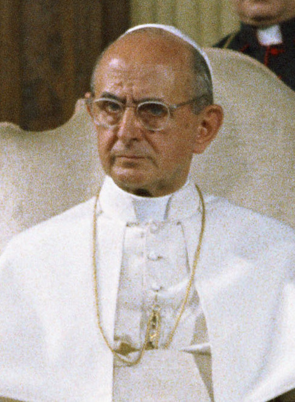
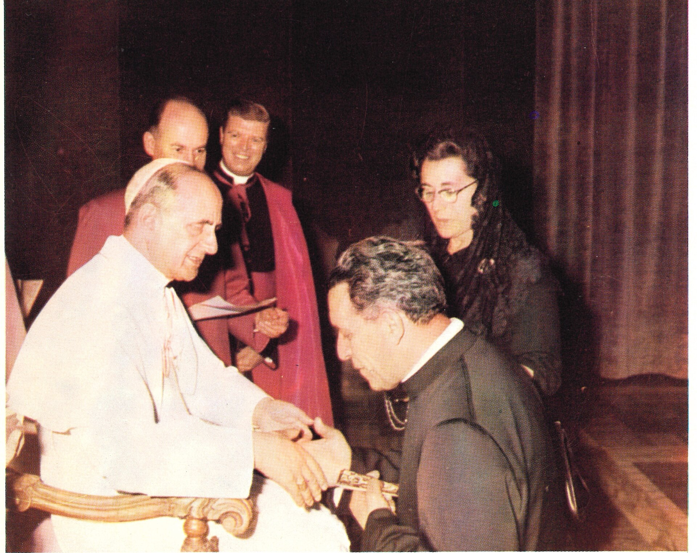
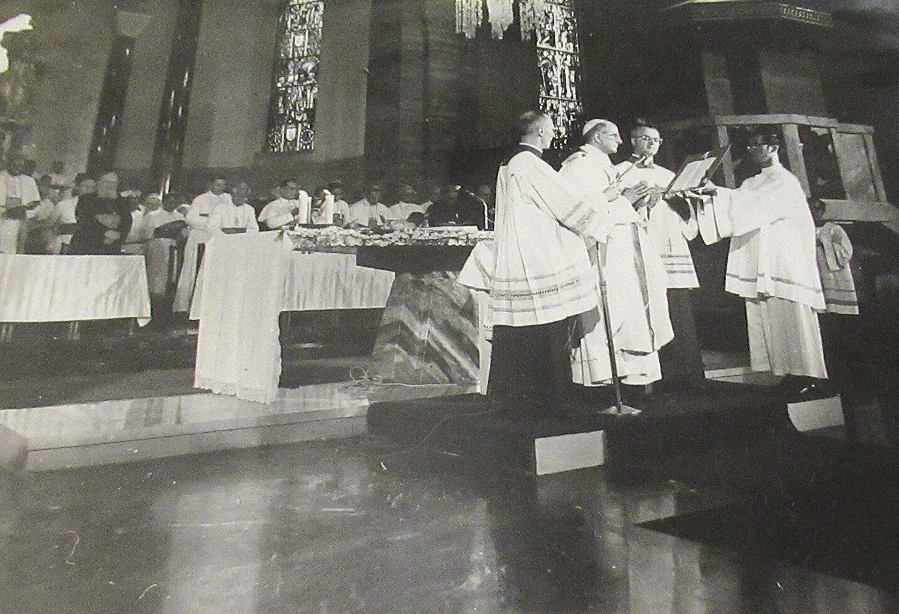

56년 전 오늘, 1970년 11월 27일. 교황 바오로 6세가 필리핀 마닐라 국제공항에서 괴한의 칼에 찔릴 뻔한 위기를 모면했습니다. 평화와 복음을 전하기 위해 아시아를 찾은 교황의 발걸음 앞에 사제 복장을 한 자객이 흉기를 꺼내 들며 전 세계를 경악에 빠뜨렸습니다.

## 환호로 가득 찼던 마닐라 국제공항

1970년 11월 27일 오전 9시 25분, 교황 바오로 6세를 태운 전용기가 필리핀 마닐라 국제공항에 착륙했습니다. 이번 방문은 교황의 최장거리 아시아 태평양 순방 일정 가운데 세 번째 기착지였습니다.

비행기 계단을 내려서는 교황의 모습을 보기 위해 공항 활주로 주변에는 수많은 환영 인파가 몰려들었습니다. 한국 천주교회를 대표해 순방을 함께 맞이하던 김수환 추기경을 비롯한 각국 고위 성직자들도 비행기 앞쪽에서 교황을 영접할 준비를 하고 있었습니다.

## 환영객 속에서 뛰쳐나온 신부 복장의 괴한

교황이 지상에 발을 디디며 환영객들을 향해 손을 흔들던 바로 그 순간, 비극적인 사태가 터졌습니다. 환영 인파 속에서 검은색과 하얀색 사제복을 차려입은 한 남성이 갑자기 뛰쳐나왔습니다.

그는 품에서 번쩍이는 6인치 길이의 칼을 꺼내 들고 교황의 가슴을 향해 무서운 기세로 돌진했습니다. 사제 복장으로 위장해 경비망을 뚫고 교황 지척까지 접근한 치밀한 암살 시도였습니다.

*Paul VI cropped — 사진: Robert LeRoy Knudsen / Public domain*

## 김수환 추기경의 다급했던 제지와 난투극

순식간에 벌어진 위기 속에서 가장 먼저 반응한 사람 중 한 명은 바로 한국의 김수환 추기경이었습니다. 교황을 맞이하기 위해 가까이 서 있던 김 추기경은 위험을 감지하고 재빨리 교황과 괴한 사이를 막아섰습니다.

현장에 있던 신변 경호원들과 김 추기경이 괴한에게 달려들면서 격렬한 난투극이 벌어졌습니다. 범인이 마구 휘두른 흉기에 김수환 추기경은 손에 자상을 입으며 피를 흘렸습니다. 현장에서 범인을 제압하지 못했다면 교황의 생명이 위태로울 뻔한 아찔한 순간이었습니다.

*Don Alfredo Ricci con Papa Paolo VI — 사진: Andrea Leopaldi / CC BY-SA 4.0*

## 범인은 볼리비아 출신의 떠돌이 화가

현장에서 체포되어 경찰차로 압송된 범인은 볼리비아 수도 라파스 출신의 서른다섯 살 떠돌이 화가 벤자민 멘도사로 밝혀졌습니다. 마닐라 경찰당국의 조사에 따르면 그는 교황이 필리핀에 도착하기 사흘 전에 이미 입국해 범행을 준비했습니다.

경비원들에게 제압되어 끌려가면서도 멘도사는 "나는 해방시키고 싶다"고 고함을 질렀습니다. 범행 동기를 둘러싸고 여러 의문이 일었으나, 그는 사제 행세를 하며 보안을 뚫고 국가 원수급 경호를 무너뜨린 흉악범으로 즉각 구금되었습니다.

*Photographs of Paulus VI (2023-07-03) E911a 02 — 사진: E911a / Public domain*

## 동요 없이 연단에 오른 바오로 6세

칼끝이 스쳐 지나가는 위기를 겪었지만, 교황 바오로 6세는 놀라울 정도로 태연한 태도를 유지했습니다. 현장을 수습한 교황은 조금의 동요도 보이지 않고 페르디난드 마르코스 필리핀 대통령과 함께 준비된 환영식 연단으로 천천히 걸어 나갔습니다.

교황은 연설을 통해 아시아 사람들에게 복음을 전할 수 있는 방법을 찾기 위해 이곳을 찾았다고 차분하게 밝혔습니다. 사건이 워낙 순식간에 일어났던 데다 교황이 의연하게 대처한 덕분에, 멀리서 환호하던 수많은 군중은 암살 미수 사건이 일어났다는 사실조차 모른 채 열렬한 박수를 보냈습니다.

## 한국 천주교회의 헌신과 기억

사건 직후 필리핀 가비올라 주교는 김수환 추기경이 다치지 않았으며 손에 묻은 피는 다른 사람의 피라고 전하기도 했으나, 긴박했던 당시 상황은 국내 신문 1면을 대대적으로 장식했습니다. 교황을 지키기 위해 물러서지 않았던 김 추기경의 용기 있는 행동은 한국 교회와 국민들에게 깊은 인상을 남겼습니다.

교황 바오로 6세의 마닐라 피습 사건은 경호와 안전의 중요성을 일깨운 사건인 동시에, 위기 앞에서도 흐트러지지 않았던 종교 지도자들의 의연한 모습을 증언하는 역사적인 순간으로 기록되어 있습니다.

### 참고 자료

- <https://newslibrary.naver.com/viewer/index.naver?articleId=1970112700329201005&editNo=2&printCount=1&publishDate=1970-11-27&officeId=00032&pageNo=1&printNo=7739&publishType=00020>
- <https://commons.wikimedia.org/wiki/File:Diario_Sirio-Liban%C3%A9s,_a%C3%B1o_42,_n_10617.png>
- <https://commons.wikimedia.org/wiki/File:Paul_VI_cropped.jpg>
- <https://commons.wikimedia.org/wiki/File:Don_Alfredo_Ricci_con_Papa_Paolo_VI.jpg>
- <https://commons.wikimedia.org/wiki/File:Photographs_of_Paulus_VI_(2023-07-03)_E911a_02.jpg>
