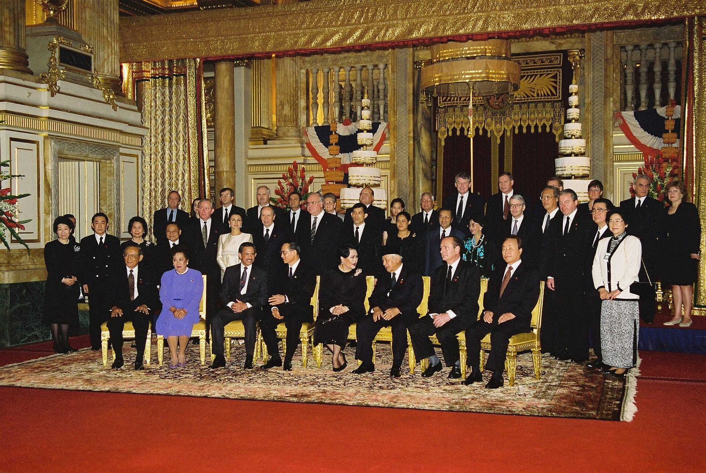
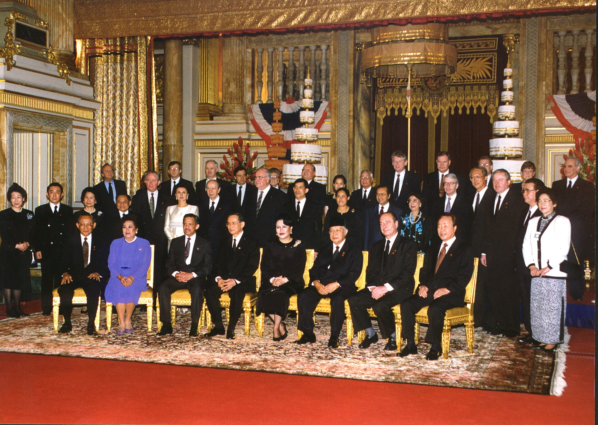
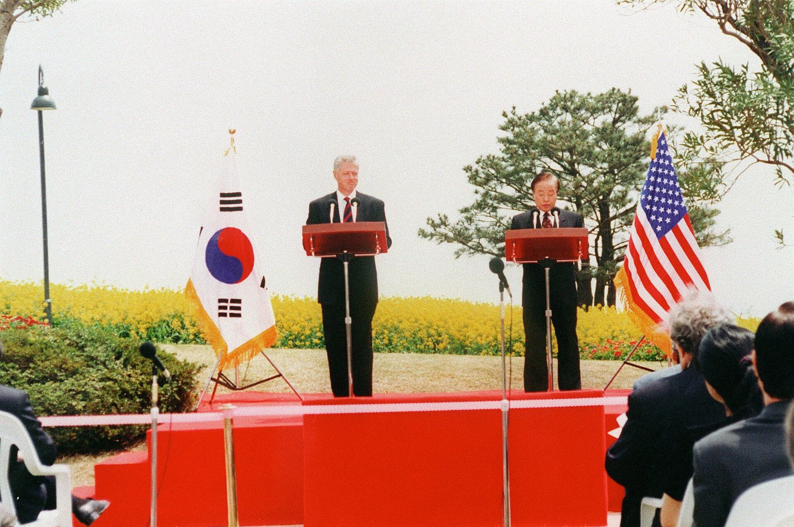

30년 전 오늘, 1996년 11월 27일 한국의 경제협력개발기구(OECD) 가입 비준동의안이 국회 본회의를 통과했습니다. 전날 오후 열린 국회 본회의에서 기립표결을 통해 찬성 159표, 반대 101표로 비준안이 최종 의결되면서 한국은 연내 OECD의 29번째 회원국 가입을 눈앞에 두게 되었습니다.

## 세계 경제 무대의 중심, OECD 가입을 향한 도전

경제협력개발기구(OECD)는 1961년 서방 선진국들을 중심으로 출범한 국제기구로, 흔히 '선진국 클럽'으로 불려왔습니다. 민주주의와 시장경제라는 가치를 공유하며 세계 경제 성장과 무역 확대를 도모하는 기구인 만큼, 여기에 가입한다는 것은 국제 사회에서 선진 경제국으로 공식 인정받는 상징적인 의미를 지녔습니다.

정부는 1990년대 들어 세계화 정책의 일환으로 OECD 가입을 적극 추진했습니다. 가입을 통해 한국 경제의 체질을 개선하고 국제 규범에 발맞춘 정책 투명성을 확보하겠다는 구상이었습니다. 하지만 이를 위해서는 자본시장과 금융시장의 빗장을 열어야 했기에, 국내 산업계와 정치권에서는 가입 시기와 속도를 둘러싸고 오랜 시간 격렬한 논쟁이 이어졌습니다.

## 팽팽하게 맞선 찬반 토론, 본회의장의 긴장감

1996년 11월 26일 오후 국회 본회의장에서는 표결에 앞서 여야 의원들의 치열한 찬반 토론이 벌어졌습니다. 신한국당의 이강희, 이신범, 차수명 의원과 민주당의 이규정 의원은 찬성 발언에 나섰습니다. 차수명 의원은 OECD 가입이 정부 정책의 투명성을 높이고 규제 완화를 앞당기며, 국제 경제 질서 형성 과정에 직접 참여해 국익을 반영할 수 있는 결정적인 계기가 될 것이라고 강조했습니다. 자본시장 개방에 따른 부작용 역시 거시경제 정책을 적절히 운용하면 충분히 관리할 수 있다고 주장했습니다.

반면 야당 의원들의 반격도 거셌습니다. 국민회의의 장재식, 박광태, 김영진 의원과 자민련의 변웅전, 이인구 의원은 단상에 올라 현 경제 상황의 엄중함을 경고했습니다. 장재식 의원은 당시 경상수지 적자가 사상 최대로 늘어나고 경기 침체가 깊어지는 상황을 지적하며, 시장 개방이 미칠 충격을 면밀히 분석하고 충분한 대응책을 마련할 때까지 가입을 유보해야 한다고 맞섰습니다. 매년 막대한 외국 자본이 유입되고 원화 절상으로 대외 무역 적자가 더 심각해져 한국 경제가 선진국의 희생물이 될 수 있다는 우려였습니다.

*1st Asia Europe Summit (ASEM), Bangkok - Group photo 2 — 사진: Christian Lambiotte / CC BY 4.0*

## 의원들이 일어선 기립표결, 찬성 159표로 통과

열띤 토론 끝에 진행된 표결 방식은 전자의회가 아닌 의원들이 자리에서 직접 일어서는 기립표결이었습니다. 전체 국회의원 299명 가운데 262명이 표결에 참여했습니다.

표결 결과는 찬성 159명, 반대 101명, 기권 2명이었습니다. 여당인 신한국당과 민주당 의원 대다수가 기립해 찬성표를 던졌고, 야당인 국민회의와 자민련 의원들은 반대표를 던졌습니다. 기권은 국민회의 김원길 의원과 민주당 의원 1명 등 단 2명이었습니다. 표결 결과에 따라 OECD 협약 가입 비준동의안은 국회의 문턱을 넘어섰고, 함께 상정된 OECD 특권면제협정 비준동의안도 함께 의결되어 국내에서 활동할 회원국 대표단의 면세 및 외교관 준우대 혜택도 법적 근거를 갖추게 되었습니다.

*1st Asia Europe Summit (ASEM), Bangkok - Group photo 1 — 사진: Christian Lambiotte / CC BY 4.0*

## 29번째 회원국 진입과 닥쳐온 과제

국회 비준이 완료됨에 따라 남은 절차는 15일 이내 대통령의 공식 비준을 거쳐 프랑스 파리에 위치한 OECD 본부에 가입서를 기탁하는 일이었습니다. 가입서가 프랑스 정부에 정식 기탁되면서 한국은 연내 29번째 정식 회원국으로 이름을 올리게 되었습니다.

비준안 통과 당시 선진국 대열 합류라는 자부심과 기대감이 컸던 것은 사실입니다. 그러나 국회 토론에서 지적되었던 금융시장 조기 개방의 위험과 대외 건전성 악화에 대한 우려는 결코 가볍지 않은 경고였습니다. 충분한 금융 감독 체계와 기초 체력을 다지지 못한 채 맞이한 급격한 개방의 물결은, 이듬해 외환위기라는 혹독한 시련과 맞물리며 한국 경제에 깊은 교훈을 남겼습니다.

*United States President Bill Clinton and Korean President Kim Yong Sam at podiums in Chejudo — 사진: Series: Combined Military Service Digital Photographic Files / Public domain*

## 그 시절 텔레비전 앞의 기억

1996년 늦가을, 신문 1면과 저녁 뉴스는 연일 OECD 가입 비준안 통과 소식과 함께 선진국 진입이라는 단어로 뜨겁게 달아올랐습니다. 시민들은 우리 경제가 전쟁의 폐허를 딛고 마침내 선진국들과 어깨를 나란히 하게 되었다는 벅찬 마음을 가지면서도, 한편으로는 잇따른 무역 적자와 불황 소식에 마음을 졸이기도 했습니다.

그로부터 30년이 지난 지금, 한국은 OECD 내에서도 주요 경제국으로 자리 잡았습니다. 화려한 선진국 진입의 문턱에서 찬반 양론이 거세게 부딪쳤던 1996년 11월 27일의 그 소식을, 시청자 여러분은 그때 어떤 마음으로 들으셨습니까.

### 참고 자료

- <https://newslibrary.naver.com/viewer/index.naver?articleId=1996112700209101002&editNo=45&printCount=1&publishDate=1996-11-27&officeId=00020&pageNo=1&printNo=23379&publishType=00010>
- <https://commons.wikimedia.org/wiki/File:Kim_Young_Sam_1996.png>
- <https://commons.wikimedia.org/wiki/File:1st_Asia_Europe_Summit_(ASEM),_Bangkok_-_Group_photo_2.jpg>
- <https://commons.wikimedia.org/wiki/File:1st_Asia_Europe_Summit_(ASEM),_Bangkok_-_Group_photo_1.jpg>
- <https://commons.wikimedia.org/wiki/File:United_States_President_Bill_Clinton_and_Korean_President_Kim_Yong_Sam_at_podiums_in_Chejudo.jpg>
