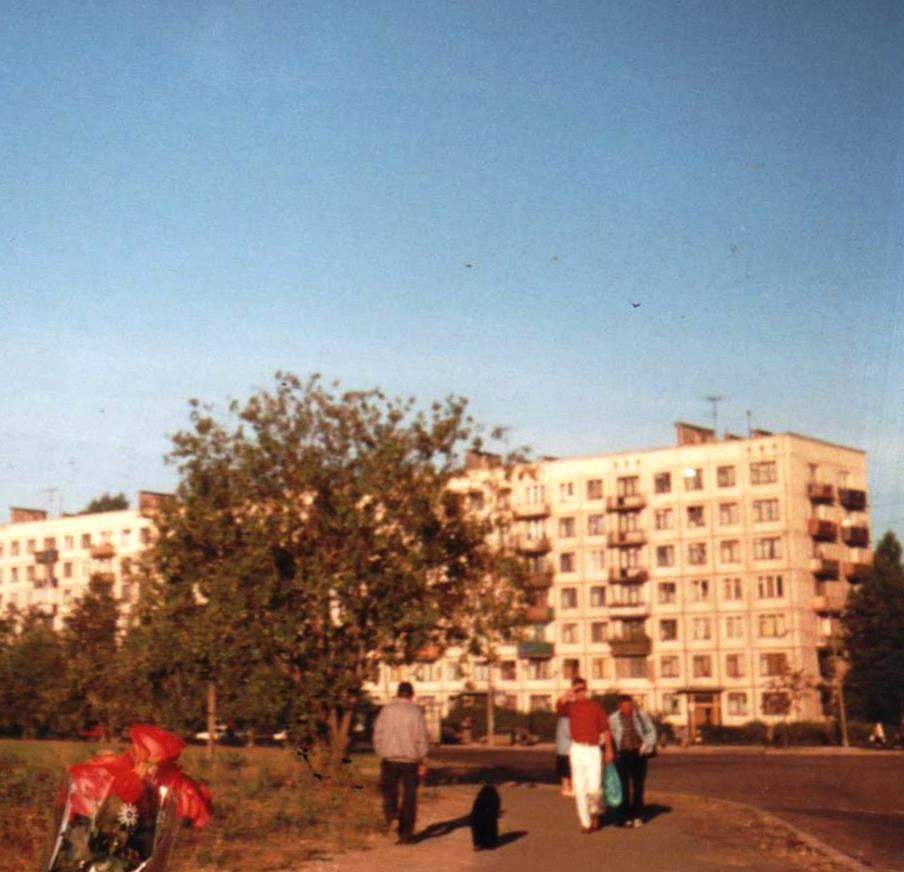
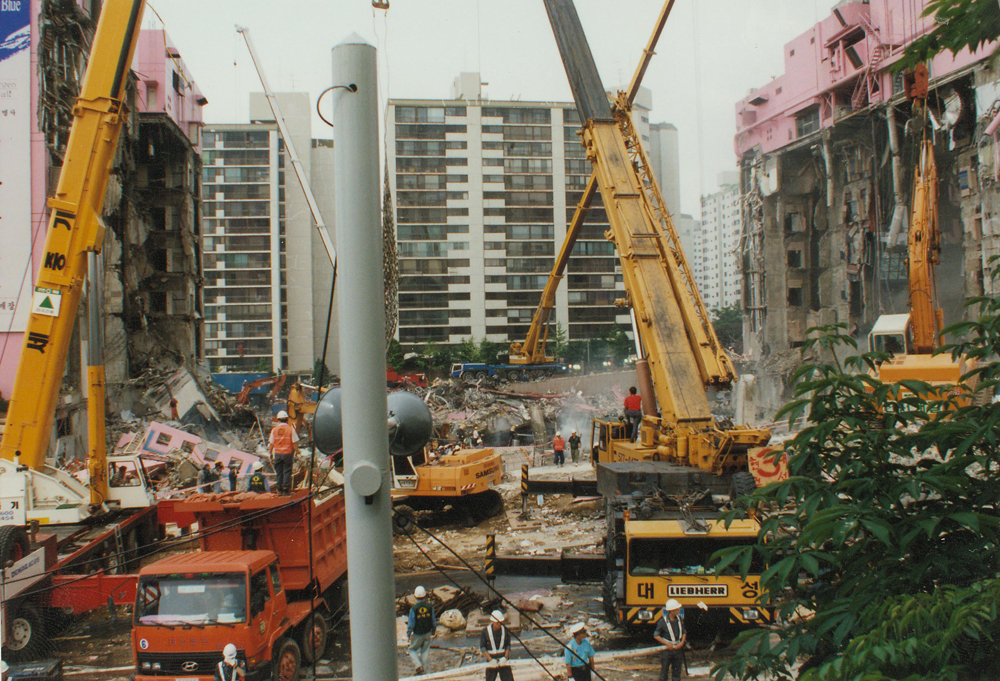
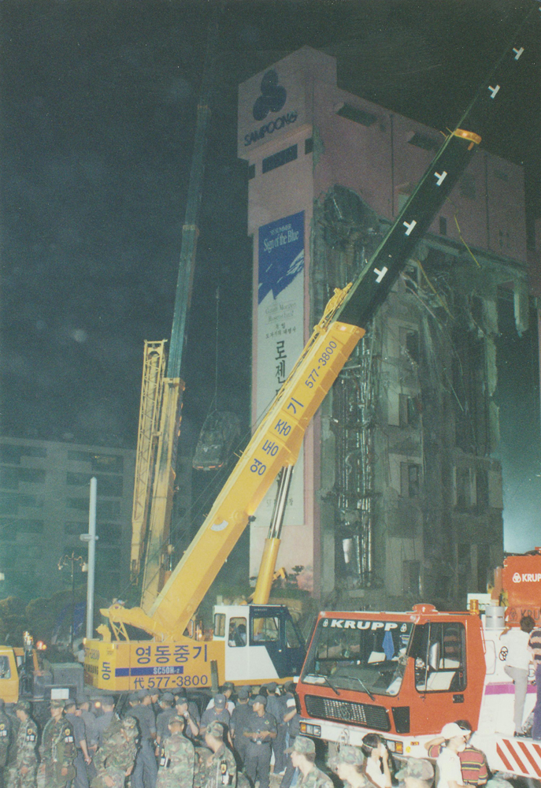

29년 전 오늘인 1997년 11월 27일, 대한민국 재계 1위 삼성그룹이 그룹 전 계열사의 조직을 30% 축소하는 초긴축 감량경영을 전격 발표했습니다. 국제통화기금(IMF) 자금지원 신청이라는 초유의 국가적 경제 위기 속에서, 20만 명이 넘는 임직원을 거느린 거대 기업조차 생존을 위해 대대적인 수술대에 올랐던 날이었습니다.

## IMF 외환위기의 한파와 벼랑 끝 경제

1997년 11월 말 대한민국은 거대한 경제적 충격 속에 빠져 있었습니다. 외환보유액이 바닥을 드러내며 정부가 국제통화기금(IMF)에 긴급 구제금융을 요청했고, 금융권과 기업 전반으로 부도 공포가 걷잡을 수 없이 번져갔습니다.

외환위기의 파도는 굴지의 대기업들마저 위협했습니다. 당시 22개 계열사에 임직원 20만여 명을 두고 있던 삼성그룹 역시 예외가 아니었습니다. 평소와 같은 경영 방식으로는 살아남을 수 없다는 위기감이 팽배해졌습니다.

## 사장단회의에서 결의된 초긴축 경영혁신 방안

1997년 11월 26일 오전, 삼성그룹은 이수빈 삼성생명 회장의 주재로 그룹 사장단회의를 열었습니다. 이 자리에서 사장단은 '위기 타개를 위한 경영혁신 방안'을 최종 확정하고 이튿날 신문을 통해 세상에 알렸습니다.

발표된 개혁안의 핵심은 조직 축소였습니다. 세분화되어 있던 사업부와 팀을 대사업부와 대팀 체제로 통폐합해 조직 규모를 30% 줄이기로 했습니다. 이를 통해 복잡한 결재 단계를 줄이고 급박한 경영 환경에 맞게 현장 대응력을 신속히 높이겠다는 구상이었습니다.

*1997년 자료 — 사진: Monoklon / CC BY-SA 4.0*

## 창사 이래 처음 단행된 임금 삭감과 동결

조직 축소와 함께 발표된 조치는 임금과 경비의 대대적인 삭감이었습니다. 삼성그룹은 창업 이래 처음으로 임원의 연봉을 10% 삭감하기로 결정했습니다. 또한 부장과 차장급 이상 간부사원에게 연봉제를 전면 도입하고, 과장급 이하 일반 사원의 임금총액은 동결하기로 했습니다.

경비 절감 조치도 혹독했습니다. 행사비와 접대비 등 각종 경비를 50% 줄이고, 에너지 비용을 30% 절감해 총 1조여 원의 경비를 줄이기로 했습니다. 내년도 그룹 전체 투자 규모 역시 기존의 8조 2천억 원에서 30%가량 줄어든 6조 원 안팎으로 크게 낮췄습니다.

*사건 당시 사진 아님 · 1995년 — 사진: 서울특별시 소방재난본부 / CC BY-SA 4.0*

## 한계사업 정리와 불가피해진 감원 태풍

삼성은 매출액 기준으로 1조 3천억 원에 이르는 34개 한계사업을 정리하겠다는 방침도 함께 내놓았습니다. 이들 사업에 종사하던 2천여 명의 인력은 다른 계열사로 재배치하기로 했습니다. 해외 주재원 수당을 10% 깎고 해외 출장 여비 기준도 10% 축소했습니다.

당시 삼성 측은 인위적인 인력 감축은 없다고 밝혔으나, 조직 30% 축소와 한계사업 정리 과정에서 대규모 감원은 피할 수 없는 현실이었습니다. 삼성 비서실 지승림 전무는 "기업 사정이 일반적으로 알고 있는 것보다 훨씬 더 어렵다"며 "경제가 위기 상황인 만큼 종래와 같은 방법으로는 대응할 수 없어 생존전략 차원에서 혁신방안을 마련했다"고 밝혔습니다.

*사건 당시 사진 아님 · 1995년 — 사진: 서울특별시 소방재난본부 / CC BY-SA 4.0*

## 재계 전체로 번져간 구조조정의 파도

재계를 주도하던 삼성의 초긴축 선언은 산업계 전반에 거대한 파장을 일으켰습니다. 현대, 엘지, 대우 등 다른 주요 대기업들도 잇따라 비상경영 체제에 돌입하며 감량경영과 경비 절감 대책을 쏟아냈습니다.

이날 삼성의 발표는 단순한 한 기업의 계획을 넘어, 대한민국 사회 전체를 뒤흔든 구조조정과 대량 실직 사태의 본격적인 신호탄이었습니다. 수많은 직장인과 가족들이 하루아침에 고용 불안의 공포와 마주해야 했던 시절이었습니다.

## 그 시절 텔레비전 뉴스를 지켜보던 국민들의 기억

1997년 11월 27일 조간신문 1면을 도배했던 '삼성 조직 30% 감축'이라는 헤드라인은 당시 온 국민에게 깊은 충격을 안겼습니다. 탄탄하던 대기업조차 허리띠를 졸라매야 했던 현실은 외환위기의 매서운 칼바람을 실감하게 만들었습니다.

그 시절 긴박하게 쏟아지던 기업들의 구조조정 뉴스와 감원 소식을 숨죽여 지켜보며, 한 치 앞을 내다보기 힘들었던 나라 경제를 함께 걱정하던 그날의 기억은 지금도 많은 이들의 가슴속에 생생하게 남아 있습니다.

### 참고 자료

- <https://newslibrary.naver.com/viewer/index.naver?articleId=1997112700289101001&editNo=6&printCount=1&publishDate=1997-11-27&officeId=00028&pageNo=1&printNo=3047&publishType=00010>
- <https://commons.wikimedia.org/wiki/File:Night_on_a_Seoul_street_1997.jpg>
- <https://commons.wikimedia.org/wiki/File:%D0%94%D0%BE%D0%BC_%D1%82%D0%B8%D0%BF%D0%B0_%D0%AD5-58_(1997).jpg>
- <https://commons.wikimedia.org/wiki/File:19950629%EC%82%BC%ED%92%8D%EB%B0%B1%ED%99%94%EC%A0%90_%EB%B6%95%EA%B4%B4_%EC%82%AC%EA%B3%A014.jpg>
- <https://commons.wikimedia.org/wiki/File:19950629%EC%82%BC%ED%92%8D%EB%B0%B1%ED%99%94%EC%A0%90_%EB%B6%95%EA%B4%B4_%EC%82%AC%EA%B3%A03.jpg>
