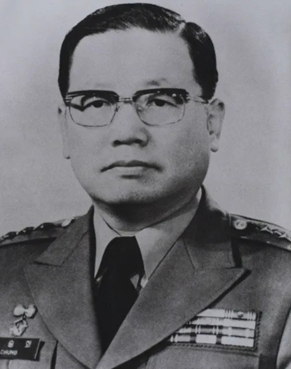
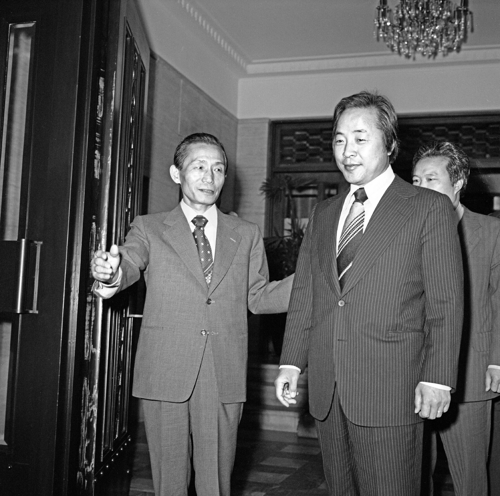
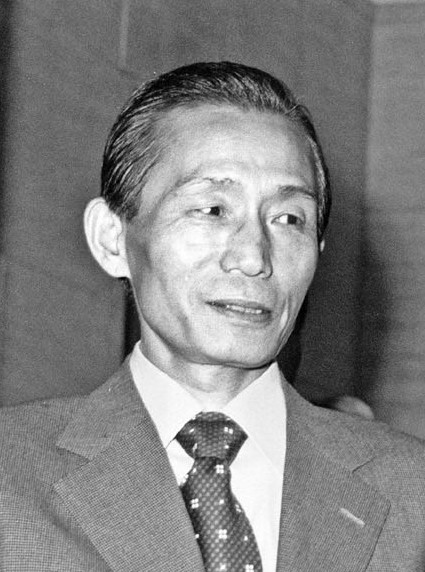

47년 전 오늘, 1979년 11월 27일. 박정희 대통령 시해 사건을 수사하던 군 당국이 김재규 전 중앙정보부장 등 핵심 관계자 8명을 군법회의에 정식 기소했다고 밝혔습니다. 사건 발생 한 달 만에 국가원수 시해라는 사상 초유의 사건이 군사재판의 심판대로 넘겨졌습니다.

## 궁정동의 총성과 10·26 사건의 전말

1979년 10월 26일 저녁, 서울 종로구 궁정동 안가 만찬장에서 총성이 울렸습니다. 박정희 대통령은 삽교천 방조제 준공식과 대북용 한국방송 당진 송신소 개소식 일정을 마치고 돌아와 측근들과 만찬을 갖던 중이었습니다. 이 자리에서 김재규 중앙정보부장이 발사한 총탄에 박정희 대통령과 차지철 경호실장이 쓰러졌고, 대통령은 국군서울지구병원으로 후송되던 중 만 61세를 일기로 숨을 거두었습니다.

## 합동수사본부 수사와 군법회의 송치

사건 직후 계엄령이 선포되었고 계엄사령부 합동수사본부가 설치되어 사건 경위와 가담자에 대한 집중 수사가 진행되었습니다. 합동수사본부는 범행 보름여 만인 1979년 11월 13일 오전 9시 30분, 피의자들을 육군본부 계엄보통군법회의 검찰부로 전원 구속 송치했습니다. 국가원수가 살해당한 충격 속에서 국민들은 수사 결과와 재판이 과연 어떤 방식으로 전개될지 숨을 죽이고 지켜보았습니다.

*1979년 자료 — 사진: Chief of Staff of the Republic of Korea Army/Ministry of Nat / Public domain*

## 기소된 8명과 적용된 형법 조항

11월 27일 계엄사령부 발표에 따르면, 검찰부는 11월 26일 자로 관련 피의자 8명을 기소 처분했습니다. 기소 대상은 김재규(53세·전 중앙정보부장), 김계원(56세·전 대통령 비서실장), 박선호(45세·전 중앙정보부 비서실 의전과장), 박흥주(40세·전 부장수행비서관), 이기주(31세·경비원), 유성옥(36세·운전사), 김태원(32세·경비원), 유석술(30세·경비원)이었습니다. 이 중 유석술을 제외한 7명에게는 형법 제87조 내란죄, 제88조 내란목적 살인죄, 제89조 미수범, 제30조 공동정범 조항이 적용되었으며, 유석술에게는 형법 제155조 제1항의 증거인멸죄가 적용되었습니다.

*1975년 자료 — 사진: 대한민국 정부 / Public domain*

## 극형 규정과 다음 주로 예고된 첫 공판

적용된 법 조항 중 내란목적 살인죄는 국토를 참절하거나 국헌을 문란할 목적으로 사람을 살해했을 때 성립하며 사형, 무기징역 또는 무기금고형에 처하도록 규정된 중죄였습니다. 검찰부는 이들이 조직적으로 역할을 분담하여 국가원수를 살해하고 국가의 헌정 질서를 어지럽히는 반란을 기도했다고 판단했습니다. 계엄사는 이들 피고인 8명에 대한 첫 공판을 다음 주 중에 즉각 개정하겠다고 밝혀 신속한 군사재판 절차를 예고했습니다.

*사건 당시 사진 아님 · 1975년 — 사진: {{|대한민국 정부}} / Public domain*

## 한국 현대사를 뒤흔든 격변의 신호탄

1961년 이후 18년 가까이 지속되던 유신 체제는 궁정동의 총성과 함께 급작스러운 파국을 맞았습니다. 최고 권력의 정점에 있던 인물들이 피고인 신분으로 군사법정에 서게 되면서 한국 사회는 극도의 긴장감에 휩싸였습니다. 이후 열린 군법회의 공판 과정과 판결은 정치 군부의 대두와 맞물리며 대한민국 현대사의 물줄기를 돌이킬 수 없는 소용돌이 속으로 이끌게 됩니다.

### 참고 자료

- <https://newslibrary.naver.com/viewer/index.naver?articleId=1979112700329201003&editNo=2&printCount=1&publishDate=1979-11-27&officeId=00032&pageNo=1&printNo=10511&publishType=00020>
- <https://commons.wikimedia.org/wiki/File:Reporting_on_a_rooftop_1979-11-03.png>
- <https://commons.wikimedia.org/wiki/File:General_Jeong_Seung-hwa.jpg>
- <https://commons.wikimedia.org/wiki/File:%EB%B0%95%EC%A0%95%ED%9D%AC_%EB%8C%80%ED%86%B5%EB%A0%B9_%EA%B9%80%EC%98%81%EC%82%BC_%EC%8B%A0%EB%AF%BC%EB%8B%B9_%EC%B4%9D%EC%9E%AC_%EC%A0%91%EA%B2%AC.jpg>
- <https://commons.wikimedia.org/wiki/File:%EB%B0%95%EC%A0%95%ED%9D%AC_%EB%8C%80%ED%86%B5%EB%A0%B9_%EA%B9%80%EC%98%81%EC%82%BC_%EC%8B%A0%EB%AF%BC%EB%8B%B9_%EC%B4%9D%EC%9E%AC_%EC%A0%91%EA%B2%AC_(cropped).jpg>
