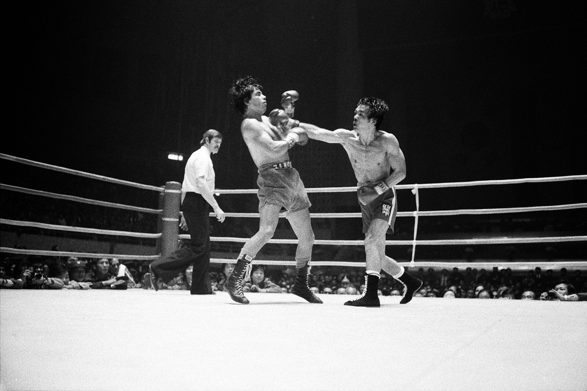
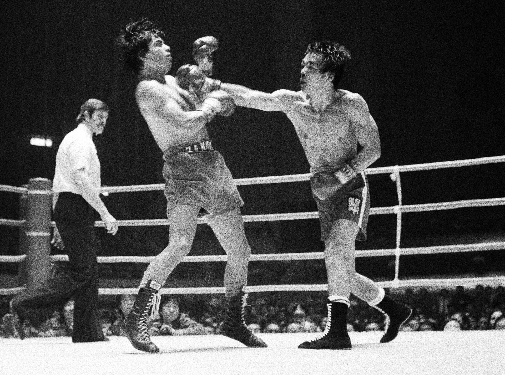
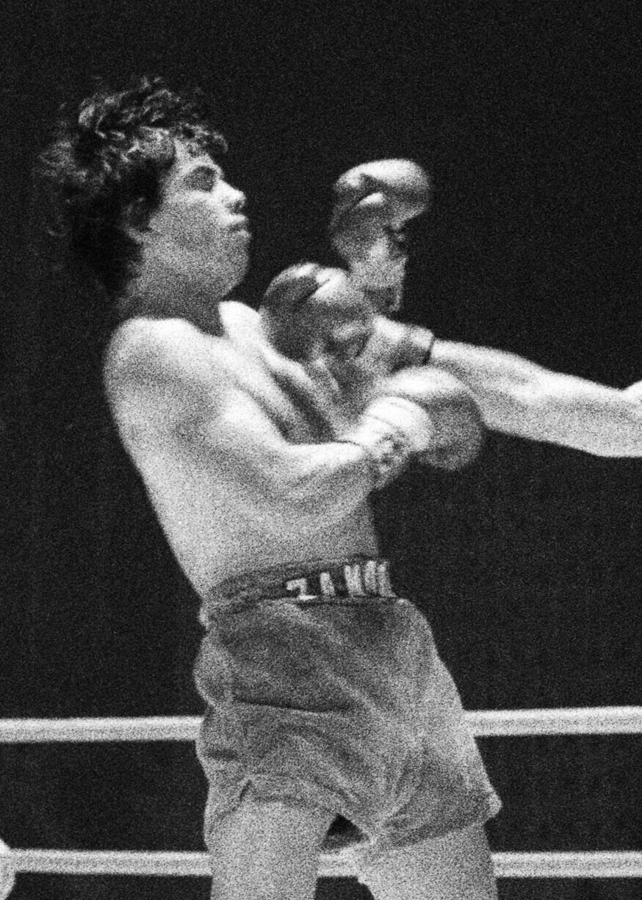

49년 전 오늘, 1977년 11월 28일. 권투 선수 홍수환이 한 라운드에 네 번이나 쓰러지고도 다시 일어나 기적 같은 역전 케이오승을 거두었습니다. 절망적인 패색을 딛고 세계 정상에 우뚝 선 이 경기는 한국 스포츠 역사상 가장 극적인 순간 중 하나로 기록되었습니다.

## 11전 11KO의 강타자와 마주 선 원정길

경기는 한국 시간으로 1977년 11월 27일 낮 12시 30분, 파나마시티 뉴파나마 체육관에서 열렸습니다. 세계복싱협회(WBA)가 신설한 주니어페더급 초대 챔피언 타이틀을 놓고 펼쳐진 15회전 경기였습니다. 당시 스물일곱 살이던 홍수환의 상대는 파나마의 엑토르 카라스키야였습니다.

카라스키야는 11전 11KO승이라는 살인적인 강펀치를 자랑하며 현지에서 '지옥에서 온 악마'로 불리던 열일곱 살의 신예였습니다. 1만 6천여 명의 현지 관중이 체육관을 가득 채우며 일방적인 응원을 보냈고, 한국 교포는 불과 40여 명에 지나지 않았습니다. 적지의 텃세와 압도적인 기세 속에서 치러진 험난한 도전이었습니다.

## 절망의 2회, 링 위에 4차례 쓰러지다

1회 초반 홍수환은 적극적인 공세를 펴며 주도권을 잡는 듯 보였습니다. 그러나 운명의 2회가 시작되자 카라스키야의 무서운 강타가 쏟아져 들어왔습니다. 소나기 펀치를 허용한 홍수환은 중심을 잃고 링 바닥에 쓰러졌습니다.

일어나면 다시 강펀치가 날아들었고, 홍수환은 2회 한 라운드 동안 무려 네 차례나 다운을 당했습니다. 턱과 옆구리에 치명적인 타격을 입은 홍수환의 몸은 무거워졌고 관중석은 카라스키야의 승리를 확신하는 환호성으로 뒤덮였습니다. 누구라도 패배를 직감할 수밖에 없던 절망의 순간이었습니다.

*사건 당시 사진 아님 · 1976년 — 사진: 대한민국 정부 / Public domain*

## 3회 48초 만에 터진 기적의 역전 드라마

하지만 홍수환의 집념은 꺾이지 않았습니다. 승리에 도취해 방심하고 있던 카라스키야를 향해 홍수환은 3회 공이 울리자마자 무섭게 돌진했습니다. 홍수환은 카라스키야를 로프로 몰아붙인 뒤 전광석화 같은 레프트 훅으로 상대의 오른쪽 옆구리를 강타했습니다.

충격을 받은 카라스키야가 중심을 잃고 흔들리자, 홍수환은 빈틈을 놓치지 않고 강력한 라이트 어퍼컷과 레프트 훅을 연달아 꽂아 넣었습니다. 마지막 레프트 펀치가 카라스키야의 턱에 작렬하는 순간 무패의 KO왕은 그대로 캔버스에 고꾸라졌습니다. 3회 48초, 절망을 환희로 바꾼 기적의 역전 KO승이었습니다.

*사건 당시 사진 아님 · 1976년 — 사진: 대한민국 정부 / Public domain*

## 세계 권투사에 남은 불멸의 대기록

한 라운드에서 네 번이나 쓰러진 선수가 바로 다음 라운드에서 상대를 KO로 눕히고 역전승을 거둔 것은 세계 프로복싱 사상 유례가 없는 최초의 사건이었습니다. 심판의 카운트가 끝나는 순간 파나마 체육관은 경악에 휩싸였고, 40여 명의 교포들은 눈물을 흘리며 환호했습니다.

이 승리로 홍수환은 WBA 주니어페더급 초대 챔피언에 올랐습니다. 1974년 남아프리카공화국 원정에서 밴텀급 챔피언에 오른 뒤 타이틀을 내줬던 그가, 체급을 올려 다시 세계 정상을 탈환하며 한국 복싱 역사상 최초로 두 체급을 석권하는 쾌거를 이룩한 날이었습니다.

*사건 당시 사진 아님 · 1976년 — 사진: 대한민국 정부 / Public domain*

## 시대의 희망이 된 불굴의 오뚝이 정신

1974년 밴텀급 챔피언 등극 당시 어머니와의 통화에서 남긴 "엄마 나 챔피언 먹었어"라는 말로 온 국민을 울렸던 홍수환은, 이번 파나마 원정을 통해 '4전 5기'라는 불멸의 별칭을 얻었습니다. 네 번 쓰러져도 다섯 번 일어난다는 이 말은 단순한 경기 결과를 넘어 절망 속에서도 포기하지 않는 한국인의 상징으로 자리 잡았습니다.

고단한 삶을 이어가던 수많은 서민에게 홍수환의 역전극은 '우리도 다시 일어설 수 있다'는 크나큰 용기를 불어넣어 주었습니다. 49년이 흐른 오늘날에도 1977년 11월 뉴파나마 체육관의 3회 48초는 수많은 이들의 가슴속에 뜨거운 기억으로 남아 있습니다.

### 참고 자료

- <https://newslibrary.naver.com/viewer/index.naver?articleId=1977112800209201021&editNo=2&printCount=1&publishDate=1977-11-28&officeId=00020&pageNo=1&printNo=17278&publishType=00020>
- <https://commons.wikimedia.org/wiki/File:Hong_Soo-hwan_(cropped).jpg>
- <https://commons.wikimedia.org/wiki/File:%ED%94%84%EB%A1%9C%EB%B3%B5%EC%8B%B1_WBC_%EB%B0%B4%ED%85%80%EA%B8%89_%ED%83%80%EC%9D%B4%ED%8B%80%EB%A7%A4%EC%B9%98_%ED%99%8D%EC%88%98%ED%99%98_%EB%8C%80_%EC%9E%90%EB%AA%A8%EB%9D%BC_%EA%B2%BD%EA%B8%B0.jpg>
- <https://commons.wikimedia.org/wiki/File:Alfonso_Zamora_vs._Soo-Hwan_Hong.jpg>
- <https://commons.wikimedia.org/wiki/File:Alfonso_Zamora_(cropped).jpg>
