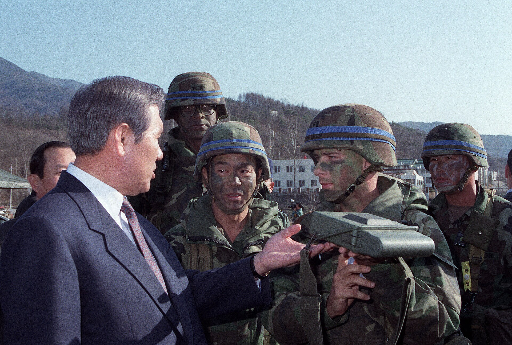
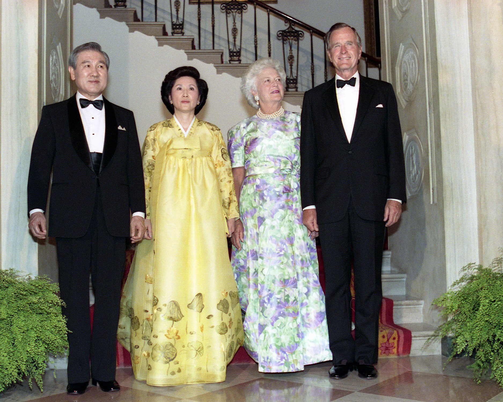
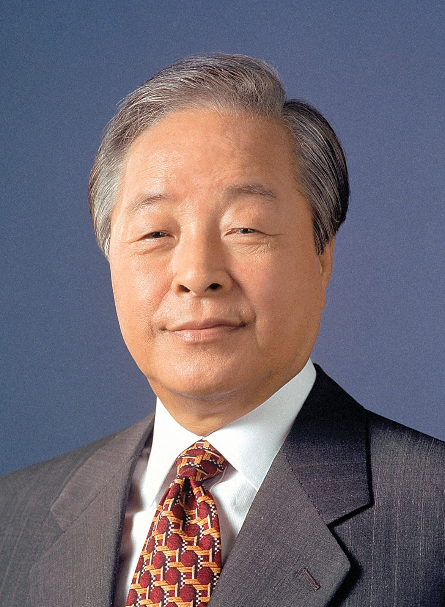

31년 전 오늘, 1995년 11월 28일. 조간신문 1면에는 사법 역사의 물줄기를 바꾼 중대한 소식이 일제히 실렸습니다. 헌법재판소가 5·18 헌법소원 사건을 심리하며 '성공한 내란도 처벌할 수 있다'는 최종 결론을 내리고 검찰의 불기소 처분이 부당하다는 판단을 확정했다는 소식이었습니다.

## 사회적 공분을 부른 ‘성공한 내란’ 불기소 논리

1995년 7월, 검찰은 12·12 및 5·18 관련 고소·고발 사건에 대해 '공소권 없음' 결정을 내렸습니다. 당시 검찰은 성공한 쿠데타나 내란은 사법적 심판의 대상이 되지 않는다는 법리를 내세웠습니다. 군사 반란을 통해 정권을 장악한 행위는 이미 새로운 법질서를 형성했기 때문에 형사처벌을 할 수 없다는 취지였습니다.

이 같은 결정은 5·18 희생자 유가족은 물론 법조계와 시민사회 전반에 막대한 충격을 안겼습니다. 쿠데타에 성공하기만 하면 어떤 헌정 파괴 행위도 면죄부를 받는다는 식의 논리는 정의 관념에 정면으로 위배된다는 비판이 들끓었습니다. 고소·고발인들은 검찰의 자의적인 처분에 불복해 헌법재판소에 헌법소원 심판을 청구했습니다.

## 헌법재판소 제8차 평의와 재판관들의 결론

헌법재판소 전원재판부(주심 김문희 재판관)는 1995년 11월 27일 오후 김용준 헌재소장을 비롯한 재판관 전원이 참석한 가운데 제8차 평의를 열었습니다. 이 자리에서 재판관들은 검찰의 불기소 처분이 잘못되었다는 점에 최종적으로 의견을 모았습니다.

재판관들은 검찰이 근거로 제시한 형법 이론에 대해 분명한 선을 그었습니다. '성공한 내란을 처벌할 수 없다'는 논리는 주모자들이 정권을 잡고 있는 동안 현실적으로 기소하거나 단죄하기 어렵다는 사실상의 한계를 뜻할 뿐이지, 영원히 법적 처벌이 불가능하다는 원천적 면책을 뜻하는 것이 아니라는 판단이었습니다. 권력의 자리에서 내려온 뒤에는 당연히 법의 심판대에 세울 수 있다는 원칙을 분명히 한 것입니다.

*사건 당시 사진 아님 · 1990년 — 사진: CHERIE A. THURLBY / Public domain*

## 군형법상 반란죄 수사 누락 지적과 시효 논의

헌재는 또한 1980년 신군부 세력의 일련의 집권 과정이 내란죄뿐만 아니라 군형법상의 반란죄로 볼 수 있는 요소가 충분하다고 보았습니다. 검찰이 반란죄 성립 여부를 전혀 따져보지 않은 채 공소권 없음 처분을 내린 것은 판단을 빠뜨린 잘못(판단유탈)에 해당한다는 지적이었습니다.

공소시효 문제에 대해서도 열띤 논의가 오갔습니다. 대통령 재임 기간 중에는 내란 또는 외환의 죄를 제외한 범죄의 공소시효가 정지된다는 기존 헌재 결정 취지를 확인하며, 전두환·노태우 두 전직 대통령의 군형법상 반란죄 시효 문제를 짚었습니다. 이러한 헌재의 방침은 사법부가 신군부 단죄의 길을 전면적으로 열어젖혔음을 의미했습니다.

*사건 당시 사진 아님 · 1991년 — 사진: The Bush 41 Presidential Library / Public domain*

## 검찰의 즉각적 재수사 방침과 5·18 특별법 제정

헌재의 최종 방침이 알려지자 검찰도 급격히 움직였습니다. 대검찰청 공안부(부장 최병국 검사장)는 헌재가 위헌 결정을 내리는 즉시 국회의 특별법 제정 여부와 관계없이 5·18 사건과 12·12 사건 재수사에 착수하겠다고 발표했습니다.

이 같은 사법적 전환은 정치권의 입법 논의와 맞물렸습니다. 그해 12월 21일 국회에서는 '5·18민주화운동 등에 관한 특별법'이 제정되었습니다. 헌정질서 파괴 범죄에 대한 공소시효 정지 규정이 마련되면서, 신군부 주요 관련자들을 모두 법정에 세울 수 있는 제도적 토대가 완성되었습니다.

*사건 당시 사진 아님 · 1993년 — 사진: 대한민국 국가기록원 / KOGL Type 1*

## 헌정질서 파괴 범죄에는 시효도 성역도 없다

1996년 1월 검찰은 전두환 등 신군부 핵심 인사들을 5·18 내란 및 반란 혐의로 전격 기소했습니다. 이후 진행된 역사적 재판에서 주동자들에게 중형이 선고되며 헌정사 최초로 전직 대통령들이 내란죄로 사법 처리를 받았습니다.

1995년 11월 헌법재판소가 내놓은 '성공한 내란도 처벌할 수 있다'는 선언은 한국 민주주의와 사법사에서 가장 중요한 이정표 가운데 하나로 평가받습니다. 불법적인 무력으로 정권을 탈취했더라도 세월이 흐른 뒤 결코 법의 심판을 피할 수 없다는 정의의 원칙은 오늘날까지도 확고한 헌법적 가치로 살아 숨 쉬고 있습니다.

### 참고 자료

- <https://newslibrary.naver.com/viewer/index.naver?articleId=1995112800209101001&editNo=45&printCount=1&publishDate=1995-11-28&officeId=00020&pageNo=1&printNo=23038&publishType=00010>
- <https://www.kogl.or.kr/recommend/recommendDivView.do?division=img&recommendIdx=69224>
- <https://commons.wikimedia.org/wiki/File:Roh_Tae-woo_-_cropped,_1990-Mar-13.jpg>
- <https://commons.wikimedia.org/wiki/File:President_George_H._W._Bush_and_First_Lady_Barbara_Bush_with_Korean_President_Roh_Tae-woo_and_Kim_Ok-suk.jpg>
- <https://commons.wikimedia.org/wiki/File:Kim_Young-sam_presidential_portrait.jpg>
