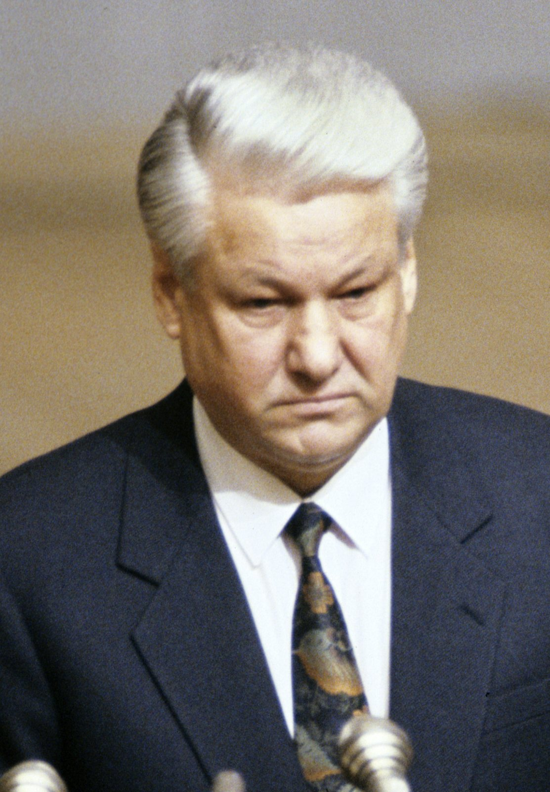
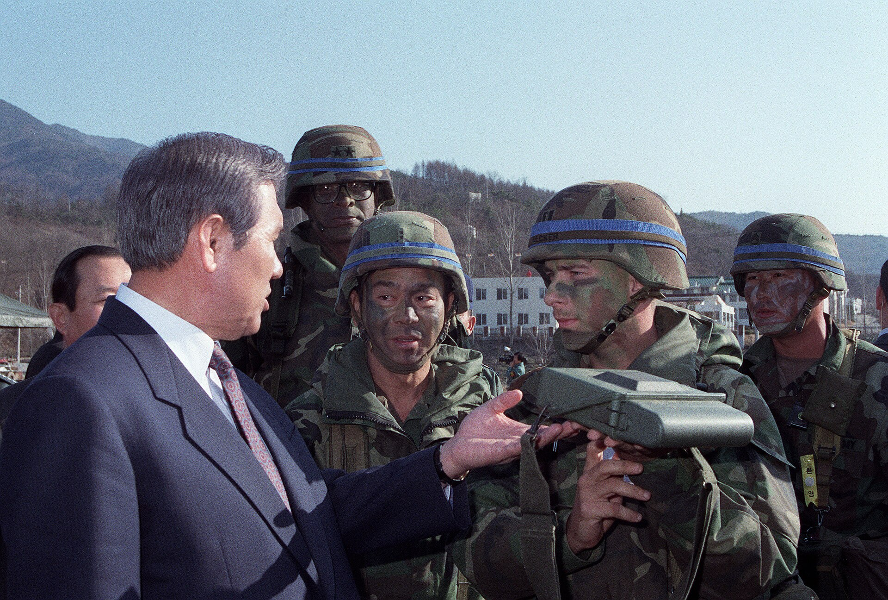
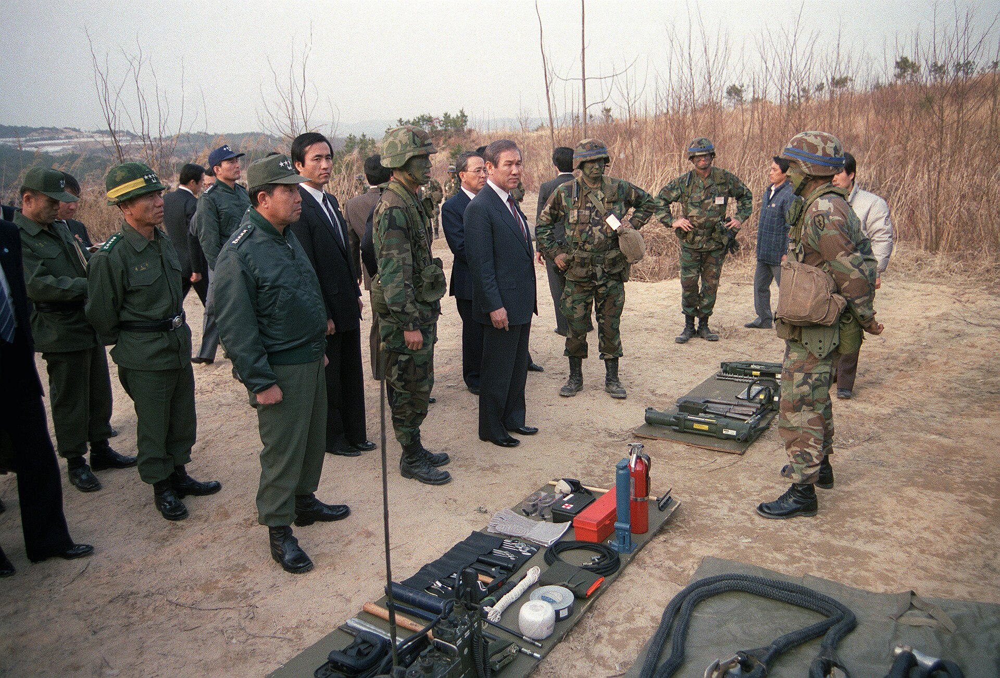

1992년 11월 28일, 대한민국 교통부는 온 국민을 충격에 빠뜨린 조사 결과를 발표했습니다. 불과 아흐레 전 방한한 러시아 옐친 대통령이 직접 전달했던 KAL 007기의 블랙박스에, 사고의 핵심 원인을 밝혀줄 비행기록장치(FDR) 테이프가 완전히 빠져 있었다는 사실이었습니다. 비극적인 피격 사건의 진실을 규명해 줄 것으로 믿었던 귀중한 상자는 사실상 알맹이가 없는 빈 껍데기나 다름없었습니다.

## 정상회담의 깜짝 선물과 커졌던 기대

1992년 11월 19일, 러시아의 옐친 대통령이 한국을 공식 방문했습니다. 당시 옐친 대통령은 청와대에서 노태우 대통령을 만나 정상회담을 진행하던 중, 피격된 대한항공 KAL 007기의 블랙박스를 직접 건넸습니다. 사고 당시의 비밀을 간직한 핵심 자료가 마침내 한국의 품으로 돌아왔다는 소식에 국민적 관심과 기대는 최고조에 달했습니다. 사건 당시 KAL 007기가 왜 정상 항로를 벗어났는지, 기체 내부에서 어떤 일이 벌어졌는지를 규명할 결정적 증거로 여겨졌기 때문입니다.

## 특수공구로 연 블랙박스, 눈앞에 나타난 빈 휠

노태우 대통령이 옐친 대통령으로부터 건네받은 물품은 2개의 블랙박스 본체와 별도로 포장된 4개의 자기 테이프였습니다. 청와대는 이틀 뒤인 11월 21일 이 자료들을 교통부에 정식으로 넘겼습니다. 교통부 조사반은 테이프 손상을 막기 위해 신중을 기하며 특수 공구를 준비했고, 11월 23일 마침내 블랙박스 본체를 조심스럽게 개봉했습니다. 그러나 상자 뚜껑을 연 기술진의 눈앞에 믿기 힘든 광경이 펼쳐졌습니다. 블랙박스 2개는 각각 음성녹음장치(CVR)와 비행기록장치(FDR) 외형을 갖추고 있었으나 내부에는 테이프가 전혀 감겨 있지 않았습니다. 오직 테이프가 감겨 있어야 할 둥근 휠만 텅 빈 채 덩그러니 들어 있었습니다.

*Борис Ельцин (13-02-1992) (cropped) — 사진: Юрий Абрамочкин / РИА Новости / CC BY 4.0*

## 국과수 정밀 감정, 확인된 알맹이의 실종

본체 내부가 비어 있자 정부의 희망은 따로 전달받았던 4개의 테이프에 쏠렸습니다. 혹시 보관을 위해 기기 본체에서 테이프를 분리해 놓았을 것이라는 기대였습니다. 교통부는 11월 24일 국립과학수사연구소에 해당 테이프 4개의 정밀 분석을 긴급 의뢰했습니다. 사흘 뒤인 11월 27일 오전 국립과학수사연구소로부터 최종 분석 통보가 도착했습니다. 그 결과는 참담했습니다. 분석된 4개의 테이프는 전부 조종실 대화 내용이 담긴 CVR 관련 자료였으며, 비행기의 운항 궤적을 증명할 FDR 테이프는 단 하나도 없었습니다. 비행기의 속도와 바람 등 51종에 달하는 기체 운항 데이터가 담긴 가장 핵심적인 기록이 통째로 빠져 있었던 것입니다.

*사건 당시 사진 아님 · 1990년 — 사진: CHERIE A. THURLBY / Public domain*

## 외교적 파문과 당혹스러운 정부의 해명

조사 결과를 확인한 교통부는 11월 28일 장상현 차관을 통해 브리핑을 열고 이 사실을 국민 앞에 공개했습니다. 장 차관은 발표 전날인 27일 오후 모스크바로 귀임하는 홍순영 주러시아 한국대사에게 이 사실을 긴급히 전달하며, FDR 테이프가 빠지게 된 경위를 철저히 확인하고 러시아 측에 추가 자료를 요구해 줄 것을 공식 요청했다고 밝혔습니다. 장상현 차관은 옐친 대통령이 고의로 핵심 자료를 빼고 전달했다고 보지는 않으며, 극심한 혼란을 겪고 있던 당시 러시아 국내 사정으로 인해 빚어진 일일 수 있다는 설명을 덧붙였습니다. 실제로 장 차관은 지난 10월 중순 러시아를 직접 방문해 51종 중 28종의 FDR 분석 자료를 넘겨받았으나, 그 내용이 명확하지 않아 항로 이탈 원인을 밝히는 데 별다른 도움이 되지 못했던 상태였습니다.

*사건 당시 사진 아님 · 1989년 — 사진: Al Chang / Public domain*

## 조기 발견에도 이어진 은폐 논란

이날 사태는 단순한 자료 누락을 넘어 정부의 은폐 의혹으로 번졌습니다. 정부가 블랙박스를 인도받고 개봉한 직후 알맹이가 빠져 있다는 결함을 즉시 파악했음에도, 이를 국민들에게 알리지 않고 적극적으로 감추려 했다는 정황이 드러났기 때문입니다. 당시 정부 일각에서는 한러 정상회담의 성과와 북방외교의 치적이 훼손될 것을 두려워해 이 사실을 쉬쉬했다는 비판이 일었습니다. 실제로 정부는 12월 초 국제민간항공기구(ICAO)에 해당 자료를 넘겨준 뒤 ICAO를 통해 이 사실이 알려지도록 하려 했던 것으로 전해졌습니다. 외무부와 교통부 당국자들이 언론의 확인 요청에 사실을 부인하며 엇갈린 해명을 내놓았던 모습은 국민들에게 큰 실망을 안겼습니다.

## 진실 규명을 둘러싼 뼈아픈 교훈

KAL 007기 피격 사건은 온 국민의 가슴에 깊은 상처를 남긴 비극이었습니다. 냉전 종식의 물결 속에서 진실의 문이 열릴 것이라 기대했던 국민들에게, 알맹이가 빠진 채 건네진 블랙박스는 또 다른 허탈감과 분노를 남겼습니다. 진실을 명명백백히 밝히기 위한 길은 여전히 멀고 험난했으며, 국가적 비극의 진상을 마주하면서도 외교적 성과를 우선시해 사실을 숨기려 했던 당시 정부의 대처는 큰 교훈을 남겼습니다.

### 참고 자료

- <https://newslibrary.naver.com/viewer/index.naver?articleId=1992112800209201001&editNo=1&printCount=1&publishDate=1992-11-28&officeId=00020&pageNo=1&printNo=22013&publishType=00020>
- <https://commons.wikimedia.org/wiki/File:A_left_side_view_of_the_I1-62M_aircraft_of_Russian_President_Boris_Yeltsin_parked_on_on_the_flight_line_following_the_official%27s_arrival_-_DPLA_-_0a42d3f6008d0bfbc5b182195aaf5fbe.jpeg>
- <https://commons.wikimedia.org/wiki/File:%D0%91%D0%BE%D1%80%D0%B8%D1%81_%D0%95%D0%BB%D1%8C%D1%86%D0%B8%D0%BD_(13-02-1992)_(cropped).jpg>
- <https://commons.wikimedia.org/wiki/File:Roh_Tae-woo_-_cropped,_1990-Mar-13.jpg>
- <https://commons.wikimedia.org/wiki/File:Roh_Tae-woo_-_cropped,_1989-Mar-13_05.jpg>
