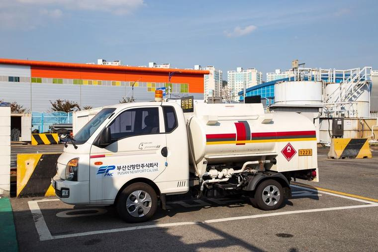
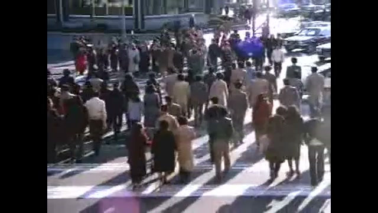

29년 전 오늘, 1997년 11월 28일. 전국의 휘발유 가격이 리터당 923원으로 일제히 올랐습니다. 에스케이와 엘지 등 국내 정유 5사가 일제히 가격을 올리면서 국민들의 생활 경제에 커다란 파장을 불러왔습니다.

## 휘발유값 리터당 923원으로 기습 인상

1997년 11월 28일부터 전국의 주유소에서 판매되는 휘발유 가격이 리터당 923원으로 공식 인상되었습니다. 에스케이와 엘지 등 정유 5사는 하루 전인 11월 27일 통상산업부에 기름값 인상안을 전격 신고했습니다. 이번 조치로 휘발유는 기존 가격에서 리터당 81원에서 82원이나 뛰며 17퍼센트라는 높은 인상률을 기록했습니다. 이는 월간 인상률 기준으로 당시 가장 큰 폭의 상승이었습니다.

## 환율 폭등과 피할 수 없었던 가격 조정

당시 정부와 정유업계는 기름값 인상을 두고 깊은 고심에 빠져 있었습니다. 통상산업부의 임육기 석유심의관은 석유 가격이 국민 경제에 미치는 막대한 영향을 감안해 정유업계에 가격 인상 자제를 요청했다고 밝혔습니다. 그러나 연일 치솟는 환율로 인해 정유사들의 부담이 임계점에 달했고, 결국 정부도 기름값 인상을 피할 수 없는 현실로 받아들였습니다. 외환위기의 불안감이 원자재와 연료 가격으로 직결되던 순간이었습니다.

*사건 당시 사진 아님 — 사진: 부산항만공사,한국문화정보원 / KOGL Type 1 attribution*

## 가수요 폭증으로 앞당겨진 인상 일정

정유사들의 애초 계획은 12월 1일부터 기름값을 올리는 것이었습니다. 그러나 가격이 곧 오른다는 소문과 보도가 퍼지자 기름을 미리 사두려는 가수요가 걷잡을 수 없이 폭증했습니다. 주유소마다 재고가 바닥나고 혼란이 가중되자, 정유사들은 예정보다 날짜를 앞당겨 11월 28일 0시부터 인상된 가격을 적용하기로 결정했습니다. 인상 시점을 사흘 앞당길 만큼 시장의 동요는 극심했습니다.

![[2007호] 한, 중 합작 고속버스 회사 한, 중 합작 고속버스 회사 (1994.04.27) 장면 1](../images/2026-11-28-05-3.jpg)
*[2007호] 한, 중 합작 고속버스 회사 한, 중 합작 고속버스 회사 (1994.04.27) 장면 1 — 사진: KTV 국민방송 e영상역사관 (대한뉴스) / KTV 공공저작물 — 영상 저작물 전면 개방(대통령실 2025-07-09), 출처 표시*

## 주유소마다 가득 채우려는 차량들로 북새통

가격 인상이 발표된 11월 27일 저녁, 서울 시내를 비롯한 전국의 주유소는 그야말로 북새통을 이루었습니다. 가격이 오르기 전에 연료 탱크를 가득 채우려는 승용차들이 일제히 몰려들었기 때문입니다. 주유소 진입로마다 차량들이 꼬리를 물고 늘어서며 인근 차선까지 정체가 이어졌습니다. 기름 한 방울이라도 더 넣으려는 운전자들의 초조한 표정은 다가올 경제적 한파를 예고하는 상징적인 풍경이었습니다.

*다시 한 번 도약을 다시 한 번 도약을 (1981.00.00) 장면 1 — 사진: KTV 국민방송 e영상역사관 (문화영화) / KTV 공공저작물 — 영상 저작물 전면 개방(대통령실 2025-07-09), 출처 표시*

## 등유와 경유도 22퍼센트 폭등

이번 가격 인상은 휘발유에만 그치지 않았습니다. 서민들의 겨울철 난방 연료인 등유와 산업 및 대중교통의 주연료인 경유 가격도 일제히 치솟았습니다. 등유와 경유는 각각 리터당 83원씩 올라 458원과 457원으로 조정되었습니다. 인상률은 무려 22퍼센트에 달했습니다. 본격적인 추위를 앞두고 난방용 등유 가격마저 급등하자 서민 가계가 느끼는 체감 물가 압박은 더욱 무거워졌습니다.

## 치솟는 연료비와 변천하는 물가

돌아보면 휘발유 가격은 한국 경제의 굴곡과 궤를 같이해 왔습니다. 1983년 리터당 619.9원이던 휘발유 가격은 1997년 11월 923원으로 오른 뒤, 외환위기가 본격화된 1998년에는 1219원까지 급등했습니다. 이후 세월이 흘러 2023년에는 리터당 1551원 수준에 이르렀습니다. 1997년 11월 28일 주유소에 늘어섰던 차량 행렬은 우리 경제가 거센 소용돌이 속으로 들어가고 있음을 보여준 선명한 기억으로 남아 있습니다.

### 참고 자료

- <https://newslibrary.naver.com/viewer/index.naver?articleId=1997112800289101002&editNo=7&printCount=1&publishDate=1997-11-28&officeId=00028&pageNo=1&printNo=3048&publishType=00010>
- <https://commons.wikimedia.org/wiki/File:Night_on_a_Seoul_street_1997.jpg>
- <https://www.kogl.or.kr/recommend/recommendDivView.do?division=img&recommendIdx=4451>
- <https://www.ehistory.go.kr/view/movie?mediasrcgbn=KV&mediaid=12012&mediadtl=27508&mediagbn=DH#t=0.3>
- <https://www.ehistory.go.kr/view/movie?mediasrcgbn=KV&mediaid=1905&mediadtl=8729&mediagbn=MH#t=0.3>
