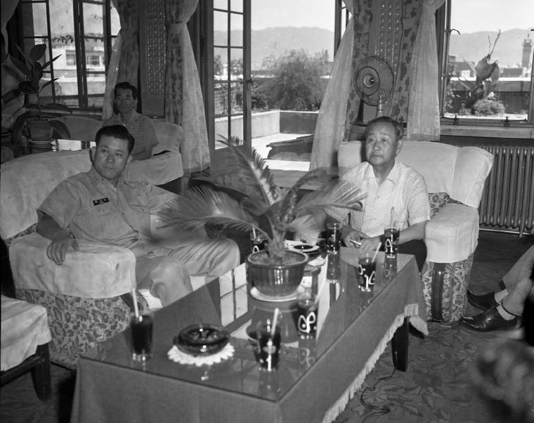
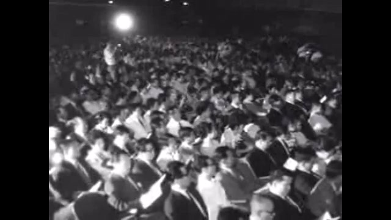

43년 전 오늘, 1983년 11월 28일. 정부가 혼란스럽던 국어의 로마자 표기 방식을 새롭게 확정했습니다. 거리의 도로 표지판과 학교 교과서마다 서로 다르게 적혀 혼선을 빚던 영문 표기가 하나의 원칙으로 정리된 순간이었습니다.

## 표지판과 지도마다 달랐던 영문 표기

1980년대 초반까지만 해도 우리나라 지명이나 인명을 로마자로 적는 방식은 무척 혼란스러웠습니다. 도로 표지판과 교과서 등에는 1959년에 문교부가 마련한 표기안이 쓰였고, 군사지도나 대외 간행물에는 외국에서 널리 쓰이던 매큔 라이샤워 체계가 그대로 쓰였습니다. 같은 지명을 두고도 표기법이 서로 달라 외국인은 물론 우리 국민도 불편을 겪었습니다. 문교부는 이러한 어색한 표현을 바로잡고 자연스러운 의사소통을 돕기 위해 표기법 통일에 나섰습니다.

## 소리대로 적는 원칙과 기호의 도입

1983년 11월 28일 확정된 개정안은 발음에 보다 가깝게 적는 데 초점을 맞추었습니다. 모음 가운데 'ㅓ'는 글자 위에 반달표를 얹은 ǒ로 바꾸고, 'ㅡ' 역시 ǔ로 적도록 했습니다. 자음 ㄱ, ㄷ, ㅂ 등은 유성음과 무성음을 구분하여 소리에 따라 k와 g, t와 d, p와 b로 다르게 표기하게 했습니다. 또한 ㅋ이나 ㅌ, ㅊ 같은 파열음과 유기음에는 어깨삐침 부호를 붙여 우리말 고유의 거센소리 느낌을 살리도록 규정했습니다.

*사건 당시 사진 아님 · 1963년 — 사진: 충청남도 / KOGL Type 0 Public Domain*

## 거북선과 한강, 지명 표기의 변화

새 표기법이 발표되면서 낯익은 단어들의 영문 표기도 달라졌습니다. 거북선과 독립문 같은 낱말은 실제 발음 변화를 살려 새롭게 표기하도록 정리되었습니다. 한강의 경우 영문으로 연이어 적으면 엉뚱하게 발음될 우려가 있어 음절 사이에 짧은 줄표를 넣어 구별하도록 배려했습니다. 행정구역 단위인 시, 군, 구, 읍, 면, 동, 리 등도 일관성을 위해 단어 앞에 붙임표를 두어 하나로 통일했습니다.

*박정희 대통령 1971년 동향(2) ... 참석 대표단 접견, 사랑의 이발 원호병원 위문 방문, 재활용사촌 방문/위문, 대통령 내외 크리스마스 씰 구입. (1976.00.00) 장면 1 — 사진: KTV 국민방송 e영상역사관 (대통령기록영상) / KTV 공공저작물 — 영상 저작물 전면 개방(대통령실 2025-07-09), 출처 표시*

## 세계에 굳어진 서울 이름은 그대로 유지

모든 고유명사를 새 규칙대로만 바꾼 것은 아니었습니다. 새 표기법의 원칙대로라면 수도 서울의 표기도 고쳐야 했으나, 이미 전 세계적으로 널리 알려지고 정착되었다는 현실을 받아들여 기존 표기를 그대로 쓰기로 했습니다. 이순신, 이승만 같은 역사적 인물의 이름이나 현대, 이화, 연세 등 오래 쓰여온 기업과 학교의 영문 명칭 역시 예외를 인정해 혼란을 줄였습니다.

*관동의 길 ... 영동고속 도로 준공 테이프 컷팅 (1975.00.00) 장면 1 — 사진: KTV 국민방송 e영상역사관 (문화영화) / KTV 공공저작물 — 영상 저작물 전면 개방(대통령실 2025-07-09), 출처 표시*

## 2000년 개정으로 이어진 표기법의 여정

1983년에 확정된 이 표기법은 12월 문교부령으로 공포된 뒤 이듬해부터 전국에 시행되었습니다. 하지만 타자기나 컴퓨터 자판에서 반달표와 어깨삐침 같은 특수 부호를 입력하기 어렵다는 현실적인 한계가 드러나기도 했습니다. 이에 정부는 세월이 흘러 2000년 7월 7일, 특수 기호를 없애고 정보화 시대에 맞춘 국어의 로마자 표기법을 새롭게 고시했습니다. 1983년의 개정은 우리말을 세계에 바르게 알리기 위해 원칙을 세워나갔던 소중한 이정표였습니다.

### 참고 자료

- <https://newslibrary.naver.com/viewer/index.naver?articleId=1983112800209201005&editNo=2&printCount=1&publishDate=1983-11-28&officeId=00020&pageNo=1&printNo=19124&publishType=00020>
- <https://www.kogl.or.kr/recommend/recommendDivView.do?division=img&recommendIdx=37778>
- <https://www.ehistory.go.kr/view/movie?mediasrcgbn=KV&mediaid=2562&mediadtl=9416&mediagbn=DT#t=0.3>
- <https://www.ehistory.go.kr/view/movie?mediasrcgbn=KV&mediaid=11323&mediadtl=25476&mediagbn=MH#t=0.3>
