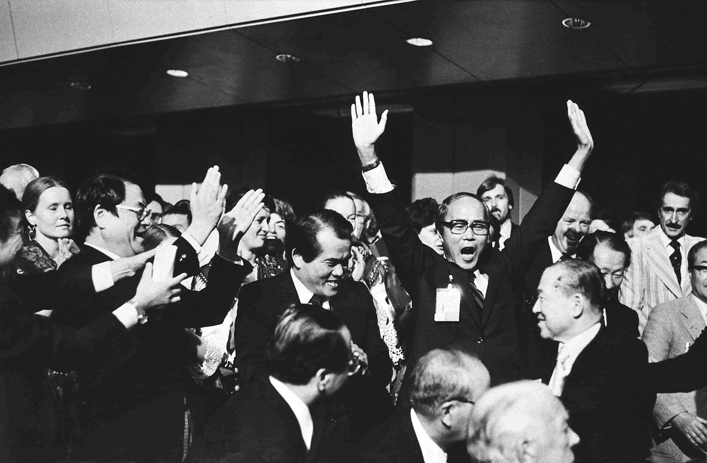

43년 전 오늘, 1983년 11월 29일. 1988년 서울 올림픽을 전 세계에 알릴 공식 휘장과 마스코트가 마침내 확정 발표됐습니다. 민족 전래의 삼태극 문양과 농악대의 상모를 돌리는 새끼 호랑이가 한국의 얼굴로 세계 무대에 서는 순간이었습니다.

## 바덴바덴의 기적 이후, 한국의 얼굴을 찾아라

1981년 9월 30일, 서독 바덴바덴에서 열린 제84차 국제올림픽위원회(IOC) 총회에서 서울이 일본 나고야를 52대 27로 꺾고 제24회 하계 올림픽 개최지로 선정되었습니다. 전쟁의 폐허를 딛고 일어선 개발도상국 한국이 올림픽이라는 거대한 축제를 치러내기 위해서는, 전 세계인에게 강렬하고 친근하게 다가갈 상징물이 절실했습니다.

서울올림픽대회조직위원회(SLOOC)는 곧바로 대회 상징 제작에 돌입했습니다. 그러나 전 세계의 이목이 집중되는 올림픽의 얼굴을 정하는 과정은 결코 순탄하지 않았습니다.

## 9백 편의 공모 탈락, 산고 끝에 탄생한 '삼태극 휘장'

1983년 1월, 조직위원회는 휘장 대국민 공모전을 실시해 무려 924점의 작품을 접수했습니다. 하지만 심사위원회의 엄격한 기준을 통과해 올림픽 공식 상징이 될 만한 당선작을 끝내 찾지 못했습니다. 결국 조직위는 국내 정상급 디자인 전문가 12명에게 지명 위촉을 의뢰했고, 여기서 출품된 26점의 작품을 재심사했습니다.

치열한 심사 끝에 선정된 것은 서울대학교 미술대학 양승춘 부교수의 도안이었습니다. 한민족 전래의 삼태극 문양을 모티브로 삼아, 안쪽으로 향하는 구심 운동은 전 세계인이 서울로 모여드는 올림픽의 대화합을, 바깥으로 향하는 원심 운동은 올림픽의 이상을 통해 세계 평화와 이해를 증진한다는 깊은 뜻을 담았습니다. 노랑, 빨강, 파랑 3원색의 유려한 소용돌이는 한국적이면서도 현대적인 조형미로 찬사를 받았습니다.

*사건 당시 사진 아님 · 1981년 — 사진: 서울역사박물관 / KOGL Type 1*

## 상모를 돌리는 아기 호랑이, 3개월의 고투

마스코트 선정 과정 역시 치열했습니다. 총 2,295개에 달하는 마스코트 후보안 중에서 한국을 대표하는 동물로 호랑이가 낙점되었습니다. 민화와 전래동화 속에 자주 등장하며 민중과 희로애락을 함께해 온 호랑이는 씩씩하고 용감하면서도 친근한 성품을 지니고 있어 약진하는 민족의 기상을 나타내기에 안성맞춤이었습니다.

이 호랑이를 캐릭터로 빚어낸 주인공은 대우그룹 기획조정실 제작부의 김현 과장이었습니다. 김현 과장은 1983년 3월 중순부터 6월 중순까지 석 달 동안 작업에 매달려 지명공모에 작품을 출품했습니다. 한국 전통 농악대의 상모(돌림모자)를 씌우고, 길게 뻗은 상모 끈으로 서울(Seoul)의 영문 첫 글자인 알파벳 'S'를 경쾌하게 그리도록 연출했습니다. 맹수 호랑이의 무서운 인상을 벗겨내고 동글동글하고 사랑스러운 새끼 호랑이의 모습으로 탈바꿈시켰습니다.

![[1465호] 88 올림픽 마스코트 확정 88 서울올림픽 상징인 휘장, 마스코트 확정 (1983.12.02) 장면 1](../images/2026-11-29-01-3.jpg)
*[1465호] 88 올림픽 마스코트 확정 88 서울올림픽 상징인 휘장, 마스코트 확정 (1983.12.02) 장면 1 — 사진: KTV 국민방송 e영상역사관 (대한뉴스) / KTV 공공저작물 — 영상 저작물 전면 개방(대통령실 2025-07-09), 출처 표시*

## 스위스 로잔 IOC 승인과 11월 29일 공식 발표

완성된 휘장과 마스코트는 1983년 11월 24일 스위스 로잔에서 열린 IOC 집행위원회에 상정되어 최종 의결을 거쳐 공식 승인을 받았습니다. 그리고 11월 29일, 노태우 서울올림픽대회조직위원장이 기자회견을 열고 내외신 언론에 당선작을 공식 발표했습니다. 해당 부문 당선 상금은 각각 3백만 원이었습니다.

이날 발표 당시 마스코트 아기 호랑이에게는 아직 이름이 없었습니다. 조직위는 12월 31일까지 전 국민을 대상으로 이름을 공모하기로 발표했습니다. 조직위는 1984년 8월 12일 로스앤젤레스 올림픽이 끝나는 시점부터 전 세계를 무대로 본격적인 홍보 활동에 들어갈 계획을 밝혔습니다.

![[1465호] 88 올림픽 마스코트 확정 88 서울올림픽 상징인 휘장, 마스코트 확정 (1983.12.02) 장면 2](../images/2026-11-29-01-4.jpg)
*[1465호] 88 올림픽 마스코트 확정 88 서울올림픽 상징인 휘장, 마스코트 확정 (1983.12.02) 장면 2 — 사진: KTV 국민방송 e영상역사관 (대한뉴스) / KTV 공공저작물 — 영상 저작물 전면 개방(대통령실 2025-07-09), 출처 표시*

## 국민 공모로 붙여진 '호돌이', 온 나라를 뒤흔들다

국민 공모를 거쳐 아기 호랑이 마스코트에는 마침내 '호돌이'라는 이름이 붙여졌습니다. 호돌이의 등장은 그야말로 선풍적인 돌풍을 일으켰습니다. 1986년 서울 아시안 게임부터 1988년 서울 올림픽까지 호돌이는 대한민국의 마스코트로 종횡무진 활약했습니다.

정부는 매월 15일을 '호돌이의 날'로 지정해 거리 캠페인을 벌였고, 공책과 연필 등 문구류는 물론 과자, 음료수, 심지어 은행 통장 표지까지 호돌이가 들어갔습니다. 만화와 텔레비전 애니메이션 '달려라 호돌이'가 제작되어 어린이들의 동심을 사로잡았고, 마스코트와 휘장 사업을 통해 서울 올림픽 조직위는 900억 원이라는 천문학적인 수입을 올렸습니다.

## 올림픽의 기억 속에 영원히 남은 호랑이

올림픽이 끝난 뒤 올림픽 헌장에 따라 호돌이에 대한 권리는 IOC에 귀속되었지만, 호돌이가 남긴 유산은 한국 사회에 깊게 새겨졌습니다. 훗날 1994년 서울특별시의 옛 마스코트였던 '왕범이'는 호돌이와 호순이의 자녀라는 설정으로 태어났고, 2018년 평창 동계 올림픽의 공식 마스코트인 백호 '수호랑' 역시 호돌이의 뒤를 잇는 한국 호랑이 마스코트로 큰 사랑을 받았습니다.

1983년 11월 29일, 가난했던 시절 온 국민의 자긍심을 드높이고 지구촌 축제의 문을 활짝 열어젖혔던 상모 쓴 새끼 호랑이의 첫 모습을, 여러분은 생생히 기억하고 계십니까?

### 참고 자료

- <https://newslibrary.naver.com/viewer/index.naver?articleId=1983112900209201011&editNo=2&printCount=1&publishDate=1983-11-29&officeId=00020&pageNo=1&printNo=19125&publishType=00020>
- <https://commons.wikimedia.org/wiki/File:1988%EB%85%84_%EC%84%9C%EC%9A%B8%EC%98%AC%EB%A6%BC%ED%94%BD_%EC%9C%A0%EC%B9%98_%EB%8C%80%ED%91%9C%EB%8B%A8%EC%9D%98_%EC%9C%A0%EC%B9%98_%EC%84%B1%EA%B3%B5_%EA%B8%B0%EC%9E%90%ED%9A%8C%EA%B2%AC_(1981.10.04).jpg>
- <https://commons.wikimedia.org/wiki/File:%EC%A0%9C24%ED%9A%8C_%ED%95%98%EA%B3%84%EC%98%AC%EB%A6%BC%ED%94%BD_%EC%84%9C%EC%9A%B8_%EC%9C%A0%EC%B9%98%EA%B0%80_%ED%99%95%EC%A0%95%EB%90%98%EC%9E%90_%ED%99%98%ED%98%B8%ED%95%98%EB%8A%94_%EB%B0%95%EC%98%81%EC%88%98_%EC%84%9C%EC%9A%B8%EC%8B%9C%EC%9E%A5_(1981.09.30).jpg>
- <https://www.ehistory.go.kr/view/movie?mediasrcgbn=KV&mediaid=10994&mediadtl=24112&mediagbn=DH#t=0.3>
- <https://www.ehistory.go.kr/view/movie?mediasrcgbn=KV&mediaid=10994&mediadtl=24112&mediagbn=DH#t=0.7>
