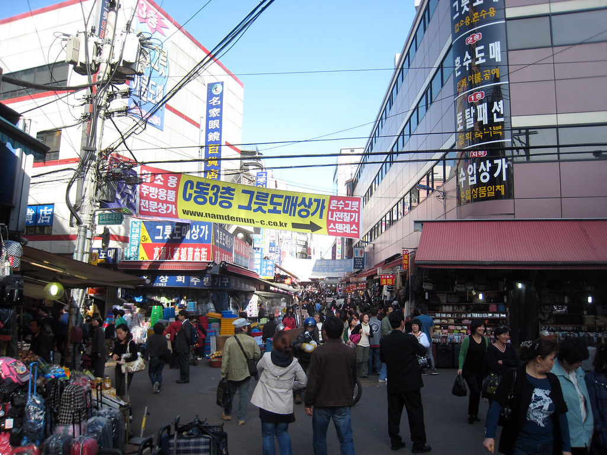
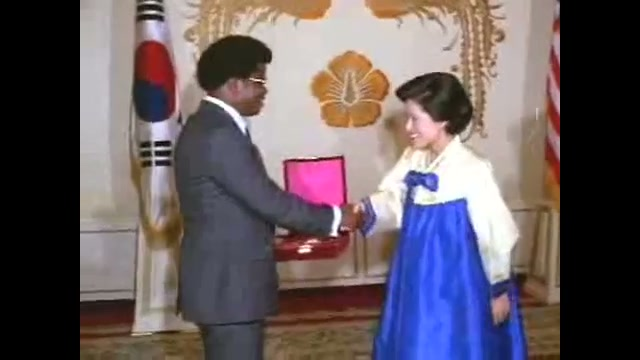

44년 전 오늘, 1982년 11월 29일. 인도 뉴델리에서 열린 제9회 아시안게임에서 대한민국 선수단이 주말 이틀 동안 금메달 6개를 휩쓸며 전국을 환호로 물들였습니다. 중반 고비였던 11월 27일과 28일, 수영과 육상, 역도, 사이클에서 연달아 전해진 승전보는 안방극장을 뜨겁게 달궜습니다.

## 뉴델리에서 날아든 주말의 승전보

1982년 11월 29일 아침 조간신문들은 일제히 '황금 주말'이라는 머리기사를 내걸었습니다. 제9회 뉴델리 아시안게임에 출전한 한국 선수단이 27일과 28일 이틀 동안 금메달 6개를 따내는 쾌거를 거두었기 때문입니다.

대회 10일째를 넘기며 중반 순위 싸움이 치열했던 시점에서 터져 나온 값진 성과였습니다. 한국은 이 주말의 메달 사냥에 힘입어 종합 3위라는 당초 목표에 성큼 다가섰습니다.

## 수영 신데렐라 최윤희, 한국 첫 3관왕 등극

가장 눈부신 활약을 펼친 주인공은 당시 열다섯 살이던 여자 수영의 최윤희 선수였습니다. 최윤희는 27일 탈카토라 실내수영장에서 열린 배영 100미터에서 1분 06초 39, 개인혼영 200미터에서 2분 24초 32로 두 종목 모두 대회 신기록을 세우며 금메달 2개를 추가했습니다.

앞서 23일 배영 200미터에서 딴 금메달을 합쳐 최윤희는 아시안게임 사상 한국 선수로는 최초로 대회 3관왕의 영예를 안았습니다. 아시아 수영계를 주름잡던 일본을 놀라게 한 당찬 10대 소녀의 질주였습니다.

*Scene of the era (not a photo of this event) — 사진: JoshBerglund19 / CC BY 2.0*

## 시상대에 나란히 오른 '인어 자매'의 감동

최윤희 선수의 뒤에는 늘 언니 최윤정 선수가 함께 있었습니다. 최윤정은 동생이 금메달을 딴 배영 100미터와 개인혼영 200미터, 그리고 배영 200미터까지 같은 종목에서 모두 은메달을 목에 걸며 은메달 3개를 따냈습니다.

자매가 나란히 금메달과 은메달을 나눠 가지며 시상대에 서서 활짝 웃는 모습은 국내 언론을 통해 대대적으로 전해졌습니다. 국민들은 물살을 함께 가른 두 자매를 '인어 자매'라 부르며 큰 찬사를 보냈습니다.

*라이베리아 국가원수 방한 ... 전달. (1982.00.00) 장면 1 — 사진: KTV 국민방송 e영상역사관 (대통령기록영상) / KTV 공공저작물 — 영상 저작물 전면 개방(대통령실 2025-07-09), 출처 표시*

## 육상과 역도, 사이클에서 쏟아진 금메달

승전보는 수영장에만 머물지 않았습니다. 27일 육상 남자 넓이뛰기에서는 스무 살의 김종일 선수가 7미터 94를 뛰어넘으며 이번 대회 한국 육상 첫 금메달을 따내는 쾌거를 달성했습니다.

역도 경기장에서도 금빛 소식이 이어졌습니다. 27일 100킬로그램급의 안지영 선수가 합계 357.5킬로그램을 들어 올려 아시아 신기록을 세우며 금메달을 차지했고, 28일에는 110킬로그램급 안효작 선수가 350킬로그램으로 대회 신기록 2개를 세우며 또 하나의 금메달을 보탰습니다. 사이클 180킬로미터 도로경기 개인전에서도 신예 박세룡 선수가 4시간 30분 48초 07의 기록으로 금메달을 따내며 기염을 토했습니다.

![[1375호] 이런일 저런일 ... 경기도 고양의 고령산) (1982.03.12) 장면 1](../images/2026-11-29-02-4.jpg)
*[1375호] 이런일 저런일 ... 경기도 고양의 고령산) (1982.03.12) 장면 1 — 사진: KTV 국민방송 e영상역사관 (대한뉴스) / KTV 공공저작물 — 영상 저작물 전면 개방(대통령실 2025-07-09), 출처 표시*

## 인도와 북한을 제치고 지켜낸 종합 3위

이틀 동안 금메달 6개와 은메달, 동메달을 추가한 한국 선수단은 29일 오전 현재 금메달 13개, 은메달 19개, 동메달 22개를 기록했습니다. 육상 남자 100미터의 장재근 선수와 사격 속사권총 개인전의 박종길 선수도 은메달을 보태 힘을 실었습니다.

이로써 한국은 금메달 11개의 개최국 인도와 금메달 9개의 북한을 따돌리고 확고한 종합 3위 자리를 굳혔습니다. 전두환 대통령은 최윤희, 김종일, 안지영 선수에 이어 박세룡, 안효작 선수에게도 축전을 보내 노고를 치하했습니다.

## 1982년 늦가을, 전국을 하나로 묶은 감동

1982년 늦가을, 텔레비전 중계와 호외로 전해진 뉴델리의 승전보는 온 국민의 마음을 하나로 묶었습니다. 힘겨운 훈련을 이겨내고 아시아 무대 정상에 올라 태극기를 휘날리던 청년들의 모습은 당시 많은 이들에게 큰 용기와 자부심을 주었습니다.

수영장을 가르던 10대 자매의 물살과 모래판을 힘차게 짚고 날아오르던 넓이뛰기, 무거운 쇳덩이를 들어 올리던 역도 선수들의 거친 숨소리는 지금도 그 시절을 지나온 이들의 기억 속에 선명한 추억으로 남아 있습니다.

### 참고 자료

- <https://newslibrary.naver.com/viewer/index.naver?articleId=1982112900329201016&editNo=2&printCount=1&publishDate=1982-11-29&officeId=00032&pageNo=1&printNo=11437&publishType=00020>
- <https://commons.wikimedia.org/wiki/File:82%EB%89%B4%EB%8D%B8%EB%A6%AC%EC%95%84%EC%8B%9C%EC%95%88%EA%B2%8C%EC%9E%84_%EC%88%98%EC%98%81.%EC%B5%9C%EC%9C%A4%ED%9D%AC.%EC%B5%9C%EC%9C%A4%EC%A0%95.jpg>
- <https://www.flickr.com/photos/79877212@N00/3391174523>
- <https://www.ehistory.go.kr/view/movie?mediasrcgbn=KV&mediaid=1774&mediadtl=8556&mediagbn=DT#t=0.3>
- <https://www.ehistory.go.kr/view/movie?mediasrcgbn=KV&mediaid=10332&mediadtl=22112&mediagbn=DH#t=0.3>
