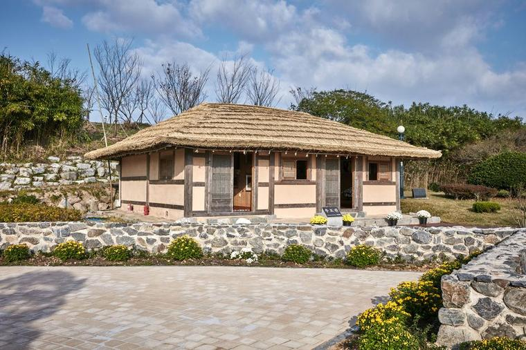
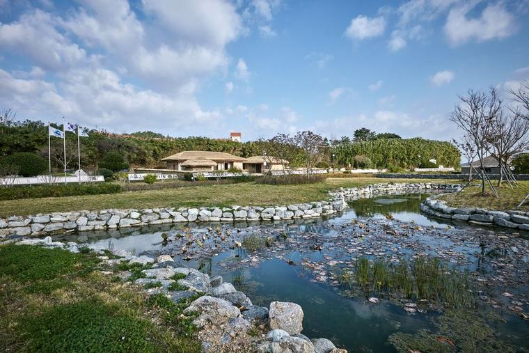
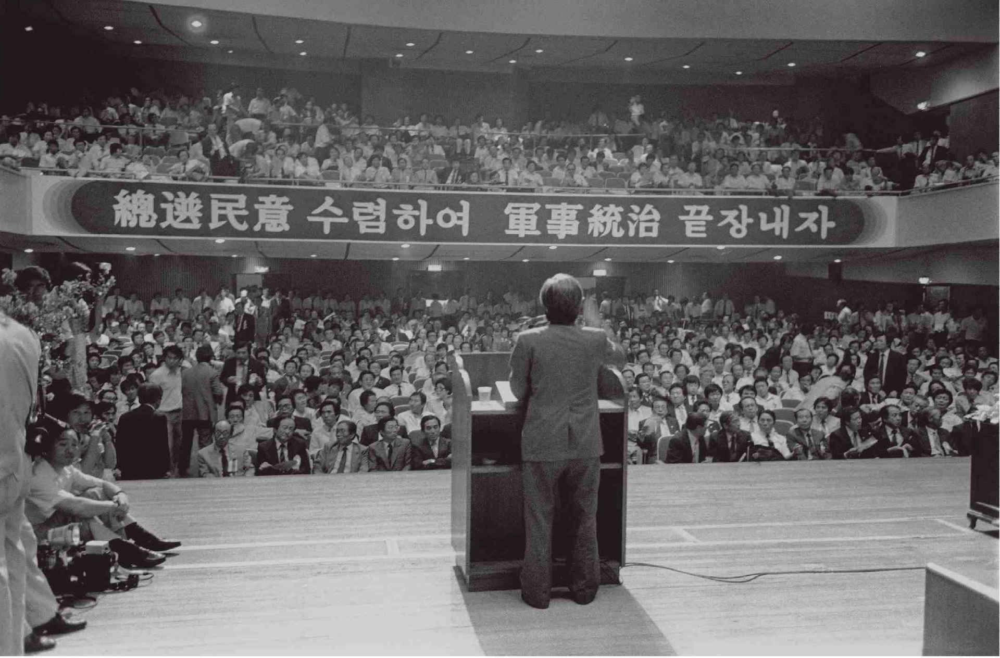

40년 전 오늘, 1986년 11월 29일. 서울 도심 일대는 거대한 군사작전장을 방불케 했습니다. 야당인 신민당이 추진한 대통령 직선제 개헌 대회를 막기 위해 3만 명이 넘는 경찰 병력이 서울 전역을 겹겹이 에워쌌기 때문입니다.

## 직선제 개헌을 향한 거센 열망과 정권의 원천 봉쇄

1986년 당시 국민들의 가장 뜨거운 염원은 내 손으로 대통령을 뽑는 '대통령 직선제'였습니다. 제1야당이던 신민당은 재야세력과 연대하여 11월 29일 서울 구 서울고등학교 부지에서 '제1회 대통령 직선제 개헌 쟁취 및 영구집권 음모 분쇄 범국민대회'를 열기로 했습니다. 하지만 전두환 정권은 이를 불법 집회로 규정하고 모든 수단을 동원해 대회를 사전에 차단하기로 방침을 정했습니다.

## 도심을 마비시킨 '29호 작전'과 3만 2천 명의 경찰력

대회 당일 경찰은 이른바 '29호 작전'을 발동했습니다. 서울 시내 경찰 131개 중대 2만 5천여 명에 지방에서 급파된 45개 중대 7천 명을 더해, 무려 3만 2천여 명의 병력이 도심 곳곳에 투입됐습니다. 행사 예정지였던 구 서울고교 일대는 물론 종로, 광화문, 서대문 등 주요 간선도로마다 바리케이드가 쳐졌습니다. 경찰은 행인들의 이유 없는 통행까지 엄격히 통제하며 도심 진입로를 철저하게 가로막았습니다.

*사건 당시 사진 아님 — 사진: 한국관광공사 / KOGL Type 1 attribution*

## 지도부 가택연금과 사전에 차단된 발걸음

정권의 봉쇄는 대회 며칠 전부터 치밀하게 시작됐습니다. 김대중 민주화추진협의회 공동의장은 11월 26일부터 마포구 동교동 자택에 연금됐고, 김영삼 고문 역시 28일 밤부터 상도동 자택에 전투경찰 1개 중대가 배치되며 발이 묶였습니다. 여기에 주요 재야인사 20명과 학생 운동권 간부 35명 등 총 55명이 집 밖으로 나오지 못하도록 가택연금을 당했습니다. 현장에 참석하지 못한 두 지도자의 연설문은 사전에 녹음 테이프로 제작되어 당원들에게 배포되어야 했습니다.

*사건 당시 사진 아님 — 사진: 한국관광공사 / KOGL Type 1 attribution*

## 당사 앞 몸싸움과 곳곳에서 벌어진 충돌

11월 29일 당일, 신민당 지도부와 의원들은 분산 집결 후 대회장 진입을 꾀했습니다. 하지만 종묘 앞 집결을 준비하던 의원들은 중앙당사 지하 다방을 나서는 순간 전경들에게 막혔습니다. 이민우 총재와 김수한, 최형우 부총재 등은 당사 밖으로 나와 진출을 시도했으나 5차례에 걸친 격렬한 몸싸움 끝에 밀려났습니다. 마포 가든호텔 뒤편에 모여 가두시위를 벌이려던 노승환, 박찬종 의원 등 50여 명은 경찰에 의해 강제로 봉고버스에 태워져 여의도 국회의원회관으로 보내졌습니다. 대회장 건너편 다방에 모여 있던 시민들도 현장에서 그대로 연행됐습니다.

*사건 당시 사진 아님 · 1985년 — 사진: Photos taken by 전민조 and hosted by the National Museum of Con / KOGL Type 1*

## 최루탄 연기 속 무산된 집회, 꺾이지 않은 불씨

종묘 일대에서는 이철, 박실 의원 등이 청년 당원 50여 명과 합세해 진입하려 했으나 경찰이 최루탄을 쏘며 강제 해산에 나섰습니다. 이날 낮 2시까지 경찰에 연행된 신민당원과 학생, 시민만 621명에 달했습니다. 결국 구 서울고등학교 부지에서 열리기로 했던 범국민대회는 단 한 사람도 입장하지 못한 채 무산되었습니다. 그러나 경찰력 3만 명으로 도심을 막아선 이날의 강경 진압은 오히려 국민들의 분노를 키웠고, 이듬해 1987년 6월 항쟁으로 폭발하는 결정적인 도화선이 되었습니다.

### 참고 자료

- <https://newslibrary.naver.com/viewer/index.naver?articleId=1986112900329201004&editNo=2&printCount=1&publishDate=1986-11-29&officeId=00032&pageNo=1&printNo=12671&publishType=00020>
- <https://commons.wikimedia.org/wiki/File:1986%EB%85%84_%EC%A0%9C5%EA%B8%B0_%EC%86%8C%EB%B0%A9%EA%B0%84%EB%B6%80%ED%9B%84%EB%B3%B4%EC%83%9D_%EC%9D%BC%EB%8F%9932.jpg>
- <https://www.kogl.or.kr/recommend/recommendDivView.do?division=img&recommendIdx=3262>
- <https://commons.wikimedia.org/wiki/File:New_democratic_party_convention_1985-08-01.png>
