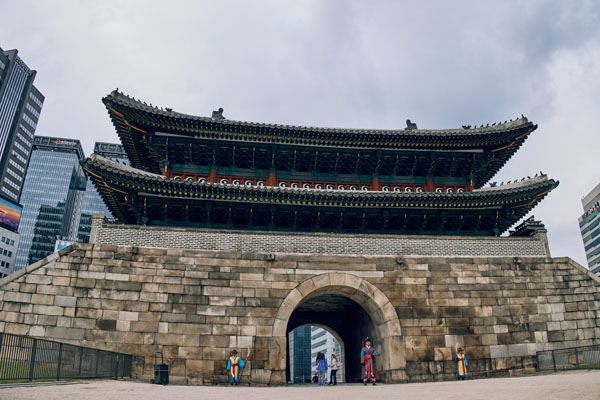
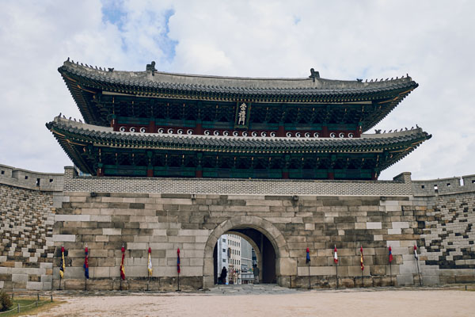
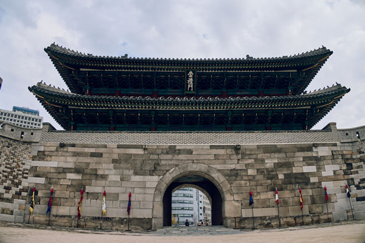

30년 전 오늘, 1996년 11월 29일 조간신문에는 우리 문화재가 제 이름을 되찾았다는 반가운 소식이 실렸습니다. 대한민국 국민이라면 누구나 입에 익었던 ‘남대문’과 ‘동대문’의 공식 명칭이 원래 이름인 ‘숭례문’과 ‘흥인지문’으로 마침내 환원된 것입니다.

## 일제 잔재 청산과 ‘역사바로세우기’ 사업

1996년 11월 28일, 문화재관리국은 그해 초부터 추진해 온 ‘일제지정문화재 재평가사업’의 심의 결과를 발표했습니다. 핵심 취지는 일제강점기에 의해 왜곡되거나 폄하된 우리 문화재의 위상을 바로잡고 일제 잔재를 청산하는 것이었습니다.

조선 시대 한양도성의 남쪽 정문과 동쪽 문이었던 두 성문은 태조 때 유교 덕목인 인·의·예·지·신을 따서 숭례문(崇禮門)과 흥인문(興仁門, 훗날 흥인지문)이라는 고유의 이름을 얻었습니다. 그러나 일제강점기를 거치며 방위를 단순하게 가리키는 ‘남대문’과 ‘동대문’으로 굳어졌고, 해방 후에도 이 명칭이 문화재 공식 지정명으로 이어져 왔습니다. 문화재관리국은 이번 심의를 통해 원래 이름을 되살리기로 최종 확정했습니다.

## 사대문의 역사와 이름에 담긴 뜻

숭례문은 1396년(태조 5년) 최유경의 지휘 아래 짓기 시작하여 1398년에 완성된 서울 최고(最古)의 목조 건축물이었습니다. 남쪽 화기(火氣)를 다스리기 위해 다른 문들과 달리 현판을 세로로 달았으며, 양녕대군이 쓴 글씨로 전해지는 웅장한 편액을 자랑합니다. 1934년 조선총독부에 의해 보물 1호로 지정되었고, 대한민국 정부 수립 후 1962년에 국보 제1호로 지정되었습니다.

동대문으로 불리던 흥인지문(興仁之門)은 1398년 처음 세워진 뒤 고종 때인 1869년에 대대적으로 중수되었습니다. 한양 동쪽의 지반과 기운이 낮고 약하다는 풍수적 이유로 ‘갈 지(之)’ 자를 덧붙여 사대문 중 유일하게 넉 자 이름을 갖게 되었습니다. 도성 성문 중 유일하게 성벽 바깥으로 반원형 옹성(甕城)을 둘러 적의 공격을 방어하도록 지어진 조선 후기 건축의 정수입니다.

*사건 당시 사진 아님 — 사진: 세종학당재단 / KOGL Type 1 attribution*

## 명칭 변경 7건, 수원성곽도 ‘화성’으로 환원

이날 발표된 재평가 심의 결과는 명칭 변경 7건과 등급 조정 15건 등 총 22건에 달했습니다. 숭례문과 흥인지문 외에도 대표적인 사적들이 제 이름을 찾았습니다.

사적 제3호로 지정되어 있던 ‘수원성곽’은 정조의 숨결이 깃든 본래 이름인 ‘화성(華城)’으로 명칭이 환원되었습니다. 또한 국보 제52호 ‘해인사대장경판고’는 건축물의 격을 온전히 반영하여 ‘판전(板殿)’으로 명칭이 바로잡혔습니다. 이러한 조치로 교과서와 국가 공문서, 각종 역사 문헌에 실린 명칭이 본래의 이름으로 바뀌게 되었습니다.

*사건 당시 사진 아님 — 사진: 세종학당재단 / KOGL Type 1 attribution*

## 보물의 국보 승격과 왜성의 격하

등급 조정에서도 굵직한 결정이 이어졌습니다. 예술적·역사적 가치가 뛰어남에도 보물에 머물러 있던 6건의 문화재가 국보로 승격되었습니다. 경남 양산 통도사 대웅전(보물 144호)과 전북 익산 왕궁리 5층석탑(보물 44호)을 비롯해, 불교 경전인 용감수경(보물 130호), 오대산 상원사 중창권선문(보물 140호), 청화백자철사진사국화문병(보물 241호), 금동관세음보살입상(보물 195호)이 국보 목록에 이름을 올렸습니다.

반면 일제의 잔재나 격에 맞지 않는 문화재는 하향 조정되었습니다. 임진왜란 당시 한반도를 침탈한 일본군이 쌓았던 울산학성(사적 9호) 등 8개 산성은 사적에서 지방기념물로 등급이 낮아졌습니다. 보물 제5호였던 중초사지 3층석탑 역시 지방문화재로 재분류되었습니다.

*사건 당시 사진 아님 — 사진: 세종학당재단 / KOGL Type 1 attribution*

## 국보 1호 재지정 논란과 오늘날의 유산

당시 심의에서는 국보 1호인 숭례문의 상징성을 두고 다른 대표 유물로 국보 1호를 바꾸자는 재지정 논의도 이루어졌습니다. 그러나 오랜 사회적 합의와 역사적 대표성을 감안해 재지정 안건은 부결되었고, 숭례문이 그대로 국보 1호 자리를 지켰습니다.

30년 전 이날의 발표는 단순한 행정 절차를 넘어, 일제의 흔적 속에 무뎌져 있던 우리 역사 인식을 바로잡는 계기가 되었습니다. 그로부터 수십 년이 지난 지금, 숭례문과 흥인지문이라는 이름은 우리 일상 속에 완전히 뿌리내렸습니다.

### 참고 자료

- <https://newslibrary.naver.com/viewer/index.naver?articleId=1996112900329101001&editNo=45&printCount=1&publishDate=1996-11-29&officeId=00032&pageNo=1&printNo=15951&publishType=00010>
- <https://www.kogl.or.kr/recommend/recommendDivView.do?division=img&recommendIdx=92228>
- <https://www.kogl.or.kr/recommend/recommendDivView.do?division=img&recommendIdx=92227>
- <https://www.kogl.or.kr/recommend/recommendDivView.do?division=img&recommendIdx=92226>
- <https://www.kogl.or.kr/recommend/recommendDivView.do?division=img&recommendIdx=92225>
