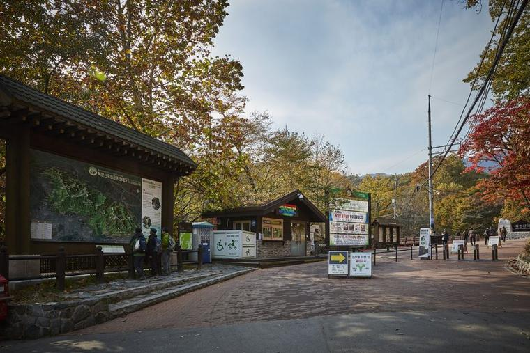
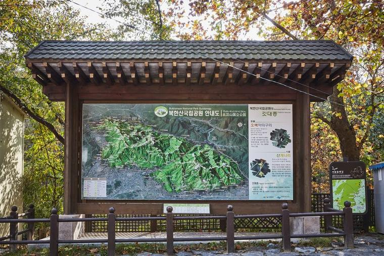
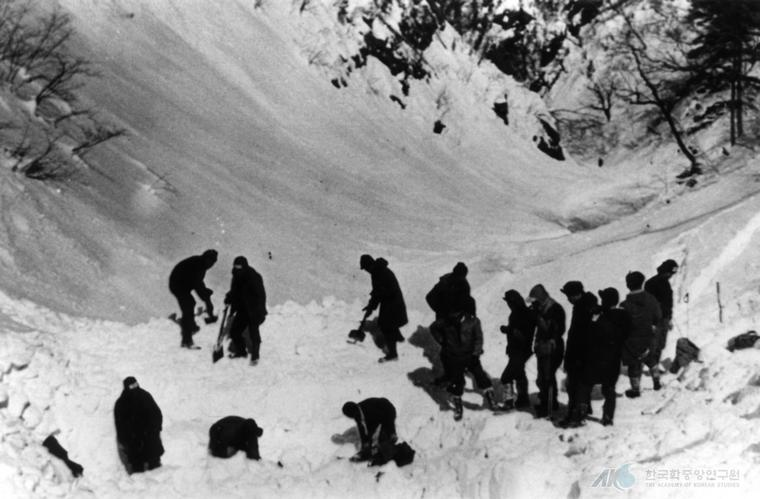

55년 전 오늘, 1971년 11월 29일 조간신문들은 일제히 북한산 인수봉에서 벌어진 끔찍한 조난 사고를 머리기사로 전했습니다. 휴일을 맞아 바위를 오르던 젊은 등반객들이 기습적인 혹한과 돌풍에 휘말려 목숨을 잃었습니다.

## 갑작스레 닥친 기습 한파와 산악 기후의 돌변

1971년 11월 28일 일요일, 서울 성북구 우이동 북한산 인수봉에는 늦가을 정취를 즐기려는 등산 동호인들의 발길이 이어졌습니다. 당시 인수봉 정상 부근에는 5개 조로 나뉜 40여 명의 등반객이 암벽 등반을 마치고 머물고 있었습니다.

하지만 평화롭던 산행은 오후 4시 무렵부터 악몽으로 바뀌었습니다. 북서쪽에서 기습적인 강추위가 밀어닥치면서 산악 기후가 급변했고, 기온은 순식간에 영하 10도까지 곤두박질쳤습니다. 방한 장비를 제대로 갖추지 못한 채 가벼운 옷차림으로 나섰던 등반객들은 예상치 못한 살을 에는 추위 속에서 큰 불안에 휩싸였습니다.

## 초속 7미터의 돌풍과 뒤엉킨 자일

추위와 함께 닥친 것은 거센 바람이었습니다. 인수봉 계곡 아래에서 위로 치솟아 오르는 바람과 정상 부근에서 아래로 사납게 내리치는 바람이 뒤섞이며 초속 7미터가 넘는 강풍이 바위벽을 강타했습니다.

정상에 있던 5개 조 40여 명은 위험을 느끼고 서둘러 암벽을 내려가기 시작했습니다. 너도나도 앞다투어 하산을 서두르면서 바위벽 일대는 큰 혼잡을 빚었습니다. 등반객들이 내려뜨린 등반용 밧줄, 즉 자일은 거센 돌풍에 휘말려 허공에서 어지럽게 뒤엉켜 버렸습니다.

*사건 당시 사진 아님 — 사진: 한국관광공사 / KOGL Type 1 attribution*

## 차가운 바위벽에 매달린 채 멎어버린 숨

자일이 얽혀 내려갈 수도, 다시 기어오를 수도 없는 절체절명의 고립 상태가 이어졌습니다. 결국 밧줄에 몸을 의지한 채 차가운 바위벽 중간에 매달린 등반객 5명이 칼바람과 영하 10도의 혹한을 견디지 못하고 그 자리에서 동사했습니다.

일부 등반객은 안간힘을 다해 계곡 바닥까지 내려오는 데 성공했으나, 극한의 추위 속에서 기력이 완전히 소진된 2명이 바닥에 쓰러진 채 숨을 거두었습니다. 이 사고로 7명이 목숨을 잃었고, 16명은 심한 동상과 부상을 입었습니다. 부상자 중 왕금식 씨 등 1명만 병원에 입원하고 나머지는 치료를 받은 뒤 귀가했습니다.

*사건 당시 사진 아님 — 사진: 한국관광공사 / KOGL Type 1 attribution*

## 어둠과 추위 속 지체된 구조 작업

경찰에 조난 사고가 접수된 것은 참사가 발생한 지 한참이 지난 밤 11시경이었습니다. 신고를 받은 경찰 구조대가 즉각 현장으로 출동했으나 험준한 산세와 칠흑 같은 어둠, 영하의 혹한 탓에 본격적인 야간 구조 작업을 펼치지 못했습니다.

뜬눈으로 밤을 지새운 뒤 날이 밝은 11월 29일 낮에야 비로소 차가운 바위에 매달려 있던 청년들의 시신을 수습하는 하산 작업이 끝났습니다. 차가운 벼랑 끝에 위태롭게 매달려 있던 모습은 당시 현장 사진기자들의 렌즈를 통해 신문에 보도되며 국민들에게 커다란 충격을 주었습니다.

*사건 당시 사진 아님 — 사진: 한국학중앙연구원 / KOGL Type 1 attribution*

## 못다 핀 청춘들이 남긴 안타까운 이름들

희생자들은 대부분 10대 후반에서 20대 초반의 젊은이들이었습니다. 확인된 사망자는 스무 살 최성규 씨, 스물한 살 유능진 씨와 구자광 씨, 고등학교 3학년이던 열여덟 살 이채은 군과 박찬갑 군, 재수생 김수홍 씨, 그리고 신원미상의 청년 1명이었습니다.

산이 좋아 휴일마다 바위를 찾았던 젊은 열정은 자연의 돌변 앞에서 허망하게 꺾이고 말았습니다. 당시 산악계와 사회 전반에는 겨울철 산악 장비의 중요성과 안전 수칙, 기상 급변에 대비한 비상 훈련의 필요성을 일깨우는 깊은 상흔과 교훈을 남겼습니다.

### 참고 자료

- <https://newslibrary.naver.com/viewer/index.naver?articleId=1971112900329201005&editNo=2&printCount=1&publishDate=1971-11-29&officeId=00032&pageNo=1&printNo=8050&publishType=00020>
- <https://www.kogl.or.kr/recommend/recommendDivView.do?division=img&recommendIdx=3050>
- <https://www.kogl.or.kr/recommend/recommendDivView.do?division=img&recommendIdx=73136>
