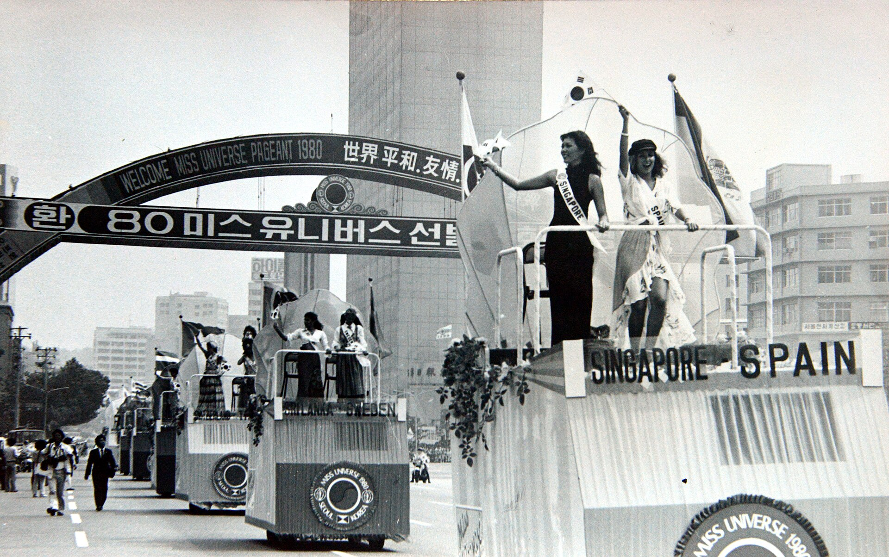

46년 전 오늘, 1980년 11월 29일. 라디오 민영 방송 동아방송이 17년 7개월 동안 이어온 방송을 마감하며 청취자들에게 석별의 고별사를 전했습니다. 신군부의 서슬 퍼런 강제 언론통폐합 조치로 민간 방송의 불꽃이 하루아침에 꺼지던 순간이었습니다.

## 17년 7개월 동안 서민과 함께한 동아방송

동아방송(DBS)은 1963년 4월 25일 AM 792㎑ 주파수로 첫 전파를 발사했습니다. 이후 1980년 11월까지 무려 6,430일 동안 만천하 애청자들과 호흡을 함께해 온 대표적인 민영 라디오 방송이었습니다.

동아방송은 신속한 보도와 건전한 오락, 유익한 생활 정보를 내세우며 청취자들의 일상 속에 깊숙이 파고들었습니다. 라디오가 가장 친근한 매체였던 시절, 수많은 시민이 아침부터 밤까지 다이얼을 792㎑에 맞추고 하루를 시작하고 마감했습니다.

## 귀에 익은 목소리, 기억 속의 명프로그램들

동아방송에는 오랜 세월 사랑받은 명프로그램들이 즐비했습니다. 전영우 아나운서의 진행과 이서구, 양주동, 김두희 등의 고정 출연자가 구수한 위트와 유머를 나누던 '오후의 응접실'은 1970년에 이미 370회를 넘기며 큰 인기를 끌었습니다.

출근길 직장인들의 벗이었던 10분 일일드라마 '오늘은 푸른하늘'은 1967년에 이미 970회를 돌파했습니다. 매일 밤 20분간 긴박감을 선사하던 다큐멘터리 드라마 '태평양 전쟁' 또한 100회를 넘기며 온 국민의 귀를 사로잡았던 추억의 방송이었습니다.

*미스유니버스 시가행진 (1980년 6월29일 광화문) — 사진: 한국저작권위원회 / CC BY 4.0*

## 신군부의 칼바람과 언론통폐합의 서막

그러나 1979년 10·26 사태와 12·12 군사반란을 거치며 권력을 잡은 전두환 신군부는 언론을 손아귀에 쥐기 위한 치밀한 공작을 시작했습니다. 보안사 정보처에 언론반을 두고 언론인들을 회유·사찰하던 신군부는 마침내 강제 통폐합을 계획했습니다.

1980년 11월 11일 통폐합 실행을 결심한 신군부는 이튿날인 11월 12일 허문도 등이 입안한 '언론창달계획'에 전두환의 결재를 받았습니다. 집행을 위임받은 보안사는 11월 12일 저녁부터 각 언론사 사주들을 강제로 연행하거나 소환해 '이의가 없다'는 각서에 강제로 서명하게 했습니다.

![[993호] 북괴 무장간첩선 격침 서해어상에서 무장간첩선 격침 및 압수품 전시. (1974.07.27) 장면 2](../images/2026-11-29-06-3.jpg)
*[993호] 북괴 무장간첩선 격침 서해어상에서 무장간첩선 격침 및 압수품 전시. (1974.07.27) 장면 2 — 사진: KTV 국민방송 e영상역사관 (대한뉴스) / KTV 공공저작물 — 영상 저작물 전면 개방(대통령실 2025-07-09), 출처 표시*

## 형식적인 결의문과 240여 명의 강제 이적

보안사의 강압 아래 11월 14일 한국방송협회와 신문협회는 총회를 열고 '건전언론육성과 창달을 위한 결의문'이라는 허울 좋은 명분을 발표했습니다. 이에 따라 방송과 신문이 대대적으로 잘려 나가고 흡수되었습니다.

동아방송은 12월 1일 자로 한국방송공사(KBS)로 강제 흡수 통합되는 운명을 맞았습니다. 임원을 제외한 240여 명의 방송 제작·기술 종사자들은 하루아침에 소속을 옮겨야 했습니다. 11월 29일 자 신문에 실린 사고에서 동아방송은 "소용돌이치는 시대적 상황과 역사의 진운 앞에 하나의 매듭을 짓지 않을 수 없다"며 애청자들에게 비통한 심정으로 감사를 전했습니다.

![[1048호] 한국방송공사 송신소 준공 한국방송공사 , 김제 송신소 준공 (1975.09.13) 장면 1](../images/2026-11-29-06-4.jpg)
*[1048호] 한국방송공사 송신소 준공 한국방송공사 , 김제 송신소 준공 (1975.09.13) 장면 1 — 사진: KTV 국민방송 e영상역사관 (대한뉴스) / KTV 공공저작물 — 영상 저작물 전면 개방(대통령실 2025-07-09), 출처 표시*

## 멈춰 선 전파와 뒤바뀐 방송의 풍경

1980년 11월 30일 자정, 동아방송의 마지막 전파가 송출을 멈췄습니다. 동아방송뿐만 아니라 동양방송(TBC), 전일방송, 서해방송, 한국FM 등 수많은 민영 방송이 일제히 KBS에 흡수 합병되었고, 문화방송(MBC)의 주식 65%도 KBS로 강제 인수되며 방송의 다양성은 완전히 짓밟혔습니다.

동아방송이 쓰던 전파는 이후 'KBS 제4방송'을 거쳐 'KBS 라디오서울'로 이름을 바꿨습니다. 방송 민주화 흐름 이후 동아일보가 원상회복을 위해 법적 대응을 벌이기도 했으나 끝내 복원은 무산되었고, 1991년 3월 라디오서울이 폐국되면서 해당 AM 792㎑ 주파수는 새로 출범한 SBS 라디오로 넘어가게 되었습니다.

## 시대의 상처로 남은 1980년 11월의 라디오

1980년 11월 말의 언론통폐합은 수많은 언론인을 해직으로 몰아넣고 오랜 세월 국민과 호흡하던 정든 방송국들을 강제로 지워버린 한국 현대사의 깊은 상처였습니다.

비록 강제로 방송국 문은 닫혔지만, 어려웠던 시절 다이얼을 돌려 따뜻한 목소리와 드라마를 들으며 웃고 울었던 동아방송의 기억은 수많은 서민의 마음속에 오래도록 지워지지 않는 추억으로 남아 있습니다.

### 참고 자료

- <https://newslibrary.naver.com/viewer/index.naver?articleId=1980112900209201009&editNo=2&printCount=1&publishDate=1980-11-29&officeId=00020&pageNo=1&printNo=18202&publishType=00020>
- <https://commons.wikimedia.org/wiki/File:Chun_Doo-hwan_(%EC%A0%84%EB%91%90%ED%99%98)_Presidential_Portrait.jpg>
- <https://commons.wikimedia.org/wiki/File:%EB%AF%B8%EC%8A%A4%EC%9C%A0%EB%8B%88%EB%B2%84%EC%8A%A4_%EC%8B%9C%EA%B0%80%ED%96%89%EC%A7%84_(1980%EB%85%84_6%EC%9B%9429%EC%9D%BC_%EA%B4%91%ED%99%94%EB%AC%B8).jpg>
- <https://www.ehistory.go.kr/view/movie?mediasrcgbn=KV&mediaid=901&mediadtl=6992&mediagbn=DH#t=0.7>
- <https://www.ehistory.go.kr/view/movie?mediasrcgbn=KV&mediaid=10049&mediadtl=20210&mediagbn=DH#t=0.3>
