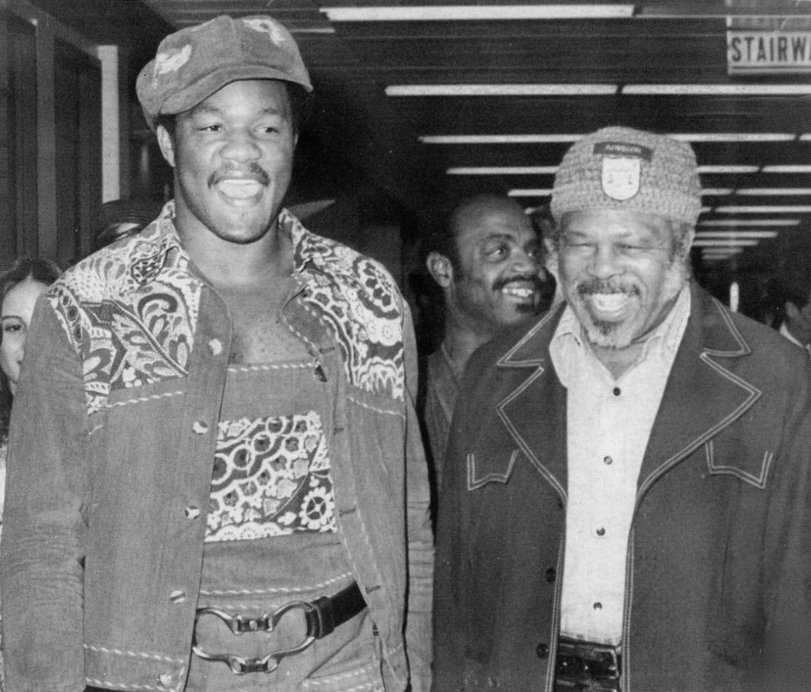
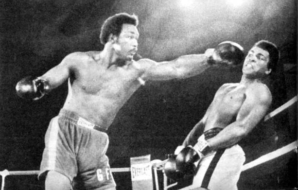
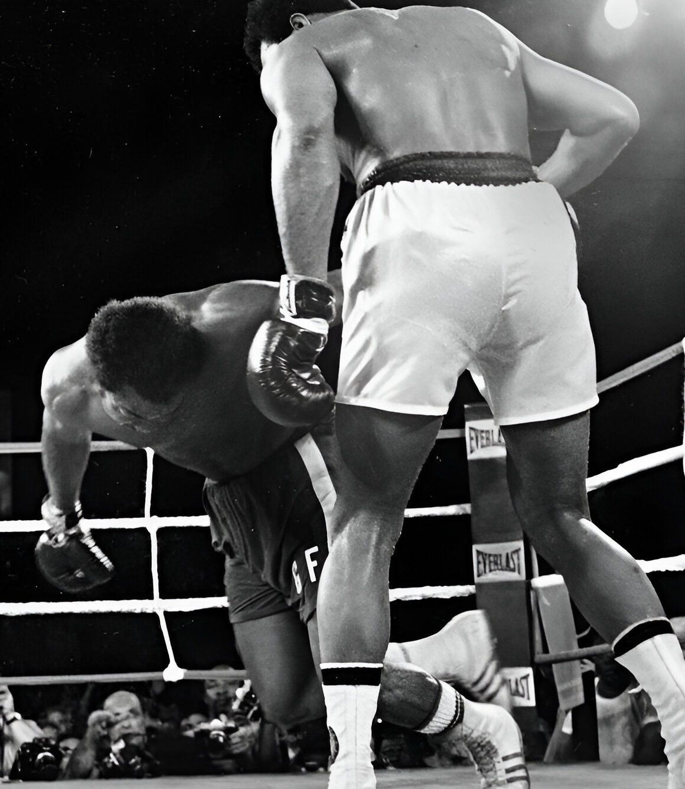

Fifty-two years ago today, on October 30, 1974, the most famous boxing match in history unfolded in Kinshasa, Zaire. Billed as the 'Rumble in the Jungle,' the fight pitted the undefeated 25-year-old heavyweight champion George Foreman against 32-year-old former champion Muhammad Ali. Against 4-to-1 odds, Ali delivered an eighth-round knockout that resonated across the globe.

## The Long Road Back to the Heavyweight Crown

Muhammad Ali's journey to Kinshasa began seven years earlier. In 1967, Ali was stripped of his world heavyweight title and suspended from boxing for three and a half years after refusing to be drafted into the U.S. Army. He finally regained his boxing license in 1970 and fought comeback bouts against Jerry Quarry and Oscar Bonavena, but suffered his first professional defeat in the 1971 'Fight of the Century' against Joe Frazier. For Ali, reclaiming the undisputed championship became a defining mission.

## The Rise of George Foreman and a Five-Million-Dollar Promise

While Ali fought his way back, George Foreman tore through the heavyweight division. After winning an Olympic gold medal in 1968, Foreman captured the professional heavyweight crown in devastating fashion, knocking down Joe Frazier six times in just two rounds. He followed that performance by stopping Ken Norton in two rounds as well. When promoter Don King sought to arrange the title fight, both boxers signed contracts guaranteeing them an unprecedented $5 million purse each. To finance the massive sum, King partnered with Zaire's president, Mobutu Sese Seko, who agreed to stage the bout in the Central African nation to showcase his regime on the global stage.

*Archive, 1974 — Photo: Associated Press / Public domain*

## An Accidental Cut and a Five-Week Delay

The fight was originally scheduled for September 25, 1974. However, just eight days prior to the date, Foreman sustained a deep laceration above his right eye from an accidental elbow thrown by sparring partner Bill McMurray. The injury required 11 stitches, forcing organizers to push the contest back five weeks to October 30. A massive three-night music festival, Zaire 74, still went ahead as scheduled in late September, featuring iconic American and international artists such as James Brown, B.B. King, and Bill Withers, keeping the international spotlight firmly fixed on Kinshasa.

*Archive, 1974 — Photo: Unknown authorUnknown author / Public domain*

## The Rope-a-Dope in the Kinshasa Heat

To accommodate prime-time live television in the United States, where it aired at 10 p.m. Eastern Time, the fighters entered the ring at 4 a.m. local time inside the 20th of May Stadium. An electric crowd of 60,000 spectators packed the venue. Instead of dancing around the ring, Ali introduced a risky and unpredicted tactic known as the 'rope-a-dope.' Ali leaned against the intentionally loosened ropes, covered his face with his gloves, and absorbed Foreman's ferocious punches to his arms and midsection while verbally taunting the champion. In the stifling humidity, Foreman expended massive amounts of energy over the first seven rounds.

*Archive, 1974 — Photo: Associated Press / Public domain*

## The Eighth-Round Knockout and Worldwide Phenomenon

By the eighth round, Foreman was visibly exhausted, his punches slowing down under the tropical heat. Sensing the moment, Ali rebounded off the ropes and landed a series of sharp, stinging combinations, punctuated by a hard right hand that sent the heavyweight champion crashing to the canvas. Referee Zack Clayton counted to ten, stopping the bout with just two seconds left in the round. The upset produced scenes of wild jubilation in the stadium and across Africa. An estimated one billion television viewers watched the broadcast worldwide, including a record 50 million fans on closed-circuit theater television and pay-per-view, generating roughly $100 million in gross revenue.

## A Boxing Masterpiece That Endures

Ali's victory in Kinshasa completed one of the greatest career resurgences in professional athletics. The tactical brilliance of the rope-a-dope entered the English lexicon, and the match later became the centerpiece of the Academy Award-winning documentary film When We Were Kings. More than five decades later, the Rumble in the Jungle remains the gold standard of dramatic sports upsets and a defining moment in American cultural and athletic history.

### Sources

- <https://en.wikipedia.org/wiki/Zaire>
- <https://commons.wikimedia.org/wiki/File:WORLD_HEAVYWEIGHT_BOXING_CHAMPION_MUHAMMAD_ALI,_A_BLACK_MUSLIM,_ATTENDS_THE_SECT%27S_SERVICE_TO_HEAR_ELIJAH_MUHAMMAD..._-_NARA_-_556247.jpg>
- <https://commons.wikimedia.org/wiki/File:George_Foreman_and_Archie_Moore_1974.jpg>
- <https://commons.wikimedia.org/wiki/File:Foreman_tira_golpe_a_clay.jpg>
- <https://commons.wikimedia.org/wiki/File:Foreman_cae.jpg>
