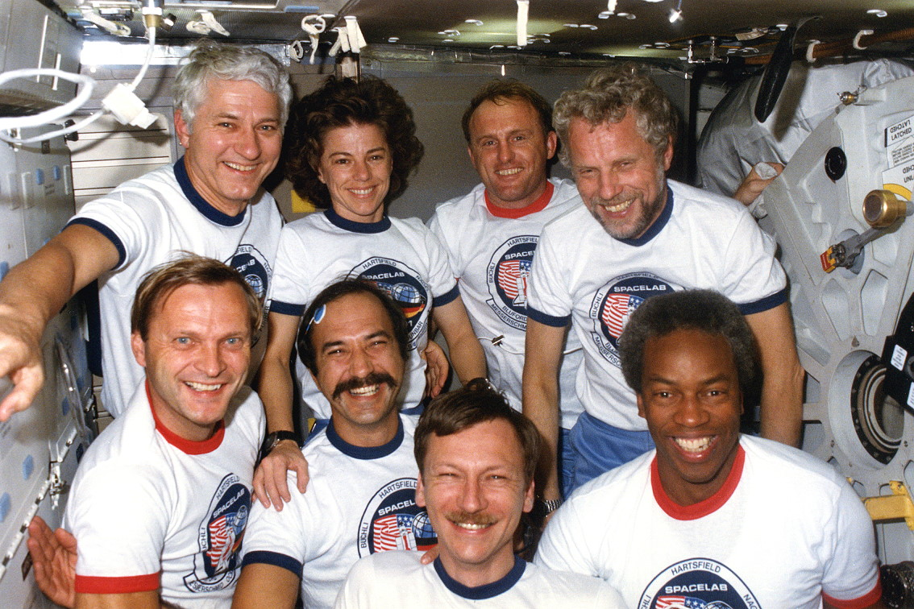
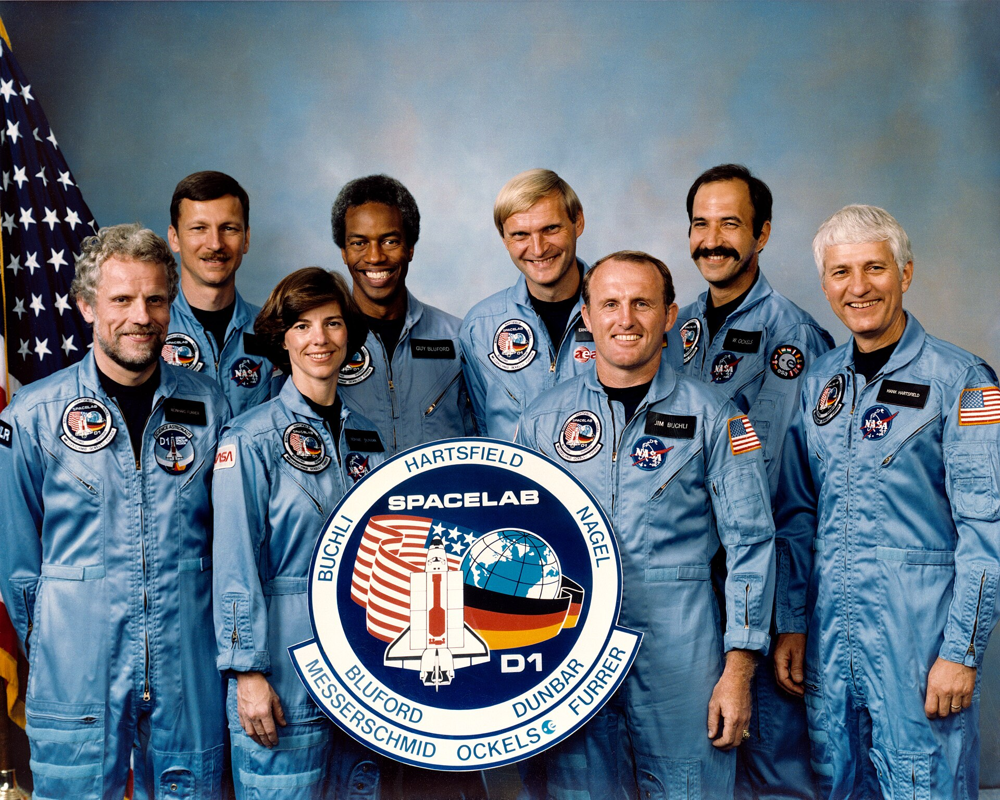
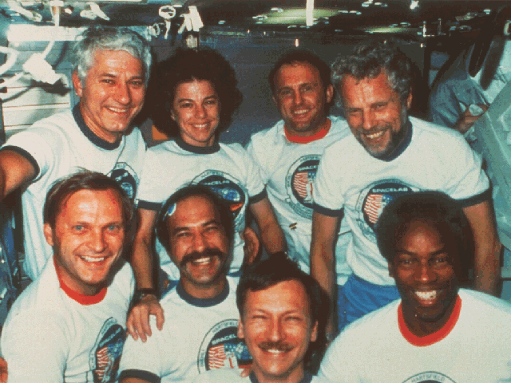

41 years ago today, October 30, 1985, Space Shuttle Challenger lifted off from Launch Complex 39A at Florida's Kennedy Space Center on mission STS-61-A. Rising into the midday sky at exactly 12:00 p.m. EST, the orbiter carried eight astronauts into orbit. It would stand as the ninth and final successful flight of Challenger, setting a historic record that remains unmatched to this day.

## A Groundbreaking Mission Directed by West Germany

Mission STS-61-A, also designated as Spacelab D-1, marked the 22nd flight of NASA's Space Shuttle program. It was the first space shuttle mission largely funded and directed by another nation. While NASA operated the shuttle and remained responsible for flight safety and vehicle control, West Germany managed the scientific research carried out during the seven-day mission.

To manage payload operations, scientific controllers on the ground worked out of the German Space Operations Center in Oberpfaffenhofen, near Munich. This arrangement made history as orbital laboratory operations were guided from European soil rather than NASA's regular mission control center in Houston.

## An Unprecedented Crew of Eight

STS-61-A established an all-time record for the largest crew aboard any single spacecraft for the entire period from launch to landing. Eight astronauts were seated inside Challenger as it climbed toward orbit.

The mission was commanded by Henry W. Hartsfield Jr., with Steven R. Nagel serving as pilot. The three NASA mission specialists were Bonnie J. Dunbar, James F. Buchli, and Guion S. Bluford. Joining them were three European payload specialists: Ernst Messerschmid and Reinhard Furrer of West Germany, along with Wubbo J. Ockels of the European Space Agency, who became the first Dutch citizen astronaut in space. It was the first spaceflight to include multiple crew members from a single foreign nation other than the United States or the Soviet Union.

*STS 61-A crew portrait onboard Challenger middeck — Photo: NASA / Public domain*

## Midday Liftoff at Kennedy Space Center

At 12:00 p.m. EST on October 30, 1985, Challenger launched vertically from Launch Complex 39A. The vehicle's two solid rocket boosters fired in parallel with its three Rocketdyne RS-25 main engines, drawing liquid hydrogen and liquid oxygen from the massive external tank.

After clearing the launch pad and ascending through the atmosphere, the twin boosters separated cleanly before the shuttle reached orbit. The orbiter's Orbital Maneuvering System engines fired to complete orbital insertion, placing the crew and the Spacelab module into low Earth orbit.

*STS-61-A crew — Photo: NASA / Public domain*

## Around-the-Clock Science in Microgravity

The primary objective of STS-61-A was to carry out 76 scientific experiments aboard Spacelab D-1, the third flight of the European-built laboratory module. To maximize research time, the eight astronauts were divided into two teams working twelve-hour shifts, keeping the orbital laboratory active 24 hours a day.

The investigations spanned fluid physics, including studies of capillarity, Marangoni convection, and diffusion phenomena. Crew members also conducted experiments on solidification, single crystal growth, biological cell functions, and plant gravity perception. One unique piece of equipment was the European Space Agency's Vestibular Sled, a motorized seat mounted on rails along the Spacelab aisle. Astronauts strapped into the sled were accelerated back and forth to measure how human balance and inner ear systems adapt to weightlessness.

*61-A-Crew — Photo: NASA / Public domain*

## Additional Payloads in the Cargo Bay

Beyond the pressurized Spacelab module, Challenger's cargo bay carried secondary objectives. The crew successfully deployed the Global Low Orbiting Message Relay Satellite, known as GLOMR, from a Getaway Special canister.

In addition, five materials processing experiments were operated in the payload bay on a dedicated carrier known as the German Unique Support Structure. Communication between the orbiting laboratory and ground stations in both the United States and West Germany remained optimal throughout the week of intensive research.

## The Trusted Workhorse of the Shuttle Fleet

Challenger, designated OV-099 and built by Rockwell International, was the second orbiter to fly into space after Columbia. Following its maiden flight in April 1983, it quickly became NASA's most active spacecraft, flying ten missions over three years. Challenger completed nearly 1,000 Earth orbits and carried numerous historic milestones, including the first American female astronaut, the first African-American astronaut, and the first American female spacewalker.

STS-61-A proved to be the peak of Challenger's service life. Tragic events followed less than three months later, in January 1986, when Challenger was destroyed 73 seconds after liftoff on mission STS-51-L due to an O-ring failure. Because of that disaster, STS-61-A stands as Challenger's final completed mission, leaving behind an unbroken record of eight space travelers who journeyed together from launch to landing.

### Sources

- <https://en.wikipedia.org/wiki/Space_Shuttle_Challenger>
- <https://commons.wikimedia.org/wiki/File:Challenger_flight_51-l_crew.jpg>
- <https://commons.wikimedia.org/wiki/File:STS_61-A_crew_portrait_onboard_Challenger_middeck.jpg>
- <https://commons.wikimedia.org/wiki/File:STS-61-A_crew.jpg>
- <https://commons.wikimedia.org/wiki/File:61-A-Crew.png>
