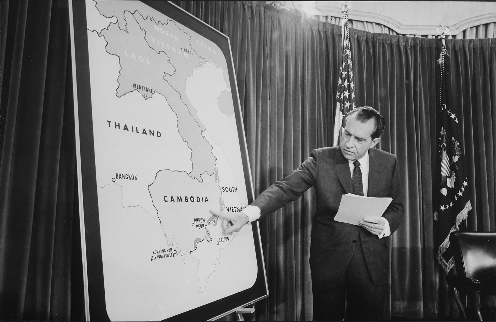
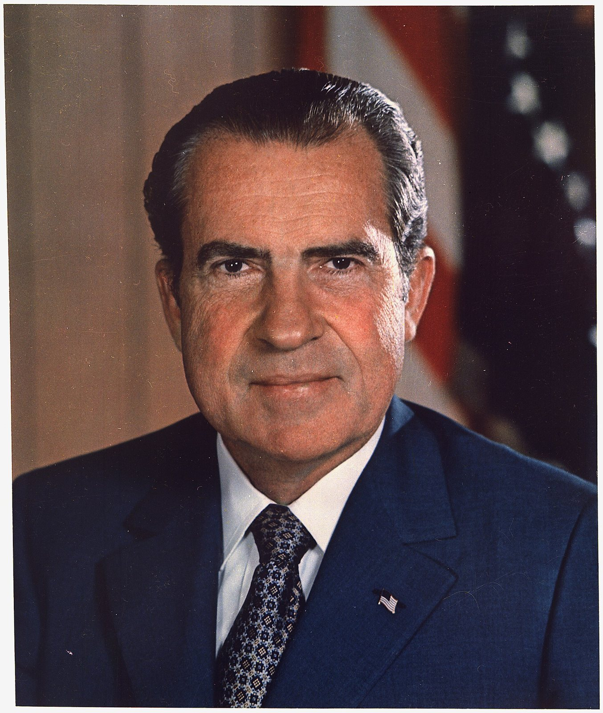
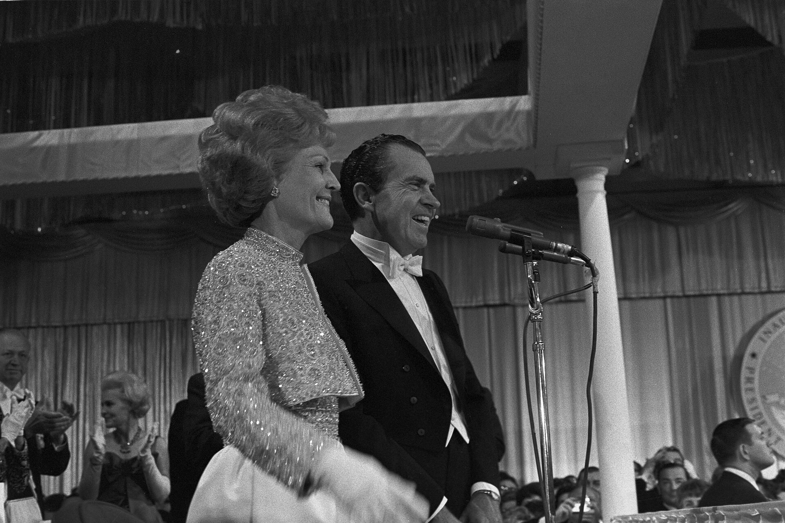

54 years ago today, October 30, 1972, President Richard Nixon approved sweeping federal legislation that increased Social Security spending by 5.3 billion dollars. The historic move delivered immediate financial reinforcement to millions of elderly, disabled, and surviving beneficiaries across the United States. It stood as one of the most substantial expansions of the social welfare program since its founding during the Great Depression.

## The Modest Origins of Social Security

Social Security began when President Franklin D. Roosevelt signed the original 37-page Social Security Act into law on August 14, 1935. Designed to counteract the devastating poverty of the Great Depression, the act created Unemployment Insurance, Aid to Dependent Children, Old Age Insurance, and Old Age Assistance. In late November 1936, the newly formed Social Security Board partnered with the Post Office Department to distribute applications and issue official cards featuring unique nine-digit identification numbers.

That same year, John Sweeney became the first American citizen to officially receive a Social Security number. Sweeney, who passed away in 1974 at age 61, never drew retirement benefits himself, though his widow later received payments based on his work history. On January 1, 1937, wages became subject to payroll taxes, and that same month, Ernest Ackerman received the first lump-sum payout of just 17 cents. In 1940, the system issued its very first monthly check to Ida May Fuller for 22 dollars and 54 cents.

## Decades of Growth and Expansion

Over the decades following World War II, lawmakers steadily broadened the scope of the program. In 1939, Congress added benefits for spouses and minor children of retired workers. In 1950, benefits were significantly boosted with irregular cost-of-living adjustments, including a historic 77 percent jump that year.

A dedicated disability program was added to the Old-Age and Survivors Insurance framework in 1954, transforming it into the modern Old-Age, Survivors, and Disability Insurance program. Administered by the Social Security Administration, the federal initiative evolved into a universal cornerstone of American family life, funded through dedicated payroll taxes under the Federal Insurance Contributions Act and Self Employed Contributions Act.

*Archive, 1970 — Photo: Jack E. Kightlinger (White House Photo Office) / Public domain*

## Nixon's Domestic Record and the 1972 Election

When Richard Nixon assumed the presidency in 1969, his administration navigated substantial domestic and economic turbulence. In 1971, Nixon took the United States off the international gold standard by ending direct dollar convertibility, and he imposed temporary wage and price controls for 90 days. He also implemented the Twenty-sixth Amendment, which lowered the federal voting age from 21 to 18.

Nixon’s first term witnessed several major domestic reforms, including the establishment of the Environmental Protection Agency, the passage of the Clean Air Act, and the launch of the war on cancer. By the autumn of 1972, Nixon was actively campaigning for re-election against Democratic nominee George McGovern. Bolstering benefits for older voters became a critical legislative focus in the final weeks before election day.

*Richard M. Nixon, ca. 1935 - 1982 - NARA - 530679 — Photo: Unknown authorUnknown author or not provided / Public domain*

## Signing the 5.3 Billion Dollar Expansion

On October 30, 1972, just days before the national election, Nixon placed his signature on legislation that increased federal Social Security spending by 5.3 billion dollars. The measure delivered crucial economic relief to senior citizens who were grappling with rising inflation and living expenses across the country.

The signing served as a major triumph in the final stretch of the campaign. Shortly after approving the expansion, Nixon defeated George McGovern on November 7, 1972, winning one of the most lopsided landslide victories in presidential election history.

*President Richard Nixon and First Lady Pat Nixon at the 1969 Inaugural Ball - DPLA - 47374c65c7af4a72c589d82264bfaa56 — Photo: President (1969-1974 : Nixon). White House Photo Office. 196 / Public domain*

## Social Security in Modern America

Today, Social Security remains the nation's premier retirement and insurance safety net, covering 94 percent of all individuals in paid employment. By May 2025, the average monthly benefit stood at 1,903 dollars, rising from 1,783 dollars in 2024. In 2026, the maximum amount of taxable earnings reached 184,500 dollars.

Despite its broad reach, approximately 6.6 million state and local government employees, representing 28 percent of that workforce, remain outside the system under independent state or municipal pension plans. The total annual cost of the program reached 1.244 trillion dollars in 2022, accounting for approximately 5.2 percent of the gross domestic product of the United States.

## A Legacy of Retirement Security

Payroll taxes collected by the Internal Revenue Service continue to flow into two dedicated reserves: the Federal Old-Age and Survivors Insurance Trust Fund and the Federal Disability Insurance Trust Fund. While revenues exceeded expenditures between 1983 and 2009, the ongoing retirement of the baby-boom generation has placed renewed scrutiny on trust fund balances.

Projections from 2026 trustees estimated that the Old-Age and Survivors Insurance Trust Fund could face depletion by the fourth quarter of 2032, at which point tax income would cover 78 percent of scheduled benefits. The bold 5.3 billion dollar boost approved on this day in 1972 demonstrated how federal policy could step in to protect seniors, creating a legacy of retirement security that millions of families still depend on today.

### Sources

- <https://en.wikipedia.org/wiki/Richard_Nixon>
- <https://commons.wikimedia.org/wiki/File:Elvis-nixon.jpg>
- <https://commons.wikimedia.org/wiki/File:NixononCambodia.jpg>
- <https://commons.wikimedia.org/wiki/File:Richard_M._Nixon,_ca._1935_-_1982_-_NARA_-_530679.jpg>
- <https://commons.wikimedia.org/wiki/File:President_Richard_Nixon_and_First_Lady_Pat_Nixon_at_the_1969_Inaugural_Ball_-_DPLA_-_47374c65c7af4a72c589d82264bfaa56.jpg>
