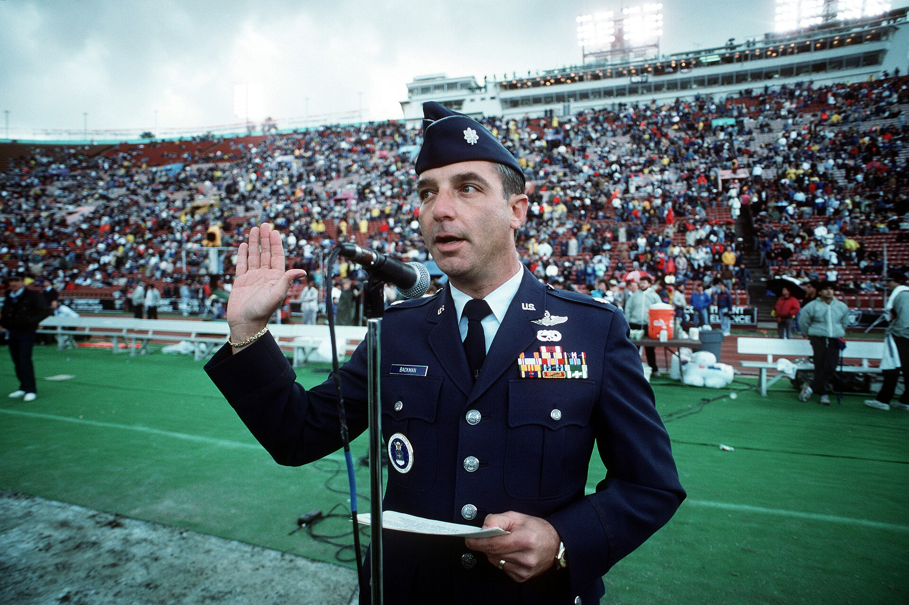
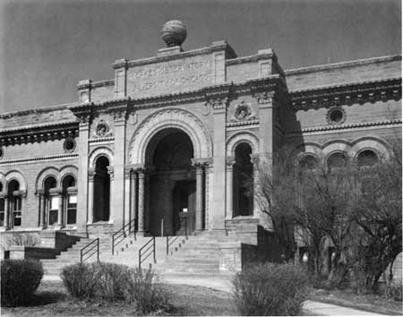
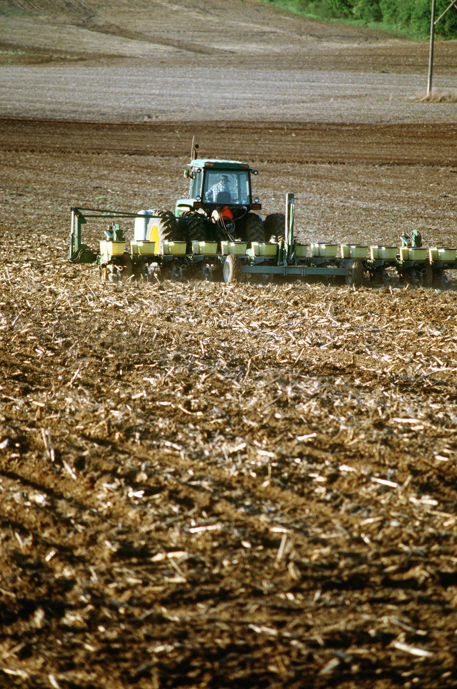

38 years ago today, October 30, 1988, tobacco giant Philip Morris agreed to acquire Kraft Foods for $13,100,000,000. The transaction brought together one of the world's most prominent cigarette producers and a Chicago-based food conglomerate known for cheese, dairy, and grocery staples. It stood as one of the largest corporate buyouts of the era, uniting household groceries with tobacco profits. The deal set off a multi-decade journey of corporate restructuring that reshaped both the food and tobacco industries in the United States.

## A Historic Buyout on October 30, 1988

On October 30, 1988, Philip Morris reached a definitive agreement to purchase Kraft Foods for $13,100,000,000. Kraft Foods was headquartered in Chicago, Illinois, and had built an extensive manufacturing operation across North America. Its core businesses spanned beverages, cheese, dairy products, snack foods, and convenience foods found in grocery stores across the country.

The purchase price of $13,100,000,000 was an astonishing financial commitment for an acquisition in 1988. By committing billions to acquire Kraft, Philip Morris signaled its intention to assemble a vast consumer goods conglomerate capable of weathering shifts in the tobacco market.

## Tobacco Profits Meet Everyday Grocery Brands

Philip Morris had long been an economic powerhouse, having been added to the prestigious Dow Jones Industrial Average in 1985. The company generated substantial cash flow from its tobacco operations, led by Philip Morris USA. However, growing awareness around public health created an incentive for corporate leadership to diversify away from exclusive reliance on cigarettes.

Kraft Foods provided an established commercial foundation. With products that filled kitchen pantries and refrigerators across the nation, Kraft offered reliable, repeat consumer demand. The takeover created a corporate behemoth that paired supermarket cheese and convenience foods with global cigarette manufacturing under a single corporate parent.

*Oath of enlistment · DF-ST-91-07705 — Photo: Michael Haggerty / Public domain*

## A New Corporate Name and Shifting Strategy

In 2003, Philip Morris Companies launched a major corporate rebranding, changing its name to Altria Group. According to the company, the rebranding was designed to emphasize that its business portfolio had expanded well beyond tobacco manufacturing. At the time of the name change, Altria held an 84% stake in Kraft Foods.

The company's branding consultants, the Wirthlin Group, observed that the name change offered the possibility of masking negatives associated with the tobacco business. Philip Morris executives believed the rebranding would help protect the broader corporation and its non-tobacco operating units from mounting legal and political pressures. In 2003, Altria was ranked number 11 on the Fortune list of major corporations.

*Yerkes Observatory Astro4p2 — Photo: Photo Credit: Yerkes Observatory / Public domain*

## Federal Court Rulings and Corporate Separation

Despite the new corporate identity, intense scrutiny of tobacco operations continued. In a major 2006 federal court ruling, Philip Morris and Altria, alongside R. J. Reynolds and Lorillard, were found guilty of misleading the public regarding the health dangers of smoking. The federal court found that the companies had altered the chemical form of nicotine using ammonia to enhance absorption speed and addiction, while publicly disputing scientific findings linking smoking to disease.

Under significant legal pressure, Altria moved to dismantle its diversified conglomerate structure. On March 30, 2007, Altria spun off its 88.1% stake in Kraft Foods by distributing shares directly to Altria shareholders. In 2008, following the spinoff of Kraft and the subsequent separation of Philip Morris International, Altria was removed from the Dow Jones Industrial Average. That same year, Altria moved its corporate headquarters from New York City to Henrico County, Virginia, near Richmond.

*Farming near Omaha, Nebraska in 1988 — Photo: SSGT Scott Stewart / Public domain*

## Brand Evolution and the Heinz Merger

After regaining its independence from Altria, Kraft Foods pursued its own corporate transformations. In August 2011, Kraft announced plans to divide into two separate publicly traded entities. On October 1, 2012, the North American grocery operations were spun off into Kraft Foods Group, Inc., while the remaining snack business was renamed Mondelēz International, Inc. During this period, Kraft remained active in culture and marketing, sponsoring the Kraft Nabisco Championship LPGA major from 2002 to 2014 and the Kraft Hockeyville competition beginning in 2006.

The grocery company soon orchestrated another massive industry consolidation. On March 25, 2015, Kraft Foods Group announced a merger agreement with the H.J. Heinz Company, owned by Berkshire Hathaway and 3G Capital. Shares of Kraft jumped about 17 percent in premarket trading on the news. The merger was completed on July 2, 2015, establishing Kraft Heinz as the fifth-largest food and beverage company in the world. In 2025, Kraft Heinz confirmed plans to spend $3 billion upgrading its U.S. manufacturing facilities, adding 3,500 employees to its workforce.

## A Defining Chapter in Corporate History

The $13,100,000,000 takeover on October 30, 1988, remains one of the most memorable corporate acquisitions in modern history. It illustrated how massive cash flows from tobacco were deployed to purchase bedrock American food brands, creating a consumer giant that touched nearly every household.

Although the union ultimately dissolved into independent entities, the ripple effects persisted for decades. The separation paved the way for the modern structures of Altria, Mondelēz, and Kraft Heinz. For observers of American business, the October 1988 purchase represents a unique era when cigarettes and cheese shared the very same corporate boardroom.

### Sources

- <https://en.wikipedia.org/wiki/Kraft_Foods>
- <https://commons.wikimedia.org/wiki/File:Soviet_inspectors_at_RAA.jpg>
- <https://commons.wikimedia.org/wiki/File:Oath_of_enlistment_%C2%B7_DF-ST-91-07705.JPEG>
- <https://commons.wikimedia.org/wiki/File:Yerkes_Observatory_Astro4p2.jpg>
- <https://commons.wikimedia.org/wiki/File:Farming_near_Omaha,_Nebraska_in_1988.JPEG>
