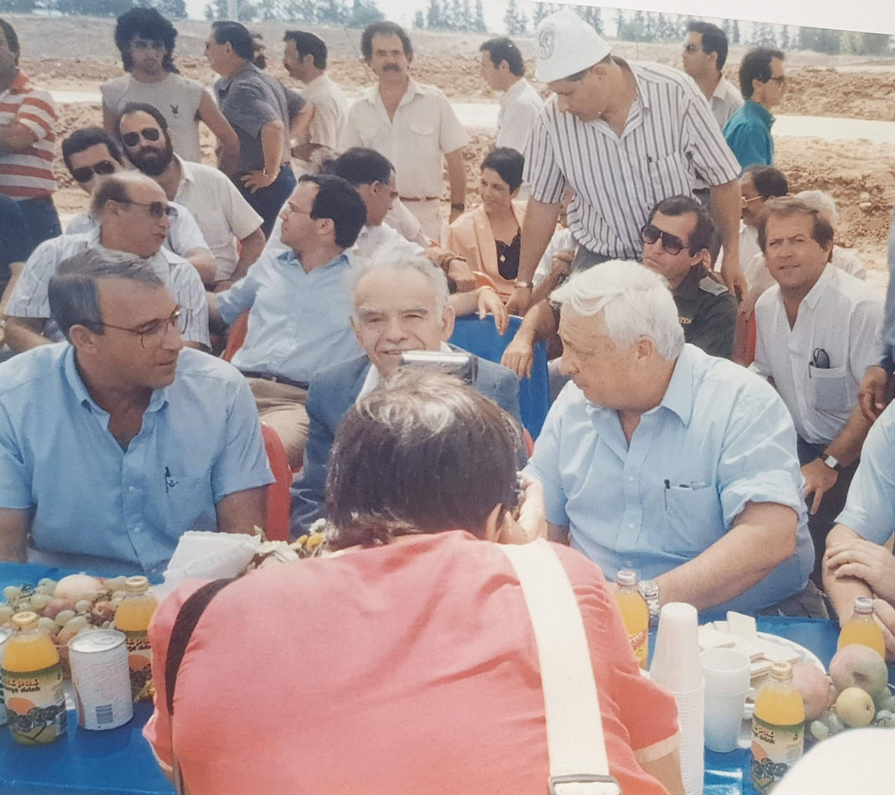
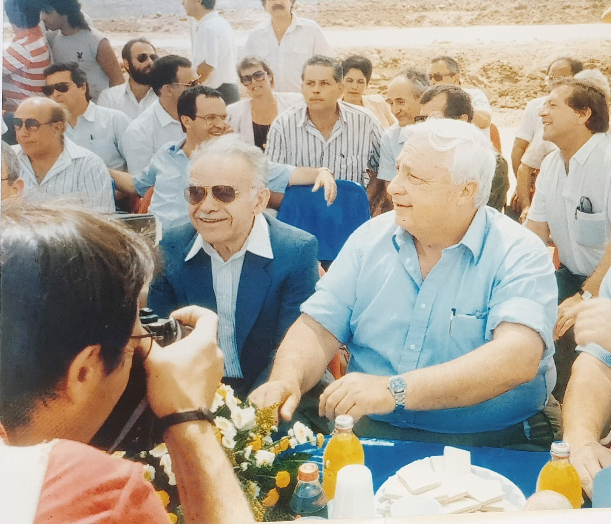
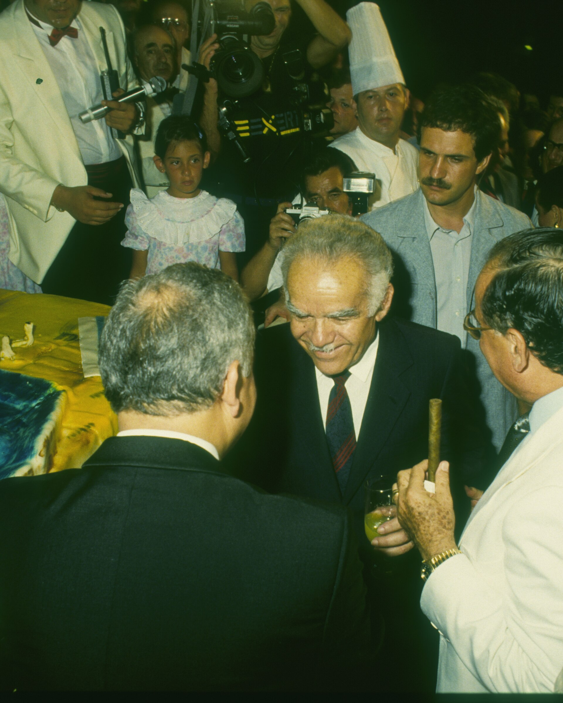

Thirty-five years ago today, October 30, 1991, an unprecedented diplomatic summit commenced in Madrid, Spain. For the first time in modern history, Israeli representatives sat face-to-face with delegates from neighboring Arab nations and the Palestinians in an ambitious bid to revive the long-stalled Middle East peace process.

## A Diplomatic Opening After the Gulf War

The roots of the Madrid summit took shape in the aftermath of the Gulf War. On March 6, 1991, U.S. President George H. W. Bush delivered an address to a joint session of Congress laying out his administration's vision for a post-war Middle East order. While the United States planned to maintain a naval presence in the Persian Gulf and provide regional development funds, the true centerpiece of the administration's program was the pursuit of an Arab-Israeli treaty based on the territory-for-peace principle and the fulfillment of Palestinian rights. The White House saw an extraordinary window of opportunity to spend the diplomatic and political capital generated by the international coalition victory to revitalize negotiations.

## Eight Missions Across the Middle East

Turning that presidential vision into an actual summit required relentless shuttle diplomacy led by U.S. Secretary of State James Baker. Baker had earlier signaled a shift in American posture during a May 1989 address to an AIPAC audience, urging Israel to abandon expansionist policies. Between March and October 1991, Baker made eight separate trips to the Middle East, meeting repeatedly with leaders across the region to hammer out an acceptable procedural formula. The initiative was designed as a multi-party international conference co-sponsored by the United States and the Soviet Union, which would immediately break into separate bilateral and multilateral negotiating tracks.

*NOT FROM THE EVENT · 1990 — Photo: Unnkown / CC BY 2.5*

## The Showdown Over Loan Guarantees

Convening the meeting proved exceedingly delicate, particularly over how Palestinians would be represented and whether economic incentives should play a role. Unlike earlier negotiations such as the Camp David Accords where check-book diplomacy was used, the Bush administration initially intended to rely on the coalition's prestige rather than financial inducements. However, in May 1991, Israeli Prime Minister Yitzhak Shamir requested 11 billion dollars in U.S. loan guarantees to help absorb humanitarian immigrants. Arab governments and Palestinian representatives viewed the loan guarantee request as a major test of American impartiality, given Shamir's pro-settlement policies, sparking a contentious political showdown between Washington and the Likud government.

*NOT FROM THE EVENT · 1990 — Photo: Unnkown / CC BY 2.5*

## Gathering at the Table in Spain

Despite these obstacles, the formal letter of invitation dated October 30, 1991, was extended jointly by the United States and the Soviet Union to Israel, Syria, Lebanon, Jordan, and the Palestinians. Hosted by Spain in its capital city, Madrid, the conference officially got underway on October 30 and lasted through November 1. Delegations from Israel, Syria, Lebanon, and Egypt attended, while Palestinian delegates participated as part of a joint Jordanian-Palestinian delegation. For three intense days, international diplomats and regional adversaries occupied the same halls, launching an open multilateral dialogue that had seemed impossible for decades.

*NOT FROM THE EVENT · 1987 — Photo: IPPA photographer / CC BY 4.0*

## From the Spanish Capital to Washington and Moscow

The plenary sessions in Madrid were immediately followed by bilateral negotiations between Israel and the respective delegations on November 3. The framework agreed upon in Madrid soon transferred onto American soil, with subsequent bilateral meetings taking place in Washington beginning on December 9, 1991. Weeks later, on January 28, 1992, multilateral negotiations focusing on broader regional cooperation commenced in Moscow. Although Lebanon and Syria chose not to attend the Moscow round, the meetings were attended by Israel, the joint Jordanian-Palestinian delegation, and key members of the international community.

## The Enduring Memory of the Madrid Summit

While the underlying Israeli-Palestinian conflict and territorial disputes would remain deeply unresolved in the decades that followed, the Madrid Conference broke an enduring psychological and diplomatic barrier. It established the groundbreaking precedent of direct, formal bilateral negotiations between Israel and its immediate Arab neighbors. Thirty-five years later, historians and observers still look back at the Madrid gathering of late 1991 as the moment when the world briefly united to bring the bitterest of rivals to the negotiating table.

### Sources

- <https://en.wikipedia.org/wiki/Madrid_Conference_of_1991>
- <https://commons.wikimedia.org/wiki/File:Intifada_in_Gaza_Strip_(FL45884501).jpg>
- <https://commons.wikimedia.org/wiki/File:82867_yitzhak_shamir_PikiWiki_Israel.jpg>
- <https://commons.wikimedia.org/wiki/File:82868_yitzhak_shamir_PikiWiki_Israel.jpg>
- <https://commons.wikimedia.org/wiki/File:Ambassador_of_Egypt_Mohammed_Bassiouni_held_a_traditional_reception_at_his_residence_on_the_Memorial_Day_for_the_Egyptian_revolution_overturning_the_Kingdom_(FL45936054).jpg>
