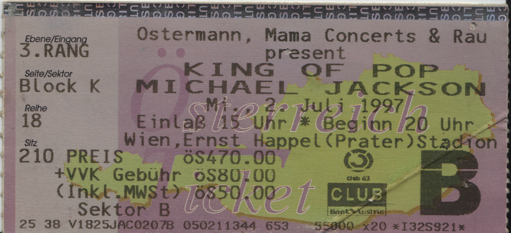
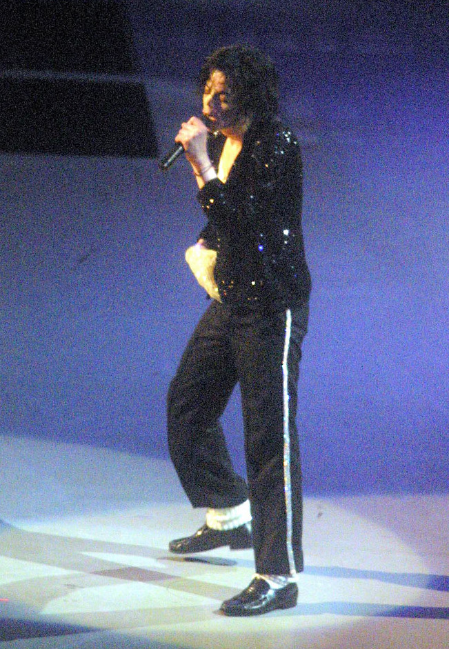
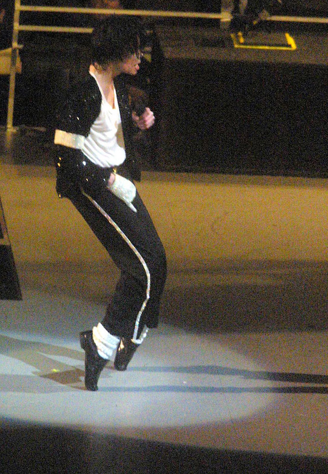

25 years ago today, October 30, 2001, Michael Jackson released his tenth studio album, "Invincible," through Epic Records. It was his first collection of all-new material in six years, and it would ultimately stand as the final studio album released during his lifetime.

## Anticipation for a Pop Icon's Return

By 2001, Michael Jackson had already established himself as one of the most influential cultural figures of the twentieth century. From his childhood debut as the lead voice of the Jackson 5 in Gary, Indiana, to solo landmarks like "Off the Wall," "Thriller," and "Bad," he had rewritten the rules of pop music, music videos, and stage performance. However, Jackson had not released an album of completely original studio material since "HIStory" in 1995, followed by the remix compilation "Blood on the Dance Floor: HIStory in the Mix" in 1997. Both the music industry and his global audience viewed "Invincible" as a critical career comeback.

## The Most Expensive Album Ever Made

Jackson spared no expense or effort during the creation of "Invincible." Production began in October 1997 and spanned four years, concluding only eight weeks prior to its release date when Jackson completed the song "You Are My Life." Over the course of the project, Jackson engaged ten different record producers, including Rodney Jerkins, Teddy Riley, Kenneth "Babyface" Edmonds, and Dr. Freeze, along with more than 100 musicians. Tracks produced with Jerkins were recorded at Criteria Studios in Miami, Florida, with Jackson seeking an edgier, modern direction across R&B, pop, and soul. When the accounting was finished, production expenses were reported at close to 30 million dollars, establishing "Invincible" as the most expensive album ever recorded.

*Archive, 1999 — Photo: Medullaoblongata Projekt / CC BY-SA 4.0*

## Star Collaborations and Dedicated Songs

Jackson took an active hand as the primary writer and producer across the album while inviting a diverse array of guest performers into the studio. Renowned guitarists Carlos Santana and Slash contributed their signature playing styles to the record, while Jackson also incorporated a posthumous appearance from hip-hop legend the Notorious B.I.G. Seeking an unfamiliar voice for rap sections, Jackson turned down established names and recruited an unknown New Jersey artist named Fats. The finished tracklist explored Jackson's familiar themes of romance, personal isolation, and sharp media criticism. In a poignant gesture, Jackson dedicated the album to Benjamin Hermansen, a fifteen-year-old Norwegian youth who had been murdered by neo-Nazis in Oslo in January 2001.

*NOT FROM THE EVENT — Photo: AllardJanssen / CC BY-SA 2.0*

## Topping Charts in the United States and Abroad

Upon its arrival on October 30, 2001, "Invincible" immediately found commercial footing. The album entered the US Billboard 200 chart at number one after selling 363,000 copies in its first week of release. It simultaneously claimed the top position on charts across 13 other countries. Its lead single, "You Rock My World," climbed to number ten on the Billboard Hot 100, earning a Grammy nomination for Best Male Pop Vocal Performance at the 2002 ceremony. It would stand as Jackson's final top-ten single during his career, followed by the release of "Cry" and promotional singles like "Butterflies" and "Speechless."

*NOT FROM THE EVENT — Photo: AllardJanssen / CC BY-SA 2.0*

## Label Friction and the Final Studio Chapter

Despite strong commercial numbers, the release campaign soon ran into severe turbulence. In July 2002, Sony Music abruptly halted promotional backing for "Invincible," prompting Jackson to publicly condemn Sony Music chief executive Tommy Mottola. Jackson chose not to launch a concert tour in support of the album, widening the rift with the record company. Even with limited promotional support, "Invincible" earned double-platinum certification in the United States and achieved global sales topping eight million copies. Jackson would never release another studio album during his life. While rehearsing for his comeback concert series, "This Is It," he died on June 25, 2009, at age 50 in Los Angeles.

## The Lasting Legacy of Invincible

Following Jackson's passing in 2009, music listeners revisited "Invincible" with renewed appreciation. In a retrospective poll conducted by Billboard that year, online readers voted it the best album of the 2000s. Critics and fans increasingly recognized the album's ambitious sound design, vocal arrangements, and pristine production quality. Today, 25 years after its release, "Invincible" remains a striking artifact of Jackson's boundless ambition—the final, lavish studio statement of the King of Pop.

### Sources

- <https://en.wikipedia.org/wiki/Michael_Jackson>
- <https://commons.wikimedia.org/wiki/File:Michael_Jackson_Invincible.png>
- <https://commons.wikimedia.org/wiki/File:Austria_Vienna_Michael_Jackson_concert_ticket.png>
- <https://www.flickr.com/photos/69374731@N06/6306205970>
- <https://www.flickr.com/photos/69374731@N06/6306205566>
