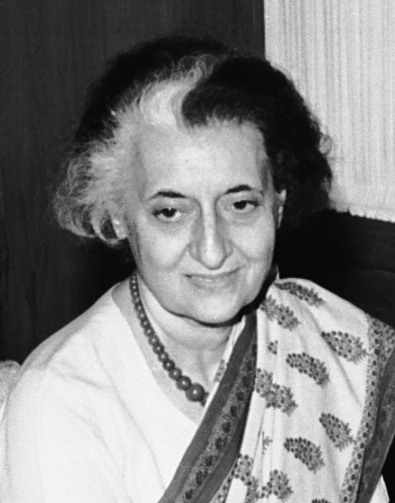
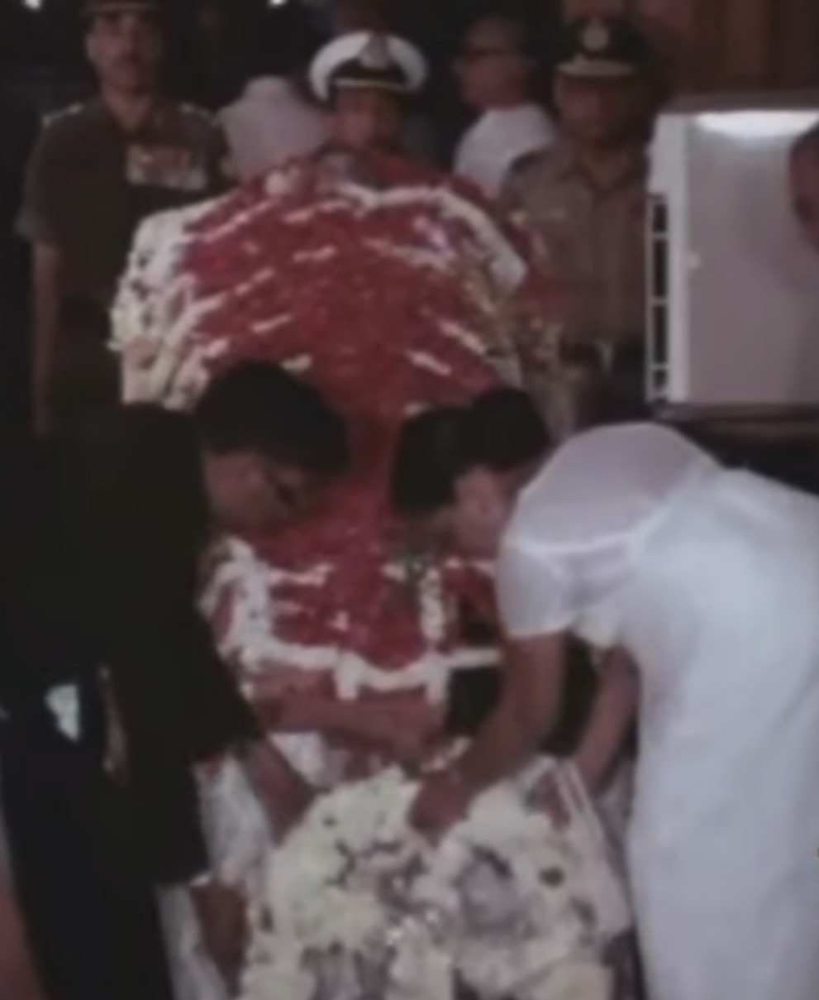
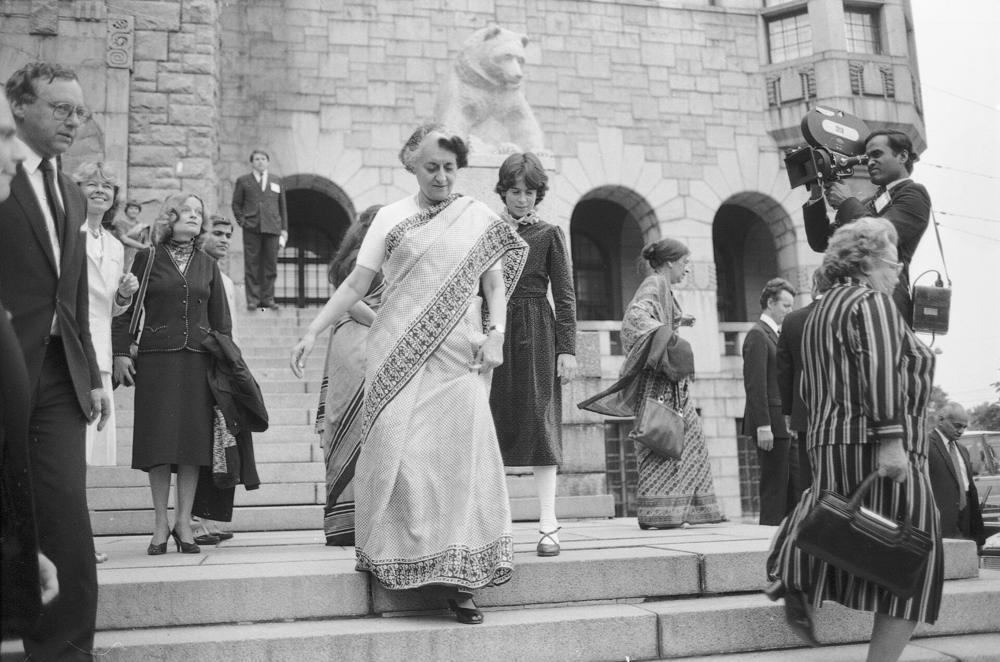

42 years ago today, October 31, 1984, Indian Prime Minister Indira Gandhi was assassinated by two of her own security guards at her official residence in New Delhi. The sudden killing of one of the twentieth century's most dominant female leaders shocked the global community and unleashed days of catastrophic communal violence across India.

## The Daughter of Nehru and a Titan of Indian Politics

Indira Priyadarshini Gandhi was the daughter of Jawaharlal Nehru, India's first prime minister, and had grown up at the very center of the nation's struggle for independence. She rose to lead the Indian National Congress and first took office as prime minister in 1966, serving until 1977, and returning to power in 1980.

Her cumulative tenure lasted 15 years and 350 days across four terms, making her the second-longest-serving prime minister in Indian history after her father. At the time of her death, she was the longest-serving female head of government in the world and also served as chairperson of the Non-Aligned Movement.

## The Fallout from Operation Blue Star

The crisis that ultimately led to Gandhi's assassination began months earlier in Punjab. Between June 1 and June 8, 1984, the Indian military conducted Operation Blue Star under Gandhi's direct orders, aiming to flush out militant leader Jarnail Singh Bhindranwale and his armed followers from the Golden Temple complex in Amritsar, the holiest shrine of Sikhism.

The intense battle inside the sacred compound resulted in heavy casualties. Hundreds of civilians, militants, and Indian Army personnel died during the assault, and severe damage was inflicted upon the Akal Takht and the Sikh Reference Library. The military assault provoked profound grief and outrage among Sikhs throughout India and abroad.

*Indira Gandhi in 1984, from- Us-vice-president-george-h-w-bushs-visit-to-india1984 11814830335 o (cropped) — Photo: U.S. Embassy in new Delhi / Public domain*

## Ignoring Security Warnings Inside the Prime Minister's Residence

Following Operation Blue Star, Indian intelligence officials warned of severe threats to the prime minister's life. The Intelligence Bureau recommended removing all Sikh officers from her personal security detail to prevent potential retaliatory strikes.

Gandhi, however, feared that purging Sikh officers would reinforce an anti-Sikh image and undermine India's secular identity. She ordered the Delhi Police to reinstate her Sikh guards. Among them was Sub-Inspector Beant Singh, whom Gandhi had known for ten years and considered one of her favorite bodyguards.

*Archive, 1984 — Photo: Indiragandhifan / CC0*

## The Attack at No. 1 Safdarjung Road

At approximately 9:20 a.m. on October 31, Gandhi left her residence at No. 1 Safdarjung Road to walk across the garden toward the neighboring office at 1 Akbar Road. She was scheduled for an interview with British actor and filmmaker Peter Ustinov, who was directing a documentary for Irish television.

Gandhi was not wearing the bulletproof vest she had been advised to wear continuously. As she passed a wicket gate, Sub-Inspector Beant Singh drew a .38 revolver and fired three shots into her abdomen. Constable Satwant Singh, a 22-year-old guard assigned to her detail five months earlier, then opened fire with a Sterling sub-machine gun, discharging thirty rounds. Both assassins dropped their weapons immediately after the shooting.

*Archive, 1983 — Photo: Ritva Bäckman / CC BY 4.0*

## Emergency Surgery and the Official Declaration

Gandhi was rushed to the All India Institute of Medical Sciences (AIIMS) in New Delhi, arriving around 9:30 a.m. Medical teams worked frantically for hours, but the damage was insurmountable. A team of doctors led by Dr. Tirath Das Dogra conducted the postmortem examination, confirming that thirty of the thirty-three fired bullets had struck Gandhi, with twenty-three passing through her body.

She was officially pronounced dead at 2:20 p.m. In the immediate aftermath at the compound, Border Police officers had captured the assassins, killing Beant Singh within minutes. Satwant Singh was arrested, convicted, and later executed by hanging in 1989 alongside conspirator Kehar Singh.

## National Tragedy and International Mourning

The news of the assassination was publicly broadcast on Doordarshan evening news by anchor Salma Sultan. That same day, Indira Gandhi's son, Rajiv Gandhi, was sworn in as prime minister. However, the assassination quickly sparked horrific retaliatory violence against the Sikh population.

Over four days of anti-Sikh riots, nationalist mobs destroyed forty historic gurdwaras, and official government figures recorded 3,350 deaths, while independent estimates placed the toll significantly higher. India observed twelve days of national mourning from November 1 to 12. Governments around the world lowered flags to half-mast, with nations including Tanzania, Uganda, Cuba, Pakistan, and Brazil declaring official days of mourning for the fallen Indian leader.

### Sources

- <https://en.wikipedia.org/wiki/Indira_Gandhi>
- <https://commons.wikimedia.org/wiki/File:Indira_Gandhi_Lying_in_State_at_Teen_Murti_House.jpg>
- <https://commons.wikimedia.org/wiki/File:Indira_Gandhi_in_1984,_from-_Us-vice-president-george-h-w-bushs-visit-to-india1984_11814830335_o_(cropped).jpg>
- <https://commons.wikimedia.org/wiki/File:Bandaranaike_attending_Indira_Gandhi%E2%80%99s_funeral.jpg>
- <https://commons.wikimedia.org/wiki/File:Indira-Gandhi-in-Finland-1983.jpg>
