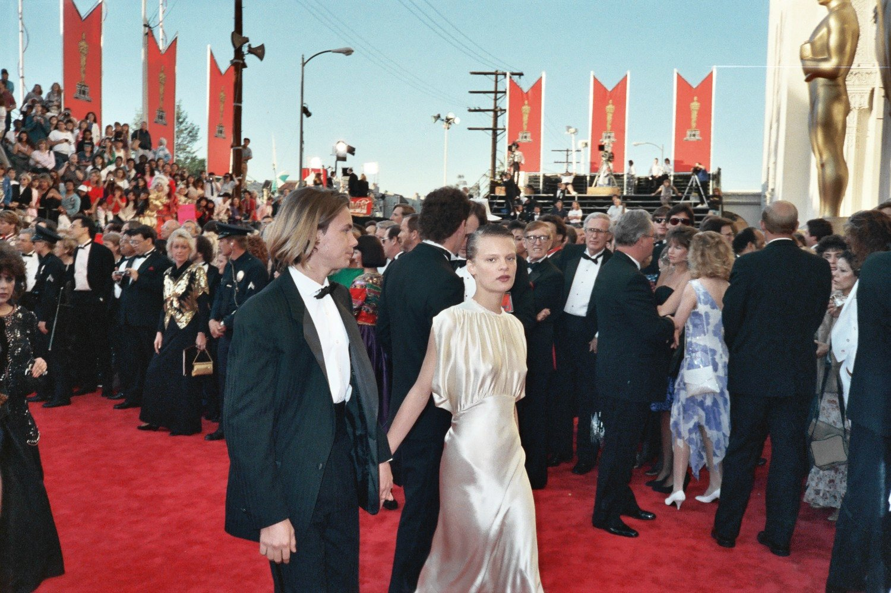
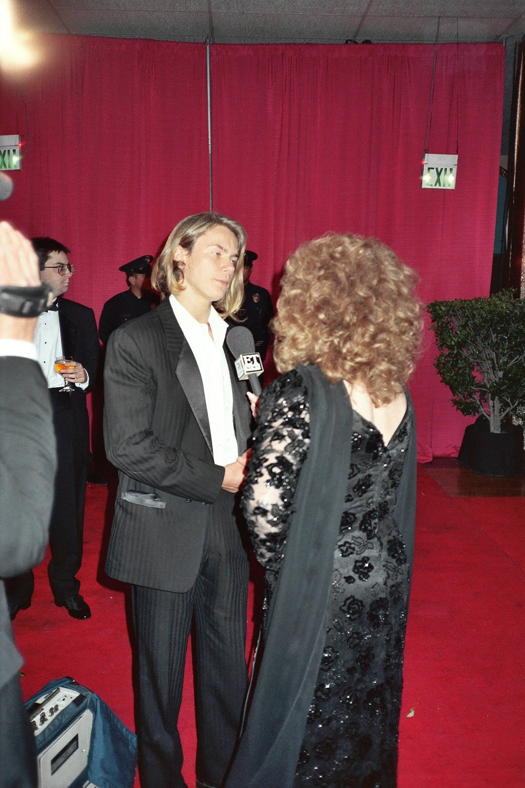
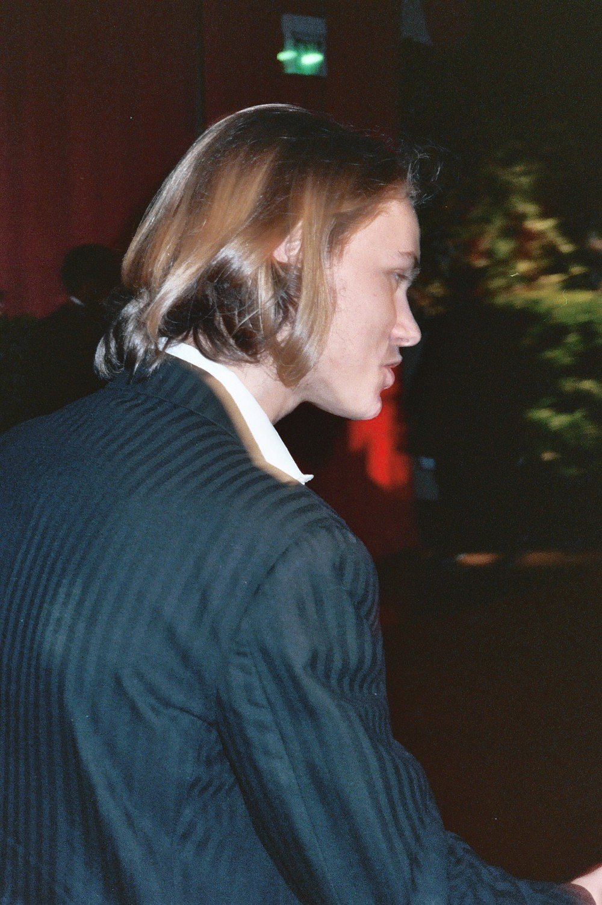

33 years ago today, October 31, 1993. Acclaimed actor and musician River Phoenix died outside a nightclub in West Hollywood, California, at just 23 years old. His sudden loss stunned audiences across the nation and silenced one of the most promising voices of American cinema.

## The Shocking News on Sunset Boulevard

In the early morning hours of October 31, 1993, tragedy unfolded on the sidewalk outside The Viper Room, a well-known nightclub located in West Hollywood, California. River Jude Phoenix suffered drug-induced heart failure and collapsed. Medical findings later confirmed that he died from acute multiple drug intoxication, including lethal amounts of cocaine and opiates taken before arriving at or while inside the venue.

At the time of his death, Phoenix was actively working in the film industry and was in the middle of shooting the feature film Dark Blood. Word of his collapse and passing spread rapidly across the country, creating an immediate sense of disbelief among fans, directors, and fellow actors who had viewed him as the leading artist of his generation.

## An Itinerant Childhood and Early Struggles

Born River Jude Bottom on August 23, 1970, in Madras, Oregon, he was the first child of Arlyn Dunetz and John Lee Bottom. His parents named him after the river of life from Hermann Hesse's novel Siddhartha, choosing Jude as his middle name in honor of the Beatles' hit song 'Hey Jude.' The couple had four more children together: Rain, Joaquin, Liberty, and Summer, alongside River's older paternal half-sister, Jodean.

The family spent years living an itinerant lifestyle, moving across the United States and Latin America. In 1973, his parents joined the religious group known as the Children of God, living as missionaries and fruit gatherers in Venezuela, Puerto Rico, and Mexico. Phoenix and his sister Rain frequently sang on street corners and played guitar to collect spare change and food for their growing family during periods of severe financial hardship.

Disillusioned with the organization, the family severed ties with the group in 1977 and returned to the United States. They eventually adopted the surname Phoenix after River's eighth or ninth birthday to symbolize a new beginning, settling in the Los Angeles area by the time he was nine years old.

*Archive, 1989 — Photo: Alan Light / CC BY 2.0*

## From Commercials to Breakthrough Screen Roles

Without any formal schooling, Phoenix possessed a natural curiosity and charisma. In Westwood, talent agent Iris Burton discovered River and his siblings singing for spare change and agreed to represent them. Phoenix started auditioning at age ten, booking commercials for brands such as Mitsubishi, Ocean Spray, and Saks Fifth Avenue.

He quickly transitioned into television drama. In 1982, Phoenix was cast as youngest brother Guthrie McFadden in the CBS television series Seven Brides for Seven Brothers. He earned critical acclaim in 1984 for his role in the ABC Afterschool Special: Backwards: The Riddle of Dyslexia, appearing alongside his younger brother Joaquin. Phoenix made his major motion picture debut in Joe Dante's 1985 science-fiction adventure Explorers, playing boy-scientist Wolfgang Müller alongside Ethan Hawke.

*River Phoenix at the Governor's Ball — Photo: Alan Light / CC BY 2.0*

## Rising Stardom and Critical Acclaim

Phoenix became an international household name following the release of Rob Reiner's 1986 coming-of-age classic Stand by Me. Filming took place during the summer of 1985 when Phoenix was only fourteen years old, and critics singled him out, noting that his mature and sensitive performance provided the true center of the movie.

Rather than remaining in standard teen roles, Phoenix pursued complex, challenging projects. In 1988, he starred in Sidney Lumet's drama Running on Empty as Danny Pope, the son of fugitive parents. His performance earned him nominations for both the Academy Award for Best Supporting Actor and the Golden Globe Award, establishing him as a serious dramatic heavyweight before his twentieth birthday.

In 1991, Phoenix reached another artistic peak in Gus Van Sant's acclaimed independent feature My Own Private Idaho. Portraying Michael Waters, a street hustler searching for his estranged mother, Phoenix won the Volpi Cup for Best Actor at the Venice International Film Festival and the Independent Spirit Award for Best Male Lead. His raw, deeply empathetic characterization received widespread critical praise across the world.

*River Phoenix Governor's Ball — Photo: Alan Light / CC BY 2.0*

## A Premature Departure and Enduring Artistry

The events of October 31, 1993, brought a sudden, tragic halt to an extraordinary artistic trajectory. River Phoenix was only 23 years old when his life ended on that West Hollywood pavement, leaving behind an unfinished film and an unfillable void in American cinema.

His younger brother Joaquin Phoenix, who had begun his own career in television alongside River, went on to carry the family's artistic legacy forward into major motion pictures. For generations of movie lovers who grew up watching Stand by Me, Running on Empty, and My Own Private Idaho, River Phoenix remains an unforgettable symbol of youthful vulnerability and rare cinematic brilliance.

### Sources

- <https://en.wikipedia.org/wiki/River_Phoenix>
- <https://commons.wikimedia.org/wiki/File:River_Phoenix.jpg>
- <https://commons.wikimedia.org/wiki/File:River_Phoenix_and_Martha_Plimpton.jpg>
- <https://commons.wikimedia.org/wiki/File:River_Phoenix_at_the_Governor%27s_Ball.jpg>
- <https://commons.wikimedia.org/wiki/File:River_Phoenix_Governor%27s_Ball.jpg>
