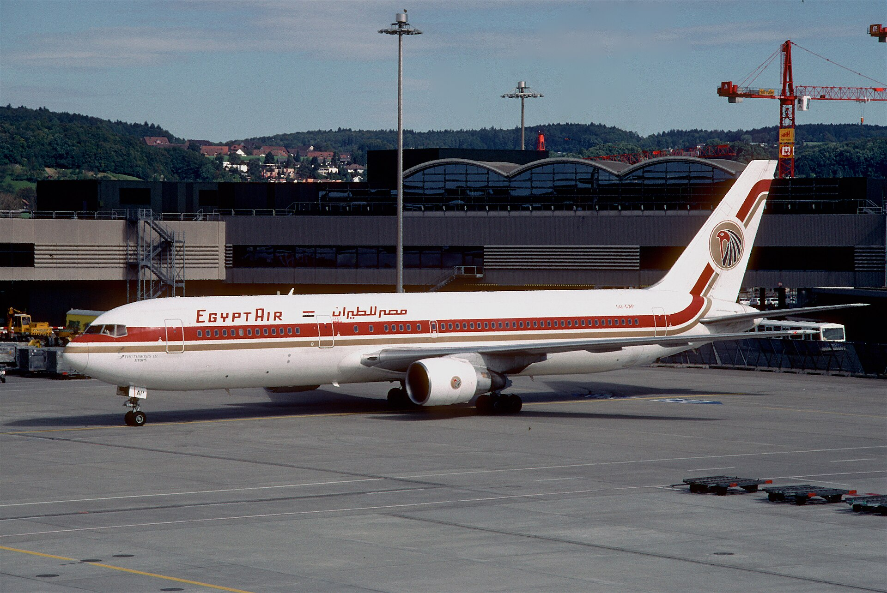
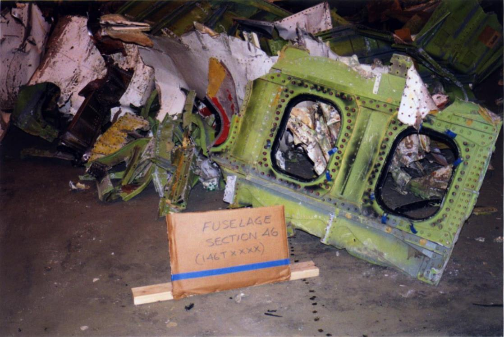
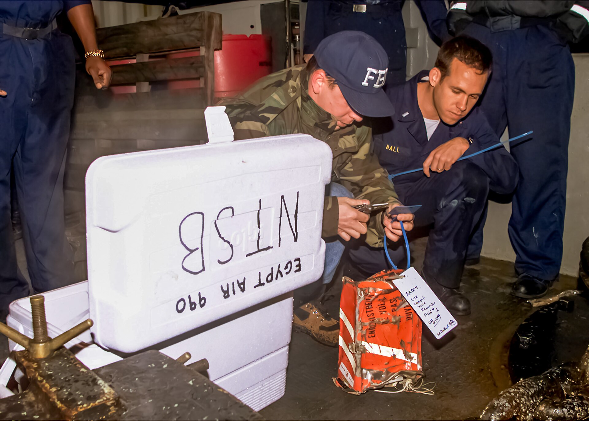

27 years ago today, October 31, 1999, EgyptAir Flight 990 disappeared from radar and crashed into the cold waters of the Atlantic Ocean about 60 miles south of Nantucket Island, Massachusetts. All 217 people aboard the twin-engine Boeing 767 lost their lives in what became the deadliest aviation disaster in the history of EgyptAir.

## A Routine Transatlantic Departure

The aircraft operating the route was a Boeing 767-366ER, registered as SU-GAP and christened Thuthmosis III after the ancient Egyptian pharaoh. Delivered new to EgyptAir in September 1989, the jet had logged over 33,000 airframe hours and was powered by two Pratt & Whitney engines. Flight 990 originated in Los Angeles and made a scheduled stop at John F. Kennedy International Airport in New York City before setting out on the 10-hour transatlantic crossing to Cairo. At 1:20 am Eastern Standard Time, the airliner took off from runway 22R into the midnight sky.

## Two Hundred and Seventeen Lives

There were 203 passengers and 14 crew members aboard the flight, representing seven different countries. The passenger list included 100 Americans, 89 Egyptians, 21 Canadians, and citizens of Germany, Sudan, Syria, and Zimbabwe. Among the American travelers were 54 elderly tourists booked through Grand Circle Travel for an eagerly anticipated two-week tour of Egypt. Also on board were 33 Egyptian military officers returning from a joint training exercise, including two brigadier generals, a colonel, a major, and four air force officers.

*Archive, 1999 — Photo: Aero Icarus from Zürich, Switzerland / CC BY-SA 2.0*

## Sudden Silence at Cruising Altitude

Because of the long flight time, EgyptAir assigned two complete flight crews: an active crew for takeoff and landing, and a relief cruise crew to handle the mid-flight hours. At 1:44 am, the Boeing 767 leveled off at its cruising altitude of 33,000 feet. Just four minutes later, at 1:48 am, veteran Captain Ahmed El-Habashi excused himself to use the lavatory. This left 59-year-old relief first officer Gameel Al-Batouti alone in the cockpit. Although relief crews traditionally took over later in the journey, Al-Batouti had insisted on relieving the first officer shortly after takeoff.

*Archive, 1999 — Photo: NTSB / Public domain*

## A Desperate Struggle in the Cockpit

Moments after being left alone, Al-Batouti began repeating the phrase 'I rely on God' into the cockpit voice recorder. At 1:49:45 am, he manually disengaged the autopilot. Eight seconds later, both throttles were pulled back to idle, and the aircraft pitched violently downward into a steep dive, producing zero-gravity conditions throughout the passenger cabin. Despite the complete weightlessness, Captain El-Habashi managed to fight his way back into the cockpit. The aircraft's descent rate reached an astonishing 39,000 feet per minute, approaching the sound barrier. The captain pulled back desperately on his control column and deployed the speedbrakes to slow the descent, but Al-Batouti moved the engine start levers to cutoff, shutting down both engines completely.

*Archive, 1999 — Photo: File:Fbi egypt air 990.jpg: Petty Officer 3rd Class Isaac D. / Public domain*

## Two Incompatible Conclusions

Because the crash occurred in international waters, the Egyptian Civil Aviation Agency invited the National Transportation Safety Board to lead the technical inquiry. Two weeks into the investigation, the NTSB proposed transferring the case to the Federal Bureau of Investigation, citing evidence of an intentional criminal act. Egyptian officials strongly resisted the proposal and rejected the idea that Al-Batouti had intentionally brought down the plane. The NTSB ultimately issued an official finding that the crash was caused by the relief first officer's flight control inputs. The Egyptian authorities published their own report, asserting instead that a mechanical failure in the elevator power control units caused the uncommanded dive.

## The Memory That Lingers Today

The loss of EgyptAir Flight 990 left profound grief across dozens of American and Egyptian communities. Families of the victims gathered on the shores of New England to mourn, while aviation authorities around the world reviewed cockpit protocols and investigative procedures. More than two decades later, the conflicting narratives of that October night remain an unresolved chapter in transatlantic aviation history.

### Sources

- <https://en.wikipedia.org/wiki/New_York_City>
- <https://commons.wikimedia.org/wiki/File:EgyptAir_Flight_990_Search_and_Rescue.jpg>
- <https://commons.wikimedia.org/wiki/File:Egypt_Air_Boeing_767-366ER;_SU-GAP@ZRH,_October_1999_BZS_(5552623021).jpg>
- <https://commons.wikimedia.org/wiki/File:EgyptAir_990_fuselage_section_46.jpg>
- <https://commons.wikimedia.org/wiki/File:Fbi_egypt_air_990_b.jpg>
