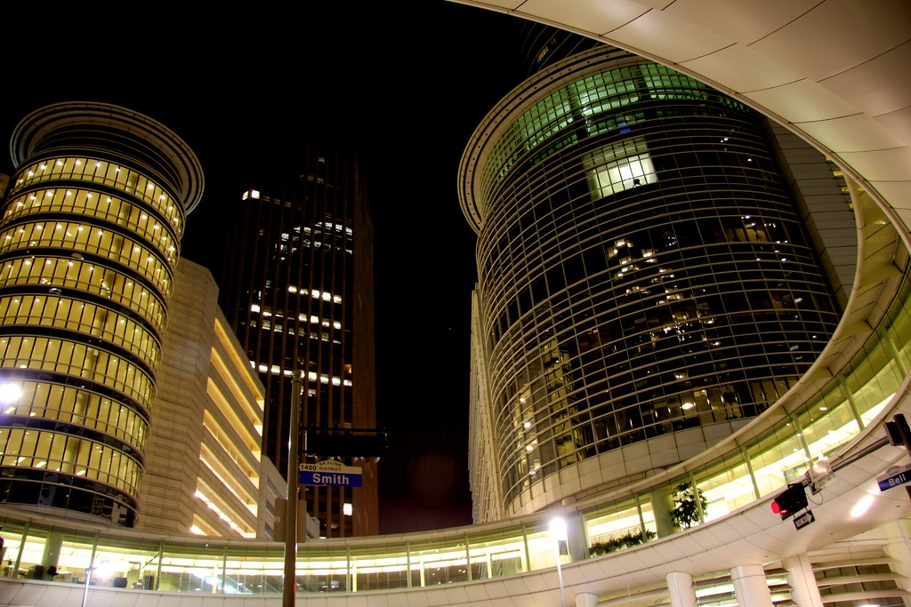
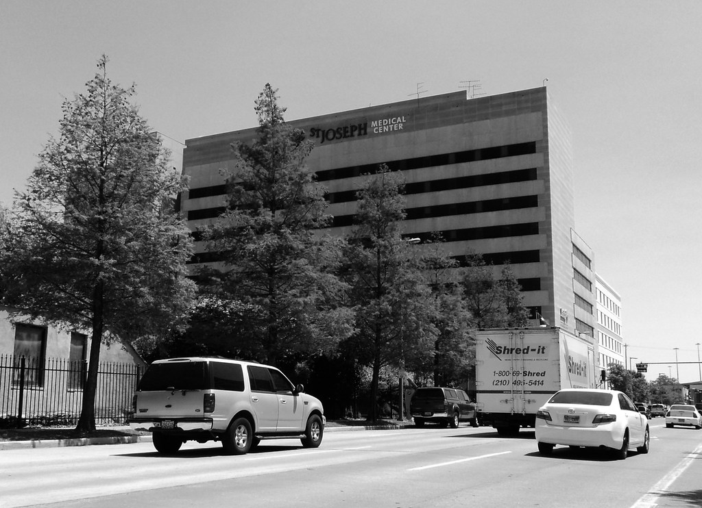

24 years ago today, October 31, 2002, a federal grand jury in Houston, Texas indicted former Enron chief financial officer Andrew Fastow on 78 criminal counts. The charges of wire fraud, money laundering, conspiracy, and obstruction of justice delivered a formal legal reckoning to the key figure behind the energy giant's hidden balance sheets.

## The Rise of Enron and Its Financial Architect

Enron Corporation was formed in 1985 through the merger of Houston Natural Gas and InterNorth, two relatively modest regional companies. Under the leadership of Kenneth Lay, the Houston-based company expanded aggressively across electricity, natural gas, communications, and paper trading. By 2000, Enron reported nearly 101 billion dollars in revenue, employed approximately 20,600 staff, and had earned Fortune's title of America's Most Innovative Company for six consecutive years.

Andrew Fastow entered this expanding operation in 1990, hired by Jeffrey Skilling at Enron Finance Corp. Fastow held a degree in Economics and Chinese from Tufts University and an MBA from Northwestern University. He had previously worked at Continental Illinois bank in Chicago, dealing with asset-backed securities that moved assets off balance sheets. In 1998, Enron promoted Fastow to chief financial officer, placing him at the center of the firm's balance sheets.

## The Web of Ghost Partnerships and the LJM Windfall

As chief financial officer, Fastow constructed an elaborate network of off-balance-sheet special purpose entities. These limited partnerships, controlled by Enron behind the scenes, were used to absorb bad investments and disguise severe financial losses from quarterly statements. The maneuvers kept Enron's reported profits strong and propelled its stock to an all-time high of 90 dollars per share.

Beyond concealing corporate distress, Fastow maintained unlawful personal financial interests in these supposedly independent entities. Among the most notable was LJM, named using the initials of his wife, Lea, and their two sons. While Fastow claimed to devote no more than three hours a week to managing LJM, he extracted a personal windfall of 45 million dollars from the transactions, directly siphoning tens of millions of dollars out of Enron.

*Medical Center Houston Texas — Photo: billjacobus1 / CC BY 2.0*

## October 2001: Scrutiny and the Rapid Unraveling

The cracks widened rapidly in the summer and autumn of 2001. Jeffrey Skilling, who had taken over as CEO in February, abruptly resigned in August citing personal reasons. Soon afterward, inquiries by The Wall Street Journal focused on transactions involving an unnamed senior officer, who was quickly identified by an Enron spokesman as Fastow. Although media attention shifted briefly following the September 11 attacks, intense reporting resumed within weeks regarding Fastow's earnings from LJM.

On October 23, 2001, Fastow admitted during a conference call with Enron board members that he had collected 45 million dollars from LJM. The next day, several lending institutions notified Enron that they would refuse any further loans while Fastow remained in his post. On October 25, Kenneth Lay recommended Fastow's removal, and the board placed him on leave, replacing him with Jeff McMahon. McMahon and an emergency financial team quickly made an alarming discovery: Fastow had never instituted basic controls to monitor debt maturities or cash flow, leaving Enron virtually devoid of cash liquidity.

*Enron Complex — Photo: eflon / CC BY 2.0*

## Bankruptcy and the Fall to 40 Cents

With its liquidity evaporated, Enron sought a rescue merger with rival energy company Dynegy. The prospect of the takeover briefly kept the company afloat, but as the true depth of Enron's obligations became clear, Dynegy terminated the agreement on November 28, 2001. Three days later, on December 2, 2001, Enron declared bankruptcy.

The collapse inflicted devastating financial harm on thousands of workers. Many employees had been encouraged to invest their retirement savings into Enron shares, only to watch the stock crash from its 90-dollar peak down to just 40 cents per share. The bankruptcy sent shockwaves through Houston, where Enron had served as a pillar of the local business community.

*First, I was born - Former St. Joseph Hospital, Houston, Texas 0416111318BW — Photo: Patrick Feller / CC BY 2.0*

## The Houston Indictment and the Judicial Aftermath

The federal criminal investigation into Enron culminated on October 31, 2002, when a grand jury in Houston issued the 78-count indictment against Fastow. The charges detailed extensive schemes involving fraudulent transactions, self-dealing, money laundering, and attempts to obstruct justice. Fastow's wife, Lea Weingarten, an assistant treasurer at Enron, was also indicted.

Faced with the charges, Fastow reached a plea agreement on January 14, 2004, pleading guilty to two counts of wire and securities fraud. He agreed to cooperate fully with federal prosecutors in cases against other Enron executives and agreed to forfeit 23.8 million dollars in assets. His wife pleaded guilty to tax and conspiracy charges and received a 12-month prison sentence. On September 26, 2006, U.S. District Judge Ken Hoyt sentenced Fastow to six years in prison, citing his substantial cooperation. Fastow ultimately served five years in custody, leaving behind a case that permanently altered how corporate accounting and financial reporting are viewed.

### Sources

- <https://en.wikipedia.org/wiki/Houston>
- <https://commons.wikimedia.org/wiki/File:DOWNTOWN_HOUSTON,_TEXAS._THIS_IS_ONE_OF_A_SERIES_OF_21_BLACK_AND_WHITE_PHOTOGRAPHS._THEY_DOCUMENT_THE_ENVIRONMENTS..._-_NARA_-_557631.jpg>
- <https://www.flickr.com/photos/67513462@N00/122489772>
- <https://www.flickr.com/photos/23094783@N03/2332728048>
- <https://www.flickr.com/photos/32345848@N07/5627172261>
