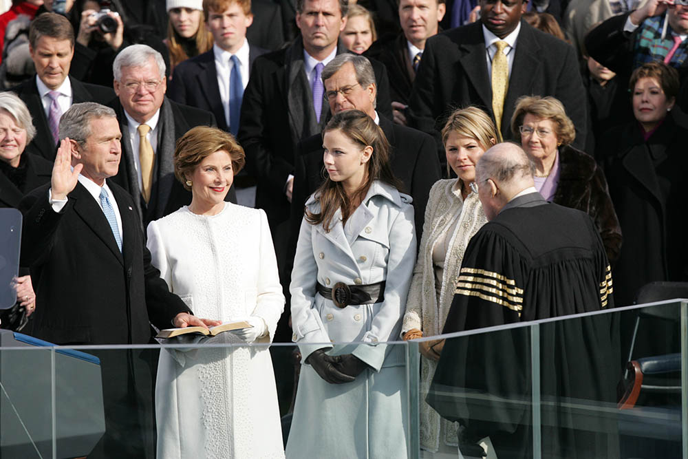
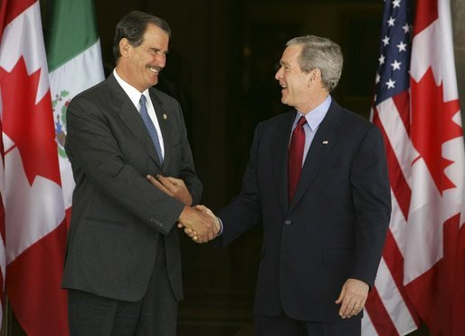
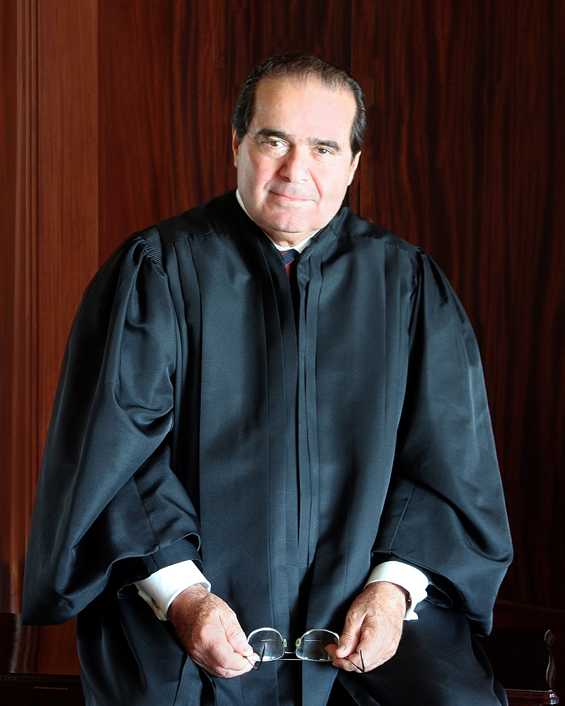

21 years ago today, October 31, 2005, President George W. Bush nominated federal appeals court judge Samuel Alito to serve as an associate justice on the Supreme Court of the United States. The selection marked a defining turning point for the nation's highest judicial body and set the stage for decades of major constitutional decisions.

## A Halloween Announcement at the White House

On the morning of October 31, 2005, the nation turned its attention to the White House. President George W. Bush introduced Samuel Anthony Alito Jr., a veteran federal judge from the U.S. Court of Appeals for the Third Circuit, as his nominee for Associate Justice of the Supreme Court.

The announcement arrived at a critical juncture for the federal judiciary. Bush sought an experienced jurist with a well-established record on constitutional law. In Alito, the administration found a disciplined legal conservative with fifteen years of appellate experience.

## From New Jersey Roots to a Princeton Ambition

Samuel Alito was born in Trenton, New Jersey, on April 1, 1950. His father, Samuel A. Alito Sr., had immigrated from Calabria, Italy, and later served from 1952 to 1984 as the first director of the New Jersey Office of Legislative Services. His mother, Rose Fradusco, was an Italian-American schoolteacher whose family hailed from Basilicata.

Alito grew up in Hamilton Township and graduated as valedictorian from Steinert High School in 1968. He attended Princeton University, where he joined the Army ROTC, led student debates, and graduated summa cum laude in 1972. In his senior yearbook, Alito left a prophetic sentence that would later draw national attention: he recorded his aspiration to eventually warm a seat on the Supreme Court.

*President George W. Bush takes the Oath of Office — Photo: Series: Photographs Related to the George W. Bush Administra / Public domain*

## Yale Law and Early Service in Federal Courtrooms

Following Princeton, Alito earned his Juris Doctor from Yale Law School in 1975, where he served as an editor of the Yale Law Journal. He fulfilled his active military duty in the Signal Officer Basic Course at Fort Gordon, Georgia, before returning to federal legal practice.

After clerking for Third Circuit Judge Leonard I. Garth in Newark, Alito joined the U.S. Attorney's Office for the District of New Jersey in 1977. Serving under appeals chief Maryanne Trump Barry, he led prosecutions targeting narcotics rings and organized crime figures across the state.

*President George W. Bush greets Mexican President Vicente Fox — Photo: White House photo by Krisanne Johnson / Public domain*

## Arguing Before the Nation's Highest Bench

In 1981, Alito moved to Washington to serve as Assistant to U.S. Solicitor General Rex E. Lee. Over the next four years, he argued 12 cases directly before the Supreme Court, prevailing in ten of them.

He then served as Deputy Assistant Attorney General in the Office of Legal Counsel under Edwin Meese from 1985 to 1987, authoring hundreds of pages of legal memoranda. By 1987, Alito returned to his home state as the United States Attorney for the District of New Jersey, overseeing high-profile prosecutions including a marathon federal mob trial involving Anthony Accetturo.

*Antonin Scalia official SCOTUS portrait — Photo: Collection of the Supreme Court of the United States / Public domain*

## Fifteen Years on the Third Circuit Appeals Bench

In 1990, President George H. W. Bush appointed Alito to the U.S. Court of Appeals for the Third Circuit. Over the next decade and a half, Alito developed a reputation as a meticulous jurist who described his judicial philosophy as practical originalism.

His extensive body of judicial opinions established him as a cornerstone of the conservative legal movement. When President George W. Bush looked for a candidate with proven appellate credentials on October 31, 2005, Alito's fifteen-year record on the federal bench made him the primary choice.

## The Legacy of the 2005 Nomination

The nomination moved to the United States Senate, where Alito was confirmed and formally sworn into office on January 31, 2006. With his appointment, he became only the second Italian American justice in Supreme Court history, following Antonin Scalia.

During his tenure on the high court, Alito authored several of the most consequential majority opinions in modern American history. He penned the landmark rulings in McDonald v. Chicago in 2010 regarding firearm regulations, Burwell v. Hobby Lobby in 2014 concerning corporate healthcare requirements, Janus v. AFSCME in 2018, and Dobbs v. Jackson Women's Health Organization in 2022. The ambitious dream he had recorded in his college yearbook in 1972 had come to define the direction of American jurisprudence.

### Sources

- <https://en.wikipedia.org/wiki/Samuel_Alito>
- <https://commons.wikimedia.org/wiki/File:George_W._Bush_announces_his_nomination_of_Samuel_Alito.jpg>
- <https://commons.wikimedia.org/wiki/File:President_George_W._Bush_takes_the_Oath_of_Office.jpg>
- <https://commons.wikimedia.org/wiki/File:President_George_W._Bush_greets_Mexican_President_Vicente_Fox.jpg>
- <https://commons.wikimedia.org/wiki/File:Antonin_Scalia_official_SCOTUS_portrait.jpg>
