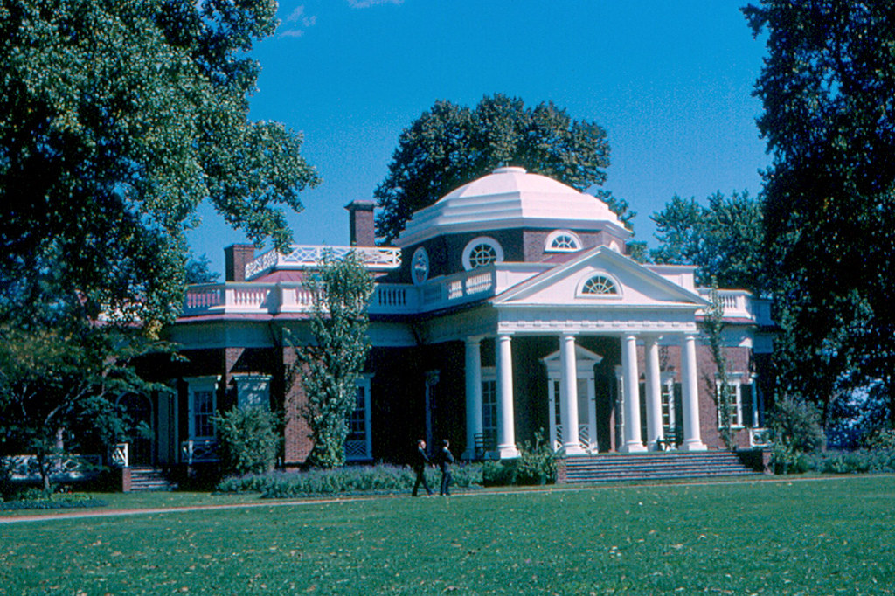
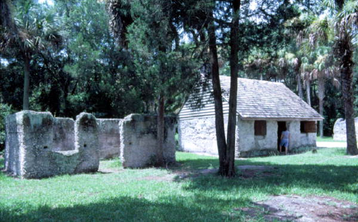
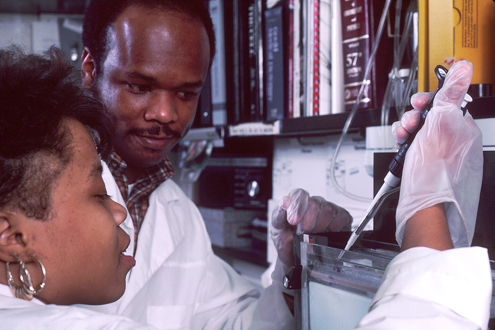

28 years ago today, October 31, 1998, scientific testing delivered an undeniable answer to one of the oldest debates in American history. A genetic study published in the prestigious journal Nature established that Thomas Jefferson fathered at least one child with Sally Hemings, an enslaved woman held at his Virginia plantation. The finding dismantled nearly two centuries of vigorous denial by biographers and descendants.

## Two Centuries of Accusation and Denial

The controversy surrounding Thomas Jefferson and Sally Hemings first exploded into the public sphere in 1802. Journalist James T. Callender, angered after being denied a federal postmaster appointment, published accusations that the sitting president had fathered multiple children with an enslaved woman named Sally. While private observers noted the open secret in Virginia—such as school headmaster Elijah Fletcher, who recorded in his 1811 diary that Jefferson's cohabitation was common knowledge among neighbors—Jefferson himself never addressed the matter publicly.

In the decades following Jefferson's death in 1826, his white family worked methodically to protect his reputation. During the 1850s, Jefferson's grandson, Thomas Jefferson Randolph, informed historian Henry Randall that Jefferson's nephew, Peter Carr, was actually the father of Hemings's children. Historian James Parton subsequently published the Carr attribution, and for nearly 150 years, major American historians accepted the family's defense, treating the Hemings family's oral accounts as unverified rumors.

## The Realities of the Monticello Shadow Family

Sally Hemings was born into what historians describe as a shadow family. Her father was John Wayles, Jefferson's father-in-law, who engaged in a 12-year relationship with his enslaved concubine Betty Hemings following his wife's death. This made Sally the younger half-sister of Jefferson's late wife, Martha Wayles Skelton Jefferson. Under Virginia's legal doctrine of partus sequitur ventrem, children inherited the legal condition of their mother, keeping Sally enslaved despite having three-quarters European ancestry.

Jefferson became a widower at age 39 in 1782 and never remarried. In 1787, 14-year-old Sally accompanied Jefferson's young daughter Maria to Paris, where Jefferson served as the United States ambassador to France. Historians establish that their intimate relationship began during this European residence before they returned to Virginia in 1789. Over four decades, Hemings bore several children at Monticello. Four survived to adulthood: Beverly, Harriet, Madison, and Eston Hemings.

*Charlottesville - Monticello — Photo: roger4336 / CC BY-SA 2.0*

## The Historiographical Turning Point

The wall of historical denial began to show serious cracks during the latter half of the twentieth century. In 1953, newly discovered archival documents reopened academic inquiry. In 1974, biographer Fawn M. Brodie presented a serious historical case that Jefferson was indeed the father of Hemings's children, though many traditional scholars continued to dismiss the thesis.

A decisive intellectual shift occurred in 1997 when legal scholar and historian Annette Gordon-Reed published an exhaustive analysis of the historical literature. Gordon-Reed demonstrated that previous generations of historians had systematically privileged white oral traditions while disregarding Black oral evidence, identifying pervasive bias and logical fallacies in the defense of Jefferson. That same year, filmmaker Ken Burns brought the debate into millions of living rooms through his PBS documentary series, priming the public for a definitive answer.

*Reconstructed tabby slave cabins at the Kingsley Plantation- Fort George Island, Florida (7676278872) — Photo: Florida Memory / Public domain*

## The Landmark 1998 DNA Investigation

The definitive turning point arrived with advances in molecular biology. Because Thomas Jefferson had no surviving legitimate sons, researchers could not test a direct male-line descendant of the president. Instead, a team of scientists traced the Y-chromosome lineage through the male descendants of Jefferson's paternal uncle, Field Jefferson, who shared an identical Y-chromosome with the president.

The researchers collected blood samples from five male-line descendants of Field Jefferson, five descendants of John Carr (the grandfather of the nephews long blamed by the family), and male-line descendants of Sally Hemings's youngest son, Eston Hemings. The laboratory results, published in the journal Nature, were striking and unequivocal: the Y-chromosome of Eston Hemings's line matched the Jefferson male line perfectly, across multiple rare genetic markers. Simultaneously, the tests revealed no genetic match to the Carr family, decisively eliminating the 150-year-old nephew theory.

*DNA gel- southern blotting — Photo: John Crawford (Photographer) / Public domain*

## From Controversy to Settled History

The release of the DNA study altered American historiography overnight. While a minority of dissenting scholars raised alternate possibilities—pointing out that other male Jefferson relatives lived in Virginia at the time—the convergence of genetic data and plantation records convinced the broader historical community. Historical records documented that Jefferson was present at Monticello during the estimated conception window for every one of Hemings's children.

By 2018, the Thomas Jefferson Foundation, which owns and operates Monticello, formally incorporated the findings into its permanent interpretation, mounting a major exhibit dedicated to Sally Hemings and declaring the paternity a settled historical matter. The revelation transformed Monticello from a monument exclusively celebrating the author of the Declaration of Independence into a site that confronts the profound complexities and contradictions of American slavery.

### Sources

- <https://www.nytimes.com/1998/11/01/us/dna-test-finds-evidence-of-jefferson-child-by-slave.html>
- <https://archive.org/details/1_20220419_20220419_0319>
- <https://www.flickr.com/photos/24736216@N07/4567637829>
- <https://commons.wikimedia.org/wiki/File:Reconstructed_tabby_slave_cabins_at_the_Kingsley_Plantation-_Fort_George_Island,_Florida_(7676278872).jpg>
- <https://commons.wikimedia.org/wiki/File:DNA_gel-_southern_blotting.jpg>
