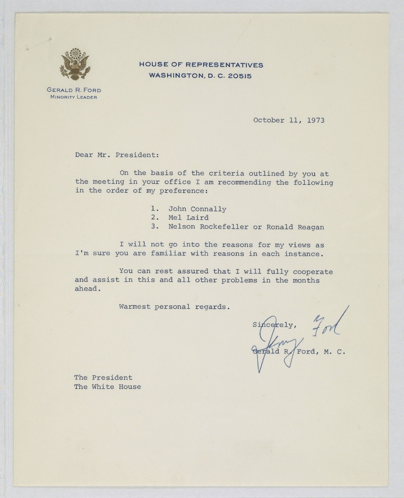
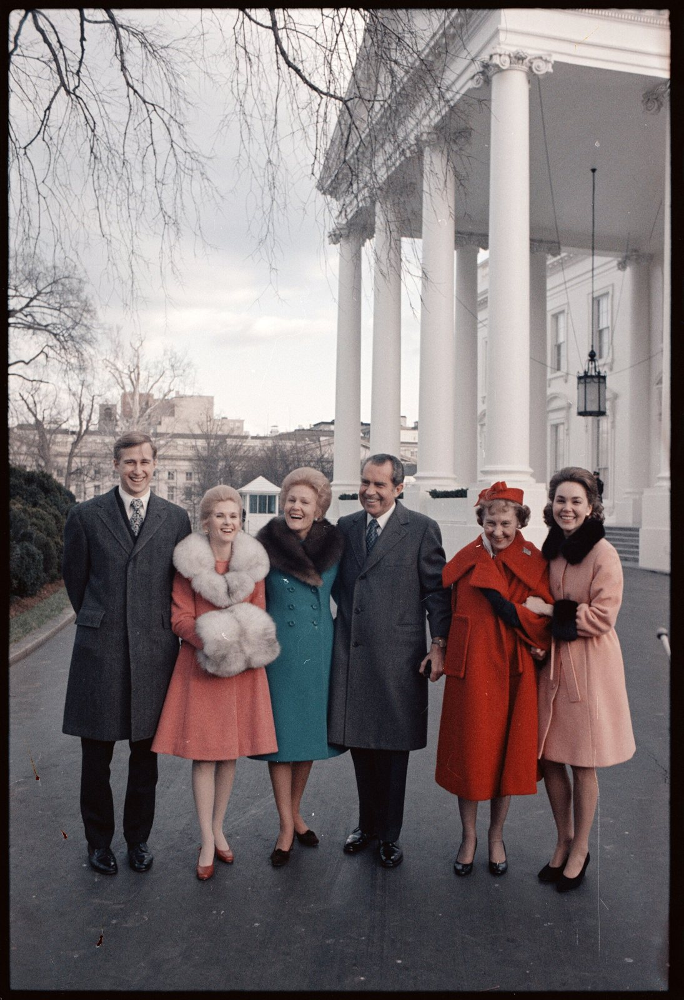
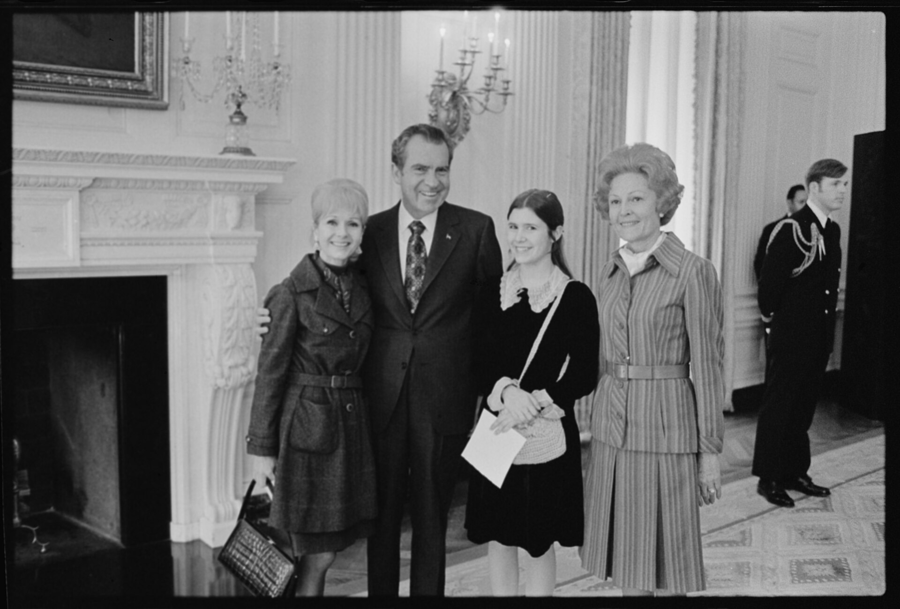

53 years ago today, November 1, 1973, Acting Attorney General Robert Bork announced the appointment of Leon Jaworski as the new Watergate special prosecutor. The decision came at the height of a constitutional crisis, as millions of Americans questioned whether any independent investigator could hold the White House accountable.

## The Fallout of the Saturday Night Massacre

The crisis had reached a fever pitch in late October 1973. Archibald Cox, the first special prosecutor appointed to investigate the June 17, 1972 break-in at the Democratic National Committee headquarters in the Watergate complex, had issued a subpoena for President Richard Nixon's secret Oval Office tape recordings. Nixon refused to turn them over, citing executive privilege, and ordered Attorney General Elliot Richardson to fire Cox. Richardson refused and resigned on the spot. His deputy also stepped down rather than follow the directive. The grim task fell to Solicitor General Robert Bork, who suddenly became Acting Attorney General. Bork carried out the firing, triggering nationwide outrage that quickly became known as the Saturday Night Massacre.

## A Respected Texas Lawyer Takes the Helm

Faced with a furious public and mounting calls in Congress for impeachment, the administration had to show it was not shutting down the investigation. On November 1, 1973, Bork appointed Leon Jaworski as Cox's successor. Born in Waco, Texas, Jaworski was an experienced and prominent attorney. He had served in the U.S. Army Judge Advocate General's office during World War II, attaining the rank of colonel, and had prosecuted war crimes in post-war Germany. Jaworski was also a past president of both the Texas Bar Association and the American Bar Association, bringing unimpeachable legal credentials to an office in turmoil.

*House Minority leader Gerald Ford letter to Richard Nixon — Photo: Gerald Ford / Public domain*

## The Battle for the Oval Office Tapes

If the White House anticipated that Jaworski would take a softer approach than Cox, that expectation was quickly shattered. Jaworski insisted on total independence before accepting the appointment. In April 1974, he reissued subpoenas for key White House tape recordings to determine the extent of the cover-up. Nixon attempted to bypass the legal demand by releasing heavily edited transcripts of select tapes, but Jaworski refused to back down. He demanded the actual recordings, arguing that no citizen, not even the sitting president of the United States, was above the rule of law.

*President Richard Nixon, Pat Nixon, Mamie Eisenhower, Julie Nixon Eisenhower, Tricia Nixon Cox and Ed Cox following the 1973 Inaugural Parade - DPLA - f27543abde482fd0e3eabc7e0069f401 — Photo: President (1969-1974 : Nixon). White House Photo Office. 196 / Public domain*

## The Supreme Court Ruling and the Smoking Gun

The legal confrontation culminated in July 1974, when the Supreme Court heard the landmark case regarding the tapes. The court ordered the White House to turn over the unedited audio recordings. Among them was the infamous 'Smoking Gun' tape, recorded on June 23, 1972, which proved that Nixon had personally ordered the Central Intelligence Agency to halt the FBI's investigation into the Watergate break-in. The House Judiciary Committee moved forward by recommending articles of impeachment for obstruction of justice, abuse of power, and contempt of Congress.

*President Richard Nixon and First Lady Pat Nixon with Actresses Debbie Reynolds and Carrie Fisher - DPLA - a80ba7ef45e4d2efd05adb1fec220a53 — Photo: President (1969-1974 : Nixon). White House Photo Office. 196 / Public domain*

## The Resignation and the Aftermath

With his political support completely evaporated, Richard Nixon announced his resignation on August 9, 1974, becoming the first president in American history to resign from office. His successor, Gerald Ford, granted Nixon a full pardon, but the legal consequences of Watergate reverberated for years. In total, 69 individuals were charged in connection with the scandal, including two cabinet members, and the vast majority pleaded guilty or were convicted by juries.

## The Enduring Legacy of November 1, 1973

The appointment of Leon Jaworski on this day in 1973 demonstrated the power of legal independence within the American constitutional system. What began as an administration's effort to control a damaging inquiry ended with an independent prosecutor compelling the surrender of vital evidence. Today, the Watergate saga remains the benchmark for executive accountability and the limits of presidential power in American history.

### Sources

- <https://en.wikipedia.org/wiki/Watergate_scandal>
- <https://commons.wikimedia.org/wiki/File:Government_Exhibit_Number_60-_Uher_5000_Reel-to-Reel_Tape_Recorder_-_NARA_-_595593_(page_3).jpg>
- <https://commons.wikimedia.org/wiki/File:House_Minority_leader_Gerald_Ford_letter_to_Richard_Nixon.jpg>
- <https://commons.wikimedia.org/wiki/File:President_Richard_Nixon,_Pat_Nixon,_Mamie_Eisenhower,_Julie_Nixon_Eisenhower,_Tricia_Nixon_Cox_and_Ed_Cox_following_the_1973_Inaugural_Parade_-_DPLA_-_f27543abde482fd0e3eabc7e0069f401.jpg>
- <https://commons.wikimedia.org/wiki/File:President_Richard_Nixon_and_First_Lady_Pat_Nixon_with_Actresses_Debbie_Reynolds_and_Carrie_Fisher_-_DPLA_-_a80ba7ef45e4d2efd05adb1fec220a53.jpg>
